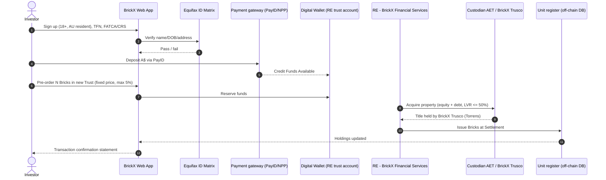
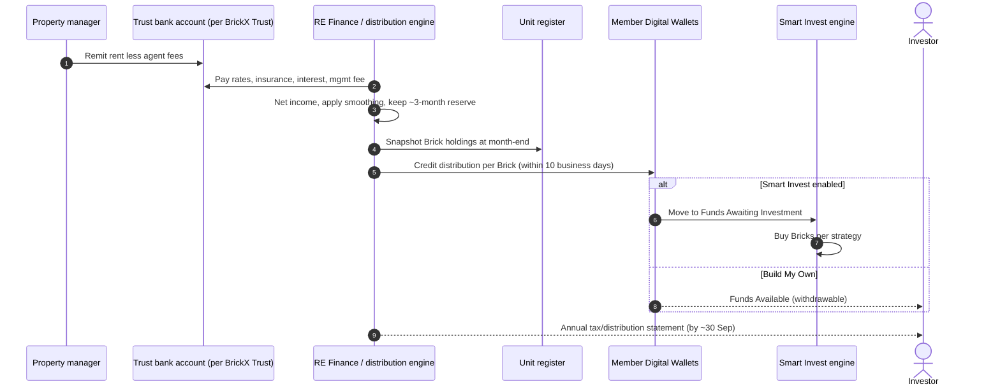
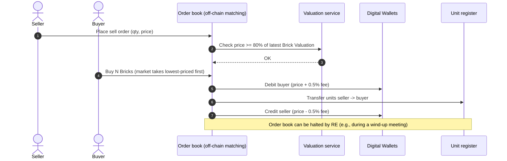
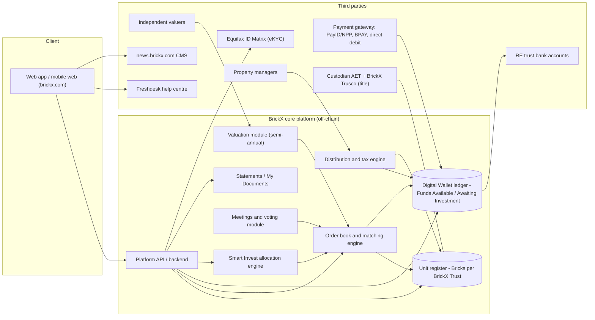

# BrickX — Australia (AU)

| Field | Value |
|---|---|
| Website | https://www.brickx.com (news: news.brickx.com; help: help.brickx.com) |
| HQ / legal entity | Sydney, NSW. Responsible Entity (RE): **BrickX Financial Services Limited** (ABN 67 616 118 088, **AFSL 494878**). Manager: **The Brick Exchange Pty Ltd** (ABN 27 600 762 749). Scheme: **BrickX Platform, ARSN 613 156 433** (registered managed investment scheme) [C#1][C#2]. Both RE and Manager became wholly owned subsidiaries of **Thundering Herd Pty Ltd** (VC/PE) on 12 Dec 2019 [C#4]. |
| Founded | 2016 [C#8] |
| Status as of Sep 2026 | **Active.** Unitholder meetings held Jul–Sep 2026 (Trust No. 30 North Melbourne, Aug 2026; Trust No. 4 Annandale, outcome 14 Sep 2026) [C#15]; PayID deposits went live 12 Aug 2025 [C#12]. |
| Category | **Off-chain fractional (digital ledger), not tokenised.** No blockchain is mentioned in the PDS, terms or help centre [C#2][C#3][C#7]; the "Brick" is a unit in a registered MIS sub-trust recorded on the RE's own register [C#2]. |
| Asset focus | Mainly residential rental property (houses/apartments in Sydney and Melbourne), one property per trust. Has since added first-mortgage **Mortgage Trusts**, developments, private syndications and "financial assets" [C#1][C#5][C#18]. |
| Scale | About 25 residential properties listed (Canstar, updated 10 Apr 2025) [C#17]. Trust numbering reaches at least **No. 30** (North Melbourne, 2026) [C#15], so at least 30 trusts have been created, some since wound up [I]. About **A$53m total funding volume** (CrowdSpace, undated) [C#8]. More than 12,000 users in 2018 [C#20]. No current AUM or investor count is published [I: not found in any source]. |
| Min. investment | A$50 in the 2019 PDS [C#2]. Membership needs a A$250 initial deposit including a A$10 application fee (Oct 2020 PDS) [C#3]. Smart Invest needs a A$50/month direct debit [C#2]. |
| Why it is in the Top 5 | This is the longest-running Australian retail fractional-property platform. It is live, ASIC-registered, retail-offered, and has a working secondary order book and per-property governance votes. It sets the compliance and UX baseline (RE + custodian + monthly distributions + order book) that any tokenised Australian entrant, RealX included, has to match or beat. |
| Research confidence | **High** for legal structure and mechanics (PDS, terms, help centre). **Medium** for current scale and tech stack. |

---

## 1. Business model snapshot

- **What investors buy:** "Bricks". Each Brick is one of 10,000 units in a single-property unit trust ("BrickX Trust") [C#2].
- **How they buy:**
  - **Build My Own:** the investor picks properties and trades on an order book.
  - **Smart Invest:** the investor sets a monthly contribution, BrickX selects properties, and distributions are reinvested automatically [C#2][C#20].
- **Revenue for BrickX:**
  - 0.5% transaction fee on every buy and every sell [C#3][C#8][C#17]. The 2019 PDS had a 1.75% transaction fee, cut to 0.5% by Oct 2020 [C#2][C#3].
  - Management fee of up to 2% p.a. [C#3].
  - Performance fee of up to 30% [C#3].
  - Interest earned on the Digital Wallet float, which the RE keeps [C#3].
  - Acquisition costs are amortised over 5 years into the Brick valuation [C#2].
- **Expansion beyond rental property:**
  - Mortgage Trusts: first-mortgage loans secured over residential and commercial real estate, with security documents held by a third-party custodian, monthly interest and terms up to 10 years [C#18].
  - "Select & Syndicate" private syndications [C#8].
  - Development and financial-asset trusts [C#1][C#5].
  - [I] The expansion points to a move from single-asset rental fractions towards a general multi-asset syndication platform. The trigger is likely the thin yields on rental properties (Canstar reports net rental yields from about 0.2% to 6.32%) [C#17].

## 2. Legal & compliance structure

### 2.1 Issuing vehicle
- A **registered managed investment scheme** (BrickX Platform, ARSN 613 156 433) under Chapter 5C / Part 7.9 of the Corporations Act 2001 [C#2].
- The scheme is made up of **separate unit trusts ("BrickX Trusts"), each holding one property** [C#2].
- Custody:
  - **AET Limited** is Custodian.
  - **BrickX Trusco**, a wholly owned sub-custodian, holds **legal title** to the properties [C#2].
- Gearing: a trust may be funded by equity or equity plus debt. **LVR must not exceed 50%** [C#2].

### 2.2 What a Brick legally is
- "A unit in a BrickX Trust that represents a beneficial interest in the property held by that BrickX Trust". Each Brick is 1/10,000 of the beneficial interest [C#2].
- Brick holders have no right to redevelop, subdivide or pledge the property [C#2].
- The register is off-chain [C#2][C#7].
- **Legal title** is recorded on the state Torrens register in the sub-custodian's name, not in investors' names [I, from C#2 sub-custodian role]. Transfers of Bricks therefore never touch PEXA or the land titles office.

### 2.3 Licences, registrations and exemptions
| Item | Status | Evidence |
|---|---|---|
| AFSL (RE) | BrickX Financial Services Ltd, AFSL 494878 | [C#1][C#2] |
| Manager as authorised representative | "BrickX" is a corporate authorised representative (#001000043) | [C#2] |
| Registered MIS (retail offer under a PDS; no s708 reliance) | ARSN 613 156 433 | [C#2] |
| Additional Disclosure Documents per trust (e.g., ADD_NEW01, ADD_EDP01) | Yes: one supplementary doc per property or mortgage trust | [C#5] (PDS page links) |
| RG46 (unlisted property schemes) and RG45 (mortgage schemes) benchmark disclosures | Published as schedules | [C#5] |
| Design & Distribution Obligations (TMD) | A TMD is legally required for a retail registered MIS since Oct 2021. No TMD URL was found in our searches | [I: regulatory necessity; not located] |
| Market licence (s791A) for the order book | None disclosed. [I] The order book probably relies on the exemption for a RE operating a facility for its own scheme's interests (ASIC relief of the kind used by unlisted-fund matching facilities). **Not confirmed**, so this should be verified in ASIC instruments. | [S] |
| AUSTRAC | The RE's issue of MIS interests and handling of client money make it a reporting entity under the AML/CTF Act 2006 (not a DCE, because nothing is crypto) | [C#13] (states AML/CTF Act compliance) |
| AFCA membership | Complaints process is in the FSG. AFCA membership is required of every AFSL holder serving retail clients | [I: regulatory necessity] |

### 2.4 Regulators and licensed partners
- ASIC regulates the AFSL, the RE and the registered scheme.
- AUSTRAC regulates AML/CTF.
- **AET Limited** is Custodian [C#2].
- Independent licensed valuers value each property every six months, using the direct-comparison method [C#10][C#11]. The valuer is not named.
- Property management is done by BrickX or third-party agents [C#2].
- The Digital Wallet cash is held on trust by the RE. The bank is not named [C#3][C#7].

### 2.5 KYC / AML
- **Equifax ID Matrix** is used for electronic identity verification of name, date of birth and residential address. There is **no credit check** [C#13].
- The terms describe disclosure to a "credit reporting agency" for AML purposes [C#7].
- The RE can refuse transactions for "Proscribed" persons, suspend accounts for suspected money laundering or terrorism financing, and report to authorities [C#7].
- FATCA/CRS self-certification is collected [C#2].
- Sanctions and PEP screening vendor: not disclosed. [I] It is probably bundled with Equifax ID Matrix watch-list checks, since ID Matrix offers PEP/sanctions add-ons [S].

### 2.6 Investor eligibility and geo-restrictions
- Australian residents only (individuals, SMSFs and entities). The terms also allow Australian citizens living overseas. Foreign investors are excluded [C#2][C#7].
- Minimum age 18 [C#7].
- **Maximum 5% of any one trust (500 Bricks) per member** [C#2].
- [I] Why the cap and the exclusion matter:
  - Excluding foreign investors avoids **FIRB**: a foreign person acquiring units in an Australian land trust that holds residential land would need approval.
  - The 5% cap keeps every holder far below **landholder-duty** "significant interest" thresholds in NSW and Victoria, which apply to private unit trusts. That keeps Brick transfers free of stamp duty.

### 2.7 Tax handling and reporting
- Distributions are taxable even when reinvested [C#2].
- Depreciation and capital-works deductions flow through, and tax losses are trapped in the trust [C#2].
- The TFN/ABN is collected; [I] tax is withheld at the top marginal rate if it is not supplied.
- An **annual tax/distribution statement** is issued within 3 months of 30 June. Members also get transaction confirmations, an annual statement and an annual report [C#16].
- AMIT election: **not confirmed** [S]. It is likely for trusts of this size with many small holders.

### 2.8 Disclosures, investor protections and regulatory actions
- There are **no cooling-off rights** [C#2].
- Each trust keeps a cash reserve of about 3 months' expenses [C#2].
- Distributions are smoothed [C#2].
- A related-party transactions policy exists [C#2].
- No ASIC enforcement action against BrickX was found in searches [I: absence of evidence].
- Governance example: the Mosman (MOS01) wind-up vote on 27 Jun 2025 **failed** (39.77% for). Trading was halted during the meeting and reopened afterwards [C#14].

## 3. User types (personas and system roles)

| Persona / role | Description | Evidence |
|---|---|---|
| Retail investor, Build My Own | Picks individual properties and trades Bricks | [C#2] |
| Retail investor, Smart Invest | Monthly direct debit, auto-allocation, locked funds | [C#2][C#20] |
| SMSF / trust / company investor | Entity accounts | [C#2]; brickx.com/smsf page exists |
| Mortgage Trust investor | Earns first-mortgage interest | [C#18] |
| Syndicate sponsor (Select & Syndicate) | Creates a private property syndicate | [C#8] |
| RE / Manager staff | Investment, property, finance and tech teams (small team of about 6 named) | [C#19] |
| Custodian (AET) and sub-custodian (BrickX Trusco) | Hold assets and title | [C#2] |
| Independent valuer, property manager, auditor | Third-party service roles | [C#2][C#10] |

## 4. Actions each user type can take

| Role | Action | Channel / UI | On-chain / off-chain |
|---|---|---|---|
| Investor | Sign up, pass eKYC (Equifax), supply TFN, FATCA/CRS | Web / mobile web | Off-chain |
| Investor | Deposit A$ by PayID/NPP (from Aug 2025), BPAY/POLi (2018 era), or direct debit for Smart Invest | Web + bank app | Off-chain |
| Investor | Pre-order Bricks in a new trust (initial price fixed) | Web | Off-chain |
| Investor | Buy on the order book (price-time priority) | Web | Off-chain |
| Investor | List Bricks for sale at their own price (≥80% of latest Brick valuation) | Web | Off-chain |
| Investor | Enable or disable Smart Invest (funds locked while on) | Web | Off-chain |
| Investor | Withdraw "Funds Available" to a nominated bank account | Web | Off-chain |
| Investor | Vote at trust meetings (wind-up / sell) | Notice + vote (method not disclosed) | Off-chain |
| Investor | Download statements and tax statements ("My Documents") | Web | Off-chain |
| RE / Manager | Acquire property, open pre-order, settle trust | Back office | Off-chain |
| RE / Manager | Halt the order book (anti-manipulation or meeting) | Back office | Off-chain |
| RE / Manager | Pay monthly distributions, apply smoothing | Back office | Off-chain |
| RE / Manager | Publish valuations, announcements and meeting notices | CMS / news site | Off-chain |
| RE / Manager | Suspend accounts, refuse transactions, lodge SMRs | Back office | Off-chain |

## 5. Core flows

### 5.1 Onboarding and KYC
1. The user creates an account and confirms Australian residency and age 18+ [C#7].
2. The platform collects name, DOB, address and TFN/ABN, plus FATCA/CRS status [C#2].
3. Equifax ID Matrix checks the identity electronically. If it fails, the application is rejected or sent for manual document review [C#13][C#2].
4. The user nominates a bank account for withdrawals [C#7].

### 5.2 Primary purchase (pre-order into a new BrickX Trust)
1. The RE sources a property and issues an Additional Disclosure Document for the new trust [C#5].
2. The pre-order phase opens at a fixed initial Brick price. Up to 50% of Bricks (5,000) may be allocated to Smart Invest [C#2].
3. Members reserve Bricks with Digital Wallet funds. BrickX can advance up to A$20k while a deposit clears; in that window the member can only buy, not sell or withdraw [C#2].
4. At property settlement the Bricks are issued to members, and legal title sits with BrickX Trusco as sub-custodian [C#2].

### 5.3 Income distribution (monthly)
1. The property manager collects rent, and expenses are paid (rates, insurance, maintenance, strata, interest, management fee) [C#2].
2. The RE works out net income per trust and applies the **distribution smoothing** policy [C#2].
3. The distribution is paid to Digital Wallets **within 10 business days of month end**, pro rata to Bricks held at month end [C#2].
4. For Smart Invest members the distribution is auto-reinvested ("Funds Awaiting Investment") [C#2].
5. Tax components are aggregated into the annual tax statement [C#16].

### 5.4 Secondary trading (order book)
- Sell orders are sorted from lowest to highest price. At the same price, orders fill in time order [C#2].
- The seller sets the price, but it **cannot be more than 20% below the latest Brick valuation** [C#2][C#3].
- BrickX can pause the order book to prevent fraud or manipulation, and does so during unitholder meetings [C#2][C#14].
- The Brick Price, which comes from supply and demand, often trades at a premium or discount to the Brick Valuation [C#9].
- The trading fee is 0.5% on each side [C#3].
- No buyback guarantee appears in the PDS. CrowdSpace lists "buyback guarantee" as a feature, which conflicts with the PDS statement that the investment is illiquid [C#8 vs C#2]. Treat the PDS as authoritative.

### 5.5 Redemption, exit and property sale
- The only exits are selling on the order book, or a collective sale when the trust is wound up [C#2].
- Brick owners can vote to sell at any time with a **75%** threshold. At each **5th anniversary** of settlement the RE must call a meeting, and **50%** is enough [C#2].
- Worked example: Mosman on 27 Jun 2025. The resolution was not passed, and trading resumed at 3 pm that day [C#14].
- If a sale is approved, the property is sold, debt repaid, and the net proceeds distributed. The trust then terminates [I from C#2].

### 5.6 Governance / voting
- Meetings are called per trust, and multiple notices and outcomes were published in 2024–2026 [C#15].
- The voting channel (online ballot or proxy) is not disclosed [C#14].
- [I] Voting runs on the register snapshot taken at the trading halt.

### 5.7 Property / issuer onboarding
- The in-house investment and property team sources assets. A property adviser oversees acquisitions [C#19].
- Each trust gets its own Additional Disclosure Document [C#5].
- Syndications and mortgage trusts are originated by the investment manager [C#18][C#19].

## 6. Reverse-engineered architecture

**Narrative:** BrickX is a classic web platform with a centralised ledger. The whole "tokenisation" sits in a relational unit register plus a matching engine. Cash runs on Australian bank rails (NPP/PayID, direct debit, BPAY) into an RE-controlled trust account. KYC is outsourced to Equifax, support to Freshdesk, and news runs on a separate CMS subdomain. There is no on-chain component [C#2][C#7][C#10][C#12][C#13].

**On-chain vs off-chain split:** 100% off-chain [C#2][C#7]. Moving to tokens would need, at a minimum, a permissioned token that enforces the 5% cap and the residency whitelist, plus a DAP/TCP licence analysis under the Digital Assets Framework Act 2026 (Act No. 38 of 2026; commences 8 Apr 2027) [C#22]. Note that the statutory TCP definition (s761GD) is built around a **single token per underlying asset held on trust**, so 10,000 Bricks per property may fall outside TCP and remain plain MIS interests; the DAP (custodial holding) limb is the more likely trigger [I: see `01-regulatory/australia.md` §2].

## 7. Tech stack

| Layer | Technology | Label | Source / reasoning |
|---|---|---|---|
| Blockchain / L2 | None | [C#2][C#7] | No DLT in PDS or terms |
| Token standard | N/A. Units on an internal register | [C#2] | |
| Compliance / permissioning | Application-level rules: 5% cap, residency, price floor, trading halts | [C#2] | |
| Identity / KYC | Equifax ID Matrix | [C#13] | Help article |
| Wallet / custody | Custodial "Digital Wallet" (client money on trust with the RE), with AET as asset custodian | [C#2][C#3] | |
| Fiat rails | PayID/NPP (Aug 2025), BPAY and POLi (2018), direct debit (Smart Invest), bank withdrawals | [C#12][C#20][C#2] | PSP not named |
| Stablecoin rails | None | [I] | No mention anywhere |
| Marketplace | Proprietary price-time-priority order book with price floor | [C#2] | |
| Oracles / valuations | Independent valuer reports loaded semi-annually | [C#10] | |
| Frontend / backend | In-house, small team led by a full-stack Tech Lead | [C#19] | Framework not confirmed. StackShare returned 429 |
| Cloud / infra | Not disclosed. The privacy policy allows data access from AU, US, CA and UK, which suggests offshore SaaS/cloud | [I from C#6] | |
| CRM / support | Freshdesk (help centre) | [C#10] | CDN paths |
| Content | Separate news site on a subdomain (news.brickx.com). [S] Probably WordPress, given the URL/category structure | [S] | |
| Analytics | "Platform analytics measurement software" (unnamed) | [C#6] | |
| E-signature | Not needed: online application acceptance | [I] | |
| Property management integration | Third-party agents remit rent. [I] Integration is probably manual/CSV | [I] | |

## 8. Money flows and revenue model

| Flow | Detail | Label |
|---|---|---|
| Investor to Digital Wallet | PayID/NPP (instant), direct debit, legacy BPAY/POLi | [C#12][C#20] |
| Wallet to trust (primary) | Pre-order funds applied at settlement | [C#2] |
| Transaction fee | 0.5% buy + 0.5% sell (was 1.75% in 2019) | [C#3][C#2] |
| Management fee | Up to 2% p.a. | [C#3] |
| Performance fee | Up to 30% | [C#3] |
| Application fee | A$10 | [C#2][C#3] |
| Float income | Interest on Digital Wallet kept by the RE | [C#3] |
| Distributions | Monthly, A$, to the wallet, within 10 business days, smoothed | [C#2] |
| Mortgage Trusts | Monthly net interest in A$ | [C#18] |
| Exit | Sale proceeds on wind-up, less costs | [C#2] |

## 9. Secondary market and liquidity mechanics
- A continuous peer-to-peer order book inside the scheme. Sellers set asks, and a buyer's market order sweeps from the cheapest ask upward [C#2].
- Guardrails:
  - Price floor at 80% of the latest valuation [C#2].
  - Trading halts [C#2][C#14].
  - Manipulation ban in the terms [C#7].
  - 5% holding cap [C#2].
- Premiums and discounts to NAV are normal and driven by sentiment and yield preference [C#9].
- There is no market maker or buyback, so liquidity depends on the investor base. The PDS calls the investment "illiquid" [C#2].
- [I] With about 25 properties and a small active base, depth per trust is thin. The 5-yearly exit vote is the real liquidity backstop.

## 10. Risks, incidents, controversies, enforcement
- In 2018 users pushed back on dashboard changes and a higher minimum. BrickX rolled back to a A$50 minimum and added an "Advanced View" [C#20].
- Exit votes can fail (Mosman 2025), leaving holders dependent on the order book [C#14].
- Concentration risk: each trust holds one property with gearing up to 50% LVR [C#2].
- Ownership changed in Dec 2019, and the BridgeLane subscription funding deed was terminated [C#4].
- The platform depends on a single sponsor (Thundering Herd) and a very small team [C#19][I].
- No ASIC enforcement was found [I].

## 11. Extrapolated platform-owner ADMIN PANEL (**EXTRAPOLATION**)

> Nothing below is publicly visible. Each module is inferred from a user-facing feature or a legal obligation, and the driving evidence is cited.

### 11.1 Modules / pages and key widgets
| # | Module / page | Key widgets | Evidence driving it |
|---|---|---|---|
| 1 | **Member & KYC console** | Onboarding funnel; Equifax ID Matrix result queue (pass/refer/fail); manual document review; residency flag; FATCA/CRS status; TFN captured Y/N; risk rating; PEP/sanctions hits | eKYC [C#13]; residency rule [C#2]; AML/CTF Act [C#7] |
| 2 | **AML/CTF case management** | Alerts (large or rapid deposits, round-tripping via order book); SMR drafting; account suspend/unsuspend; "Proscribed" list | Suspension and reporting powers [C#7] |
| 3 | **Digital Wallet & payments ops** | PayID inbound reconciliation; unmatched receipts; withdrawal queue; direct-debit batch status; A$20k advance exposure; trust-account balance vs ledger | PayID [C#12]; advances [C#2]; client money on trust [C#3] |
| 4 | **Trust / property registry** | Per-trust card: 10,000 Bricks, holders, top-holder % (5% cap check), LVR, cash reserve (months), debt facility, settlement date, 5-year anniversary countdown | [C#2] |
| 5 | **Offer / pre-order manager** | Create trust; attach ADD; set initial Brick price; Smart Invest allocation (≤50%); pre-order book; settlement trigger | [C#2][C#5] |
| 6 | **Order book & market surveillance** | Live depth per trust; last price vs Brick Valuation (premium/discount); price-floor rejects; halt/resume toggle; wash-trade and self-match detection | Order book, floor, halts, manipulation ban [C#2][C#7][C#9] |
| 7 | **Smart Invest engine** | Strategy parameters; monthly allocation run preview; suitability review of eligible properties (annual) | [C#2] |
| 8 | **Distribution run** | Monthly per-trust P&L (rent − expenses); smoothing reserve; per-Brick rate; month-end holder snapshot; payment file; reinvestment split | [C#2] |
| 9 | **Valuations** | Upload independent valuation; recompute Brick Valuation (valuation + unamortised costs + cash − liabilities) ÷ 10,000; publish announcement | [C#10][C#11] |
| 10 | **Property operations** | Rent roll by PM; arrears; maintenance approvals; insurance and rates calendar; strata | [C#2] |
| 11 | **Meetings & voting** | Create notice; trading-halt scheduling; proxy/vote capture; quorum and threshold calculator (50% on the 5-year anniversary / 75% at any time); publish outcome | [C#2][C#14][C#15] |
| 12 | **Tax & investor reporting** | Annual tax/distribution statements; annual statements; transaction confirmations; TFN withholding report; FATCA/CRS lodgement file | [C#16][C#2] |
| 13 | **Mortgage & syndication desk** | Loan book (LVR, maturity, arrears); custodian doc checklist; syndicate builder ("Select & Syndicate") | [C#18][C#8] |
| 14 | **Compliance & DDO** | TMD register per product; distribution-condition checks; significant-dealing log; complaints (IDR → AFCA); breach register; RG45/RG46 disclosure updates | DDO [I]; RG45/46 schedules [C#5] |
| 15 | **Content & comms** | News CMS publishing; bulk email; notice-of-meeting mail-out | [C#15][C#7] |
| 16 | **Admin, RBAC & audit** | User and role management, immutable audit log, 2FA enforcement | Regulatory good practice [S] |

### 11.2 Admin actions (maker-checker where plausible)
| Action | Maker | Checker (4-eyes) | Why |
|---|---|---|---|
| Approve or override a KYC referral | Ops analyst | AML compliance officer | AML/CTF Act |
| Suspend an account or refuse a transaction | AML officer | Head of Compliance | Terms powers [C#7] |
| Release a withdrawal above threshold | Payments ops | Finance manager | Client-money protection |
| Publish a new valuation | Investment manager | CFO | Drives floor price and NAV [C#10] |
| Approve the monthly distribution run | Fund accountant | CFO | Money out to all holders [C#2] |
| Halt or resume a trust's order book | Market ops | Head of Compliance | [C#2][C#14] |
| Open a pre-order / create a trust | Investment manager | RE board delegate | New ADD issuance [C#5] |
| Change Smart Invest strategy parameters | Investment manager | Compliance | Suitability / TMD |
| Record a meeting result and trigger wind-up | Company secretary | RE director | [C#2][C#14] |
| Manually adjust the register (error correction) | Registry ops | CFO + Compliance | Register integrity |

### 11.3 Admin RBAC roles
- **Super Admin**: platform config only; cannot move money.
- **Compliance / MLRO**: KYC overrides, AML cases, suspensions, TMD, complaints.
- **Member Services**: read member profiles, reset access, raise tickets (Freshdesk).
- **Payments Ops**: reconciliation and withdrawals (maker).
- **Finance / Fund Accounting**: distributions, fees, tax statements (maker or checker).
- **Investment / Property Manager**: trust creation, valuations, PM oversight, mortgage book.
- **Market Ops / Surveillance**: order-book monitoring, halts (maker).
- **Company Secretary**: meetings and notices.
- **Auditor / Custodian (read-only)**: AET and external auditor views.
- **Tech Support (break-glass)**: time-boxed and logged.

### 11.4 Alerts, automations and reports
- **Alerts:**
  - Top holder approaching 5% in a trust.
  - Cash reserve below 3 months.
  - LVR above 45% (early warning ahead of the 50% cap).
  - Ask price rejected at the 80% floor.
  - Unusual order patterns.
  - Unmatched PayID receipts.
  - Failed direct debits.
  - 5-year anniversary 90 days out.
  - Valuation older than 6 months.
- **Automations:**
  - Month-end holder snapshot.
  - Distribution payment file.
  - Smart Invest allocation run.
  - Trading halt at meeting start.
  - Annual tax statement generation by 30 Sep.
- **Reports:**
  - Trust P&L.
  - Premium/discount to NAV.
  - Order-book depth and turnover.
  - AML metrics.
  - AUSTRAC compliance report.
  - DDO significant-dealings.
  - AFCA complaints.

## 12. Builder takeaways (for RealX)
- **Copy:**
  - A single-property sub-trust in a registered MIS, with a professional custodian holding title. This is the proven retail-legal wrapper in Australia.
  - Monthly A$ distributions to an in-app wallet.
  - A price floor versus NAV plus trading halts.
  - Mandatory 5-yearly liquidity votes.
  - Clear publication of valuations and meeting outcomes.
- **Avoid:**
  - Thin secondary liquidity with no market-making.
  - Wallet float interest kept by the RE, which is a trust and optics risk.
  - Unclear voting UX. Failed exit votes strand holders.
- **Differentiate:**
  - Tokenise the unit register on a permissioned chain, with an ERC-3643-style whitelist enforcing residency and the 5% cap.
  - Settle with AUD stablecoins, available 24/7.
  - Offer on-chain voting and instant distributions.
  - From April 2027, licensing a Tokenised Custody Platform or DAP under the Digital Assets Framework Act is a way to become "BrickX on-chain" [C#22]. Whether a fractional (many-tokens-per-property) product is a TCP at all is doubtful under the single-token-per-asset definition; get counsel before designing to it [I].
- **Compliance hooks:**
  - DDO/TMD.
  - AFCA.
  - AML/CTF: the RE is already a reporting entity. Tranche 2 (from 1 Jul 2026) additionally captures the real-estate agents who buy and sell the properties [C#24].
  - The wholesale thresholds are unchanged as of 2025–26, so retail requires a registered MIS [C#23].

## 13. Sources (accessed 23 Sep 2026)
1. BrickX homepage — https://www.brickx.com/
2. BrickX Platform PDS (31 Jan 2019) — https://assets.brickx.com/downloads/pds.pdf
3. BrickX PDS Platform Document (16 Oct 2020) — https://assets.brickx.com/downloads/BrickX+PDS+Final+16.10.20.pdf
4. "BrickX has a new home" (23 Jan 2020) — https://news.brickx.com/announcements/brickx-has-a-new-home/
5. BrickX PDS / latest updates page — https://www.brickx.com/pds/latest-pds-updates
6. BrickX Privacy Policy — https://www.brickx.com/privacy
7. BrickX Terms & Conditions — https://www.brickx.com/terms
8. CrowdSpace — BrickX overview & statistics — https://thecrowdspace.com/platform/brickx/
9. "BrickX Platform Valuations & Pricing" — https://news.brickx.com/investing/brickx-platform-valuations-pricing/
10. Help: "How are properties valued?" — https://help.brickx.com/support/solutions/articles/17000077300-user-guide-how-are-properties-valued-
11. "Valuations – December 2024" — https://news.brickx.com/announcements/valuations-december-2024/
12. "PayID now live on the BrickX Platform" (12 Aug 2025) — https://news.brickx.com/announcements/payid-now-live-on-the-brickx-platform/
13. Help: "How does BrickX conduct identity verification?" — https://help.brickx.com/support/solutions/articles/17000084650-how-does-brickx-conduct-identity-verification-
14. "Outcome of Meeting – BrickX Trust No.2 (Mosman)" (27 Jun 2025) — https://news.brickx.com/announcements/outcome-of-meeting-brickx-trust-no-2-mosman-nsw-mos01/
15. BrickX announcements archive (2024–Sep 2026) — https://news.brickx.com/category/announcements/
16. Help: "What reports will I receive?" — https://help.brickx.com/support/solutions/articles/17000074559-what-reports-will-i-receive-
17. Canstar, "BrickX v DomaCom" (updated 10 Apr 2025) — https://www.canstar.com.au/investor-hub/brickx-v-domacom/
18. "What is a BrickX Mortgage Trust?" — https://www.brickx.com/brickx-mortgage-trusts
19. BrickX team page — https://www.brickx.com/team
20. "The next evolution of BrickX" (28 Aug 2018) — https://news.brickx.com/announcements/the-next-evolution-of-brickx/
21. ASIC 25-250MR, updated INFO 225 (29 Oct 2025; INFO 225 page itself last modified 30 Apr 2026) — https://www.asic.gov.au/about-asic/news-centre/find-a-media-release/2025-releases/25-250mr-updated-asic-guidance-supports-digital-asset-innovation-and-boosts-investor-protection
22. CryptoSlate, Corporations Amendment (Digital Assets Framework) Act 2026 — https://cryptoslate.com/crypto-laws/australia-corporations-amendment-digital-assets-framework-act-2026/ (Act dates verified in QA against legislation.gov.au C2026A00038: Royal Assent 8 Apr 2026, commencement 8 Apr 2027)
23. Gilbert + Tobin, "Wholesale client tests remain the same" (22 May 2025) — https://www.gtlaw.com.au/insights/wholesale-client-tests-remain-the-same
24. NameScan, "AUSTRAC Tranche 2 for Real Estate Agents" — https://namescan.io/insights/austrac-tranche-2-what-real-estate-agents-must-do-before-1-july-2026/
