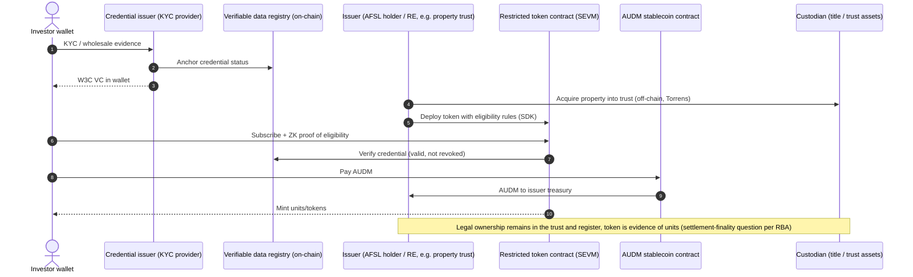
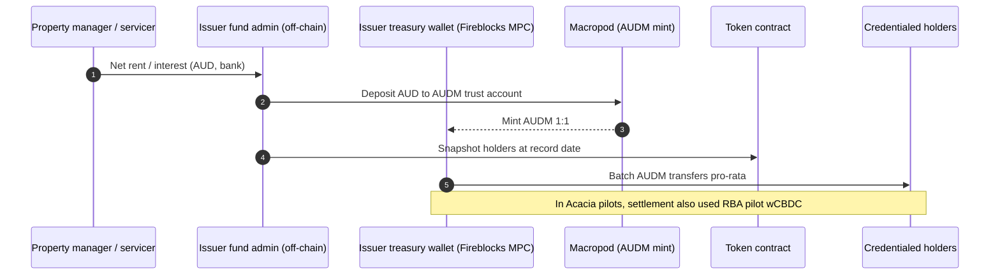
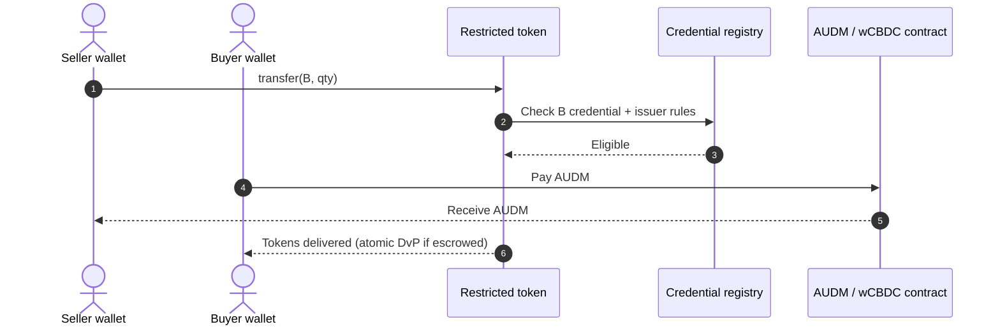
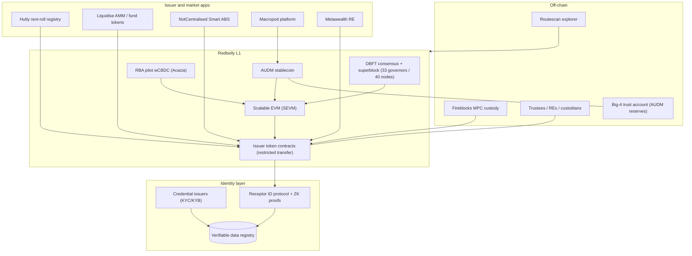

# Redbelly Network — Australia (AU)

| Field | Value |
|---|---|
| Website | https://redbelly.network (docs: docs.redbelly.network; explorer: redbelly.routescan.io) |
| HQ / legal entity | **Redbelly Network Pty Ltd**, 304/74 Pitt St, Sydney NSW. Engineering office in Chandigarh, India [C#1][C#4]. Formed in **Jun 2021 as a JV of Block8, CSIRO and the University of Sydney** [C#4]. Capital Brief reports Australian government participation in the ownership structure [C#7]. |
| Founded | Research lineage of about 10 years at USyd/CSIRO Data61. JV formed 2021. **Mainnet Nov/Dec 2024**. RBNT token listed Dec 2024 [C#4][C#7]. |
| Status as of Sep 2026 | **Live.** Mainnet launched Nov 2024 [C#4]. The Routescan explorer showed ~1s block time and ~7.07m cumulative transactions at fetch time [C#11], **but the explorer page labels the network "Testnet"**, so treat these throughput figures as unconfirmed for mainnet [I]. Hosted 4 Project Acacia pilot use cases (ABE, Macropod and Fireblocks corporate-bond pilots; NotCentralised collateralised loans), and the RBA's pilot wCBDC was minted onto Redbelly [C#3][C#21]. Its 2026 focus is "funds, private credit and securitised debt" [C#14]. |
| Category | **Tokenisation infrastructure (public-permissioned L1).** It is not a property marketplace. It is the main Australian-built chain that property and fund tokenisers (Hutly, Liquidise, Metawealth, Macropod) issue on. |
| Asset focus | General RWA. Property-related activity: **Hutly rent rolls (US$1.8bn announced Feb 2024)** [C#13], Metawealth tokenised real estate (Rome, Jul 2025) [C#14], Liquidise unit-trust tokenisation incl. property trusts [C#26], Macropod/Catena tokenised MIS units and an annuity settled in its AUD stablecoin (Acacia use cases as conditionally selected in Aug 2025; the Final Report lists Macropod's live pilot as a corporate bond and its fund use case as a proof-of-concept) [C#18][C#20][C#21]. |
| Scale | Claimed on-chain assets: **"US$73.8bn"** (Dec 2024, mostly a CarbonHood carbon-credit pipeline) [C#10][C#12]. A more conservative figure is **about US$1bn** (US$999.5m / A$1.59bn) of on-chain RWAs by Jan 2026 per RWA.io, cited by Redbelly [C#14]. Liquidise: US$736m (A$1.17bn) and Hutly: US$210m (A$336m) onboarded, both as at Jan 2025 [C#14]. Explorer showed about 0.03 TPS of live activity at fetch time (network label ambiguous, see Status) [C#11]. |
| Min. investment | N/A (infrastructure) |
| Why it is in the Top 5 | Australia has no scaled per-property on-chain issuer. The **real on-chain layer for Australian real estate and funds is Redbelly**. It is Australian-built, compliance-native (verifiable credentials and ZK eligibility), hosted the RBA's wCBDC pilot, and carries AUDM. Any Australian "RealX on-chain" design has to decide whether to use Redbelly or a global EVM chain. |
| Research confidence | **Medium.** The architecture and compliance model are well documented. Asset figures are self-reported and inconsistent, and token standards are not disclosed. |

---

## 1. Business model snapshot
- Redbelly sells **"Open Capital Markets Infrastructure"**: a patented, scalable L1 where "verified participants can interact with verified assets" [C#1][C#8].
- Revenue sources:
  - [I] Gas in **RBNT**: about 32m RBNT in cumulative fees at fetch time [C#11].
  - [I] Enterprise and partner integration fees.
  - [I] Treasury value of RBNT (10bn supply; 37.1% ecosystem, 20% reserve, 14.9% private, 13% seed, 10% team, 3% DAO, 2% academic) [C#6].
- **First-party products (verticalisation):**
  - **Tokeniser** (Tokeniser Pty Ltd, "a Redbelly Network project") is an issuance, registry and investor-portal SaaS. It reports A$1.2B issued and uses ERC-3643 [C#23].
  - **Averer** ("a Redbelly Network project") provides reusable identity, VCs and an embedded wallet [C#27].
  - [I] Redbelly is moving from a neutral L1 to a full-stack tokenisation provider. See `03-tokeniser-liquidise.md`.
- Go-to-market: partner issuers bring assets on-chain. Examples:
  - Hutly (rent rolls) [C#13]
  - Liquidise (unlisted equity and fund units) [C#16][C#17]
  - NotCentralised/Wisr (ABS) [C#15]
  - Macropod (AUDM stablecoin plus fund units) [C#18][C#19]
  - Australian Bond Exchange and Fireblocks (bonds) [C#20][C#21]
  - Metawealth (European real estate) [C#14]
  - CarbonHood (carbon) [C#12]

## 2. Legal & compliance structure

> Redbelly is a network, not an issuer. Legal wrappers belong to each issuer on it. This section covers the network's compliance primitives and the legal position of issuers that use it.

### 2.1 Issuing vehicles on Redbelly (examples)
| Issuer | Vehicle | What the token represents | Evidence |
|---|---|---|---|
| Hutly | Rent-roll contracts (property-management rights) | Digital twins of rental authorities and rent-roll books, not title | [C#13][C#8] |
| Liquidise | Unit trusts / funds / private-company shares | Units or shares (wholesale-focused) | [C#16][C#17][C#26] |
| NotCentralised / Wisr | Securitisation trust (Wisr Freedom Trust 2025-1, A$250m) | "Digital twin" of ABS notes | [C#15] |
| Macropod | AUDM stablecoin (AFSL 566313) and a digital-asset fund | Stablecoin plus fund units | [C#19][C#21] |
| Metawealth | Italian RE project | Fractional RE | [C#14] |

### 2.2 Network-level compliance primitives
- **Verifiable credentials (VCs):**
  - Uses the W3C VC Data Model v2.0 and DIDs. Credentials are held in a wallet, and there is a "verifiable data registry" [C#9].
  - Participants "complete a verification process ... during onboarding" and reuse the credential [C#8].
  - "All network participants have verifiable credentials" [C#7].
- **Zero-knowledge proofs:** participants can prove compliance without exposing personal data [C#6][C#8].
- **Programmatic eligibility:** issuers "programmatically check eligibility criteria" at issuance and at trade [C#2][C#8].
- **Receptor**, described as the "ID protocol", is a core component in the docs [C#5].
- **AML/CTF and Travel Rule** support is claimed. MiCA and Travel Rule "planned" at protocol level [C#2][C#8].
- **Accountability:** combining VC identity with consensus produces an "undeniable proof of fraud" [C#9].
- **Governance:** 40 institutional nodes, 33 of them governors [C#1].

### 2.3 Australian regulatory position (issuers on Redbelly)
- **Tokenised MIS interests, bonds and ABS notes are financial products.** INFO 225 (rewritten 29 Oct 2025; page last modified 30 Apr 2026) explicitly covers tokenised securities, stablecoins and wrapped tokens [C#24]. The sector-wide no-action position announced with it ran to 30 Jun 2026 and has lapsed [C#24][I]. Issuers therefore need an AFSL (and a registered MIS for retail) regardless of the chain.
- **Digital Assets Framework Act 2026** (Act No. 38 of 2026; Royal Assent 8 Apr 2026; commences 8 Apr 2027; 6-month transition, i.e. AFSL transition to 8 Oct 2027; low-value exemption ≤$10m transactions per 12 months and ≤$5k entry value per client) [C#25; verified in QA against legislation.gov.au C2026A00038]:
  - Creates Digital Asset Platforms (DAP) and **Tokenised Custody Platforms (TCP)**. A TCP operator "creates a single digital token" per non-money asset, holds the asset in trust or as bailee, and the token confers a right to redeem or direct delivery of that asset [C#25].
  - [I] A Redbelly-based property tokeniser holding title through a custodian and issuing **one token per property** would fit the TCP model. **A fractional issuer (many unit-tokens per property) probably does not**: the units are more likely plain MIS interests under INFO 225, and the custodial holding of those tokens for clients is the more likely DAP trigger. This is unresolved and needs counsel (see `01-regulatory/australia.md` §2 and `04-synthesis/conflicts-and-gaps.md` #2).
  - [I] The network operator itself is not a DAP or TCP unless it holds client assets; the Act also carves out "public digital token infrastructure" [C#25].
- **Project Acacia relief:** ASIC gave opt-in exemptions from AFS, market and CS-facility licensing for pilot participants, and AUSTRAC gave AML/CTF exemptions [C#21]. The relief was tied to the pilot programme (Aug 2025–Feb 2026) and should be treated as **time-bound**; the Final Report does not print an expiry date [C#21][I].
- **AUSTRAC:** stablecoin issuers on Redbelly are registered. Macropod is AUSTRAC-registered [C#19]. DCE registration applies to exchange between digital currency and fiat [I].
- **Settlement finality:** the Acacia report flags "how legal settlement finality is achieved in DLT environments" and enforceable on-chain ownership records as open issues [C#21].

### 2.4 Licensed partners in the ecosystem
- **Fireblocks:** MPC institutional custody. Integration announced 17 Dec 2024 [C#10].
- **Macropod Global:** AUDM issuer. AFSL 566313; reserves in a Big-4 trust account; monthly attestations [C#19].
- **AMAL / IQ-EQ:** trustee and servicer in the Smart ABS pilot [C#15].
- **RBA:** pilot wCBDC issuer (Acacia). Distribution ran through ESA-holder "distributors" who did the KYC [C#21].

### 2.5 KYC / AML
- Onboarding is credential-based and reusable, and Redbelly claims "2–3 day KYC in <1 second" when re-using credentials [C#8].
- The **KYC vendor is not named** [C#9]. [S] Credential issuers are likely third-party eIDV providers acting as VC issuers.
- Travel Rule support is claimed [C#2].

### 2.6 Investor eligibility and geo
- Eligibility is set per issuer through credentials, e.g. the wholesale-only JellyC/Liquidise funds [C#17].
- Redbelly says it offers "jurisdictional compliance without network-level access restrictions" [C#2]. [I] Anyone can hold a wallet, but regulated assets check credentials in their contracts.

### 2.7 Tax
- Handled per issuer. [I] Trust distributions and AMIT statements are produced off-chain by the fund administrator. The chain carries payment events (for example AUDM transfers).

### 2.8 Incidents
- No security incidents found.
- The RBNT market cap was only about US$7.4m at fetch time [C#11]. [I] That raises questions about the economic security of the token layer, which is mitigated by permissioned governor nodes.
- The "US$73.8bn" on-chain figure [C#10] conflicts with the "~US$1bn" RWA.io figure [C#14]. Treat the headline numbers as pipeline, not issued assets [I].

## 3. User types (personas and system roles)
| Role | Description | Evidence |
|---|---|---|
| Governor node operator | Institutional validators (33 of 40 nodes) | [C#1] |
| Credential issuer / verifier | Issues W3C VCs after KYC | [C#9] |
| Asset issuer | Hutly, Liquidise, Wisr/NotCentralised, Macropod, Metawealth, ABE | [C#13][C#14][C#15][C#16] |
| Investor (verified wallet) | Holds and trades eligible tokens | [C#8] |
| Institutional custodian | Fireblocks MPC | [C#10] |
| Stablecoin issuer | Macropod (AUDM) | [C#19] |
| Central bank (pilot) | RBA wCBDC | [C#3][C#21] |
| Trustee / servicer | AMAL / IQ-EQ (ABS) | [C#15] |
| Developer | Uses SDKs and SEVM | [C#5] |
| AI agents (roadmap) | "AI-driven agent integration" | [C#2] |

## 4. Actions by role
| Role | Action | Channel | On/off-chain |
|---|---|---|---|
| Investor | Complete KYC and receive a VC into the wallet | Credential issuer app | Off-chain KYC, credential registry on-chain [C#9] |
| Investor | Prove eligibility (ZK) and buy a token | Issuer dApp | On-chain [C#8] |
| Investor | Receive distributions in AUDM or wCBDC (pilot) | Wallet | On-chain [C#21] |
| Investor | Transfer or trade to another credentialed wallet, or via a Liquidise AMM | dApp | On-chain [C#26] |
| Issuer | Deploy a token with transfer restrictions using SDKs | SDK / console | On-chain [C#2][C#5] |
| Issuer | Program waterfalls and coupons (Smart ABS) | Smart contracts | On-chain [C#15] |
| Custodian | Hold keys in MPC (Fireblocks) | Fireblocks console | Off-chain keys, on-chain assets [C#10] |
| Governor | Validate blocks (DBFT) and govern the network | Node | On-chain [C#1][C#6] |
| RBA (pilot) | Mint and redeem wCBDC through distributors | RBA / ESA | On-/off-chain [C#21] |

## 5. Core flows

### 5.1 Onboarding and credentialing
1. The user onboards with a credential issuer: KYC/KYB, and for corporates, multi-user accounts [C#6][C#9].
2. A VC (W3C v2.0) is issued to the holder's wallet and referenced in the verifiable data registry [C#9].
3. The user presents a ZK proof of eligibility to issuer contracts. No personal data goes on-chain [C#6][C#8].
4. Keys can be recovered via delegate key-sharing [C#6].

### 5.2 Primary issuance and purchase (generic property or fund token on Redbelly)

Evidence: VC/ZK/eligibility [C#2][C#8][C#9]; AUDM on Redbelly [C#19]; open legal issue [C#21]. The overall sequence is [I].

### 5.3 Income distribution (programmable)

Evidence: AUDM mint/redeem [C#19]; programmable waterfalls in the Smart ABS pilot [C#15]; wCBDC [C#21]. The overall sequence is [I].

### 5.4 Secondary transfer / trade
- Peer-to-peer between credentialed wallets, with the eligibility check at trade [C#2].
- AMM liquidity through Liquidise, which lists Redbelly among its chains [C#26].
- Delivery-versus-payment against wCBDC was tested in Acacia (bond use cases) [C#21].

### 5.5 Redemption / exit
- Issuer-specific. [I] Burn on redemption, with AUDM redeemed to AUD by transferring to Macropod's treasury wallet [C#19].

### 5.6 Governance
- Network: DBFT consensus among governor nodes, plus a 3% DAO allocation [C#1][C#6].
- Asset-level voting is up to the issuer [I].

### 5.7 Issuer onboarding
- Issuers go through partnership, SDK and Fireblocks integration [C#5][C#10]. [I] Redbelly vets issuers ("verified assets") [C#8].

## 6. Reverse-engineered architecture

**On-chain:** tokens, credential status, transfer rules, AUDM/wCBDC payments, programmable waterfalls [C#8][C#15][C#19][C#21].
**Off-chain:** KYC data, legal title (Torrens/trust), fund administration, AUD reserves, custodial keys [C#9][C#19][C#10].

## 7. Tech stack
| Layer | Technology | Label | Source |
|---|---|---|---|
| Blockchain | Redbelly L1: DBFT ("democratic"/delegated BFT), no-fork, superblock | [C#5][C#6] | |
| Throughput | 97,500 TPS measured (Chainspect, Mar 2025). Lab peak 660k TPS on 300 nodes | [C#4][C#6] | |
| VM | Scalable EVM (SEVM) | [C#5][C#6] | |
| Token standard | Not specified at network level. **ERC-3643 (+ ERC-7575 vaults) is used by Tokeniser on Redbelly** | [C#23] | Tokeniser pricing and protocol-finance pages |
| Compliance | VCs (W3C v2.0), DIDs, ZK proofs, Receptor ID protocol | [C#5][C#6][C#9] | |
| Custody | Fireblocks MPC | [C#10] | |
| Stablecoin | AUDM (Macropod, AFSL 566313), multichain incl. Redbelly | [C#19] | |
| CBDC | RBA pilot wCBDC on Redbelly mainnet (Acacia) | [C#3][C#21] | |
| Explorer | Routescan | [C#11] | |
| Gas token | RBNT (10bn supply) | [C#6][C#11] | |
| SDKs | Tokenisation SDKs | [C#5] | |
| Oracles / NAV | "Real-time NAV unit pricing" (JellyC/Liquidise) | [C#17] | Oracle vendor unknown |

## 8. Money flows and revenue model
- Gas is paid in RBNT by transacting parties. [I] Issuers sponsor gas for investors.
- Settlement assets: AUDM (AUD stablecoin), and the RBA pilot wCBDC during Acacia [C#19][C#21].
- Issuer-level fees (management, AMM spread) belong to each issuer, e.g. Liquidise [I].
- Distribution cadence and currency are issuer-defined. [I] A$ via AUDM is the natural choice for Australian property.

## 9. Secondary market and liquidity
- The network has no native exchange.
- Liquidity comes from:
  - Liquidise's AMM on Redbelly, Ethereum and Arbitrum [C#26].
  - P2P transfers with eligibility checks [C#2].
  - RBNT CEX listings (Dec 2024) [C#4].
- Live activity was low at fetch time (about 0.03 TPS) [C#11]. [I] This is consistent with institutional, low-frequency RWA flows.

## 10. Risks, incidents, controversies
- **Metric inflation risk:** headline on-chain values (US$73.8bn) are mostly announced pipelines (CarbonHood's US$70bn carbon) [C#10][C#12], versus about US$1bn per RWA.io [C#14].
- **Token economics:** a low RBNT market cap (about US$7.4m) versus asset value secured [C#11]. [I] Security relies on institutional governors rather than stake.
- **Legal finality:** the RBA flags enforceability of on-chain records and settlement finality as unresolved [C#21].
- **Vendor concentration:** Hutly, Liquidise and others are small Australian fintechs. Hutly's rent-roll tokenisation has no visible investor marketplace [I].

## 11. Extrapolated ADMIN PANELS (**EXTRAPOLATION**)
Two consoles are implied: (A) the network operator's, and (B) an issuer console that a property tokeniser would build on Redbelly's SDKs. RealX would build (B).

### 11.1 (A) Network-operator console
| Module | Widgets | Evidence |
|---|---|---|
| Governor & node registry | Node status, governor set (33/40), onboarding of new institutional nodes, uptime/latency | [C#1][C#6] |
| Credential-issuer registry | Approved VC issuers, trust lists, revocation registry health | [C#9] |
| Compliance module registry | Approved eligibility-check contracts, Travel Rule adapters | [C#2][C#8] |
| Ecosystem / issuer onboarding | Partner pipeline (Hutly, Liquidise, Macropod), "verified asset" attestations | [C#8][C#13][C#16] |
| Network analytics | TPS, fees (RBNT), RWA value by issuer (reconciles headline claims) | [C#11][C#14] |
| CBDC / stablecoin integrations | wCBDC mint/burn monitoring (pilot), AUDM supply | [C#3][C#19][C#21] |

### 11.2 (B) Issuer console for a property token on Redbelly (what RealX would need)
| # | Module | Widgets | Admin actions (maker-checker) | Evidence |
|---|---|---|---|---|
| 1 | **Token factory** | Deploy restricted token per property trust; supply; decimals; linked ARSN/AFSL metadata | Deploy (maker: product; checker: compliance) | SDKs [C#5] |
| 2 | **Eligibility rules** | Accepted credential types (retail AU resident / wholesale s761G), per-holder caps, jurisdiction blocks | Change rule set (4-eyes) | Programmatic eligibility [C#2][C#8] |
| 3 | **Investor registry (mirror)** | On-chain holders ↔ off-chain unit register reconciliation; credential expiry | Resolve breaks (ops → registry manager) | Legal-record issue [C#21] |
| 4 | **Primary issuance desk** | Subscriptions in AUDM; mint queue; refunds | Approve mint batch (ops → finance) | AUDM [C#19] |
| 5 | **Distribution engine** | Record-date snapshot; AUDM batch payouts; tax components export | Approve payout (fund accountant → CFO) | [C#15][C#19] |
| 6 | **Transfer controls** | Freeze wallet, forced transfer (court order or estate), pause token | Freeze (AML officer → Head of Compliance) | Standard for regulated tokens [I] |
| 7 | **Custody & keys** | Fireblocks vault policies, signer quorum, whitelisted addresses | Policy change (CTO → CISO) | [C#10] |
| 8 | **Market / AMM integration** | Liquidise pool depth, price vs NAV, circuit breakers | Pause pool (market ops → compliance) | [C#26] |
| 9 | **Corporate actions & voting** | Snapshot-based voting, wind-up/sale resolutions | Publish result (co-sec → director) | [I] |
| 10 | **Regulatory reporting** | AUSTRAC (SMR/TTR), Travel Rule logs, DDO significant dealings, TCP/DAP reports (from 2027) | Lodge (MLRO) | [C#2][C#25] |

### 11.3 RBAC (issuer console)
- **Compliance officer / MLRO**
- **Token operator**: mint and burn.
- **Fund accountant**: distributions.
- **Treasury signer(s)**: Fireblocks quorum.
- **Registry manager**
- **Market ops**
- **Auditor**: read-only, with a chain-explorer view.
- **Super admin**: no signing rights.

### 11.4 Alerts, automations and reports
- **Alerts:**
  - Credential revoked for an existing holder.
  - On-chain/off-chain register mismatch.
  - AUDM treasury below the distribution requirement.
  - Unusual transfer velocity.
  - Governor-node degradation.
- **Automations:**
  - Record-date snapshots.
  - Auto-payout in AUDM.
  - Credential-expiry reminders.
- **Reports:**
  - Holder register for the RE.
  - Distribution reconciliation.
  - Travel Rule logs.
  - Gas spend.

## 12. Builder takeaways (for RealX)
- **Copy:** credential-gated, privacy-preserving eligibility (VC + ZK) instead of per-issuer whitelists. It maps cleanly to the Australian retail/wholesale split and FIRB residency gating.
- **Copy:** AUD stablecoin (AUDM) settlement plus programmable waterfalls (Smart ABS pattern) for rent distributions.
- **Avoid:** headline "on-chain asset" metrics that mix pipeline with issued assets. Australian investors and ASIC will look at the register.
- **Decide early:** whether the token is the legal register or a mirror of the off-chain unit register. The RBA flags this as unresolved [C#21]. The DAF Act (from 8 Apr 2027) is the likely licensing home, but which limb applies (TCP for single-token-per-asset custody, DAP for custodial holding of tokens, or neither if the tokens are just MIS interests held by investors) depends on the structure [C#25][I].
- **Differentiate:** Redbelly has no retail property marketplace. RealX could be the first retail-grade, MIS-wrapped property token app on an Australian compliance-native chain, or multi-chain like Liquidise.

## 13. Sources (accessed 23 Sep 2026)
1. Redbelly Network homepage — https://redbelly.network/
2. Redbelly, Asset Tokenisation — https://redbelly.network/asset-tokenisation
3. Redbelly, Project Acacia page — https://redbelly.network/projectacacia
4. Redbelly, About Us — https://redbelly.network/about-us
5. Redbelly Docs (index) — https://docs.redbelly.network/
6. Gate Learn, "What is Redbelly Network (RBNT)?" — https://www.gate.com/learn/articles/all-about-redbelly-network/6094
7. Capital Brief, "Australia's Redbelly says its new blockchain is first ever designed for RWAs" (5 Dec 2024) — https://www.capitalbrief.com/article/australias-redbelly-says-its-new-blockchain-is-the-first-ever-designed-for-real-world-assets-c8d336de-d02b-46f1-926c-4d083756b17b/
8. Redbelly blog, "Not Another RWA 101" — https://redbelly.network/blog/not-another-rwa-101-the-benefits-of-a-purpose-built-network
9. Redbelly blog, "What are Verifiable Credentials..." — https://redbelly.network/blog/what-are-verifiable-credentials-and-what-role-do-they-play-on-the-redbelly-network
10. Redbelly blog, "Integration with Fireblocks" (17 Dec 2024) — https://redbelly.network/blog/redbelly-network-announces-integration-with-fireblocks
11. Redbelly explorer (Routescan) — https://redbelly.routescan.io/
12. Redbelly blog index — https://redbelly.network/blogs
13. Redbelly blog, "Hutly partners with Redbelly to tokenise $1.8B USD in rent rolls" (22 Feb 2024) — https://redbelly.network/blog/hutly-partners-with-redbelly-network-to-tokenise-1.8b-usd-in-rent-rolls
14. Redbelly, "Year in Review 2025" (Medium) — https://medium.com/@redbellyblockchain/redbelly-network-year-in-review-2025-4cca70e3146d
15. Redbelly blog, "Tokenised asset-backed security transaction pilot launches under Project Acacia" (11 Dec 2025) — https://redbelly.network/blog/tokenised-asset-backed-security-transaction-pilot-launches-under-Project-Acacia
16. Redbelly blog, "Redbelly and Liquidise" (11 Jan 2024) — https://redbelly.network/blog/redbelly-and-liquidise
17. JellyC, "Liquidise and JellyC partner to tokenise JellyC funds on Redbelly" (22 Jan 2025) — https://www.jellyc.io/insights/jellyc-liquidise-tokenise-on-redbelly-network
18. Redbelly, "RWA & Tokenization: Industry News September 2025" (Medium) — https://medium.com/@redbellyblockchain/real-world-assets-tokenization-industry-news-september-2025-5cfa76967f7e
19. Macropod, AUDM — https://www.macropod.com/audm
20. DFCRC, "Project Acacia: summary of conditionally selected use cases" (Aug 2025) — https://dfcrc.com.au/wp-content/uploads/2025/08/Project-Acacia-summary-of-use-cases.pdf
21. RBA/DFCRC, Project Acacia Final Report (May 2026) — https://www.rba.gov.au/payments-and-infrastructure/tokenised-money/pdf/project-acacia-final-report.pdf
22. AdviserVoice, "Project Acacia releases findings" (22 May 2026) — https://www.adviservoice.com.au/2026/05/project-acacia-releases-findings-on-tokenisation-of-money-and-assets/
23. Tokeniser (a Redbelly Network project) — https://tokeniser.com (see 03-tokeniser-liquidise.md for full profile)
24. ASIC 25-250MR, INFO 225 update (29 Oct 2025; INFO 225 page last modified 30 Apr 2026) — https://www.asic.gov.au/about-asic/news-centre/find-a-media-release/2025-releases/25-250mr-updated-asic-guidance-supports-digital-asset-innovation-and-boosts-investor-protection
25. CryptoSlate, Digital Assets Framework Act 2026 — https://cryptoslate.com/crypto-laws/australia-corporations-amendment-digital-assets-framework-act-2026/ (dates and definitions verified in QA against legislation.gov.au C2026A00038)
26. Liquidise (UAE/AU site) — https://uae.liquidise.com/
27. Averer (a Redbelly Network project) — https://averer.com
