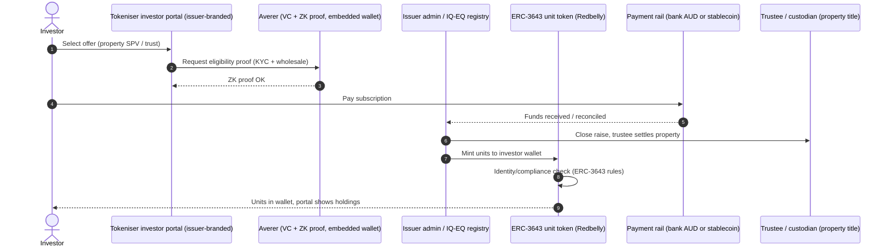
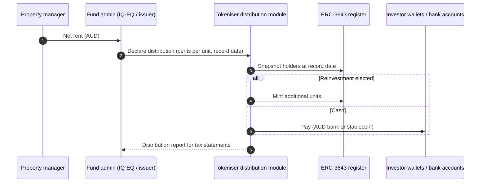
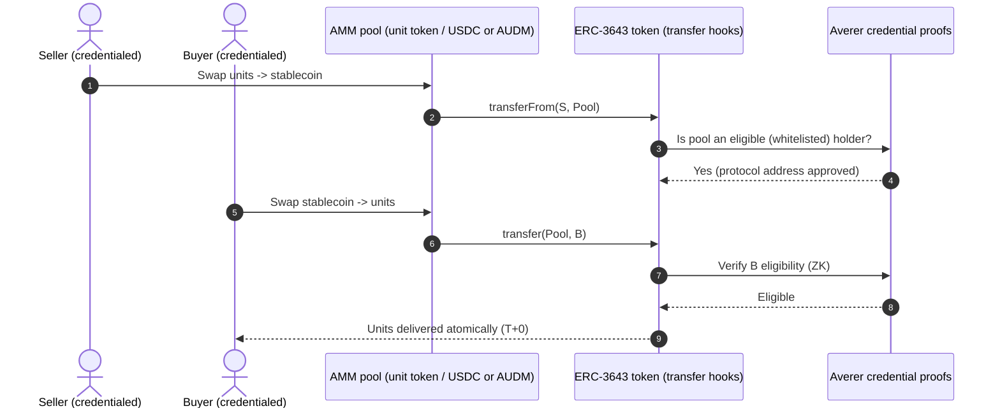
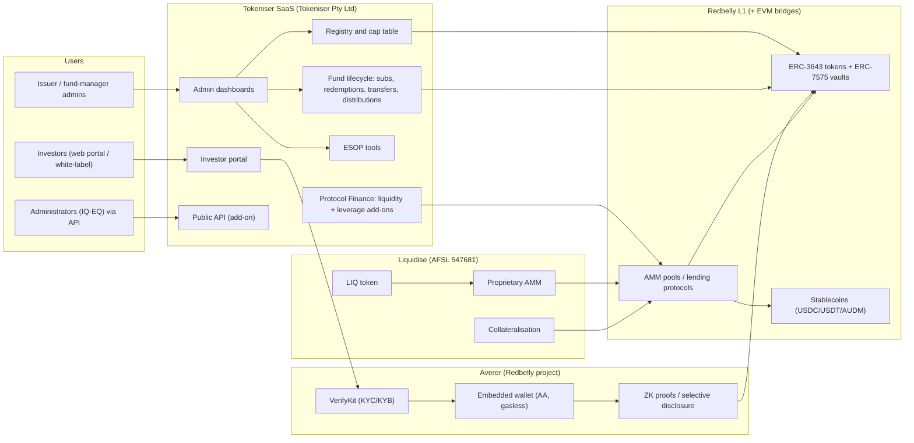

# Tokeniser (Redbelly Network project) + Liquidise — Australia (AU)

| Field | Value |
|---|---|
| Website | https://tokeniser.com (app: app.tokeniser.com). Liquidise: https://liquidise.com, which redirects to uae.liquidise.com. Identity layer: https://averer.com |
| HQ / legal entity | **Tokeniser Pty Ltd (ACN 689 725 577)**, "a Redbelly Network project", Sydney [C#1][C#5]. **Liquidise**: "public unlisted company in Australia" holding **AFSL 547681**, Sydney office, Abu Dhabi "soon", founder and MD Andrew Ward [C#13]. |
| Founded | Tokeniser Pty Ltd's ACN (689…) points to incorporation around 2025 [I]. Liquidise was operating by Jan 2024, when it announced >$800m (currency not stated in the headline; A$ more likely for an Australian book) of unlisted equity to tokenise on Redbelly [C#14]. |
| Status as of Sep 2026 | **Active.** The Tokeniser site shows live metrics and pricing, and Liquidise's site is © 2026 [C#1][C#8][C#13]. Liquidise's "Share Registry" link now **redirects to tokeniser.com** [C#13]. [I] The Liquidise registry/tokenisation book appears to have moved onto Tokeniser. Liquidise remains the AFSL-holding liquidity/AMM brand. |
| Category | **On-chain tokenised (fund/unit/share level) + tokenisation infrastructure (white-label SaaS).** ERC-3643 permissioned tokens on Redbelly [C#8][C#9]. |
| Asset focus | Unlisted funds (unit trusts, feeder funds, SPVs, co-investments), private-company shares and ESOPs [C#3][C#8]. Liquidise explicitly lists **"property trusts"** [C#13]. We found **no named property-fund client** [gap]. |
| Scale | **A$1.2B issued equity and funds; 160+ companies and funds; A$2B+ transactions** (self-reported, undated) [C#1][C#7]. Redbelly credits Liquidise with **US$736m (A$1.17B)** of tokenised unlisted assets as at Jan 2025 [C#16]. [I] This is probably the same book. |
| Min. investment | Set by the issuer. Platform pricing to issuers: A$11k/yr + A$2.5k setup for "Emerging" funds (~50 investors) [C#8]. |
| Why it is in the Top 5 | It is the **only Australian platform with evidence of scaled on-chain issuance of fund and trust units** (ERC-3643 on an Australian L1), with a live investor portal, distributions, 24/7 secondary trading and AMM-based liquidity. For a RealX-type property syndicator it is the closest local build-vs-buy benchmark: property trusts, SPVs and co-investments are exactly its "Enterprise" use case. |
| Research confidence | **Medium-Low.** Product and pricing pages are clear. The legal role (whose AFSL?), property-specific clients and AMM mechanics are not disclosed. The Liquidise–Tokeniser relationship is inferred. |

---

## 1. Business model snapshot
- **Tokeniser is B2B SaaS.** Fund managers, companies and administrators tokenise their registers, onboard investors, run subscriptions, redemptions, transfers and distributions, and optionally switch on "Protocol Finance" add-ons: liquidity, leverage and the public API [C#3][C#8].
- **Pricing** [C#8]:
  - Funds, "Emerging": **A$11,000/yr + A$2,500 setup**. Covers registry, KYC, standard reporting and investor portal, for about 50 investors with a single strategy.
  - Funds, "Enterprise": tailored pricing. Covers multiple unit classes, multiple closes, **SPVs, co-investments, retail investors**.
  - Companies: Connect is free for up to 20 investors (on-chain registry only). Amplify is A$5 per investor per month, falling to A$1 above 250 investors. Accelerate (with ESOP) is A$10 per investor per month, falling to A$2.
- **Liquidise** offers "tokenisation, collateralisation, proprietary AMM technology and liquidity solutions" for illiquid holdings (unit and mutual funds, **property trusts**, private shares, VC LP positions) [C#13].
  - Settlement tokens: **USDT, USDC and LIQ** (Liquidise's own token) [C#13].
  - Chains: Ethereum, Arbitrum, Redbelly [C#13].
- Tokeniser markets two efficiency figures: about "A$10B annually in liquidity benefits" and about "A$6B yearly in asset efficiency gains" [C#9]. Both are marketing claims.

## 2. Legal & compliance structure

### 2.1 Issuing vehicle
- **The issuer keeps its own vehicle and licence.** Tokeniser positions "Protocol Finance" as capital-markets functions delivered "through exempt public protocols, keeping issuers within their AFSL", and states that the issuer's AFSL covers the offer "while the infrastructure remains exempt" [C#9]. The page anchors this on the Digital Assets Framework Act: "Australia's digital assets framework recognises open, permissionless protocols as Public Digital Token Infrastructure … The licensed perimeter sits where it belongs, at issuance and conduct toward the investor. Everything beneath it is shared public infrastructure" [C#9]. [I] The Act does carve out public digital token infrastructure from the DAP/TCP regime, but that carve-out does not by itself answer whether an AMM in MIS units is a financial market under s767A.
- Typical Australian vehicles on the platform:
  - Wholesale unit trusts (JellyC funds are wholesale-only under s761G/761GA) [C#15].
  - Feeder funds, SPVs and co-investments [C#3][C#8].
  - Pty Ltd companies (share registry, ESOP) [C#8].
- Trustee and registry services are provided with partner **IQ-EQ** [C#7].

### 2.2 What the token legally represents
- An ERC-3643 token (plus ERC-7575 vault structures) that represents units or shares [C#9]. Tokeniser describes the register as a "digital source of truth" [C#10].
- **The legal status of the on-chain record is not stated** on the funds, admin or terms pages [C#3][C#6][C#10].
- [I] For a trust, the RE's or trustee's register is still the legal register under the trust deed and Corporations Act s169, unless the deed designates the token ledger as the register.
- The RBA's Acacia report flags "structuring of on-chain records to provide enforceable evidence of asset ownership" as an open issue [C#21].

### 2.3 Licences, exemptions and regulatory theory
| Item | Status | Evidence |
|---|---|---|
| Tokeniser's own AFSL | Not disclosed. The terms are pure SaaS, "as is", with liability capped at the prior cycle's fees | [C#6] |
| Liquidise AFSL | **547681** | [C#13] |
| Issuer AFSL | Required, and it "covers the offer" | [C#9] |
| Market licence for AMM / secondary trading | Tokeniser claims an AMM is "a decentralised-application protocol ... [that] operates as exempt infrastructure" [C#9]. [I] This is an **untested legal position**: under Corporations Act s767A, a facility through which offers to acquire or dispose of financial products are regularly made or accepted is a financial market. [S] ASIC may view AMMs for ERC-3643 securities as markets that need an AML (market licence) or exemption | [C#9][I] |
| Digital Assets Framework Act 2026 | Act No. 38 of 2026 (Royal Assent 8 Apr 2026). From 8 Apr 2027, TCP/DAP licensing applies to platforms that hold digital tokens for clients (DAP) or create a **single token per held asset** with redemption rights (TCP); low-value exemption ≤$10m transactions/12 months and ≤$5k per client [C#19; verified in QA against legislation.gov.au]. [I] Tokeniser's non-custodial Averer wallet [C#9] is designed to stay outside the DAP "holding" trigger; fractional unit tokens are unlikely to be TCP products because the TCP definition is one token per asset | [C#19][C#9] |
| INFO 225 (Oct 2025) | Tokenised securities are financial products. Class relief exists for stablecoin distributors and custodians. The sector-wide no-action position ran to 30 Jun 2026 and **has now lapsed**; INFO 225 was revised again on 30 Apr 2026 | [C#18][I] |
| Wholesale / sophisticated tests | FAQ refers to "wholesale and sophisticated investor tests". Thresholds are unchanged | [C#1][C#20] |

### 2.4 Partners
- **IQ-EQ**: trust and registry services [C#7].
- **Redbelly Network**: settlement. Deterministic finality, "100% uptime since Oct 2024" [C#4].
- **Averer**: identity and non-custodial wallet. Also a Redbelly Network project [C#11].
- Clients and testimonials: **JellyC, Holon Global Investments, EnviroMission** [C#1][C#7].

### 2.5 KYC / AML / identity
- **Averer** issues reusable KYC and KYB credentials. The VerifyKit SDK and embedded wallet generate **zero-knowledge proofs with selective disclosure**, built on W3C VCs and DIDs [C#11][C#12].
- "Verifiable credentials gate every holder" [C#9]. "Compliance criteria follow the asset forever" [C#11].
- The underlying document/DVS vendor is not disclosed [C#12]. [S] It is probably an Australian eIDV aggregator.
- KYC is included in all Tokeniser plans [C#8].

### 2.6 Investor eligibility and geo
- Set per issuer: wholesale and sophisticated by default [C#1], retail only on Enterprise [C#8].
- Liquidise targets institutional investors, fund managers and LPs [C#13].
- The Abu Dhabi expansion suggests non-Australian investors [C#13]. [I] For Australian land-rich trusts, foreign holders would need FIRB screening, which could be encoded as an Averer credential.

### 2.7 Tax
- Distributions are supported, including reinvestment [C#3].
- AMIT and tax statement generation is not mentioned [C#3]. [I] It is probably done by the administrator (IQ-EQ) and fed through the API.

### 2.8 Actions and controversies
- No enforcement found.
- The "exempt public protocol" theory is the main regulatory risk [I].

## 3. User types
| Role | Description | Evidence |
|---|---|---|
| Fund manager / issuer admin | Configures the fund, classes and closes; runs the register | [C#3][C#8] |
| Company issuer | Share registry, fundraising, announcements, ESOP | [C#8] |
| Administrator / registry (e.g., IQ-EQ) | Runs workflows via UI or API | [C#7][C#10] |
| Investor (wholesale/sophisticated; retail on Enterprise) | Onboards via Averer, subscribes, holds, trades | [C#1][C#8][C#11] |
| Employee (ESOP participant) | Holds and exercises options/shares | [C#8] |
| LP / unit holder seeking liquidity | Sells via Liquidise AMM or pool | [C#13] |
| Liquidity provider / lender | Provides pool liquidity or lends against tokens | [C#9][C#13] |
| Credential issuer (Averer) | KYC/KYB credentials | [C#11] |
| Platform operator (Tokeniser/Redbelly) | SaaS operations, API | [C#1][C#7] |

## 4. Actions by role
| Role | Action | Channel | On/off-chain |
|---|---|---|---|
| Investor | Create an Averer embedded wallet (gasless, account abstraction) and verify KYC once | Tokeniser portal / issuer white-label | Credential off-chain in wallet; proof on-chain [C#12] |
| Investor | Subscribe or redeem units | Investor portal | Register on-chain (ERC-3643) [C#3][C#8] |
| Investor | Receive distributions or reinvest | Portal | On-chain transfer / register update [C#3] |
| Investor | Trade 24/7; swap in AMM pools; settle atomically T+0 | Protocol Finance / Liquidise | On-chain [C#1][C#2][C#9] |
| Investor | Borrow against tokens (leverage add-on) | Protocol Finance | On-chain [C#8][C#9] |
| Issuer admin | Onboard investors, manage holdings, announcements, fundraising | Admin dashboard | Mixed [C#8] |
| Issuer admin | Configure unit classes, closes, SPVs, co-investments | Admin (Enterprise) | Mixed [C#8] |
| Administrator | Integrate via API; keep existing workflows and branding | API | Mixed [C#3][C#10] |
| Liquidise | Tokenise positions, provide AMM liquidity, collateralise | Liquidise platform | On-chain (ETH/ARB/Redbelly) [C#13] |

## 5. Core flows

### 5.1 Onboarding
1. The investor opens the issuer's portal. The Averer VerifyKit/embedded wallet is created with no seed phrase and gas abstracted [C#12].
2. KYC/KYB runs once and yields a VC held in the wallet [C#11][C#12].
3. The wholesale or sophisticated credential is checked where required [C#1].
4. [I] The ERC-3643 identity registry is bound to the wallet's credential proof.

### 5.2 Primary subscription (property trust / SPV example)

Evidence: [C#3][C#8][C#9][C#11][C#12]. The property trust and trustee step is [I]: Tokeniser supports SPVs and co-investments [C#8], and Liquidise lists property trusts [C#13].

### 5.3 Income distribution

Evidence: distributions and reinvestment [C#3][C#8]. The payment rail is not specified, so it is [I].

### 5.4 Secondary trading (Protocol Finance / Liquidise AMM)

Evidence: AMM and exempt-protocol theory [C#9]; atomic T+0 [C#2]; USDT/USDC/LIQ settlement on Liquidise [C#13]. The pool-whitelisting step is [I]: ERC-3643 requires every holder, including a pool contract, to be eligible.

### 5.5 Redemption / exit
- Redemptions are handled by the fund workflow [C#3]. Liquidise offers partial "liquidise portions of their holdings — on their terms" [C#13].
- [I] A property sale is followed by a final distribution and burning all tokens.

### 5.6 Governance
- Announcements for companies [C#8]. On-chain voting is not mentioned [gap].

### 5.7 Issuer onboarding / migration
- New fund, feeder, "staged digital version of an existing fund", or migration of an existing register [C#3][C#10].
- Adoption can be staged [C#10].

## 6. Reverse-engineered architecture

**On-chain:** the register (ERC-3643), transfers, AMM swaps, collateral, credential proofs [C#8][C#9][C#12].
**Off-chain:** KYC data (in the wallet or issuer), payments in AUD, trustee and custodian holding real assets, tax reporting [C#12][I].

## 7. Tech stack
| Layer | Technology | Label | Source |
|---|---|---|---|
| Blockchain | Redbelly L1 (primary); Liquidise also on Ethereum and Arbitrum; bridges to Ethereum/Solana/Avalanche claimed | [C#4][C#13][C#2] | |
| Token standard | **ERC-3643** (permissioned security token) and **ERC-7575** (multi-asset vault); the pricing page also cites **ERC-7540** (asynchronous vault, "dealing-window settlement") for funds | [C#8][C#9] | ERC-7575 on the Protocol Finance page; ERC-3643 and ERC-7540 on the pricing page |
| Compliance | ERC-3643 transfer hooks + Averer VC/ZK eligibility | [C#9][C#12] | |
| Identity | Averer VerifyKit (React SDK), W3C VC, DIDs, ZK proofs | [C#11][C#12] | |
| Wallet / custody | Averer non-custodial embedded wallet with account abstraction and gas abstraction | [C#9][C#12] | |
| Fiat rails | Not specified | [I] | Bank transfer via administrator |
| Stablecoins | USDT, USDC, LIQ (Liquidise). [I] AUDM is available on Redbelly | [C#13][C#17] | |
| Marketplace | AMM pools ("protocol finance"), Liquidise proprietary AMM | [C#9][C#13] | |
| Frontend | React/Next.js/Vite-compatible SDK (Averer); Liquidise marketing site built with **Lovable** | [C#12][C#13] | |
| Backend / API | Public API add-on | [C#8] | |
| CRM / scheduling | Zoho Bookings (demo booking under the "info-redbelly" account) | [C#1] | |
| Registry partner | IQ-EQ | [C#7] | |
| Cloud | Not disclosed. Overseas service providers are used | [C#5] | |

## 8. Money flows and revenue model
- **Tokeniser SaaS:** annual base plus setup fees for funds; per-investor monthly fees for companies [C#8].
- **Add-ons:** API, Protocol Finance, liquidity and leverage (priced separately) [C#8].
- **Liquidise:** [I] AMM fees/spread and collateral lending interest; LIQ token [C#13].
- **Distribution currency and cadence:** set by the issuer; reinvestment is supported [C#3].

## 9. Secondary market and liquidity mechanics
- **24/7 trading with atomic T+0 settlement** [C#1][C#2].
- AMM liquidity pools and lending against tokens [C#9].
- Liquidise gives LPs and unit holders partial liquidity "on their terms" [C#13].
- [I] Pricing is AMM curve-based, not NAV-matched. The real-time NAV unit pricing referenced in the JellyC deal [C#15] could anchor oracle-based pools.
- [I] ERC-3643 eligibility checks on the pool contract restrict pools to credentialed participants. This separates it from DeFi AMMs.

## 10. Risks, incidents, controversies
- **Regulatory theory risk:** "exempt public protocols" for trading and lending may not survive ASIC scrutiny under the s767A market definition, or the DAF Act regime from 2027 [C#9][C#19][I].
- **Opaque entity mapping:** Tokeniser has no stated AFSL [C#6]. Liquidise has one [C#13], but its relationship with Tokeniser is undisclosed. Liquidise's site redirects its registry product to Tokeniser [C#13].
- **Metrics:** A$1.2B issued and A$2B+ transactions are self-reported and undated [C#1].
- **Token exposure:** Liquidise's LIQ token as a settlement asset [C#13] creates conflicts and volatility [I].
- **Legal register ambiguity:** see the RBA finding [C#21].

## 11. Extrapolated ADMIN PANEL (**EXTRAPOLATION**, anchored on published plan features)
> Tokeniser confirms "admin dashboards" are included in every plan [C#8]. The modules below are extrapolated from the plan feature list, the fund workflows and Australian obligations.

### 11.1 Modules / pages
| # | Module | Key widgets | Evidence |
|---|---|---|---|
| 1 | **Fund / company setup** | Entity (trust/SPV/company), unit classes, closes, co-investment vehicles, token deployment (ERC-3643 / ERC-7575) | Enterprise features [C#8][C#9] |
| 2 | **Investor onboarding & eligibility** | Averer KYC/KYB status, wholesale/sophisticated evidence, credential expiry, FIRB/residency flags | [C#1][C#11][C#12] |
| 3 | **Registry & cap table** | On-chain holders, classes, locked/vesting positions, reconciliation to IQ-EQ register | [C#7][C#8][C#10] |
| 4 | **Raise / fundraising** | Offers, commitments, closes, allocation, payment reconciliation | Amplify "fundraising" [C#8] |
| 5 | **Subscriptions & redemptions** | Queues, NAV strike, gating, cut-offs | [C#3] |
| 6 | **Distributions** | Declare, record date, cash vs reinvest, payment file, statements | [C#3][C#8] |
| 7 | **Announcements & investor comms** | Posts, notifications, document vault | [C#8] |
| 8 | **ESOP** | Grants, vesting, exercise, leaver rules | [C#8] |
| 9 | **Protocol Finance: liquidity** | Enable pools, pool depth, price vs NAV, circuit breakers | Add-on [C#8][C#9] |
| 10 | **Protocol Finance: leverage** | Collateral whitelist, LTVs, liquidation monitor | Add-on [C#8][C#9] |
| 11 | **Token controls** | Pause, freeze address, forced transfer / recovery (ERC-3643 agent functions) | [I: ERC-3643 standard agent role] |
| 12 | **API & integrations** | API keys, webhooks, administrator integrations | [C#8][C#10] |
| 13 | **Compliance & reporting** | AML (SMR/TTR drafts), DDO (for retail Enterprise), audit trail, tax exports to administrator | [I: regulatory necessity] |
| 14 | **Billing** | Plan, investor count (per-investor pricing), invoices | [C#6][C#8] |

### 11.2 Admin actions and maker-checker
| Action | Maker | Checker |
|---|---|---|
| Deploy token / new class | Issuer ops | Issuer compliance (and Tokeniser ops for contract release) |
| Approve investor (wholesale evidence) | Onboarding officer | Compliance |
| Mint / burn (subscription / redemption) | Registry officer | Fund accountant |
| Declare and pay distribution | Fund accountant | CFO / trustee (IQ-EQ) |
| Freeze wallet / forced transfer | AML officer | Head of Compliance + trustee |
| Enable an AMM pool / change circuit breaker | Market ops | Compliance |
| Change collateral LTV | Risk | CIO |

### 11.3 RBAC
- **Tokeniser platform admin**: multi-tenant, support, contract releases.
- **Issuer owner**
- **Issuer operator**
- **Compliance / MLRO**
- **Fund accountant**
- **Administrator (IQ-EQ)**: scoped by API.
- **Trustee / RE sign-off**
- **Market / liquidity manager**
- **Read-only auditor**
- **Investor-relations editor**

### 11.4 Alerts, automations and reports
- **Alerts:**
  - Credential revoked or expired for a holder.
  - Pool price deviates more than X% from NAV.
  - Collateral LTV breach.
  - Register mismatch with the administrator.
  - Investor count crossing a plan tier.
- **Automations:**
  - Record-date snapshots.
  - Reinvestment mints.
  - Vesting releases.
  - Credential-expiry reminders.
- **Reports:**
  - Holder register.
  - Distribution statements.
  - AMM volume and fees.
  - AUSTRAC logs.
  - Billing usage.

## 12. Builder takeaways (for RealX)
- **Copy:**
  - ERC-3643 tokens with reusable ZK credentials, where the pool contract itself must be eligible. This is the cleanest pattern for compliant secondary liquidity.
  - Transparent SaaS pricing per investor.
  - A white-label investor portal plus an API layer under existing administrators such as IQ-EQ.
- **Avoid:**
  - Relying on an "exempt public protocol" theory for secondary trading of property-trust units without ASIC relief or a market-licence strategy.
  - Settling in a proprietary token (LIQ).
- **Build vs buy:** RealX could run on Tokeniser + Averer + Redbelly (buy) and concentrate on property origination, the RE/trustee relationship and a retail-grade UX. Or it could replicate the stack on a global EVM chain for more liquidity.
- **Gap to exploit:** there is no visible **property-specific** product on Tokeniser. A retail, MIS-wrapped, property-by-property token offering with A$ stablecoin distributions is still open in Australia.

## 13. Sources (accessed 23 Sep 2026)
1. Tokeniser homepage, including link/footer extraction — https://tokeniser.com
2. Tokeniser, Product: Liquidity — https://tokeniser.com/product/liquidity
3. Tokeniser, Solutions: Funds — https://tokeniser.com/solutions/funds
4. Tokeniser, Technology — https://tokeniser.com/technology
5. Tokeniser, Privacy Policy — https://tokeniser.com/privacy-policy
6. Tokeniser, Terms and Conditions — https://tokeniser.com/terms-and-conditions
7. Tokeniser, About — https://tokeniser.com/about
8. Tokeniser, Pricing — https://tokeniser.com/pricing
9. Tokeniser, Protocol Finance — https://tokeniser.com/protocol-finance
10. Tokeniser, Solutions: Asset Administrators — https://tokeniser.com/solutions/asset-administrators
11. Averer homepage — https://averer.com
12. Averer docs (Web SDK overview) — https://docs.averer.co
13. Liquidise (redirect target of liquidise.com) — https://uae.liquidise.com/
14. Redbelly blog, "Redbelly and Liquidise announce deal to tokenise $800M in unlisted private equity" (11 Jan 2024) — https://redbelly.network/blog/redbelly-and-liquidise
15. JellyC, "Liquidise and JellyC partner to tokenise JellyC funds on Redbelly" (22 Jan 2025) — https://www.jellyc.io/insights/jellyc-liquidise-tokenise-on-redbelly-network
16. Redbelly, "Year in Review 2025" — https://medium.com/@redbellyblockchain/redbelly-network-year-in-review-2025-4cca70e3146d
17. Macropod, AUDM — https://www.macropod.com/audm
18. ASIC 25-250MR, INFO 225 update (29 Oct 2025; INFO 225 page last modified 30 Apr 2026) — https://www.asic.gov.au/about-asic/news-centre/find-a-media-release/2025-releases/25-250mr-updated-asic-guidance-supports-digital-asset-innovation-and-boosts-investor-protection
19. CryptoSlate, Digital Assets Framework Act 2026 — https://cryptoslate.com/crypto-laws/australia-corporations-amendment-digital-assets-framework-act-2026/ (dates and TCP definition verified in QA against legislation.gov.au C2026A00038)
20. Gilbert + Tobin, "Wholesale client tests remain the same" (22 May 2025) — https://www.gtlaw.com.au/insights/wholesale-client-tests-remain-the-same
21. RBA/DFCRC, Project Acacia Final Report (May 2026) — https://www.rba.gov.au/payments-and-infrastructure/tokenised-money/pdf/project-acacia-final-report.pdf
22. Redbelly (HubSpot mirror), "Redbelly and Liquidise" — https://hs.redbelly.network/blog/redbelly-and-liquidise
