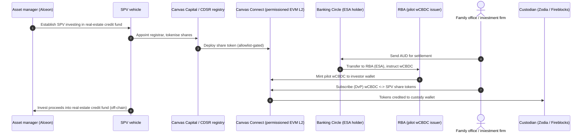
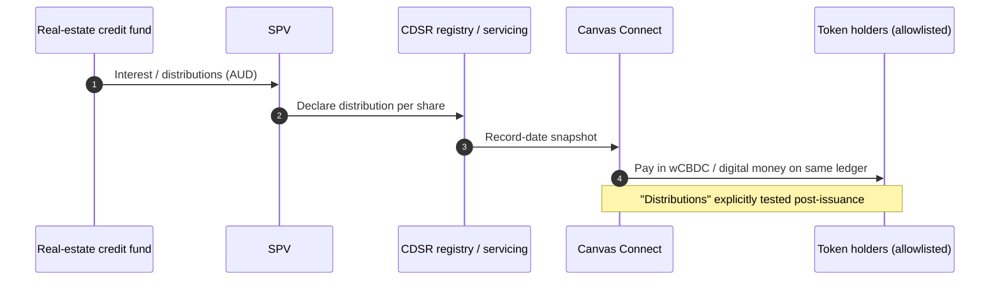
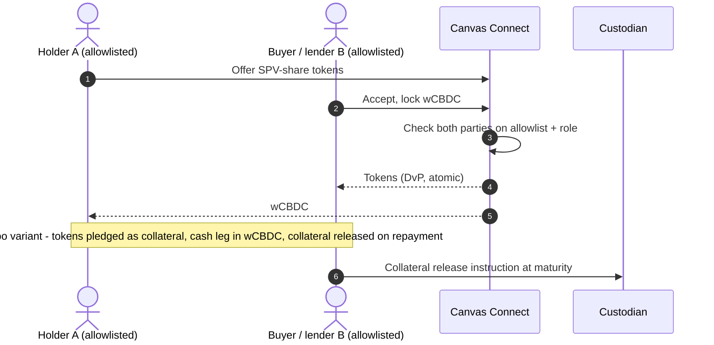
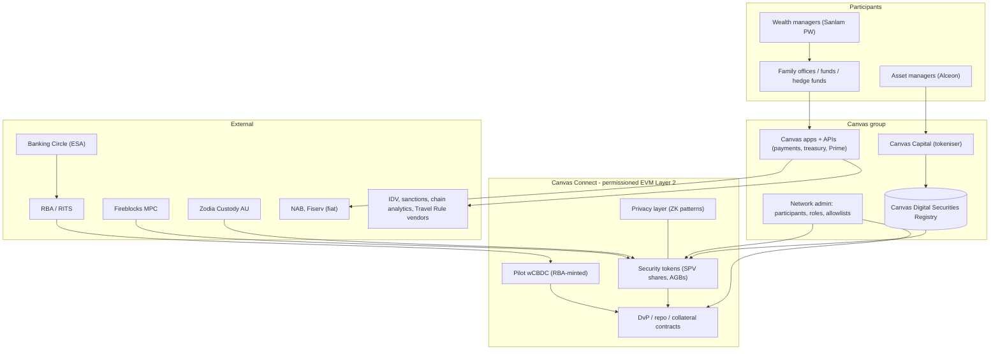

# Canvas (Canvas Connect) — Australia (AU)

| Field | Value |
|---|---|
| Website | https://canvas.co (product: /canvas-connect; case studies: /case-studies/project-acacia, /case-studies/eaud-cbdc-pilot) |
| HQ / legal entity | **Canvas Digital Pty Ltd** (ACN 648 707 706), Level 2, 222 Pitt St, Sydney [C#3]. Parent: **Canvas Technology Group Pty Ltd** [C#7]. Group entities: **Canvas Capital Pty Ltd** (tokeniser/issuer of the tokenised AGB), **Canvas Connect Pty Ltd**, Canvas Management Pty Ltd, Canvas IP Pty Ltd [C#11][C#2]. Registry brand: **Canvas Digital Securities Registry (CDSR)** [C#2]. |
| Founded | [I] About 2021, based on the ACN 648… series. Co-founders David Lavecky (CEO) and Daniel Lavecky (Chair), both ex-Pure Commerce, which was acquired by Euronet [C#9]. |
| Status as of Sep 2026 | **Active.** Ran two Project Acacia pilots (2025–26) and executed **Australia's first live repo using a tokenised Australian Government Bond settled in RBA wholesale CBDC** (announced Jun 2026) [C#2][C#4][C#6]. |
| Category | **Regulator-backed pilot + tokenisation infrastructure (DFMI).** A permissioned, EVM-compatible Layer 2 [C#1]. |
| Asset focus (real-estate relevance) | Acacia private-credit pilot: **"tokenised shares in a vehicle investing in a real estate credit fund"**, covering primary issuance, secondary trading, distributions and collateralised lending. Asset-side participants: **Alceon Group** and **Sanlam Private Wealth** [C#6][C#12]. Also AGBs and repo [C#6]. |
| Scale | Pilot scale. Across Acacia, A$4.4m of pilot wCBDC was issued across 8 use cases [C#5]. Canvas reports "$250M volume processed" on its payments business [C#3]. The real-estate credit pilot size was **not disclosed** [C#6]. |
| Min. investment | N/A. Wholesale/institutional only [C#7][C#12]. |
| Why it is in the Top 5 | It is the **only Project Acacia use case that explicitly tokenised a real-estate-linked asset**: SPV shares in a real-estate credit fund, settled in wCBDC [C#12][C#6]. It shows the regulator-sanctioned institutional template for tokenised property credit in Australia: a permissioned EVM network with allowlists, DvP against central-bank money, and custodians (Zodia, Fireblocks). This is the "top-down" path that will shape the post-Acacia DFMI sandbox [C#13]. |
| Research confidence | **Medium.** The pilot scope and partners are confirmed. Volumes, legal documents and the L2's settlement layer are undisclosed. |

---

## 1. Business model snapshot
- Canvas sells "institutional stablecoin, payments, treasury, and tokenised-market infrastructure" [C#9]:
  - Payments across 180+ countries.
  - Treasury management.
  - Developer APIs.
  - **Canvas Prime**, an AUD/USDT FX and stablecoin non-cash payment facility [C#3][C#7].
  - **Canvas Connect**, the tokenised-finance L2 [C#1][C#3].
- **Tokenisation role:**
  - Canvas Capital tokenises assets, e.g. the AGB [C#2].
  - CDSR keeps the digital securities register [C#2].
  - Canvas Connect runs issuance, trading, servicing and collateral workflows [C#1][C#6].
- **Revenue:** "fee schedule provided at onboarding" [C#7]. [I] Transaction and FX spreads, SaaS/network fees, and registry fees.

## 2. Legal & compliance structure

### 2.1 Issuing vehicle (real-estate credit pilot)
- **An SPV ("vehicle") whose shares were tokenised.** The SPV invests in a **real estate credit fund** [C#6][C#12].
- The investors are family offices and investment firms [C#12].
- [I] The fund is most likely an Alceon-managed real-estate private-credit fund, because Alceon is the named asset-manager participant [C#6]. The fund's exact name is **not confirmed**.
- The AGB pilot tested two structures: **direct beneficial ownership** and **SPV debt claims backed by off-chain bonds** [C#6]. [I] The same two-model choice applies to property tokens: a direct unit or share token versus an SPV wrapper token.

### 2.2 What the token represents
- Shares in the SPV vehicle, i.e. securities recorded in Canvas's registry (CDSR) [C#2][C#6].
- [I] The legal title to fund interests sits with the SPV. Custody of tokens and keys sits with Zodia Custody Australia and/or Fireblocks [C#2][C#6].

### 2.3 Licences, exemptions and relief
| Item | Status | Evidence |
|---|---|---|
| Project Acacia relief | ASIC granted **opt-in exemptions from AFS, financial-market and CS-facility licensing** for pilot participants. AUSTRAC granted AML/CTF exemptions. The relief was tied to the pilot programme and is treated as time-bound; the Final Report does not print an expiry date | [C#13][I] |
| Canvas Digital AFSL | **Not AFSL-authorised** for Canvas Prime. Relies on the **FinTech sandbox (ERS) exemption**: FSG v0.1 dated 1 Jul 2026 states the exemption commenced **30 May 2026** and the testing period ends **29 May 2028**; an **AFSL application is in progress**; wholesale clients only | [C#7] |
| AUSTRAC | Registered **virtual asset service provider** | [C#1][C#3] |
| AFCA | Member 123536 (membership commenced 24 Jun 2026). AFCA jurisdiction is limited for wholesale clients | [C#7] |
| Investor eligibility | Wholesale only (s761G). [I] Family offices qualify via net-asset or professional-investor tests (s708(8)/(11)) | [C#7][C#12] |
| Post-pilot path | [I] A live (non-pilot) real-estate SPV token market would need a market licence or exemption, a CS facility licence or exemption, or the proposed **DFMI sandbox** recommended by Acacia. From 8 Apr 2027 the **DAF Act** (No. 38 of 2026) also applies: custodial holding of tokenised securities for clients is the **DAP** trigger; the **TCP** limb is defined around a single token per asset held on trust, which fits a one-token-per-bond model better than fractional SPV shares | [C#13][C#17] |

### 2.4 Licensed partners
- **Banking Circle Australia**: ADI with ESA access. It received fiat from Canvas, did due diligence, and moved funds to the RBA, which minted wCBDC onto Canvas Connect [C#4].
- **Zodia Custody Australia** (digital-asset custody) and **Fireblocks** (MPC) [C#2][C#6].
- **NAB** and **Fiserv**: banking and payment partners [C#11][C#7].
- **RBA / DFCRC**: pilot owners [C#8][C#13].

### 2.5 KYC / AML
- "Known participants only", with identity, role and allowlist controls [C#1].
- Vendors are unnamed, but the privacy disclosure lists these categories: **identity verification, sanctions screening, blockchain analytics, Travel Rule compliance and transaction monitoring** providers [C#11].
- Canvas published an "AML reforms" help page [C#3]. [I] It covers the AML/CTF Amendment Act 2024 changes to VASP obligations (Travel Rule) effective 31 Mar 2026.

### 2.6 Geo and data
- Personal data may be processed in **Luxembourg, the US, UK, Singapore and Denmark** [C#11]. [I] These locations match Banking Circle (Luxembourg/Denmark) and Fireblocks/cloud (US).

### 2.7 Tax
- Not disclosed. [I] For SPV shares, dividends and franking or interest pass-through are handled off-chain by the fund administrator.

### 2.8 Actions
- No enforcement found. Canvas operates under the sandbox exemption and pilot relief [C#7][C#13].

## 3. User types
| Role | Description | Evidence |
|---|---|---|
| Asset manager (real-estate credit) | Alceon Group | [C#6] |
| Wealth manager / distributor | Sanlam Private Wealth | [C#6] |
| Institutional investors | Family offices, investment firms, hedge funds (repo cash provider) | [C#12][C#2] |
| Cash borrower (repo) | Sanlam Group | [C#2] |
| Tokeniser / issuer agent | Canvas Capital | [C#2] |
| Registrar | CDSR (Canvas Digital Securities Registry) | [C#2] |
| Network operator | Canvas Connect Pty Ltd | [C#11] |
| Custodians | Zodia Custody AU, Fireblocks | [C#2][C#6] |
| Settlement bank | Banking Circle (ESA access) | [C#4] |
| Central bank | RBA: mints and redeems pilot wCBDC | [C#4][C#13] |
| Regulators | ASIC, AUSTRAC (relief); DFCRC (research) | [C#13] |

## 4. Actions by role
| Role | Action | Channel | On/off-chain |
|---|---|---|---|
| Asset manager | Set up SPV; issue tokenised shares | Canvas Capital / CDSR | On-chain register [C#2][C#6] |
| Investor | Subscribe with wCBDC (DvP) | Canvas Connect app / API | On-chain [C#6] |
| Investor | Trade SPV-share tokens with other allowlisted participants | Canvas Connect | On-chain [C#6] |
| Investor | Receive distributions | Canvas Connect | On-chain servicing [C#6] |
| Investor | Pledge tokens as collateral / repo | Canvas Connect | On-chain [C#6][C#2] |
| Custodian | Hold keys; release collateral | Zodia / Fireblocks | Off-chain keys [C#2][C#6] |
| Settlement bank | Fund wCBDC via ESA; redeem | Banking Circle → RBA | Off-chain (RITS) + on-chain mint [C#4] |
| Network admin | Manage participants, roles and allowlists | Canvas Connect admin | On-chain permissions [C#1] |

## 5. Core flows

### 5.1 Onboarding
1. The institution is onboarded by Canvas: KYB, sanctions screening, Travel Rule set-up [C#11].
2. It is added to the Canvas Connect allowlist with a role (investor, issuer, custodian, lender) [C#1].
3. It connects to a custodian wallet (Zodia or Fireblocks) [C#2][C#6].

### 5.2 Primary issuance: tokenised SPV shares (real-estate credit), DvP in wCBDC

Evidence: the pilot scope [C#6][C#12]; the wCBDC mint path [C#4]; CDSR and Canvas Capital roles [C#2]. The exact step order is [I].

### 5.3 Distribution (fund income to token holders)

Evidence: [C#6]. The settlement asset for distributions is [I], by analogy with the AGB coupon workflow [C#6].

### 5.4 Secondary trade and collateralised lending / repo

Evidence: secondary trading, collateralised lending and collateral release were tested [C#6]; the live AGB repo settled "within seconds" [C#2].

### 5.5 Redemption / exit
- Not described. [I] Via the SPV share buyback or the fund's redemption, then burning the tokens.

### 5.6 Governance
- Participant permissions are set by network administrators [C#1]. Voting is not described.

### 5.7 Issuer onboarding
- Case-by-case with Canvas Capital as tokeniser [C#2]. Canvas stresses that "asset structure, money movement, custody assumptions, permissions, and servicing records" must be aligned [C#6].

## 6. Reverse-engineered architecture

- **Settlement layer of the L2:** not disclosed [S]. It may anchor to Ethereum.
- **Privacy:** the eAUD pilot used zero-knowledge proofs for confidentiality with auditability [C#8]. Canvas Connect advertises "privacy patterns" [C#1].

## 7. Tech stack
| Layer | Technology | Label | Source |
|---|---|---|---|
| Blockchain | Canvas Connect: permissioned, EVM-compatible **Layer 2** with RPC interfaces | [C#1] | |
| Settlement L1 | Undisclosed | [S] | |
| Token standard | Not disclosed. [I] Solidity permissioned tokens with allowlist checks (ERC-20 with hooks or ERC-3643-like) | [I] | EVM + allowlists [C#1] |
| Privacy | ZK proofs (eAUD pilot); "privacy patterns" | [C#8][C#1] | |
| Identity / permissioning | Identity, role and allowlist controls; "known participants only" | [C#1] | |
| Custody | Zodia Custody AU; Fireblocks | [C#2][C#6] | |
| Fiat rails | NAB, Fiserv, Banking Circle | [C#11] | |
| CBDC / stablecoin | RBA pilot wCBDC (Acacia); eAUD + USDC atomic FX (2023); Canvas Prime AUD/USDT | [C#4][C#8][C#7] | |
| Compliance vendors | IDV, sanctions, blockchain analytics, Travel Rule, transaction monitoring (unnamed) | [C#11] | |
| HR / ATS | Employment Hero | [C#10] | |
| Data residency | Processing in LU, US, UK, SG, DK | [C#11] | |

## 8. Money flows and revenue
- **Cash leg:** AUD, then Banking Circle ESA, then RBA wCBDC minted on Canvas Connect. Redemption runs the reverse [C#4].
- **Asset leg:** SPV-share tokens in the CDSR register [C#2][C#6].
- **Distributions:** tested on-chain [C#6]. Currency: [I] wCBDC in the pilot, stablecoin or deposit tokens in production.
- **Canvas revenue:** fees disclosed at onboarding [C#7]. [I] Registry, tokenisation, network and FX fees.

## 9. Secondary market and liquidity
- Bilateral DvP trades and repo between allowlisted institutions. There is no public venue or AMM [C#1][C#6].
- [I] Liquidity comes from using the tokens as **collateral** (repo, lending) rather than selling them. This is the institutional answer to illiquid property-credit exposure, and one RealX could offer to wholesale investors.

## 10. Risks, incidents, controversies
- **Pilot-only legal basis:** Acacia relief was tied to the pilot programme [C#13][I]. Canvas Digital's AFSL is still "in progress"; the ERS sandbox exemption it relies on runs 30 May 2026 – 29 May 2028 [C#7].
- **Opacity:** undisclosed L2 settlement layer, volumes, and token standard [C#1][C#6].
- **Settlement finality and legal record:** unresolved at the system level per the RBA [C#13].
- **Data offshoring** to five countries [C#11]. This is manageable, but matters for Australian privacy reform.

## 11. Extrapolated ADMIN PANEL (**EXTRAPOLATION**)
Canvas Connect explicitly has "network permissions for participants, roles, and administrators" [C#1]. The modules below extend that.

### 11.1 Modules / pages
| # | Module | Key widgets | Evidence |
|---|---|---|---|
| 1 | **Participant & role admin** | Institution directory; roles (issuer, investor, custodian, lender, settlement bank, regulator-observer); allowlist per asset | [C#1] |
| 2 | **Asset issuance console (Canvas Capital)** | Create token for SPV/AGB; structure type (direct ownership vs SPV claim); supply; restrictions | [C#2][C#6] |
| 3 | **CDSR registry** | Legal register view; holder records; reconciliation to on-chain balances; register extracts for auditors | [C#2] |
| 4 | **Settlement & cash-leg monitor** | wCBDC/stablecoin balances; ESA funding requests via Banking Circle; mint/redeem status | [C#4] |
| 5 | **DvP / trade blotter** | Pending and settled DvPs; failed-settlement queue | [C#6] |
| 6 | **Collateral & repo manager** | Pledges, haircuts, margin calls, maturity and collateral release | [C#2][C#6] |
| 7 | **Servicing (coupons / distributions)** | Record dates; distribution calc; payment run | [C#6] |
| 8 | **Custody integration** | Zodia/Fireblocks wallet mapping; signer policies | [C#2][C#6] |
| 9 | **Compliance hub** | KYB files; sanctions hits; blockchain-analytics alerts; Travel Rule messages; transaction monitoring; SMRs | [C#11] |
| 10 | **Privacy & regulator view** | Selective-disclosure keys for the RBA/ASIC observer role; audit trail | ZK/auditability [C#8]; regulator involvement [C#13] |
| 11 | **Relief / licence conditions tracker** | Acacia relief conditions; sandbox limits; AFSL application status | [C#7][C#13] |

### 11.2 Actions (maker-checker)
| Action | Maker | Checker |
|---|---|---|
| Admit a participant / assign a role | Onboarding ops | CRCO (Chief Risk & Compliance Officer) |
| Deploy an asset token | Canvas Capital ops | CRCO + issuer sign-off |
| Request wCBDC / stablecoin mint | Treasury ops | CFO; Banking Circle DD |
| Force-cancel a failed DvP | Settlement ops | Head of Operations |
| Margin call / collateral liquidation | Risk | CIO + lender consent |
| Freeze participant wallet | Compliance | CRCO |
| Distribution run | Servicing ops | Issuer finance |

### 11.3 RBAC
- **Network super-admin**
- **Participant admin**: per institution.
- **Issuer operator**
- **Registrar (CDSR)**
- **Settlement / treasury**
- **Risk / collateral**
- **Compliance (MLRO)**
- **Custodian operator**
- **Regulator observer**: read-only with selective disclosure.
- **Auditor**

### 11.4 Alerts, automations and reports
- **Alerts:**
  - DvP timeout.
  - Collateral below haircut.
  - wCBDC/stablecoin float low.
  - Sanctions or analytics hit.
  - Register–chain mismatch.
- **Automations:**
  - Coupon and distribution runs.
  - Repo maturity unwind.
  - Travel Rule message exchange.
- **Reports:**
  - Pilot KPIs (settlement times, volumes).
  - Participant activity.
  - AUSTRAC reports.
  - Regulator data packs.

## 12. Builder takeaways (for RealX)
- **Copy for a wholesale tier:**
  - Tokenise **SPV shares in a property-credit or property-equity vehicle** on a permissioned EVM chain with allowlists.
  - Settle DvP in regulated digital money.
  - Offer **repo/collateral utility** so investors get liquidity without selling.
- **Copy the structuring lesson:** decide early between "direct beneficial ownership" and "SPV claim" token models [C#6].
- **Avoid:** building a retail product on pilot-only relief. Canvas itself is still sandbox and wholesale-only [C#7].
- **Watch:**
  - The post-Acacia **DFMI sandbox** and the **tokenised government bond initiative** [C#13].
  - The DAF Act (TCP from 8 Apr 2027) [C#17].
  - Wholesale thresholds are unchanged [C#18].
  - Together these set the rails that institutional property-credit tokens in Australia will run on.

## 13. Sources (accessed 23 Sep 2026)
1. Canvas, "Canvas Connect" — https://canvas.co/canvas-connect
2. Australian FinTech, "Canvas makes Australian financial history with first live repo using tokenised AGB and wholesale CBDC" (Jun 2026) — https://australianfintech.com.au/canvas-makes-australian-financial-history-with-first-live-repo-using-tokenised-australian-government-bond-and-wholesale-cbdc/
3. Canvas homepage (incl. link/footer extraction) — https://canvas.co/
4. Banking Circle, "Banking Circle supports RBA's Project Acacia..." (22 Jun 2026) — https://www.bankingcircle.com/banking-circle-supports-rbas-project-acacia-in-the-first-ever-issuance-of-a-central-bank-digital-currency-on-a-public-blockchain/
5. Genfinity, "Project Acacia Final Report Maps Australia's Path..." (26 May 2026) — https://genfinity.io/2026/05/26/project-acacia-final-report-rba-dfcrc-tokenised-finance/
6. Canvas, Case study: Project Acacia — https://canvas.co/case-studies/project-acacia
7. Canvas, Financial Services Guide — https://canvas.co/legal/financial-services-guide
8. Canvas, Case study: eAUD CBDC pilot — https://canvas.co/case-studies/eaud-cbdc-pilot
9. Canvas, About — https://canvas.co/about
10. Canvas, Jobs — https://canvas.co/jobs
11. Canvas, Privacy Disclosure — https://canvas.co/legal/privacy-disclosure
12. DFCRC, "Project Acacia: summary of conditionally selected use cases" (Aug 2025) — https://dfcrc.com.au/wp-content/uploads/2025/08/Project-Acacia-summary-of-use-cases.pdf
13. RBA/DFCRC, Project Acacia Final Report (May 2026) — https://www.rba.gov.au/payments-and-infrastructure/tokenised-money/pdf/project-acacia-final-report.pdf
14. Rem-Money, "rem-acacia report breakdown" (GitHub) — https://github.com/Rem-Money/rem-acacia/blob/main/report-breakdown.md
15. AdviserVoice, "Project Acacia releases findings" (22 May 2026) — https://www.adviservoice.com.au/2026/05/project-acacia-releases-findings-on-tokenisation-of-money-and-assets/
16. ASIC 25-250MR, INFO 225 update (29 Oct 2025; INFO 225 page last modified 30 Apr 2026) — https://www.asic.gov.au/about-asic/news-centre/find-a-media-release/2025-releases/25-250mr-updated-asic-guidance-supports-digital-asset-innovation-and-boosts-investor-protection
17. CryptoSlate, Digital Assets Framework Act 2026 — https://cryptoslate.com/crypto-laws/australia-corporations-amendment-digital-assets-framework-act-2026/ (dates and definitions verified in QA against legislation.gov.au C2026A00038)
18. Gilbert + Tobin, "Wholesale client tests remain the same" (22 May 2025) — https://www.gtlaw.com.au/insights/wholesale-client-tests-remain-the-same
