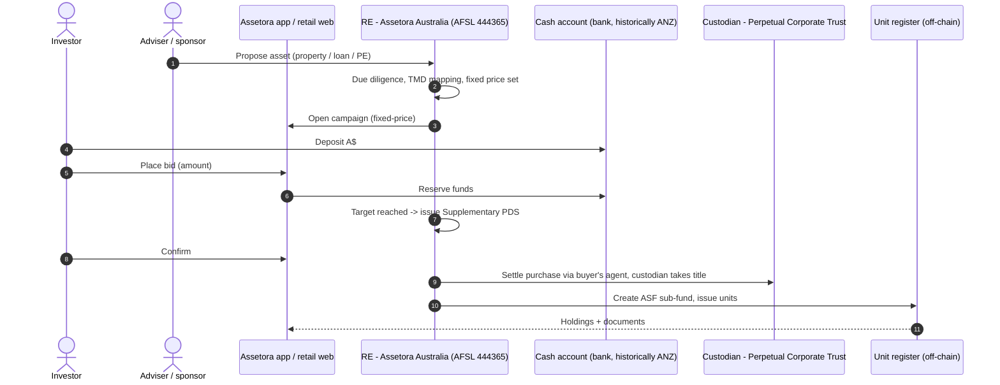
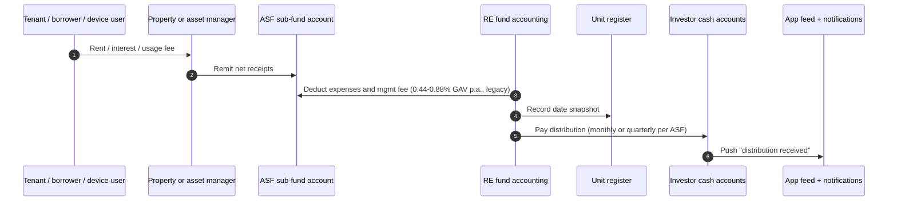
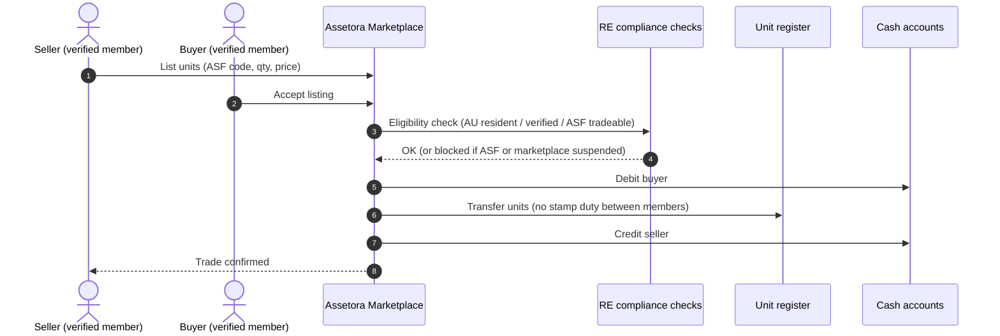
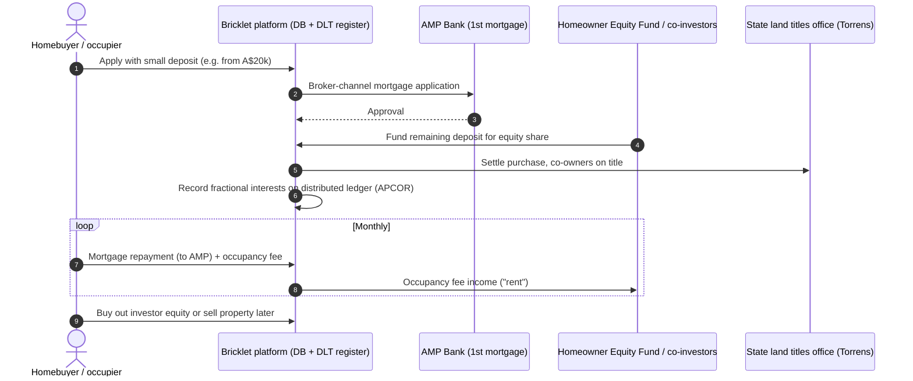
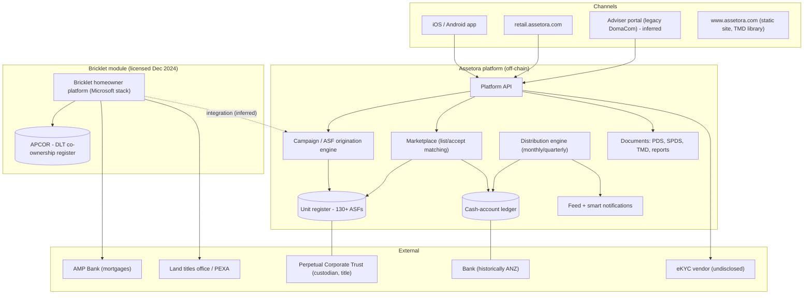

# Assetora (formerly DomaCom) + Bricklet — Australia (AU)

| Field | Value |
|---|---|
| Website | https://www.assetora.com (retail app: retail.assetora.com; legacy: domacom.com.au; Bricklet: portal.bricklet.com.au) |
| HQ / legal entity | Melbourne/Sydney [I]. Listed parent: **Assetora Limited** (ACN 604 384 885; ASX: AOH, formerly DomaCom Ltd, ASX: DCL). RE/operator: **Assetora Australia Limited** (ABN 33 153 951 770, **AFSL 444365**). Platform services: **Assetora Platform Services Pty Ltd**. Offshore: **Assetora Singapore Pte Ltd** [C#1][C#4]. Scheme: **Assetora Investment Fund, ARSN 167 020 626**, which is the same ARSN as the former DomaCom Fund [C#1][C#16]. |
| Founded | DomaCom was listed on the ASX on 7 Nov 2016 [C#14]. It was renamed Assetora around 1–2 Apr 2025 [C#13][C#14]. |
| Status as of Sep 2026 | **Operating but fragile.** The fund re-opened to new investors and new sub-fund launches on 14 Aug 2025 after being closed from Jul 2024 [C#16]. The listed parent's quotation is **suspended**: ASX suspended it on 21 Aug 2025 for unpaid listing fees [C#12], and Market Index still showed it as halted/suspended when fetched, with the last trade dated 30 Jun 2025 (so trading appears to have stopped before the fee suspension) [C#14]. In the quarter to 31 Dec 2025 it raised more than A$4m and "resolved all legacy administration and disputed claims"; the 29 Jan 2026 quarterly said it was working towards reinstatement but that there was "no certainty" of it [C#18]. No reinstatement announcement was found up to 23 Sep 2026 [I]. |
| Category | **Off-chain fractional (MIS sub-funds with an internal marketplace), plus a DLT-backed shared-equity module (Bricklet).** It positions itself as "tokenised real-world assets" [C#18], but we found **no on-chain issuance evidence for the Assetora fund itself** [C#1][C#3][C#5]. |
| Asset focus | Real Estate ASFs (residential, commercial, industrial, land, hospitality). Also Lending (private credit), Income and Private Equity ASFs, plus the Homeowner Equity (shared ownership) product via Bricklet [C#6][C#17]. |
| Scale | "**$200M+ FUM across 130+ active sub-funds**" and "**4,000+ verified members**" [C#2]. Real Estate ASFs hold $82M+, Lending $54M+, Income $46M+ and PE $32M+ [C#6]. The marketplace shows "$10M+ traded, 623+ trades, 112+ tradeable sub-funds" [C#3]. All figures are self-reported and undated. |
| Min. investment | Legacy DomaCom: A$1,000 (A$2,500 for "Family & Friends") [C#8][C#25]. Assetora gives a Real Estate ASF example of A$25,000, which is not stated to be a minimum [C#6]. |
| Why it is in the Top 5 | It is the second Australian retail fractional-property platform, and by self-reported FUM and sub-fund count it is larger and broader than BrickX. It runs a registered MIS with per-asset sub-funds, TMDs and a secondary marketplace. Its **exclusive licence of Bricklet's blockchain-backed co-ownership register**, plus a board-level tokenisation hire (ex-DigitalX CEO Lisa Wade), make it the local incumbent most likely to move on-chain. Its 2024 freeze is also a useful case study in failure modes. |
| Research confidence | **Medium.** The website and ASX-derived news are good. The PDS, fee table and vendor names were not retrievable, and the Bricklet chain is unnamed. |

---

## 1. Business model snapshot
- **Pooled fund with per-asset sub-funds:**
  - Investors buy units in an "ASF" (Assetora Sub-Fund). Each ASF is a sub-fund of the Assetora Investment Fund and "owns a single asset and trades on our marketplace" [C#1].
  - Assets are originated through **fixed-price campaigns**, historically crowdfunded through DomaCom-accredited financial advisers [C#8][C#9].
- **Revenue:**
  - Legacy DomaCom charged 0.44%–0.88% p.a. of gross asset value on sub-fund investments and 0.22% p.a. on cash [C#8][C#25].
  - Campaign and due-diligence costs are passed through to investors [C#9].
  - [I] Marketplace fees likely apply but are not disclosed [C#3].
- **Pivot:**
  - In Mar 2025 the chair said: "We are no longer just a property fund manager. We are an investment platform of the future." The pivot covers property, private credit, hotels, farms and ventures [C#11][C#14].
- **Bricklet (shared home ownership):**
  - A homebuyer brings a deposit as low as A$20k. Investors fund the rest of the deposit for an equity stake, and the occupier pays them an **occupancy fee** [C#20].
  - AMP Bank provided the first-ranking mortgages in the pilot [C#20][C#23].
  - Assetora (then DomaCom) took an **exclusive worldwide licence** on 20 Dec 2024. Terms: up to 5 years, 50% revenue share to Bricklet shareholders capped at A$100m, no upfront payment, and a path to full acquisition [C#17].
  - The licence supports the "Australian Homeowner Equity Fund" [C#17].

## 2. Legal & compliance structure

### 2.1 Issuing vehicle
- **Registered MIS: Assetora Investment Fund (ARSN 167 020 626)**, previously the "DomaCom Fund" [C#1][C#16].
- Each asset sits in a **segregated sub-fund**. Investors hold "units in the sub-fund" [C#8].
- [I] Legally the sub-funds are most likely **classes of units or separate sub-trusts within one registered scheme**, not separate registered schemes, because they share one ARSN.
- **Custodian: Perpetual Corporate Trust**, which "holds the title for each property" [C#1][C#8].
- **RE history:**
  - Originally DomaCom Australia Ltd [I: same ABN as today's Assetora Australia].
  - Later a third-party trustee/RE, described as **Melbourne Securities Corporation (AFSL 428289)** on the legacy page [C#8] and as "MSC Trustees" in press coverage [C#10].
  - **Assetora was appointed RE on 18 Jun 2025** [C#15], and the fund re-opened on 14 Aug 2025 [C#16].
  - [I] This returns the RE role in-house, so the group controls both the manager and the RE, which reduces third-party trustee friction.

### 2.2 What investors legally hold
- Units in a sub-fund of a registered MIS, giving a beneficial interest in one asset's income and capital [C#8].
- The unit register is off-chain. [I] Registry and administration are provided by in-house or outsourced service providers, since the privacy policy lists "custody, registry, administration" providers [C#4].
- **Bricklet (legacy design):**
  - Its founder said "owners of a BRICKLET is an owner of the property, so they're registered on the title". There is "no tokenisation as a digital asset that sits above it", only "a distributed ledger that sits underneath" a database [C#19].
  - That makes Bricklet a **direct tenants-in-common-style co-ownership model recorded on Torrens title**, with a DLT register ("Australian Property Co-Ownership Register", APCOR) [C#20][C#21].
  - This differs from Assetora's trust-unit model. [I] Under the licence, Bricklet interests are likely to be held through the Homeowner Equity sub-fund rather than by retail investors directly on title.

### 2.3 Licences, registrations and exemptions
| Item | Status | Evidence |
|---|---|---|
| AFSL (RE/operator) | Assetora Australia Ltd, AFSL 444365 | [C#1][C#7] |
| Registered MIS (retail PDS; no s708 reliance) | ARSN 167 020 626 | [C#1] |
| DDO / TMDs | A TMD library searchable by property address, ASF code or category | [C#2][C#1] |
| Supplementary PDS per campaign | Historically an SPDS was issued once bids reached target | [C#9] |
| Market licence for the marketplace | Not disclosed. [S] It probably relies on an ASIC exemption or relief for a scheme operator matching its own units, as with BrickX | [S] |
| AML/CTF | [I] The RE is a reporting entity when issuing MIS interests. The KYC vendor is not disclosed | [I] |
| AFCA / IDR | "Rigorous internal disputes resolution process". [I] AFCA membership, as required for retail AFSLs | [C#7][I] |
| ASX Listing Rules (parent) | Quoted but suspended (fee-related suspension from 21 Aug 2025; last trade shown 30 Jun 2025); reinstatement not confirmed as of Sep 2026 | [C#12][C#14][C#18] |

### 2.4 Regulators and licensed partners
- ASIC regulates the AFSL and the scheme. The ASX regulates the listed parent.
- **Perpetual Corporate Trust** is custodian [C#1].
- Historically a **buyer's agent** acquired assets [C#9], and deposits went to an **ANZ Bank** account [C#9].
- Bricklet partners: **AMP Bank** (mortgages) [C#20], **Lakeba** (venture builder) [C#19], and **DigitalX** (HxART token pool, 2023) [C#22].

### 2.5 KYC / AML
- Trading is limited to "verified Assetora members". Individuals, SMSFs, trusts and companies each need platform verification [C#3].
- The vendor is not disclosed [C#4].
- [S] Likely an Australian eIDV provider (GreenID, FrankieOne or Equifax) using the DVS.

### 2.6 Investor eligibility and geo-restrictions
- Marketplace participants must be Australian residents (individuals, SMSFs, trusts and companies) [C#3].
- Historically, investing needed a **DomaCom-accredited financial adviser** [C#9]. [I] The adviser gate has since been relaxed for self-directed retail through the app, given the retail sign-up flow at retail.assetora.com [C#1].
- A Singapore entity exists [C#4]. [S] It could support future non-AU distribution. Foreign investors buying into AU land sub-funds would trigger **FIRB** analysis.

### 2.7 Tax
- The site says there is "**No stamp duty on unit transfers between members**" [C#3]. [I] This holds because transfers of units in a widely held registered scheme are not dutiable unless a landholder "significant interest" threshold is crossed.
- [I] Annual tax statements; TFN collection and withholding; AMIT election status unknown [S].
- Private Equity ASFs offer ESOP secondary liquidity [C#6]. [I] That brings employee share scheme (ESS) tax considerations.

### 2.8 Disclosures, protections and actions
- **Jul 2024 freeze:**
  - The trustee (MSC Trustees) temporarily withdrew the PDS "to enhance the control environment". This followed problems with **NDIS-related sub-funds that could not secure tenants**, with up to 14 properties potentially to be sold.
  - The **secondary market was suspended** and new business halted [C#10].
  - Inflows and new sub-fund launches stayed suspended for about 13 months [C#16].
- Recapitalisation in Mar 2025: A$3.5m, plus A$3m of debt converted to equity [C#11].
- ASX suspension in Aug 2025 for unpaid fees [C#12].
- Q4 2025: more than A$4m raised and legacy claims resolved [C#18].
- No ASIC enforcement action found [I: absence of evidence]. The freeze was trustee-initiated [C#10].

## 3. User types
| Persona / role | Description | Evidence |
|---|---|---|
| Retail investor (individual) | Buys ASF units in campaigns or on the marketplace | [C#3][C#5] |
| SMSF / trust / company investor | All ASF types are marked SMSF-eligible | [C#6][C#3] |
| Accredited financial adviser | Legacy distribution channel; initiates campaigns | [C#8][C#9] |
| Asset sponsor / originator | Brings property, loans, PE and income assets to ASFs | [C#6] [I] |
| Homebuyer / occupier (Bricklet) | Contributes a small deposit, pays an occupancy fee, services the mortgage | [C#20] |
| Equity co-investor (Bricklet) | Funds the rest of the deposit, earns "rent" and capital share | [C#23] |
| Lender partner (AMP Bank) | First-ranking mortgage | [C#20] |
| RE / platform staff; Custodian (Perpetual); Auditor; Audit Committee | Operations and oversight | [C#7] |

## 4. Actions each user type can take
| Role | Action | Channel | On/off-chain |
|---|---|---|---|
| Investor | Sign up and verify (individual, SMSF, trust, company) | retail.assetora.com / app | Off-chain |
| Investor | Fund the cash account (historically ANZ) | Bank transfer | Off-chain |
| Investor | Bid in fixed-price campaigns | App / web | Off-chain |
| Investor | Browse and buy on the marketplace; list units for sale | App (iOS/Android) | Off-chain |
| Investor | Receive monthly/quarterly distributions; view NAV movements | App dashboard, feed, notifications | Off-chain |
| Investor | Vote on sub-fund termination (75% during the initial term, 50% after) | Meeting / vote | Off-chain |
| Investor | Read documents (PDS, TMD, property reports); message support | App | Off-chain |
| Adviser | Create a campaign; apply for a client | Adviser portal [I] | Off-chain |
| Occupier (Bricklet) | Apply, get pre-approved with AMP, pay occupancy fee | Bricklet portal | Off-chain + DLT register |
| RE | Open or close inflows; suspend marketplace; issue SPDS/TMD; pay distributions | Back office | Off-chain |

## 5. Core flows

### 5.1 Onboarding
1. Sign up at retail.assetora.com [C#1].
2. Complete entity verification. Historically an ANZ cash account was opened [C#3][C#9].
3. [I] Supply TFN and complete the FATCA/CRS declaration.

### 5.2 Primary purchase (campaign to sub-fund)
1. The sponsor or adviser proposes an asset. The platform arranges property reviews and inspections and shares summaries with bidders [C#9].
2. A fixed-price campaign opens. Investors bid amounts until the purchase price plus costs is covered [C#9].
3. Once the target is reached, a **Supplementary PDS** is issued and investors confirm [C#9].
4. A buyer's agent buys the property. Perpetual holds title, and the sub-fund is created and units issued [C#8][C#9].

### 5.3 Income distribution
1. Rent, interest or usage fees are collected into the sub-fund.
2. Expenses and the management fee (0.44–0.88% p.a. of GAV historically) are deducted [C#8].
3. Distributions are paid to investors' cash accounts. Frequency varies by ASF: Lending pays quarterly, Income pays monthly or quarterly [C#6].
4. The app shows a feed and a "smart notification" when rental receipts and distributions arrive [C#5].

### 5.4 Secondary trading (Assetora Marketplace)
- Four steps: "List your units", then "Buyer matches", then "Trade confirmed", then "Funds settled" to the Assetora cash account [C#3].
- Only 112+ of the 130+ sub-funds are eligible for trading [C#3].
- The marketplace was **suspended** during the 2024 freeze [C#10].
- [I] The mechanism looks like a listing board (seller-set ask, buyer accepts) rather than a continuous order book. That fits the relatively low 623+ trades across 112 sub-funds.

### 5.5 Exit
- Sub-fund termination needs a **75% vote** during the initial term and **50%** afterwards [C#8]. The typical term is 5 years [C#25].
- Other exits are the marketplace and asset sale at expiry [C#25].

### 5.6 Bricklet shared-equity flow (licensed module)

Evidence: [C#19][C#20][C#23][C#17]. The buyout step is [I].

### 5.7 Governance and property onboarding
- There is an Audit Committee, and Perpetual provides independent oversight [C#7].
- Onboarding runs through campaigns and SPDS [C#9].

## 6. Reverse-engineered architecture
**Narrative:** Assetora is a mobile-first fund-platform stack:
- iOS/Android app plus a retail web app at retail.assetora.com [C#1][C#5].
- Static marketing site (.html pages) [C#1].
- Off-chain unit register and cash ledger.
- Campaign engine and marketplace module.
- Custodian (Perpetual) and banking partner outside the platform.

The Bricklet platform is a separate stack: "Microsoft technology" plus a blockchain-based co-ownership register [C#20]. It is being integrated under licence. We found no public chain, contract or explorer footprint for either stack.

**On-chain vs off-chain:** Assetora core is off-chain [C#1][C#3][C#5]. Bricklet uses a permissioned or private DLT register; the chain is undisclosed [C#19]. The DigitalX HxART token pool linked to Bricklet was on-chain [C#22], but DigitalX later wound up its "Real World Asset Tokenisation Fund" because it "failed to attract investors" [C#24].

## 7. Tech stack
| Layer | Technology | Label | Source / reasoning |
|---|---|---|---|
| Blockchain | None for the Assetora fund. Bricklet: unnamed distributed ledger beneath a database | [C#19] | Founder interview |
| Token standard | N/A (units). HxART tokens (DigitalX, 2023), standard not disclosed | [C#22] | |
| Compliance / permissioning | App-level: verified members only, AU residents, tradeable-ASF whitelist | [C#3] | |
| Identity / KYC | Undisclosed vendor | [S] | |
| Wallet / custody | Custodial cash account plus Perpetual as asset custodian | [C#1][C#3] | |
| Fiat rails | Bank transfer to the cash account (historically an ANZ account) | [C#9] | |
| Stablecoin rails | None found | [I] | |
| Marketplace | Proprietary list/accept marketplace | [C#3] | |
| Frontend | Native iOS + Android apps (4.9★), biometric auth, "256-bit encryption"; static HTML marketing site | [C#5][C#1] | |
| Backend / cloud | Undisclosed. The privacy policy says there are no overseas recipients, so [I] onshore/AU-region hosting | [I from C#4] | |
| Bricklet stack | "Microsoft technology" + blockchain APCOR | [C#20] | |
| CRM / support | In-app messaging to the support team | [C#5] | Vendor unknown |
| Share registry (listed parent) | BoardRoom | [C#14] | |
| Content | Podcast "Assetora Unlocked" (Apple/Spotify) | [C#1] | |

## 8. Money flows and revenue model
| Flow | Detail | Label |
|---|---|---|
| Management fee | 0.44–0.88% p.a. of GAV on sub-funds; 0.22% p.a. on cash (legacy DomaCom) | [C#8][C#25] |
| Campaign / DD costs | Apportioned to investors | [C#9] |
| Marketplace fee | Not disclosed | [S] |
| Bricklet | Occupancy fees to equity investors. Assetora pays 50% revenue share to Bricklet shareholders (cap A$100m) | [C#20][C#17] |
| Distribution cadence | Monthly or quarterly depending on ASF; A$ to the cash account | [C#6] |
| Corporate funding | A$3.5m recap (Mar 2025) and >A$4m placements (Q4 2025) | [C#11][C#18] |

## 9. Secondary market and liquidity
- An internal marketplace covering 112+ sub-funds, with $10M+ volume over 623+ trades (average about A$16k per trade) [C#3][I: arithmetic].
- There is no market maker. The marketplace **can be and was suspended** at the trustee's request from Jul 2024 [C#10]. The 14 Aug 2025 re-opening announcement covers investor onboarding and new sub-fund launches [C#16]; that the marketplace resumed at the same time is inferred from the live marketplace page, not confirmed by an announcement [I].
- Exit backstops are the term-end vote and asset sale [C#8][C#25].

## 10. Risks, incidents, controversies
- **Concentration and tenant risk:** NDIS specialist housing sub-funds could not find tenants, leading to the freeze and possible sale of 14 properties [C#10].
- **Operator solvency:** recapitalisation, debt conversion, ASX suspension, and "legacy administration and disputed claims" [C#11][C#12][C#18].
- **Trustee/RE churn:** the third-party trustee was replaced by the in-house RE in Jun 2025 [C#15]. [I] This removes an independent check that the 2024 freeze showed had value.
- **Tokenisation claims vs evidence:** the "tokenised RWA" positioning [C#18] has no public on-chain footprint [I]. DigitalX's related RWA fund failed to attract investors [C#24].

## 11. Extrapolated platform-owner ADMIN PANEL (**EXTRAPOLATION**)

### 11.1 Modules / pages
| # | Module | Key widgets | Evidence driving it |
|---|---|---|---|
| 1 | **ASF / campaign manager** | Pipeline by category (Real Estate/Lending/Income/PE); fixed price; bids vs target; DD report uploads; SPDS generator; go/no-go | Campaign process [C#9]; 4 ASF types [C#6] |
| 2 | **TMD / DDO library** | TMD per ASF (searchable by address/code/category); review triggers; distribution-condition checks; significant-dealing log | TMD library [C#2] |
| 3 | **Member & entity verification** | Individual/SMSF/trust/company KYC queues; beneficial-owner capture; residency flag; adviser linkage | Verified members [C#3] |
| 4 | **Adviser management** | Accredited-adviser register; campaigns per adviser; client applications | Legacy channel [C#8][C#9] |
| 5 | **Cash account & payments** | Bank reconciliation; deposits/withdrawals; campaign escrow holds | Cash account [C#3][C#9] |
| 6 | **Marketplace operations** | Listings per ASF; tradeable-ASF whitelist; global suspend switch; per-ASF halt; trade blotter; price vs NAV | 112+ tradeable, suspension in 2024 [C#3][C#10] |
| 7 | **Distribution engine** | Per-ASF schedule (monthly/quarterly); income waterfall; payment batch; tax components | [C#6] |
| 8 | **Asset management** | Tenancy status and vacancy (NDIS alerting); rent roll; capex; valuations and NAV; lending-ASF loan book (LVR, arrears, maturities); PE cap-table/ESOP | NDIS vacancy incident [C#10]; ASF types [C#6] |
| 9 | **Governance & meetings** | Term-end votes (75%/50% thresholds); notices; results | [C#8] |
| 10 | **Bricklet homeowner module** | Occupier applications; AMP pre-approval status; equity co-investor allocation; occupancy-fee billing; APCOR ledger viewer; buyout calculator; revenue-share accrual (50%, cap A$100m) | [C#17][C#19][C#20] |
| 11 | **Regulatory controls** | "Stop new business" / inflow freeze switch; PDS status; breach register; IDR/AFCA complaints; custodian (Perpetual) reporting; audit-committee pack | Jul 2024 freeze [C#10]; governance [C#7] |
| 12 | **Investor comms & feed** | Feed posts (rental receipts, new ASFs); push-notification rules; in-app messaging inbox | App feed [C#5] |
| 13 | **Listed-company disclosures** | ASX announcement drafting; continuous-disclosure checklist | ASX-listed parent [C#14] |

### 11.2 Admin actions (maker-checker)
| Action | Maker | Checker |
|---|---|---|
| Launch campaign / issue SPDS | Investment manager | RE compliance + director |
| Freeze inflows or suspend the marketplace (global or per ASF) | Compliance | RE board (and custodian notified) |
| Approve distribution batch | Fund accountant | CFO |
| Override KYC referral | Ops | AML officer |
| Update NAV / valuation | Asset manager | CFO / valuer sign-off |
| Record vote result, trigger asset sale | Company secretary | Director |
| Bricklet equity buyout settlement | Bricklet ops | Finance + Legal |

### 11.3 RBAC roles
- **Super Admin**
- **RE Compliance / MLRO**
- **Investment Committee member**: approve campaigns.
- **Asset Manager**: property, lending or PE.
- **Fund Accountant / Finance**
- **Marketplace Ops**
- **Member Services**: messaging inbox.
- **Adviser (external, scoped)**
- **Bricklet Ops**
- **Custodian and auditor (read-only)**
- **Company Secretary**: ASX and meetings.

### 11.4 Alerts, automations and reports
- **Alerts:**
  - Vacancy above N days per sub-fund (lesson from NDIS).
  - Arrears in Lending ASFs.
  - Marketplace listings far below NAV.
  - Campaign under-subscribed at deadline.
  - Liquidity and fee-income shortfall at the operator level.
- **Automations:**
  - Distribution schedule per ASF.
  - Feed posts on receipts.
  - TMD review reminders.
- **Reports:**
  - FUM by ASF type (reconciles to the $82M/$54M/$46M/$32M splits).
  - Marketplace volume and trades.
  - Member growth ("+214 monthly" style KPI shown on the homepage [C#1]).
  - AUSTRAC compliance report.
  - DDO reporting.

## 12. Builder takeaways (for RealX)
- **Copy:**
  - A single registered MIS with per-asset sub-funds. One ARSN, many assets, fast launches under an SPDS, which is cheaper than registering a scheme per property.
  - A TMD library by asset.
  - SMSF-first positioning.
  - Mobile feed UX that surfaces rent receipts.
- **Avoid:**
  - Niche single-tenant asset classes (NDIS) without vacancy buffers.
  - A marketplace that can be frozen for 13 months.
  - Operator-level capital fragility.
  - Claiming "tokenisation" without on-chain evidence.
- **Differentiate:**
  - Bricklet shows a **shared-equity/occupier** use case that tokenisation could make liquid, with on-chain occupancy-fee streaming.
  - RealX could combine the Assetora umbrella-MIS structure with an on-chain register, and after 8 Apr 2027 a DAP or TCP authorisation under the Digital Assets Framework Act 2026 [C#27]. The TCP definition is one token per asset held on trust, so fractional sub-fund units are more likely to stay plain MIS interests, with custodial token holding as the DAP trigger; confirm with counsel [I].
  - Transparent, independent RE governance is a selling point after the Assetora churn.
- **Regulatory note:**
  - Wholesale thresholds are unchanged as of 2025–26 [C#28], so the retail path requires a registered MIS plus TMDs.
  - INFO 225 (rewritten Oct 2025; revised again 30 Apr 2026, when Example 9 "83Smith" treats a fractional real-estate token as a likely MIS interest) confirms that tokenised MIS interests are financial products [C#26]. The Oct 2025 no-action position expired 30 Jun 2026 [I].
  - AML tranche 2 (1 Jul 2026) now covers the real-estate agents on the acquisition side [C#29].

## 13. Sources (accessed 23 Sep 2026)
1. Assetora homepage and footer/legal links — https://www.assetora.com/
2. Assetora "Our Fund & TMDs" — https://www.assetora.com/our-fund.html
3. Assetora Marketplace — https://www.assetora.com/marketplace.html
4. Assetora Privacy Policy — https://www.assetora.com/privacy-policy.html
5. Assetora App page — https://www.assetora.com/app.html
6. Assetora ASF Types — https://www.assetora.com/asf-types.html
7. Assetora Governance — https://www.assetora.com/governance.html
8. DomaCom, "The DomaCom Fund" (legacy) — https://domacom.com.au/our-fund/the-domacom-fund/
9. DomaCom, "Investment Process" (legacy) — https://domacom.com.au/our-fund/investment-process/
10. Money Management, "DomaCom fund PDS temporarily withdrawn" (29 Jul 2024) — https://www.moneymanagement.com.au/domacom-fund-pds-temporarily-withdrawn/
11. Financial Newswire, "DomaCom chair reassures investors" (18 Mar 2025) — https://financialnewswire.com.au/funds-management/domacom-chair-reassures-investors/
12. TipRanks, "DomaCom faces suspension from ASX due to unpaid fees" (21 Aug 2025) — https://www.tipranks.com/news/company-announcements/domacom-ltd-faces-suspension-from-asx-due-to-unpaid-fees
13. MarketScreener, "DomaCom Limited will change its ticker to AOH" (1 Apr 2025) — https://www.marketscreener.com/quote/stock/ASSETORA-29752157/news/DomaCom-Limited-will-Change-its-Ticker-to-AOH-from-DCL-49490077/
14. Market Index, Assetora Ltd (ASX:AOH) — https://www.marketindex.com.au/asx/aoh
15. Market Index, "Assetora Appointed as New Responsible Entity of DomaCom Fund" (18 Jun 2025) — https://www.marketindex.com.au/asx/aoh/announcements/assetora-appointed-as-new-responsible-entity-of-domacom-fund-3A670124
16. Listcorp, "DomaCom Fund Re-Opens" (14 Aug 2025) — https://www.listcorp.com/asx/aoh/assetora-limited/news/domacom-fund-re-opens-3226720.html
17. Listcorp, "DomaCom Licenses Bricklet Platform with Path to Acquisition" (20 Dec 2024) — https://www.listcorp.com/asx/aoh/assetora-limited/news/domacom-licenses-bricklet-platform-with-path-to-acquisition-3134538.html
18. TipRanks, "Assetora secures $4m funding and resolves legacy issues" (Q4 CY2025) — https://www.tipranks.com/news/company-announcements/assetora-secures-4m-funding-and-resolves-legacy-issues-as-it-rebuilds-alternative-asset-platform
19. Lakeba, "BRICKLET aims to solve property crisis through blockchain" (16 Aug 2022) — https://lakeba.com/bricklet-aims-to-solve-property-crisis-through-blockchain/
20. iTnews, "AMP partners with Australian proptech Bricklet" (23 Nov 2022) — https://www.itnews.com.au/news/amp-partners-with-australian-proptech-bricklet-588139
21. UNSW BusinessThink, "How real estate asset tokenisation is helping solve housing problems" — https://www.businessthink.unsw.edu.au/articles/blockchain-assets-property-tokenisation-housing
22. DigitalX, "DigitalX launches Asset Reference Token fund" (30 Jun 2023) — https://www.digitalx.com/digitalx-asxdcc-launches-asset-reference-token-fund/
23. Stockhead, "DigitalX's Bricklet partnership to close the deposit gap" — https://stockhead.com.au/tech/digitalxs-bricklet-partnership-to-close-the-deposit-gap-for-homeowners/
24. TipRanks, "DigitalX to wind up underperforming funds" — https://www.tipranks.com/news/company-announcements/digitalx-limited-to-wind-up-underperforming-funds-to-refocus-on-profitable-ventures
25. Canstar, "BrickX v DomaCom" (updated 10 Apr 2025) — https://www.canstar.com.au/investor-hub/brickx-v-domacom/
26. ASIC 25-250MR (29 Oct 2025; INFO 225 page last modified 30 Apr 2026) — https://www.asic.gov.au/about-asic/news-centre/find-a-media-release/2025-releases/25-250mr-updated-asic-guidance-supports-digital-asset-innovation-and-boosts-investor-protection
27. CryptoSlate, Digital Assets Framework Act 2026 — https://cryptoslate.com/crypto-laws/australia-corporations-amendment-digital-assets-framework-act-2026/ (dates and definitions verified in QA against legislation.gov.au C2026A00038)
28. Gilbert + Tobin, "Wholesale client tests remain the same" (22 May 2025) — https://www.gtlaw.com.au/insights/wholesale-client-tests-remain-the-same
29. NameScan, "AUSTRAC Tranche 2 for Real Estate Agents" — https://namescan.io/insights/austrac-tranche-2-what-real-estate-agents-must-do-before-1-july-2026/
