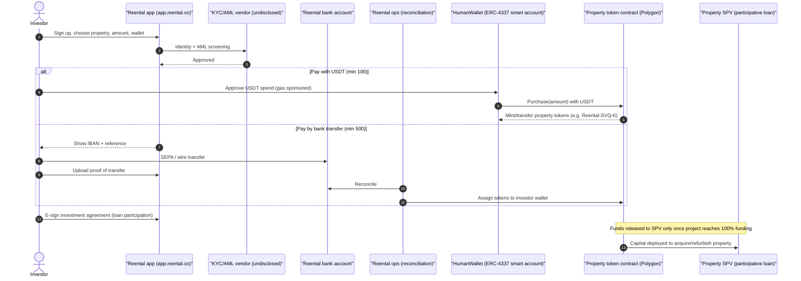
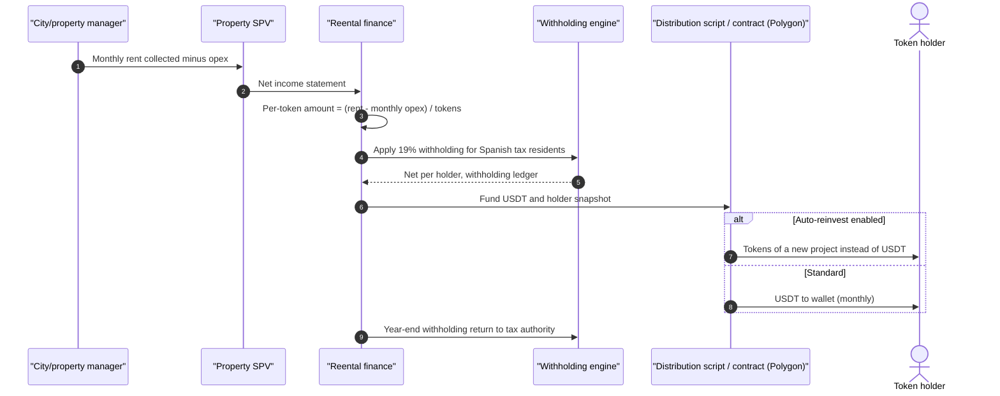
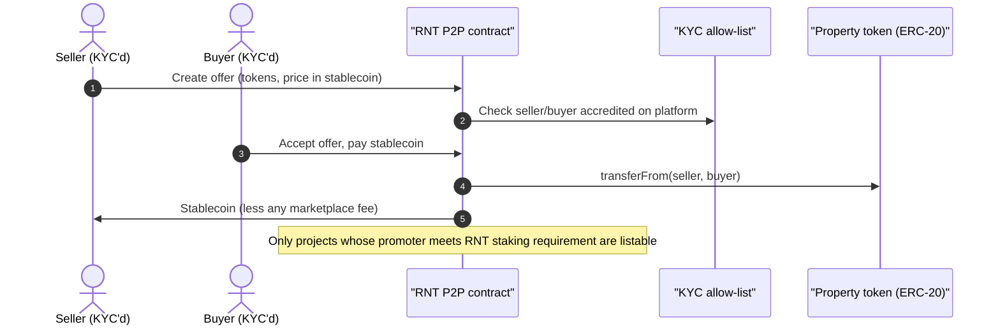
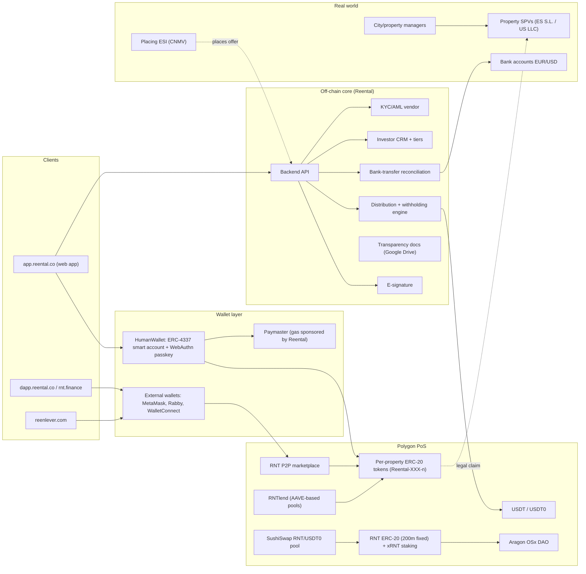

# Reental — EU (Spain)

| Field | Value |
|---|---|
| Website | https://www.reental.co (app: app.reental.co, dApp: dapp.reental.co, protocol: rnt.finance, lending: reenlever.com) |
| HQ / legal entity | Operating company **RentalToken, S.L.** (CIF B01988393, Calle Don Ramón de la Cruz 38, Madrid) [C#4]; data controller named in the privacy policy is **Reental Holding Company**, Dover, Delaware (USA) [C#9]; per-property SPVs [C#4] |
| Founded | Company incorporated 30 Sep 2020, registered 15 Dec 2020 [C#4] |
| Status as of Sep 2026 | **Active**, growing. Raised a ~€1.4m / US$1.7m strategic round on 31 Jul 2026 (Akka.app, Monte Bianco Naif, Arzalejos Real Estate, Rufinanz, Waycapital) [C#13] |
| Category | On-chain tokenised fractional (retail, direct-to-consumer) + own DeFi protocol (RNT Protocol) that it plans to open to third-party issuers → **hybrid platform/protocol** |
| Asset focus | Residential rental (long-stay + tourist), refurbish-and-sell, some mixed-use/retail; assets in Spain, USA, Argentina, Mexico, Dominican Republic, UAE [C#15] |
| Scale | Home page (Sep 2026): **43,774+ users, 108 countries, 123 tokenised projects, US$110m+ tokenised, 16.47% avg IRR on closed projects** [C#1]. Q1-2026: €85m cumulative invested, RNT mcap ~US$20m, Reenlever liquidity US$6.5m [C#12]. Whitepaper: 120 projects, US$120m+, 40,000+ investors, 250+ RNTlend borrowers [C#3]. Mar-2025: 21,877 investors, 82 properties, US$57.2m [C#14] → roughly doubled in 18 months |
| Min. investment | 1 token = €100/US$100 when paying in crypto (USDT on Polygon); €500/US$500 by bank transfer [C#6][C#15]; €300 via distribution partner Akka [C#13] |
| Why it is in the Top 5 | Largest retail-facing, genuinely on-chain real-estate token issuer headquartered in the EU by investor count and cumulative volume; full lifecycle on-chain (issuance, monthly stablecoin distributions, P2P secondary, collateralised lending); fast growth; distinctive UX (passkey smart wallet, gas sponsored) |
| Research confidence | **Medium-High** for business model, legal wrapper and product surface; **Medium-Low** for vendors (KYC, banking) and exact contract standard (Polygonscan blocked) |

---

## 1. Business model snapshot

- Reental sources properties (directly or through "city managers"/collaborators), places each into a vehicle, and **tokenises a participative loan (préstamo participativo) linked to the income of the property** for Spanish deals; for US deals it tokenises **shares/membership interests in property-owning LLCs** sold under private-placement exemptions [C#1][C#2][C#6].
- COO (quoted in press): "what we are tokenising are the **returns** that properties generate", not property ownership; a €120k property = 1,200 tokens × €100 [C#5].
- Revenue: ~**10% structuring fee at launch**, ~2% of rental income (rarely applied), **40% of the sale profit** (investors keep 60%; Reental min. €2,500) [C#4][C#5]. RNT Protocol adds fee income from swaps, farming withdrawals and RNTlend interest, used to **buy back RNT for xRNT stakers** [C#3].
- Growth loops: (i) RNT utility token + staking tiers ("SuperReentel") for early access and higher yields [C#6][C#14]; (ii) Reenlever/RNTlend lets investors borrow against property tokens instead of selling [C#1][C#3]; (iii) distribution partners (Akka, from Jul 2026) [C#13]; (iv) 2026 roadmap to open the stack ("RNT Studio" white-label) to third-party real-estate operators [C#3][C#16].

## 2. Legal & compliance structure

### 2.1 Issuing vehicle
- Spain: property held by an SPV (Spanish S.L.) [C#4]; SPV borrows from investors via a **participative loan** under Real Decreto-Ley 7/1996 art. 20 (variable interest linked to the borrower's activity, subordinated) [C#4]. Token = investor's share of that loan [C#2][C#10].
- USA: per-property **LLC**; tokens represent LLC equity (STO) [C#2].
- At least one **CNMV-registered non-convertible bond** issue ("Reental Tourist Homes", ~€322,500, Dec 2025) is reported by an independent review [C#6] — could not be verified in the CNMV register (search returned nothing) → treat as [C#6, single source].

### 2.2 What the token legally represents
- ES: a **credit claim** (share in a participative loan) giving variable interest = (rent collected − monthly operating costs) / number of tokens, plus a share of the appreciation on sale [C#4]. No property title, no land-registry entry for investors [C#5][I: participative lenders are unsecured/subordinated creditors of the SPV].
- US: LLC membership interest (equity) [C#2].
- Reental itself states the property tokens are **financial instruments subject to MiFID II / securities law**, while **RNT is a utility token in MiCA scope** [C#3].

### 2.3 Securities exemptions / licences used
- Spanish offers are structured as **STOs presented through an authorised investment firm (ESI)** under **art. 35.2 of the (former) Securities Market Law**, i.e. offers exempt from a full prospectus (below the Spanish threshold) but placed by a regulated intermediary [C#4][C#5]. Under the 2023 Securities Markets and Investment Services Law (Ley 6/2023) the equivalent obligation survived [I: Ley 6/2023 re-enacted the rule that prospectus-exempt public offers using advertising must go through an authorised entity; exact article not verified].
- Which ESI(s) act for Reental is **not disclosed** in pages reviewed [gap].
> **QA note (Fable):** the same review cited as [C#6] states that on 19 Dec 2025 the CNMV register recorded **Ursus-3 Capital** (a CNMV-registered *agencia de valores*) in connection with the "Reental Tourist Homes" DLT-bond issuance (€322,500). That makes Ursus-3 Capital a candidate placing ESI — single secondary source, not verified against the CNMV register.
- Reental itself is **not** a licensed ECSP, investment firm or CASP in any register I found [I: absence from its legal pages; no licence number displayed on site/T&Cs [C#10]].
- USA: Regulation D (accredited only — the FAQ requires US tax residents to be accredited) and Regulation S [C#2][C#6].
- **Why not MiCA (for property tokens):** MiCA art. 2(4) excludes crypto-assets that qualify as MiFID II financial instruments. A transferable, standardised claim to income from an SPV is a transferable security or at least a financial instrument → MiFID/Prospectus Regulation regime, not MiCA [I]. **RNT**, however, is a "crypto-asset other than ART/EMT" → MiCA Title II (white paper notification for offers/admission to trading) [I]; whether Reental notified an RNT white paper to an NCA was **not verified** [gap].
- **Why not ECSPR:** Reental does not hold an ECSP licence; ECSPR would cap offers at €5m per project owner per 12 months and impose KIIS and investor tests. The ESI/prospectus-exemption route avoids that cap but relies on the prospectus-exemption threshold: Spain's national **€8m** threshold (Ley 6/2023 art. 35) applied until the EU Listing Act's harmonised **€12m per issuer per 12 months** exemption (Member State option: €5m) took effect on **5 June 2026** (Reg. 2024/2809; see `01-regulatory/eu.md` §2). Whether Spain elected the €5m option is unverified [I].

### 2.4 Regulators & licensed partners
- CNMV (Spain) — indirect, via the placing ESI and any registered bond issue [C#5][C#6]. CNMV's stated concern in coverage is **quality of information and risk disclosure**, not prohibition [C#5].
- CNMV sandbox precedent: "Realfund" (Sunblock Urban Token) tested tokenised participative loans on Ethereum with USDC interest and whitelisting; concluded successfully (report Mar 2023) — not Reental, but the same legal pattern [C#17].
- Custodian: none — **self-custody** by design (HumanWallet or external wallet) [C#2][C#7].
- Distribution partner: Akka (from Jul 2026) [C#13].

### 2.5 KYC / AML / sanctions / travel rule
- KYC/AML identity validation is mandatory before purchase; Reental may re-verify at any time [C#1][C#10]. Of 2,300 new sign-ups in Apr 2026, 700 completed KYC [C#12] (≈30% conversion — useful benchmark).
- KYC **vendor not disclosed** (privacy policy names no processors) [C#9]; [S] an API vendor such as Sumsub/Veriff/Onfido given 108-country reach.
- P2P transfers only to users "accredited on our platform" → **wallet allow-listing tied to KYC** [C#2][I].
- Travel rule (EU TFR 2023/1113) formally binds CASPs; Reental receives USDT directly from self-hosted wallets and is not a CASP [I], so no TFR data exchange is evidenced. Source-of-funds checks on incoming USDT would be an AML best practice [S].

### 2.6 Investor eligibility & geo-restrictions
- Adults under Spanish law; entities with documentation [C#10]. Investors from 108 countries [C#1]. US tax residents must be accredited [C#2].
- No appropriateness test or KIIS-style knowledge test evidenced on the site [I: would be required under ECSPR, which Reental does not use; an ESI may run MiFID appropriateness for complex products].

### 2.7 Tax handling & reporting
- **19% Spanish withholding** automatically applied to returns of Spanish residents [C#1][C#2] → Reental (or the SPV) acts as withholding agent; implies annual informative returns to AEAT (e.g., Modelo 193 for capital-income withholding) [I].
- Distributions in USDT (a crypto-asset) create a second taxable event when converted for investors [I].
- **DAC8** (from 1 Jan 2026) targets Reporting CASPs and MiCA crypto-assets; property tokens that are financial instruments fall outside the DAC8 crypto definition, while RNT and USDT flows would be reportable only if a CASP intermediates them [I].

### 2.8 Disclosures, protections, regulatory actions
- Transparency Portal links to a **Google Drive** folder with contracts and financial reports [C#19] — low-tech but effective.
- Risk warning on site ("lack of liquidity or total or partial loss") [C#1]. Press flags: Reental decides sales unilaterally (investors consulted if below forecast); company insolvency risk affects token holders [C#5].
- No CNMV warning or enforcement found [negative finding, search R26].
- **USDT under MiCA:** EU CASPs had to stop offering non-MiCA-compliant stablecoins by Q1-2025 [I: ESMA statement Jan 2025]. Reental pays yields in USDT and its RNT pool trades against USDT0 [C#1][search R3] — an off-ramp friction for EU investors.

## 3. User types (personas & system roles)

| # | Persona / role | Notes |
|---|---|---|
| U1 | Retail investor ("Reentel") | Global, KYC'd; buys €100 tokens; 43.7k users [C#1] |
| U2 | US accredited investor | Only for US LLC deals [C#2] |
| U3 | "SuperReentel" / tiered member | Status via RNT staking; early access, higher yields, bank withdrawal of USDT profits for Spanish bank accounts [C#6][C#3] |
| U4 | RNT holder / xRNT staker / DAO voter | Governance on Aragon OSx; fee buy-backs [C#3] |
| U5 | RNTlend borrower | Borrows up to 75% LTV against property tokens [C#3] |
| U6 | RNTlend liquidity provider | Supplies stablecoin liquidity (US$6.5m) [C#12] |
| U7 | P2P seller / buyer | Secondary market, KYC-accredited only [C#2] |
| U8 | Promoter / developer (issuer) | Third-party developers listing on P2P must stake RNT [C#6]; RNT Studio white-label [C#16] |
| U9 | City manager / property manager | Operates assets locally [C#2] |
| U10 | Distribution partner | Akka [C#13] |
| U11 | Placing ESI (regulated firm) | Presents the offering documentation [C#5] |
| A* | Reental internal staff | Ops, compliance, finance, investor relations — see §11 |

## 4. Actions by user type

| Role | Action | Channel / UI | On-chain / off-chain |
|---|---|---|---|
| U1 | Register, KYC | app.reental.co | Off-chain |
| U1 | Create HumanWallet (passkey) or connect MetaMask/Rabby/WalletConnect; link multiple wallets | app | On-chain account creation (ERC-4337) [C#7][C#8] |
| U1 | Buy tokens with USDT | app | On-chain (USDT → sale contract → property token) [I] |
| U1 | Buy with bank transfer: pick property, currency, amount, receiving wallet; upload proof | app → "Settings › My Transfers" | Off-chain payment; on-chain token assignment after manual check [C#11] |
| U1 | Sign investment agreement | app (e-signature) | Off-chain [C#1] |
| U1 | Receive monthly USDT; opt into auto-reinvest | app / wallet | On-chain transfer [C#1] |
| U3 | Withdraw USDT profits to Spanish bank account | app | Off-ramp by Reental (off-chain) [C#6] |
| U4 | Stake RNT → xRNT, vote on DAO proposals | dapp / rnt.finance | On-chain (Aragon OSx) [C#3] |
| U5 | Deposit property tokens as collateral, borrow stablecoin, repay | reenlever.com / RNT Lend | On-chain (AAVE-fork) [C#3] |
| U7 | Post / take P2P offers | RNT P2P (external wallet only) | On-chain [C#7][C#16] |
| U8 | Tokenise asset via RNT Studio; stake RNT to list | studio.rnt.finance | Mixed [C#3][C#6] |

## 5. Core flows

### 5.1 Onboarding & KYC
1. Sign-up (email) → KYC/AML identity validation (document + liveness [S]) [C#1].
2. Wallet: create **HumanWallet** — ERC-4337 smart account secured by a WebAuthn **passkey** (Face ID/Touch ID), synced in iCloud Keychain/Google Password Manager; Reental "doesn't keep your keys"; gas is sponsored by Reental's paymaster [C#7][C#8]. Or connect external wallet (needs POL for gas) [C#6].
3. Wallet address(es) recorded against KYC profile → eligible for P2P [I from C#2].

### 5.2 Primary purchase

Evidence: payment paths and minimums [C#6][C#11]; 100% funding before operations [C#2]; token naming [C#18]; agreement signature [C#1]; escrow-until-fully-funded logic [I from C#2].

### 5.3 Income distribution

Evidence: formula and monthly USDT [C#1][C#4]; 19% withholding [C#1]; auto-reinvest [C#1]; year-end reporting [I].

### 5.4 Secondary trading (RNT P2P)

Evidence: P2P exists, 24/7, KYC-only [C#1][C#2]; promoter staking gate [C#6]; a P2P marketplace fee is **not evidenced** — the review [C#6] found no published fee schedule covering P2P, so the fee step is [S]; escrow/atomic swap mechanics [I].

### 5.5 Redemption / exit
- Short projects (flip/development, ~10 months) repay principal + return at completion; rental projects 1–4 years then sale [C#15][C#5].
- On sale: investors receive capital + **60%** of appreciation; Reental 40% (min €2,500) [C#4]. Tokens are then burned/redeemed [I].
- Liquidity alternatives: P2P sale or RNTlend borrowing [C#3].

### 5.6 Governance
- **Protocol-level** governance only: xRNT holders vote via Aragon OSx DAO; roadmap to "progressively transfer key decisions to the DAO" [C#3].
- **Asset-level** decisions (e.g., sale timing) remain with Reental; consultation promised only for below-forecast sales [C#5]. No on-chain property votes evidenced.

### 5.7 Issuer / property onboarding
- Today: in-house sourcing + promoters in 6 countries [C#15]. RNT Studio offers "smart contracts, KYC and DApps" white-label to third parties; listing on P2P requires promoter RNT staking [C#16][C#6]. 2026 goal: open to third-party operators, any income-producing asset [C#3].

## 6. Reverse-engineered architecture

Narrative: The legal/economic layer (SPV, loan contracts, bank accounts, property managers, ESI) is entirely off-chain. On-chain Polygon carries ownership records (per-property ERC-20), stablecoin payouts, and the DeFi layer (P2P, lending, staking, DAO). The web app bridges them: KYC → wallet allow-list, fiat reconciliation → token assignment, rent ledger → USDT distribution. Reental is not a custodian; the HumanWallet passkey smart account is the key UX innovation that removes seed phrases and gas.

## 7. Tech stack

| Layer | Technology | Label | Source / reasoning |
|---|---|---|---|
| Blockchain | Polygon PoS (RNT also bridged on BNB Chain) | [C#2][C#3] | FAQ, whitepaper; BscScan RNT listing (search R14) |
| Property token standard | ERC-20 per property (e.g., "Sevilla 6 / Reental-SVQ-6") | [I] | Polygonscan token tracker page exists [C#18]; RNT is ERC-20 [C#3]; P2P/AAVE-style lending requires ERC-20 compatibility. Compliance extension (whitelist) likely custom, not ERC-3643 (never mentioned) |
| Compliance / permissioning | Platform allow-list for P2P; probably not enforced at token-transfer level | [I] | "direct sale to a third party provided you are accredited on our platform" [C#2]; tokens usable in AAVE-style pools suggests freely transferable ERC-20 |
| Utility token | RNT ERC-20, 200m fixed, xRNT staking | [C#3] | Whitepaper |
| Governance | Aragon OSx | [C#3] | Whitepaper |
| Lending | AAVE-architecture fork (RNTlend/Reenlever), up to 75% LTV | [C#3] | Whitepaper |
| DEX liquidity | SushiSwap RNT/USDT0 pool on Polygon | [I] | Seen only as DEX Screener / GeckoTerminal search-result listings (search log R3); listing pages not fetched, so not a numbered source |
| Wallet | HumanWallet (ERC-4337, WebAuthn passkeys, ERC-7212, paymaster) + WalletConnect wallets | [C#7][C#8] | Help page + HumanWallet docs |
| Frontend libs | Viem + Wagmi (HumanWallet is a Wagmi drop-in connector) | [I] | [C#8] implies Reental app uses Wagmi/Viem |
| Stablecoin rails | USDT (payouts, purchases) | [C#1][C#6] | |
| Fiat rails | Manual bank transfer (EUR/USD) with proof upload; USDT-to-bank withdrawal for Spanish accounts (tier-gated) | [C#11][C#6] | No PSP named → likely plain bank accounts [I] |
| KYC vendor | Undisclosed | — | Privacy policy names none [C#9] |
| Oracles | None named; whitepaper flags oracle risk for RNTlend | [C#3] | Property token pricing for collateral is likely admin-set/NAV-based [I] |
| Docs / transparency | Google Drive folder | [C#19] | |
| Marketing site | Webflow (whitepaper hosted on `cdn.prod.website-files.com`, Webflow's asset CDN) | [I] | URL pattern of [C#3] |
| Backend / cloud | Unknown | [S] | Node/TypeScript given Viem/Wagmi stack |
| E-signature | Present, vendor unknown | [C#1] | "Sign investment agreement" |
| Community | Discord, Telegram, WhatsApp (phishing warnings) | [C#20] | |

## 8. Money flows & revenue model
- Investor → (USDT or EUR/USD bank) → Reental/SPV → property purchase/refurb [C#11].
- Fees: ~10% structuring at launch; ~2% of rents (rare); 40% of sale gain (min €2,500) [C#4][C#5]; P2P fee not evidenced (no public schedule found [C#6]) [S]; RNTlend interest spread, swap/farming fees → RNT buy-back to xRNT [C#3]. Investors see "zero commissions" because fees are embedded in project economics [C#15].
- Distributions: **monthly, in USDT**, after 19% withholding for Spanish residents; lump-sum at completion for short projects [C#1][C#6].
- Gas: absorbed by Reental for HumanWallet users [C#7] → an operating cost line.

## 9. Secondary market & liquidity mechanics
- In-house **RNT P2P** marketplace, 24/7, peer-to-peer offers among KYC-accredited users [C#1][C#2]. External wallet required (HumanWallet not yet supported on P2P) [C#7].
- Listing of a project's tokens on P2P depends on its **promoter meeting RNT staking requirements** — ties issuer liquidity to demand for the utility token [C#6].
- **Collateralised borrowing** (RNTlend) as a liquidity substitute: 250+ borrowers, US$6.5m liquidity [C#3][C#12].
- No MTF/DLT-MTF; no order-book depth data; no guaranteed buyer [C#6].

## 10. Risks, incidents, controversies, enforcement
- **Legal-wrapper risk:** investors are subordinated participative lenders to an SPV controlled by Reental; no in-rem security on the property [C#4][C#5][I].
> **QA note (Fable):** the Xataka piece [C#5] (28 May 2023, COO Carla Castelló) says the property "backs" the debt while warning that a Reental insolvency would still endanger token holders. No mortgage or other in-rem security in favour of token holders appears in the T&Cs [C#10]; participative loans are subordinated by law (RDL 7/1996 art. 20). Treat "no in-rem security" as [I] until a loan agreement from the transparency portal [C#19] is reviewed.
- **Operator concentration:** Reental decides sales; company insolvency risk [C#5].
- **Utility-token entanglement:** RNT staking gates (tiers, promoter listing), buy-backs and DAO governance mix a speculative crypto-asset with securities distribution — a MiCA/MiFID boundary and marketing-conduct risk [I].
- **Stablecoin risk:** payouts in USDT (non-MiCA-authorised) [I].
- **DeFi risk:** AAVE-fork liquidations with non-market property-token prices; oracle manipulation acknowledged in whitepaper [C#3].
- **Jurisdictional complexity:** Delaware holding, Spanish opco, assets in 6 countries, investors in 108 countries [C#1][C#9][C#15].
- No enforcement actions or CNMV warnings found [negative search R26].

## 11. Extrapolated platform-owner ADMIN PANEL (EXTRAPOLATION — not observed)

> Built from Reental's observed user features, its regulatory obligations (Spanish AML Law 10/2010, withholding, ESI-placement, GDPR) and generic white-label issuer dashboards. Everything below is **[I]** unless marked [S].

### 11.1 Modules / pages and key widgets

| # | Module | Key widgets | Evidence driving it |
|---|---|---|---|
| 1 | **Executive dashboard** | Users / KYC-completed funnel (e.g., 2,300 → 700 in Apr-26), capital raised MTD, active projects, USDT distributed MTD, P2P volume, RNTlend TVL & utilisation, paymaster POL balance | Monthly KPI posts [C#12]; gas sponsorship [C#7] |
| 2 | **Investor 360 / CRM** | Profile, KYC status & expiry, tax residency, tier (Reentel/SuperReentel), linked wallets (multiple), holdings per project, payout history, P2P activity, loans | Multi-wallet support [C#7]; tiers [C#6] |
| 3 | **KYC/AML review queue** | Vendor result, PEP/sanctions hits, manual review, request docs, risk score, US-accredited verification | Mandatory KYC [C#10]; US accredited rule [C#2] |
| 4 | **Wallet registry & allow-list** | Wallet ↔ user mapping, allow/deny for P2P, HumanWallet vs external flag, blocked addresses | P2P only for accredited users [C#2] |
| 5 | **Project / offering builder** | Property data, SPV, loan agreement template, token symbol (Reental-XXX-n), supply = price/€100, currency (EUR/USD), funding window, 100%-funded threshold, target IRR, docs upload, ESI sign-off | 100% funding rule [C#2]; token naming [C#18]; ESI placement [C#5] |
| 6 | **Token operations** | Deploy per-property contract, mint/assign, burn on redemption, pause, (re)issue after lost-key cases | Manual token assignment after bank transfer [C#11] |
| 7 | **Fiat reconciliation ("My Transfers" back-office)** | Queue of uploaded proofs, bank statement import, match/mismatch, approve → assign tokens | Bank-transfer flow [C#11] |
| 8 | **Distribution engine** | Monthly rent & opex per SPV input, per-token calc, holder snapshot, withholding by residency, auto-reinvest allocation, USDT batch preview, execution status, failed transfers | Monthly USDT, formula, 19% withholding, auto-reinvest [C#1][C#4] |
| 9 | **Tax & reporting** | Withholding ledger, annual investor certificates, AEAT informative-return export, non-resident treatment | Withholding [C#1] |
| 10 | **Exit / sale manager** | Sale proposal, forecast vs actual, investor consultation (if below forecast), 60/40 waterfall calc, redemption payout, token burn | Sale split and consultation [C#4][C#5] |
| 11 | **P2P marketplace surveillance** | Open offers, price vs NAV deviation, wash-trade flags, listing eligibility (promoter RNT stake), fee revenue | P2P + staking gate [C#6] |
| 12 | **RNTlend risk console** | Collateral prices per property token, LTV caps (≤75%), health factors, liquidation queue, reserve params, oracle/NAV update | Whitepaper [C#3] |
| 13 | **RNT / tiers & staking** | Tier rules, staking thresholds, buy-back schedule, xRNT rewards, DAO proposal tracker | Whitepaper [C#3]; tiers [C#6] |
| 14 | **Promoter / issuer portal admin (RNT Studio)** | Issuer KYB, asset due diligence checklist, staking status, white-label config | Studio [C#16] |
| 15 | **Paymaster / gas treasury** | POL balance, sponsored tx count, cost per user, auto top-up | Gas covered by Reental [C#7] |
| 16 | **Transparency & document centre** | Per-project contracts, financial reports, publish to investor data room | Transparency portal [C#19] |
| 17 | **Communications** | Monthly investor updates, KPI newsletter, phishing alerts | Security page [C#20]; monthly KPIs [C#12] |
| 18 | **Partner channel** | Akka and other distributors: referral codes, partner minimums (€300), commissions | Akka partnership [C#13] |
| 19 | **Audit log & GDPR** | Immutable admin action log; DSAR handling; off-chain PII only | GDPR/LOPDGDD reference [C#9] |

### 11.2 Admin actions (with 4-eyes where plausible)
- Approve/reject KYC; override risk score (**maker-checker**: analyst proposes, compliance officer approves).
- Approve bank-transfer match → assign tokens (**maker-checker** above threshold, e.g. >€10k).
- Publish a new project / open funding window (**4-eyes**: ops + legal/ESI sign-off).
- Execute monthly distribution batch (**maker-checker**: finance prepares, CFO approves; dry-run file first).
- Pause token / P2P market / RNTlend market (**emergency single-signer** then ratified).
- Adjust RNTlend collateral price / LTV parameters (**4-eyes** + timelock) [I].
- Replace a lost wallet's holdings (burn + re-mint) after identity re-verification (**4-eyes**) [I].
- Trigger sale and redemption waterfall (**4-eyes**, legal + finance).
- Block wallet / file suspicious-activity report to the FIU (SEPBLAC) (compliance only) [I].

### 11.3 Admin roles (RBAC)
| Role | Scope |
|---|---|
| Super-admin | Config, role assignment, emergency pause |
| Compliance officer / MLRO | KYC decisions, sanctions, SAR, wallet blocks, US-accreditation checks |
| KYC analyst | First-line review (maker) |
| Finance / treasury | Reconciliation, distributions (maker), withholding, paymaster funding |
| CFO / finance approver | Checker for payouts and token assignments |
| Asset manager | Project data, rent/opex inputs, sale proposals, city-manager liaison |
| Blockchain ops | Contract deployment, mint/burn, pauses, lending parameters (under timelock) |
| Investor support | Read-only 360, ticketing, resend certificates |
| Partner manager | Distributor onboarding and commissions |
| Read-only auditor | ESI / external auditor access to logs and reports |

### 11.4 Alerts / automations / reports
- Alerts: sanctions hit; KYC expiry; unmatched bank transfer >48h; project funding stalled below 100% near deadline; distribution batch failure; P2P price <80% of NAV; RNTlend health factor < threshold; paymaster POL low; unusual RNT movements by insiders.
- Automations: auto-reinvest allocation; monthly payout scheduling; phishing-alert broadcast; tier recalculation on staking change.
- Reports: monthly KPI pack (public posts) [C#12]; per-project investor report; annual withholding certificates; AEAT informative return; ESI placement report; DAO treasury report.

## 12. Builder takeaways (for RealX)
- **Copy:** passkey smart wallet with sponsored gas (removes crypto friction while staying non-custodial) [C#7][C#8]; dual payment path (stablecoin low minimum / bank higher minimum) [C#6]; monthly stablecoin payouts with auto-reinvest [C#1]; simple, public KPI cadence [C#12]; "tokenise the income claim, keep title in SPV" for speed [C#5].
- **Avoid:** mixing a speculative utility token into securities access (staking gates, tiered yields) — regulatory and reputational risk [I]; USDT as the EU payout asset post-MiCA (prefer EURC/EURCV or bank EUR) [I]; Google-Drive-grade disclosure; manual proof-upload reconciliation (use virtual IBANs via a PSP) [I].
- **Differentiate:** obtain an ECSP or MiFID route with passporting and a proper KIIS; use a permissioned token standard (ERC-3643) so allow-listing is enforced at transfer level, not just in the UI; give investors in-rem security or a trustee; automate reconciliation and tax certificates.

## 13. Sources (accessed 23 Sep 2026)
1. Reental home page — https://www.reental.co/en
2. Reental FAQs — https://www.reental.co/en/faqs
3. RNT Protocol Whitepaper (English) — https://cdn.prod.website-files.com/67a1f66b74f968c3486a6301/6a7c68e12daf1a37373c181b_RNT_Protocol_Whitepaper_(English).pdf
4. Inversor Inteligente, "Reental: Tokenización de inmuebles" — https://inversorinteligente.substack.com/p/reental-tokenizacion-de-inmuebles
5. Xataka, "Invertir en pisos con solo 100 euros: la tokenización…" — https://www.xataka.com/empresas-y-economia/invertir-pisos-solo-100-euros-tokenizacion-ultima-idea-para-entrar-arriesgado-mercado-inmobiliario
6. Tokenized Living, "Reental Review (2026)" — https://tokenizedliving.com/reental-review/
7. Reental Help, "How to create or connect your wallet (HumanWallet or external)" — https://www.reental.co/en/help/how-to-create-or-connect-your-wallet-on-reental-human-wallet-or-external
8. HumanWallet docs — https://docs.humanwallet.io/
9. Reental privacy policy — https://www.reental.co/en/politica-de-privacidad
10. Reental terms & conditions — https://www.reental.co/en/terminos-y-condiciones
11. Reental, "Cómo invertir por transferencia bancaria" — https://www.reental.co/en/invertir-por-transferencia
12. Finect, "Reental supera los 85 millones de euros…" (7 May 2026) — https://www.finect.com/usuario/sonIA/articulos/reental-supera-los-85-millones-de-euros-en-inversion-inmobiliaria-tokenizada-en-el-primer-trimestre
13. CriptoTendencia, "Reental cierra una ronda de 1,7 millones de dólares…" (31 Jul 2026) — https://criptotendencia.com/2026/07/31/reental-cierra-una-ronda-de-17-millones-de-dolares-y-suma-cinco-socios-estrategicos/
14. Decrypt, "$RNT: The Token for Real Estate Tokenization" (5 Mar 2025) — https://decrypt.co/308726/rnt-the-token-for-real-estate-tokenization
15. Finect, "Domoblock vs Reental: comparativa (2026)" — https://www.finect.com/usuario/davidcarmona/articulos/domoblock-vs-reental-comparativa-para-invertir-en-inmobiliario-2026
16. RNT Protocol site — https://www.rnt.finance/
17. CNMV, Conclusiones proyecto Realfund (sandbox) — https://cnmv.es/DocPortal/Fintech/ConclusionesRealfund.pdf
18. Polygonscan token tracker "Sevilla 6 (Reental-SVQ-6)" (search-result title only; page fetch blocked 403) — https://polygonscan.com/token/0xfc5e219788a953ad8e71c3b7cb9484695e7f028e
19. Reental Transparency Portal — https://www.reental.co/en/portal-de-transparencia
20. Reental Security page — https://www.reental.co/en/seguridad
