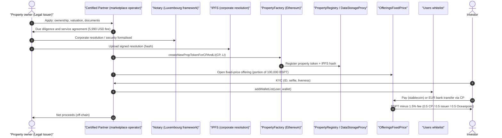
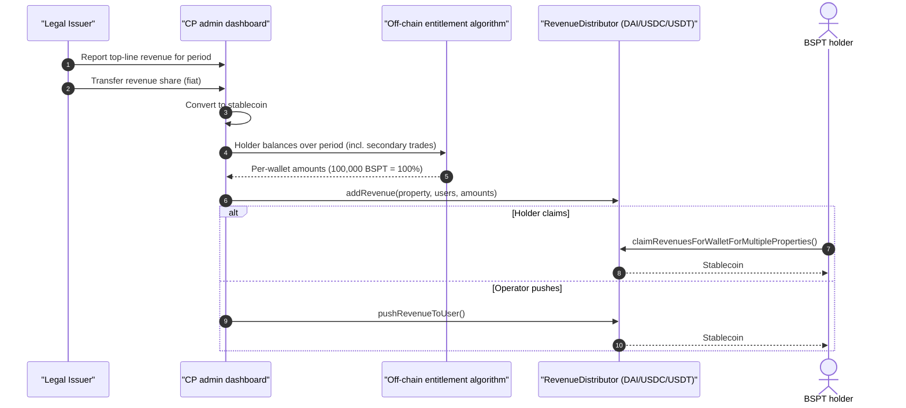
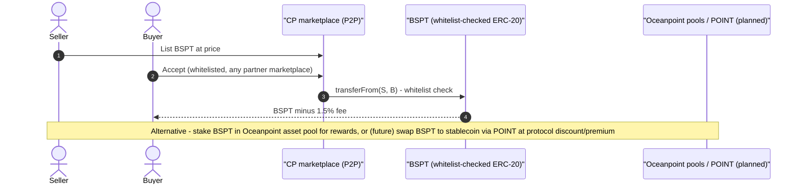

# Blocksquare (+ Oceanpoint) — EU (Slovenia)

| Field | Value |
|---|---|
| Website | https://blocksquare.io · docs: https://docs.blocksquare.io · marketplace/DeFi: https://oceanpoint.fi |
| HQ / legal entity | **Blocksquare d.o.o.**, Cankarjevo nabrežje 1, 1000 Ljubljana, Slovenia [C#12]; **Blocksquare SARL** (Luxembourg) set up for the notarised "Luxembourg framework" (Feb 2025) [C#4]. CEO Denis Petrovčič [C#25] |
| Founded | 2017 [C#2] |
| Status as of Sep 2026 | **Active**; new Oceanpoint relaunched 27 Aug 2026 [C#22]; active blog (posts through 10 Sep 2026) [C#28] |
| Category | **Tokenization infra (white-label protocol + marketplace SaaS)** with its own flagship marketplace/DeFi layer (Oceanpoint) → hybrid infra/marketplace |
| Asset focus | Income-producing residential & commercial; properties in Slovenia, Germany, Austria, Belgium, France, Croatia, UK, Dubai, Jamaica, USA, Panama, Australia, Turkey [C#1][C#11] |
| Scale | Oceanpoint (Sep 2026): **172 properties, US$216.9m tokenised value, 19 partner marketplaces, 27.9m BST staked, avg yield 6.88%** [C#1]. Mar 2026: US$205m, 17 live marketplaces in 30 countries [C#3]. Jul 2025: crossed US$200m [C#2]. Note: "tokenised value" = property valuations, not capital raised [I] |
| Min. investment | Set per operator; typically ~€100 (third-party reviews) — not confirmed in docs [S] |
| Why it is in the Top 5 | Largest EU-born real-estate tokenisation *protocol* by tokenised value and number of properties; the de-facto white-label rail for dozens of small operators; distinctive "economic rights, not securities" legal thesis tested in the European Blockchain Sandbox; rich public docs (contracts, fees, pricing) |
| Research confidence | **High** for contracts, fees, pricing, roles (docs + Etherscan); **Medium** for legal wrapper (Blocksquare's own framing); **Low** for per-operator KYC/payments vendors |

---

## 1. Business model snapshot

- **Three products** [C#25][C#7]: (1) **Tokenization Protocol** — Ethereum smart contracts + IPFS that fractionalise each property into exactly **100,000 BSPT** (1,000 tokens = 1% of the capital stack) [C#3][C#6]; (2) **White-label marketplace** licensed to "Certified Partners" (CPs) who run branded investment hubs "in weeks" [C#23]; (3) **Oceanpoint** — DeFi/liquidity layer (staking of BSPTs, pools, launchpad, planned POINT aggregator) and aggregated marketplace [C#1][C#20].
- **Revenue** [C#7][C#14][C#23]:
  - Software licence (one-time "lifetime" or instalments) — mandatory for operators.
  - **US$5,990 per tokenisation + primary offering**; **US$69/month per tokenised property** maintenance.
  - **1.5% in-kind fee on every BSPT transaction** (paid by buyer, in BSPT): 0.5% operator, 0.5% issuing company, 0.5% Oceanpoint [C#14].
  - Discounts on licence/tokenisation fees (up to 100%) for operators staking sBST; 400,000 BST staked ⇒ free marketplace operation [C#23][C#25]. Secondary fees are never discounted [C#23].
- **BST token** (ERC-20, 100m supply) is the ecosystem token: staking → sBST (governance on Snapshot, fee discounts); buy-back-and-burn funded from protocol revenue [C#16][C#25].
- Blocksquare itself does **not** onboard retail investors for third-party marketplaces — the CP is the data controller and KYC-performing "operator"; Blocksquare d.o.o. is processor [C#12][C#27].

## 2. Legal & compliance structure

### 2.1 Issuing vehicle
- **No SPV by design.** The property-owning company (the "issuer"/"Legal Issuer", LI) adopts a **corporate resolution** — a legally binding document stored on IPFS and hash-linked to the PropToken contract — that "creates a financial obligation by the issuer towards any and all holders" [C#6][C#26].
- The **Luxembourg framework** (Blocksquare SARL, Feb 2025): a notary formalises each tokenisation, "following the same legal structures banks use to secure real-estate-backed loans"; the owner obtains funds through a "structured borrowing process, using the property as collateral" and keeps legal title [C#4]. Pilots planned in Belgium and Austria [C#4].
- Smart-contract evidence: the factory can create a token "for CP and LI" (`createNewPropTokenForCPAndLI`) — i.e., each token binds a Certified Partner and a Legal Issuer [C#17].

### 2.2 What the token legally represents
- **Economic rights**: 100,000 BSPT = a predefined percentage of **royalties of all net revenues, including revenue from a sale of the property** [C#6]. Operating model emphasises payouts on **top-line revenues** (harder to manipulate than net profit) [C#3]. Not equity, not a land-register title [C#2][C#26].
- Title remains "on paper"; cash-flow rights move on-chain [C#30].

### 2.3 Securities exemptions / licences used
- **Blocksquare's position:** BSPTs are **crypto-assets under MiCA, not MiFID II financial instruments**; the non-SPV economic-rights design is "designed to avoid classification as a transferable security" [C#25][C#26]. Operator ToS template calls the token "a crypto asset" [C#27].
- **Regulatory dialogue:** selected for the **European Blockchain Sandbox (2025, 3rd cohort)**, discussing this framework with 18 EU/EEA regulators — explicitly "not a regulatory licence or blanket approval" [C#26].
- **Analyst view [I]:** A freely negotiable, standardised token that pays a share of revenues and sale proceeds of an issuer closely resembles a *transferable security* (MiFID II art. 4(1)(44)) under ESMA's 2024–25 guidelines on qualifying crypto-assets as financial instruments; classification is decided per Member State NCA. If an NCA treats BSPTs as securities, the Prospectus Regulation (since **5 June 2026** a harmonised **€12m per issuer/12-month** exemption threshold under the Listing Act, Reg. 2024/2809, with a Member State option of €5m — Slovenia's choice unverified; see `01-regulatory/eu.md` §2) and MiFID placement rules apply; if treated as MiCA "other crypto-assets", **each offer to the public needs a MiCA Title II white paper** (unless < €1m/12 months or < 150 persons per Member State), and **marketplace operators providing custody, exchange or placement of crypto-assets need CASP authorisation**. No CASP licence or white-paper notification by Blocksquare or its CPs was evidenced [C#26 says no licence claimed].
- Blocksquare's own docs say KYC is required because "regulators require operators of transactional marketplaces to verify your identity due to AML regulation" [C#8].

### 2.4 Regulators & licensed partners
- No licensed custodian, trustee or MTF identified. Notaries + land registries are the legal anchor [C#4]. Account-abstraction wallet infra by **Alchemy Insights, Inc.** (processor under SCCs) [C#13].
- Responsibility split: CP = data controller, marketplace operator, KYC performer; Blocksquare d.o.o. = processor/software licensor [C#12][C#27].

### 2.5 KYC / AML / sanctions / travel rule
- End users: ID document + selfie + optional liveness, once, before first purchase [C#8]; vendor unnamed [C#12].
- Operators must screen UN, EU, UK Treasury and OFAC sanctions lists; target KYC turnaround 24h; discretion to refuse; may **freeze transactions pending document review** [C#27].
- **On-chain whitelist:** BSPT `transfer` checks the Users/WhitelistingContract; wallets are added with `addWalletList` by accounts holding "end user admin rights" (Roles contract) [C#6][C#18]. Issuers may add eligibility criteria (e.g., "US residents only") [C#6].
- **One account, many marketplaces:** a single user account can transact across CP marketplaces [C#11] → shared KYC/allow-list across tenants [I].
- Travel rule: if BSPTs are MiCA crypto-assets, operators acting as CASPs would fall under TFR 2023/1113 (originator/beneficiary data, self-hosted-wallet checks > €1,000) [I]; nothing in docs addresses it [gap].

### 2.6 Investor eligibility & geo-restrictions
- Per-issuer/per-operator; template leaves restricted jurisdictions blank for each CP to fill [C#27]. Oceanpoint lists marketplaces in BE, AT, DE, FR, SI, HR, AU, US, TR [C#11].

### 2.7 Tax handling & reporting
- Not addressed in docs [gap]. Distributions are paid gross in stablecoin [C#10] → holders self-report [I]. If BSPTs are MiCA crypto-assets, **DAC8** reporting (from 2026) applies to any CP that qualifies as a Reporting CASP [I].

### 2.8 Disclosures, protections, regulatory actions
- Legal documents are hash-linked on IPFS ("transparent, immutable trail connecting digital asset to physical deed") [C#25].
- ToS template: crypto-assets "lack regulatory protection" [C#27].
- "Honest liquidity framing": tokenisation = "liquidity readiness", not guaranteed exit [C#3].
- No enforcement actions found [negative finding; search budget limited].
- GDPR: PII stays off-chain with the CP; Alchemy receives only IP + anonymised aliases [C#13]; data may be transferred outside the EEA under safeguards [C#12].

## 3. User types (personas & system roles)

| # | Persona / role | Evidence |
|---|---|---|
| U1 | Retail/professional investor (end user) on a CP marketplace | [C#8][C#9] |
| U2 | Oceanpoint user: stakes BSPTs, buys BST, provides liquidity | [C#1][C#21] |
| U3 | BST holder / sBST staker / DAO voter (Snapshot) | [C#16] |
| U4 | **Certified Partner (CP) / marketplace operator** — licensee running a branded marketplace | [C#9][C#23] |
| U5 | **Legal Issuer (LI) / property owner** — adopts the corporate resolution, receives funds, pays revenues | [C#6][C#17] |
| U6 | CP "end user admin" — on-chain role that whitelists wallets | [C#18] |
| U7 | Notary / land-registry counterpart (Luxembourg framework) | [C#4] |
| U8 | Blocksquare protocol admin (owner of Factory/Roles/Registry) | [C#17][C#18] |
| U9 | Ambassadors / affiliates (referral programme) | [C#25][C#28] |
| U10 | Integrators (Landhive CH, Haven1, Vera Capital, Flipstone PT) | [C#28][C#25] |

## 4. Actions by user type

| Role | Action | Channel | On/off-chain |
|---|---|---|---|
| U1 | KYC once; open account; link up to 10 wallets | CP marketplace | Off-chain KYC; wallets whitelisted on-chain [C#9][C#18] |
| U1 | Buy BSPT in primary offering (fixed price) | CP marketplace | On-chain via `OfferingsFixedPrice` [C#5] |
| U1 | Pay by EUR bank transfer or stablecoin | CP marketplace | Off-chain EUR / on-chain stablecoin [C#9][I] |
| U1 | Claim revenues (single / multiple properties) or receive push | Marketplace / Oceanpoint | On-chain (`claimRevenuesForWallet…`) [C#10] |
| U1 | Trade P2P with other whitelisted users across marketplaces | Marketplace | On-chain, 1.5% fee [C#9][C#14] |
| U2 | Stake BSPT in Oceanpoint asset pools; buy BST via Uniswap | oceanpoint.fi | On-chain [C#21] |
| U3 | Stake BST → sBST; vote on protocol parameters (BSPT eligibility, stablecoins, lending rules) | Snapshot | Off-chain signature vote [C#16][C#20] |
| U4 | Buy licence; stake sBST for discounts; configure marketplace; KYC users; list properties; distribute revenue (`addRevenue`); push payouts | Admin dashboard | Mixed [C#10][C#23] |
| U5 | Apply for tokenisation; sign corporate resolution; notarise; receive proceeds; pay royalties | CP / Oceanpoint owner application | Off-chain + IPFS hash [C#6][C#22] |
| U8 | Create tokens for CP/LI; set registry/data proxy; manage roles; freeze tokens | Protocol admin | On-chain (Ownable) [C#17] |

## 5. Core flows

### 5.1 Onboarding & KYC
1. User registers on a CP marketplace (or Oceanpoint) → smart wallet created via **Alchemy account abstraction** (email-based, anonymised alias) or external wallet [C#13][I].
2. KYC: ID + selfie (+liveness) → CP approves within ~24h [C#8][C#27].
3. CP "end user admin" calls `addWalletList` to map wallet(s) ↔ user ID in the on-chain Users registry [C#18].

### 5.2 Issuer onboarding & primary purchase

Evidence: [C#4][C#6][C#7][C#14][C#17][C#18][C#22]; EUR path [C#9]; payout of proceeds to owner off-chain [I].

### 5.3 Income distribution

Cadence monthly/quarterly/annual per property; only system admins or authorised CPs may `addRevenue` [C#10].

### 5.4 Secondary trading / liquidity

[C#9][C#14][C#20][C#21].

### 5.5 Redemption / exit / property sale
- Sale proceeds are part of "net revenues" → distributed through the same RevenueDistributor [C#6]. Operating model lists "sales, buybacks, refinancings" as enforceable terms [C#3]. Burn of BSPT on buy-back is possible (`burn`) [C#17][I].

### 5.6 Governance
- **Protocol:** sBST holders vote on Snapshot (stablecoin integrations, BSPT eligibility, discount/premium settings, treasury ratios, lending rules) [C#16][C#20].
- **Asset-level:** no BSPT holder voting evidenced; issuer controls the asset [I].

### 5.7 Issuer / property listing onboarding
- Via CP (tokenisation service) or directly through the new Oceanpoint owner application (property, ownership and valuation info + documents) [C#22].

## 6. Reverse-engineered architecture

```mermaid
flowchart TB
    subgraph Tenants["White-label marketplaces (multi-tenant SaaS)"]
        CP1["Oceanpoint marketplace"]
        CP2["Tokeniza (ES) app.blocksquare.io/tokeniza"]
        CP3["Bricktrade (UK) app.blocksquare.io/bricktrade"]
        CP4["HomeInvest (US), ARCre (PA), RWA Technology"]
    end
    subgraph Platform["Blocksquare platform services"]
        Admin["CP admin dashboard (assets + investors)"]
        KYC["KYC automation (vendor unnamed)"]
        Fiat["EUR bank-account integration"]
        AA["Alchemy account-abstraction smart wallets"]
        Algo["Revenue entitlement engine (off-chain)"]
        Idx["blocksquare-indexer (TypeScript, Envio)"]
        IPFS["IPFS legal docs"]
    end
    subgraph Eth["Ethereum mainnet (Solidity 0.6.12, Ownable + Roles)"]
        Roles["BlocksquarePermissionRoles"]
        CPs["CertifiedPartners"]
        Users["EndUsers / Users whitelist"]
        Fac["PropertyFactory"]
        Reg["PropertyRegistry + DataStorageProxy"]
        BSPT["BSPT per property (ERC-20, 100k, 18 dec, freezeToken)"]
        Offer["OfferingsFixedPrice"]
        RD["RevenueDistributor (DAI)"]
        Fees["FeesWallet"]
        BST["BST ERC-20 + Governance pool (sBST)"]
        Pools["Oceanpoint Asset Pools"]
        Uni["Uniswap v2 BST/ETH"]
        POINT["POINT aggregator (planned)"]
    end
    Snap["Snapshot voting"]
    Legal["Notary + land registry (LU framework) / Legal Issuer"]
    CP1 --> Admin
    CP2 --> Admin
    CP3 --> Admin
    CP4 --> Admin
    Admin --> KYC
    Admin --> Fiat
    Admin --> Algo
    CP1 --> AA
    AA --> BSPT
    Admin --> Users
    Users --> Roles
    CPs --> Roles
    Fac --> BSPT
    Fac --> Reg
    Offer --> BSPT
    BSPT --> Fees
    Algo --> RD
    BSPT --> Pools
    BST --> Snap
    Uni --> BST
    POINT -.-> Pools
    Reg --> IPFS
    IPFS -.-> Legal
    Idx --> Reg
```

Narrative: A **single shared protocol** on Ethereum with a role hierarchy (Blocksquare owner → Certified Partners → end-user admins → whitelisted wallets) serves many tenant marketplaces. URL paths such as `app.blocksquare.io/tokeniza/` and `/bricktrade/` show a **multi-tenant hosted front-end** [C#11][I]. Legal anchoring is off-chain (resolution + notary) with an IPFS hash on-chain. Revenue calculation is off-chain; settlement/claims on-chain. Oceanpoint adds a DeFi layer (pools, staking, planned POINT AMM-like aggregator) governed by sBST via Snapshot. Indexing moved from The Graph subgraphs (archived) to an Envio-based indexer [C#19].

## 7. Tech stack

| Layer | Technology | Label | Source |
|---|---|---|---|
| Blockchain | Ethereum mainnet (documented addresses); "multi-chain, sub-cent fees" claimed in recent posts | [C#5][C#29] / [I] L2 deployment likely | Docs; blog summary [C#28] |
| Token standard | ERC-20-compatible PropToken ("BlocksquarePropertyToken", 18 decimals) with whitelist-checked transfer, `mint`, `burn`, `freezeToken`; custom, **not ERC-3643** | [C#17][C#6] | Etherscan verified source |
| Compliance contracts | PermissionRoles, CertifiedPartners, EndUsers (Users: `addWalletList`/`removeWalletList`) | [C#5][C#18] | |
| Registry/data | PropertyRegistry, DataStorageProxy; IPFS legal documents | [C#5][C#6] | |
| Offerings | OfferingsFixedPrice | [C#5] | |
| Distributions | RevenueDistributorDAI; stablecoins DAI/USDC/USDT | [C#5][C#10] | |
| Smart-contract language | Solidity 0.6.12, optimiser 200 runs, OpenZeppelin-style Ownable | [C#17][C#18] | |
| Governance token | BST ERC-20 (100m), Governance pool → sBST; Snapshot | [C#16] | |
| DeFi | Oceanpoint pools; Uniswap v2 BST/ETH; POINT/OceanpointProtocol/Router (planned) | [C#5][C#20] | |
| Wallets | Alchemy account abstraction (smart wallets) + external wallets; up to 10 wallets per account | [C#13][C#9] | |
| Indexing | The Graph subgraphs (archived) → blocksquare-indexer (TypeScript, Envio) | [C#19] | GitHub |
| Analytics | DefiLlama adapter | [C#19] | |
| KYC | Automated, ID+selfie+liveness; vendor unnamed | [C#8] | |
| Fiat | EUR bank-account integration (per operator) | [C#9] | |
| Frontend | Multi-tenant web app (app.blocksquare.io/<tenant>) | [C#11] / [I] | |
| Backend / cloud | Unknown; TypeScript ecosystem | [S] | |

## 8. Money flows & revenue model
- Investor money → CP (EUR bank) or on-chain stablecoin → Legal Issuer [C#9][I].
- Blocksquare: licence + US$5,990/tokenisation + US$69/month/property [C#7]; 0.5% of every BSPT transaction to Oceanpoint [C#14]; BST demand from operators staking for discounts [C#23].
- CP: 0.5% of transactions + own fees; Issuer: 0.5% of transactions [C#14].
- Distributions: stablecoin (DAI/USDC/USDT), monthly/quarterly/annual, claim or push [C#10]. Oceanpoint: avg 6.88% yield, €86.2k distributed via staking rewards [C#1].

## 9. Secondary market & liquidity mechanics
- P2P trading inside each marketplace and **across marketplaces with one account** [C#9][C#11].
- Oceanpoint: stake BSPT in asset pools (rewards "backed by real rental income") [C#1]; planned **POINT** aggregator to swap BSPT ↔ stablecoin "without waiting for buyers", with BSPT-collateralised borrowing and a "POINT Zero" auto-stabiliser [C#20].
- 1.5% transaction fee on all transfers [C#14].

## 10. Risks, incidents, controversies, enforcement
- **Classification risk:** Blocksquare's MiCA-not-MiFID thesis is untested by any NCA decision; sandbox dialogue ≠ approval [C#26][I]. If reclassified, CPs could be conducting unauthorised securities placement.
- **Operator risk:** investor protection depends on each CP's licensing, KYC and cash handling; Blocksquare is a processor [C#12].
- **Issuer credit risk:** economic rights are a contractual obligation of the property owner, not a lien held by a trustee (Luxembourg notarised framework improves this where used) [C#4][C#6][I].
- **Upgradeability/admin keys:** contracts are non-proxy, Ownable; owner can re-point registry/data proxy [C#17] — centralised control [I].
- **DeFi/token risk:** BST price-dependent discounts; POINT depeg risk acknowledged via POINT Zero [C#20].
- No incidents found [negative finding].

## 11. Extrapolated platform-owner ADMIN PANEL (EXTRAPOLATION — not observed)

Blocksquare needs **two admin layers**: (A) the **Protocol console** (Blocksquare staff, super-tenant) and (B) the **CP admin dashboard** (each operator tenant), which Blocksquare confirms exists ("admin dashboard for asset and investor oversight") [C#23]. All items [I] unless labelled.

### 11.1 Modules / pages

**A. Protocol console (Blocksquare)**
| Module | Widgets | Evidence |
|---|---|---|
| Tenant (CP) registry | CP list, licence type/instalments, sBST staked → discount tier, invoices due, status | Pricing, licensing, invoicing [C#7][C#15][C#23] |
| Certified-partner on-chain roles | Add/remove CP in `CertifiedPartners`; grant "end user admin" | Roles contracts [C#5][C#18] |
| Property token factory | Create token for CP + LI; IPFS resolution hash; registry entries | `createNewPropTokenForCPAndLI` [C#17] |
| Fee & treasury | FeesWallet inflows (0.5% splits), BST buy-back & burn, Oceanpoint share | [C#14][C#25] |
| Billing | Proforma, monthly invoices by 10th business day, $69/property counts | [C#15][C#7] |
| Oceanpoint parameters | Pool configs, BSPT eligibility, discount/premium, stablecoin list (subject to Snapshot outcome) | [C#20] |
| Indexer / analytics | Tokenised value, properties, marketplaces, BST staked (feeds public stats) | [C#1][C#19] |
| Emergency | `freezeToken` per property; owner functions | [C#17] |

**B. CP admin dashboard (tenant)**
| Module | Widgets | Evidence |
|---|---|---|
| Overview | Investors, KYC funnel, capital raised, AUM, pending distributions, fee income | Feature list [C#9] |
| Investor management | KYC status, sanctions hits, wallets (≤10), holdings, freeze/unfreeze, decline without reason | [C#9][C#27] |
| Whitelist manager | Batch `addWalletList`/`removeWalletList`; per-issuer eligibility rules (e.g., country) | [C#6][C#18] |
| Property / issuer onboarding | Owner application intake, DD checklist, valuation, corporate-resolution upload to IPFS, notary status | [C#6][C#22] |
| Offering manager | Fixed-price offering setup, allocation, % of 100k tokens offered, close/extend | `OfferingsFixedPrice` [C#5] |
| Payments & reconciliation | EUR bank transfers, stablecoin receipts, allocation to offerings | EUR integration [C#9] |
| Revenue distribution | Import issuer revenue report, conversion to stablecoin, entitlement calc (holding-period-weighted), `addRevenue` batch, push vs claim, unclaimed tracker | [C#10] |
| Secondary market | Orders, trades, fee accrual (0.5%), suspicious trades | [C#14] |
| Documents & disclosures | Per-property docs, IPFS hashes, investor reports | [C#25] |
| Legal templates | ToS, privacy, cookie, AA disclaimer with tenant placeholders | [C#27][C#12][C#13] |
| Branding & settings | Domain/path, logo, restricted jurisdictions, fee schedule | ToS blanks [C#27] |

### 11.2 Admin actions (maker-checker where plausible)
- Approve KYC → whitelist wallet (**maker-checker**: analyst approves identity; compliance releases whitelist tx).
- Create property token & open offering (**4-eyes**: CP ops + Blocksquare protocol admin since factory needs CP authorisation).
- Execute `addRevenue` batch (**maker-checker**: finance prepares entitlements CSV; second approver signs tx; ideally via multisig [S]).
- Freeze property token / suspend account pending review (**single approver, post-hoc review**) [C#27][C#17].
- Change fee schedule / restricted countries (**4-eyes**).
- Protocol: add/remove CP, change registry/data proxy (**Blocksquare owner multisig** [S]).

### 11.3 Admin roles (RBAC)
| Role | Layer | Permissions |
|---|---|---|
| Protocol owner | A | Ownable functions, roles contract, factory config |
| Protocol ops | A | CP onboarding, billing, token creation support |
| Treasury / DAO liaison | A | Fees wallet, buy-backs, Snapshot execution |
| CP admin (tenant owner) | B | Everything within tenant, role assignment |
| End-user admin (on-chain role) | B | Whitelist add/remove [C#18] |
| KYC/compliance officer | B | KYC decisions, sanctions, freezes, SARs |
| Asset manager | B | Property onboarding, issuer liaison, revenue inputs |
| Finance | B | Payments, distributions, invoices |
| Support | B | Read-only investor views, ticketing |

### 11.4 Alerts / automations / reports
- Alerts: sanctions/PEP hit; KYC backlog > 24h SLA [C#27]; unclaimed revenue > N days; issuer late revenue report; token frozen; unusual P2P price vs last offering; licence instalment overdue; BST stake below discount tier.
- Automations: whitelist tx on KYC approval; monthly invoice generation; distribution push on schedule; indexer-driven public stats.
- Reports: per-property payout history (`getAverageMonthlyPayout`, `totalPayout`) [C#10]; investor statements; CP revenue share; protocol KPIs (properties, tokenised value, marketplaces).

## 12. Builder takeaways (for RealX)
- **Copy:** fixed 100,000-token-per-property convention (makes % ownership trivial) [C#6]; on-chain registry of partners/users/properties with legal-doc hash on IPFS [C#5][C#6]; claim-or-push distribution contract with holding-period-aware off-chain calc [C#10]; transparent public pricing (US$5,990 + US$69/month) [C#7]; one KYC → many marketplaces [C#11]; account abstraction for email-first users [C#13].
- **Avoid:** relying on a "not-a-security" thesis for revenue-share tokens in the EU without an NCA ruling [I]; in-kind 1.5% fee taken in the property token (fragments cap tables, complicates tax) [C#14][I]; Ethereum-mainnet-only core with 2021-era Solidity 0.6 and Ownable admin keys [C#17].
- **Differentiate:** licensed wrapper (ECSP or MiFID) with passporting; ERC-3643-style identity registry and forced-transfer/recovery functions; trustee/security agent holding the notarised security for token holders; built-in tax reporting.

## 13. Sources (accessed 23 Sep 2026)
1. Oceanpoint home — https://oceanpoint.fi/
2. Blocksquare blog, "RWA Tokenization Explodes in 2025: Blocksquare surpasses $200M…" — https://blog.blocksquare.io/article/rwa-tokenization-explodes-in-2025-blocksquare-surpasses-200-m-in-tokenized-real-estate-fueled-by-marketplace-operators/
3. Blocksquare blog, "Tokenized Real Estate Beyond the Headlines: The Shift to a 2026 Operating Model" (11 Mar 2026) — https://blog.blocksquare.io/article/tokenized-real-estate-beyond-the-headlines-the-shift-to-a-2026-operating-model/
4. crypto.news, "Blocksquare launches EU-compliant real estate tokenization in Luxembourg" (5 Feb 2025) — https://crypto.news/blocksquare-launches-eu-compliant-real-estate-tokenization-in-luxembourg/
5. Blocksquare Docs, Smart contracts — https://docs.blocksquare.io/infrastructure/tokenization-protocol/smart-contracts.md
6. Blocksquare Docs, BSPT tokens — https://docs.blocksquare.io/infrastructure/tokenization-protocol/bspt-tokens.md
7. Blocksquare Docs, Pricing — https://docs.blocksquare.io/certified-partners/pricing.md
8. Blocksquare Docs, FAQ End users: KYC — https://docs.blocksquare.io/faq/end-users/kyc.md
9. Blocksquare Docs, Operating your marketplace — https://docs.blocksquare.io/certified-partners/operating-your-marketplace.md
10. Blocksquare Docs, Revenue Distribution Contract — https://docs.blocksquare.io/for-developers/revenue-distribution-contract.md
11. Blocksquare Docs, Active partners — https://docs.blocksquare.io/certified-partners/partner-network/active-partners.md
12. Blocksquare Docs, Privacy Policy (operator template) — https://docs.blocksquare.io/certified-partners/legal/privacy-policy.md
13. Blocksquare Docs, Account Abstraction Disclaimer — https://docs.blocksquare.io/certified-partners/legal/account-abstraction-disclaimer.md
14. Blocksquare Docs, Transaction fees — https://docs.blocksquare.io/infrastructure/tokenization-protocol/transaction-fees.md
15. Blocksquare Docs, Payments & invoicing — https://docs.blocksquare.io/faq/marketplace-operators/payments-and-invoicing.md
16. Blocksquare Docs, BST Token overview — https://docs.blocksquare.io/bst-token/token-overview.md
17. Etherscan, PropertyFactory 0x1ae91a263a690bf2129cf0b3acac92bbb67e6685 (page + verified code) — https://etherscan.io/address/0x1ae91a263a690bf2129cf0b3acac92bbb67e6685
18. Etherscan, Users (EndUsers) 0x13344d0cb96b17df81c4171ce47e14ff6c1975f7 (verified code) — https://etherscan.io/address/0x13344d0cb96b17df81c4171ce47e14ff6c1975f7#code
19. GitHub, Blocksquare organisation — https://github.com/blocksquare
20. Blocksquare blog, "Blocksquare Publishes Oceanpoint Whitepaper" (24 Apr 2025) — https://blog.blocksquare.io/article/blocksquare-publishes-oceanpoint-whitepaper-the-future-of-tokenized-real-estate-liquidity-is-here/
21. Blocksquare blog, "Oceanpoint v2" (3 Jul 2025) — https://blog.blocksquare.io/article/oceanpoint-v2-ushering-in-a-new-era-for-de-fi-and-real-estate-tokenization/
22. Blocksquare blog, "The New Oceanpoint Is Live" (27 Aug 2026) — https://blog.blocksquare.io/article/new-oceanpoint-tokenized-real-estate-platform/
23. Blocksquare blog, "Understanding Blocksquare's Marketplace Whitelabel Licensing Options" (12 Mar 2026) — https://blog.blocksquare.io/article/understanding-blocksquare-s-marketplace-whitelabel-licensing-options/
24. Blocksquare blog, "Tokenized Real Estate Isn't About Tokens…legal anchoring" (15 Apr 2026) — https://blog.blocksquare.io/article/tokenized-real-estate-isn-t-about-tokens-why-infrastructure-and-legal-anchoring-will-define-the-winners/
25. Blocksquare blog, interview with CEO Denis Petrovčič (6 Apr 2026) — https://blog.blocksquare.io/article/bridging-brick-and-mortar-to-the-blockchain-an-exclusive-interview-with-denis-petrovcic-ceo-of-blocksquare/
26. Blocksquare blog, "Germany's MiCA Momentum Is a Signal…" (26 Aug 2026) — https://blog.blocksquare.io/article/germany-s-mica-momentum-is-a-signal-for-europe-s-tokenized-real-estate-market/
27. Blocksquare Docs, Terms of Service (operator template) — https://docs.blocksquare.io/certified-partners/legal/terms-of-service.md
28. Blocksquare blog index (Sep 2026) — https://blog.blocksquare.io/
29. Blocksquare home (meta) — https://blocksquare.io/
30. Tokenizer.Estate, "Real Estate Tokenization Highlights – Nov–Dec 2025" — https://blog.tokenizer.estate/real-estate-tokenization-highlights-november-2025-2
