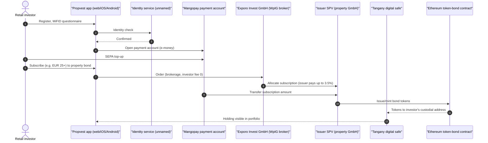
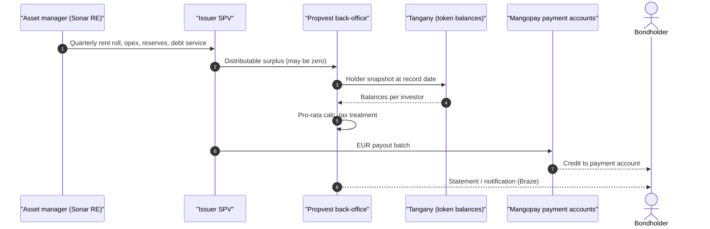
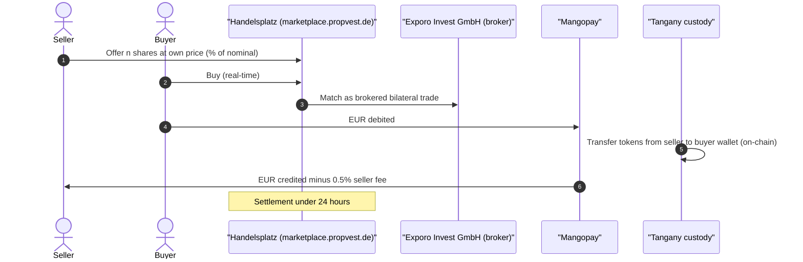
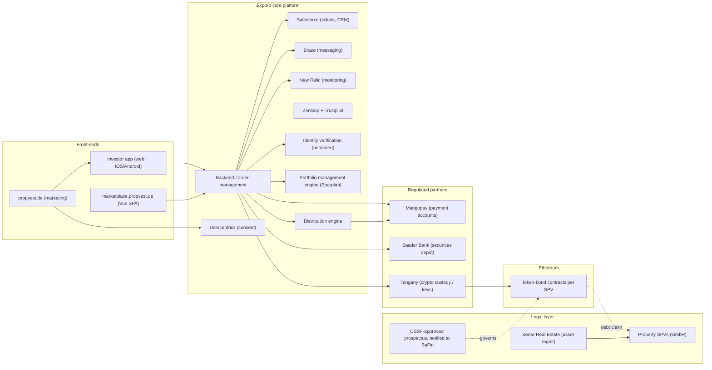

# Propvest (Exporo group) — EU (Germany)

| Field | Value |
|---|---|
| Website | https://www.propvest.de · marketplace: https://marketplace.propvest.de · sister brand https://exporo.de |
| HQ / legal entity | **Exporo Invest GmbH**, Am Sandtorkai 70, 20457 Hamburg; HRB 146341 (AG Hamburg); MD Patrick Hartmann; part of Exporo Group under **Exporo AG** [C#12]. Some pages/secondary sources refer to the operator as "EPH Investment GmbH" [C#1][C#3] — treated as the same licensed entity/brand family [I] |
| Founded | Exporo 2014 [C#16]; token-based bonds since Jul 2019 [C#4]; Propvest brand for the tokenised "Bestand" (hold) product since Jul 2021 [C#5] |
| Status as of Sep 2026 | **Active but under performance pressure**: live site/apps, but secondary prices ~75–80% of par and investor dissatisfaction/KapMUG steps reported in 2025 [C#8][C#17] |
| Category | **On-chain tokenised fractional (regulated securities)** — token-based bearer bonds on Ethereum issued by per-property SPVs under a prospectus; distributed by a BaFin-licensed investment firm; own OTC-style secondary market |
| Asset focus | Existing German residential/commercial rental properties ("Bestandsimmobilien"); asset management by Sonar Real Estate [C#5] |
| Scale | ~€250m managed real estate (65 portfolio projects at 2021 launch; 68 standing properties, €256m AUM in another profile) [C#5][C#16]; **16,000+ investors**; **€20.39m distributions paid 2018–2023** [C#1][C#17]. Exporo's blockchain summary: 14 properties digitised, >€45m, 15,000 blockchain transactions (earlier figure) [C#15]. Handelsplatz: ~2,100 trades in 3 months at avg 100.2% of par (early 2022) [C#18] |
| Min. investment | From **€25** (Sparplan / Select) [C#1][C#9]; historically €500–1,000 per Bestand project [C#16] |
| Why it is in the Top 5 | The EU's most mature **fully-regulated** real-estate security-token programme for retail: first EU prospectus-approved token-based real-estate bond (2019), MiFID-licensed distributor, bank/licensed-custodian stack (Baader Bank, Tangany, Mangopay), and a live secondary market used by thousands of retail investors. Also the clearest cautionary tale on performance and liquidity |
| Research confidence | **Medium-High** on licences, partners, fees, vendors (primary disclosures); **Medium-Low** on current token mechanics (no whitepaper; Etherscan lookup timed out; marketplace is a JS app) |

---

## 1. Business model snapshot

- Exporo originates/buys income-producing German properties; each property sits in an **SPV (e.g., "Exporo Hannover GmbH")** financed ~50% by bank debt and ~50% by retail money raised via **subordinated token-based bonds** [C#6][C#8].
- Investors receive **quarterly distributions** from rental surplus and **80% of the appreciation on sale**; Propvest retains **20%** [C#6][C#17].
- **Revenue** [C#2][C#17]: issuer-paid placement commission (up to **3.5%**, investor brokerage free); **0.5% p.a.** portfolio-management fee on the Immobilien-Sparplan; **0.5% seller fee** on the Handelsplatz; **20% performance share** on exit; asset/property management fees inside SPVs [I].
- **Products**: *Select* (pick individual properties), *Immobilien-Sparplan* (automated savings plan from €25/month across three risk tiers, discretionary portfolio management), *Handelsplatz* (secondary) [C#1][C#17].

## 2. Legal & compliance structure

### 2.1 Issuing vehicle
- One German GmbH SPV per property issues the bonds [C#8]. Bond-level security: described as subordinated notes linked to a land charge (*nachrangige … Grundschuld*) [C#8]; other analysis: "subordinated debentures (nachrangige Schuldverschreibungen) issued via individual property companies" [C#17]. Precise collateral/trustee arrangement not verified in primary documents [gap].

### 2.2 What the token legally represents
- A **token-based bond** (debt security, bearer-bond-like) whose register/ownership record is an **Ethereum token**, issued "within a regulated securities prospectus" [C#4][C#5][C#15]. Economic rights: interest linked to rental surplus + share in sale proceeds (profit-participating subordinated debt) [C#17][I].
- Whether the legacy tokens were converted into **eWpG crypto securities (Kryptowertpapiere)** with a registered crypto-securities registrar was **not confirmed** [gap]. The 2019 structure predates the eWpG (in force June 2021); it used a prospectus-approved bond with the token as the transfer/record layer [C#4][I].

### 2.3 Securities exemptions / licences
- **Prospectus**: first EU approval of a prospectus for a token-based real-estate bond — approved by **Luxembourg's CSSF** (summer 2019) and **notified (passported) to BaFin** [C#15][C#4]. → Prospectus Regulation route rather than the German small-offer exemptions (VIB/WIB) [I].
- **Distributor licences (Exporo Invest GmbH)** [C#2][C#12]:
  - **Securities institution (WpIG §15)**: investment brokerage, investment advice, contract brokerage, **financial portfolio management**; not permitted to hold client money or securities.
  - **ECSP licence** (EU Regulation 2020/1503) for loan brokerage and securities placement (used for Exporo's crowdfunding projects).
  - **GewO §34c** loan brokerage.
- **Why not MiCA:** the tokens are MiFID II transferable securities (bonds) → excluded from MiCA by art. 2(4) [I]. **Why not ECSPR for Bestand**: ECSPR's €5m cap per project owner/12 months is too small for €10m+ property financings; the prospectus route has no cap [I].
- **Investor classification**: all clients treated as **retail** with full WpHG protections [C#2] → appropriateness/suitability (portfolio management) obligations apply [I].

### 2.4 Regulators & licensed partners
| Role | Partner | Evidence |
|---|---|---|
| Supervisor | BaFin + Deutsche Bundesbank (Hamburg) | [C#12] |
| Prospectus approval | CSSF Luxembourg (2019) | [C#15] |
| Securities depot / custody | **Baader Bank AG** | [C#2] |
| Digital safe (token wallet custody) | **Tangany GmbH** (BaFin crypto-custody licence; "MiCA-licensed") | [C#2][C#10] |
| Payment account (e-money / payment institution) | **Mangopay S.A.** | [C#2][C#7] |
| Early wallet provider (2019) | Upvest | [C#4] |
| Asset manager | Sonar Real Estate | [C#5] |
| Investor compensation | EdW (90% up to €20,000) | [C#2] |
| ADR | Schlichtungsstelle der Deutschen Bundesbank | [C#2] |

### 2.5 KYC / AML / sanctions / travel rule
- Identity verification by an unnamed service that "confirms or denies identity" [C#7]; German market practice = **VideoIdent/eID via IDnow or WebID** [S].
- AML obligations under GwG as a licensed institution [I]. Travel rule: token transfers happen inside the licensed custodian (Tangany) between KYC'd clients; no self-hosted withdrawals evidenced → TFR exposure minimal [I].

### 2.6 Investor eligibility & geo-restrictions
- Retail clients; apps in Germany/Austria stores [C#1]; German-language onboarding. Passport of prospectus to other Member States not evidenced beyond DE [I].

### 2.7 Tax handling & reporting
- Distributions are capital income; as depots sit with **Baader Bank**, German withholding tax (Abgeltungsteuer + Soli (+ church tax)) and annual tax certificates are handled bank-side [I: standard for German custodian-held securities].
- DAC8 not applicable (financial instruments, not MiCA crypto-assets); regular DAC2/CRS via the depot bank [I].

### 2.8 Disclosures, protections, regulatory actions
- Prospectus + MiFID customer-information pack (costs, conflicts, complaints) [C#2].
- **Performance controversy**: an investor-advocacy blog reports that all 38 Bestand projects missed promised returns (e.g., promised 6.4% vs −11.1% actual), missed quarterly payouts, alleged overvaluation (Jun 2025) [C#8]; a model-case proceeding under the German Capital Markets Model Case Act (**KapMUG**) is described as admitted and opened in a *reader comment* on that article, not in the article body [C#8, comment]; a reviewer reports holdings trading at 75–80% of nominal and personal yield falling to ~1.3% p.a. [C#17]. These are critical secondary sources; no BaFin enforcement action found [negative, limited search].

## 3. User types (personas & system roles)

| # | Persona / role | Evidence |
|---|---|---|
| U1 | Retail investor — Select (self-directed) | [C#9] |
| U2 | Retail investor — Sparplan (discretionary portfolio management mandate) | [C#1][C#2] |
| U3 | Secondary seller / buyer on Handelsplatz | [C#3] |
| U4 | Issuer SPV (per property) | [C#8] |
| U5 | Asset manager (Sonar Real Estate) / property manager | [C#5] |
| U6 | Depot bank (Baader), crypto custodian (Tangany), payment institution (Mangopay) | [C#2] |
| U7 | Exporo compliance, investor relations, portfolio managers | [C#2] |
| U8 | Legacy Exporo crowdfunding investors migrated to Propvest (12,500 at launch) | [C#5] |

## 4. Actions by user type

| Role | Action | Channel | On/off-chain |
|---|---|---|---|
| U1/U2 | Register, identify, MiFID questionnaire | Web / iOS / Android | Off-chain [C#1][I] |
| U1/U2 | Open Mangopay payment account + Baader depot + Tangany digital safe | Onboarding | Off-chain accounts; wallet address at Tangany [C#2] |
| U1 | Subscribe to a property bond (from €25) via SEPA to payment account | App | Off-chain cash; token booked on Ethereum to custodial wallet [C#4][C#15][I] |
| U2 | Set monthly savings amount and risk tier | App | Off-chain mandate; tokens allocated [C#17] |
| U1/U2 | Receive quarterly distributions in EUR | Payment account | Off-chain [C#6] |
| U3 | List tokens for sale at own price; buy listed tokens | Handelsplatz (Vue SPA) | Off-chain order; on-chain transfer between custodial wallets; settlement < 24h [C#3][C#15][I] |
| U4/U5 | Report rents/costs; propose sale | Back-office | Off-chain |

## 5. Core flows

### 5.1 Onboarding & KYC
1. Registration → identification (vendor unnamed) → MiFID appropriateness/suitability questionnaire [C#7][I].
2. Accounts opened with three regulated partners: Mangopay payment account (cash), Baader Bank depot, Tangany digital safe (keys) [C#2].

### 5.2 Primary purchase

Evidence: partners and fees [C#2]; token issuance on Ethereum under prospectus [C#4][C#15]; min €25 [C#1]; mint-to-custodial-address mechanics [I].

### 5.3 Income distribution

Quarterly cadence and frequent zero payouts [C#6][C#8][C#17]; notifications via Braze [C#7]; snapshot-from-custodian logic [I].

### 5.4 Secondary trading (Handelsplatz)

Seller-set prices, real-time, < 24h, 0.5% seller fee [C#2][C#3][C#18]; bilateral brokered (not MTF) nature [I: Exporo Invest holds brokerage licences, not an MTF licence].

### 5.5 Redemption / exit / property sale
- On sale, investors receive principal + **80%** of appreciation (20% to Propvest) [C#17]; tokens redeemed/burned [I]. Subordination means bank lenders are paid first [C#17].

### 5.6 Governance
- Bondholder rights under the German Bond Act (SchVG) majority resolutions are typical for such bonds [S]; investors organising a joint representative (KapMUG/quorum) [C#8]. No on-chain voting.

### 5.7 Issuer / property onboarding
- In-house origination by Exporo; SPV per asset; valuation by external appraiser (criticised) [C#8]; prospectus supplement/final terms per issuance [I].

## 6. Reverse-engineered architecture

Narrative: Propvest is the **"bank-grade" pattern**: every regulated function is outsourced to a licensed partner (cash → Mangopay, depot → Baader, keys → Tangany) and the investment firm itself holds neither money nor assets [C#2]. Ethereum is a **back-office ledger** — investors never touch wallets, gas or crypto; settlement is EUR [C#15]. The on-chain layer enables fast transfers between custodial wallets (secondary settlement < 24h) [C#3].

## 7. Tech stack

| Layer | Technology | Label | Source / reasoning |
|---|---|---|---|
| Blockchain | Ethereum | [C#4][C#15] | Press release, blog |
| Token standard | Not disclosed; likely ERC-20-based with transfer restrictions | [S] | 2019-era Ethereum security tokens were typically ERC-20 + whitelist |
| Legal form | Token-based subordinated bonds under prospectus | [C#4][C#17] | |
| Custody / keys | Tangany (wallet-as-a-service, BaFin crypto custody) ; originally Upvest | [C#2][C#10][C#4] | |
| Securities depot | Baader Bank | [C#2] | |
| Fiat rails | Mangopay payment accounts (SEPA) | [C#2][C#7] | |
| Stablecoin rails | None (EUR settlement) | [C#15] | |
| KYC | Identity-verification service, unnamed | [C#7] | |
| Marketplace | Custom OTC/bilateral order board (seller-priced) | [C#3][I] | |
| Frontend | Vue.js SPA for marketplace (Vue CLI default no-JS message) ; native iOS/Android apps | [I] / [C#1] | P13 fetch; app stores |
| CRM / support | Salesforce | [C#7] | |
| Messaging | Braze | [C#7] | |
| Monitoring | New Relic | [C#7] | |
| Tag mgmt / consent | Google Tag Manager, Usercentrics | [C#7] | |
| Feedback | Zenloop (NPS), Trustpilot | [C#7] | |
| HR | Personio | [C#7] | |
| Cloud | Not disclosed; [S] AWS (common for Hamburg fintechs) | [S] | |

## 8. Money flows & revenue model
- Investor EUR → Mangopay → SPV; SPV bank loan ~50% [C#6].
- Fees: issuer commission ≤3.5%; 0.5% p.a. portfolio mgmt (Sparplan); 0.5% seller fee on Handelsplatz; 20% of sale gains [C#2][C#17].
- Distributions: **quarterly, EUR**, from rental surplus; historical avg 3.52% p.a. (2018–2023); many quarters at zero recently [C#1][C#8][C#17].

## 9. Secondary market & liquidity mechanics
- In-house Handelsplatz since 2021/2022; seller-set prices; real-time; T+<1 settlement; 0.5% seller fee [C#2][C#3][C#18].
- Early 2022: ~2,100 trades in 3 months at ~100.2% of par [C#18]; by 2025: offers at ~75–80% of par with little turnover [C#8][C#17] → illustrates that **token rails do not create liquidity when asset performance disappoints**.

## 10. Risks, incidents, controversies, enforcement
- **Performance gap vs. marketing** (promised 5.7–6.4% vs. negative realised in examples) [C#8].
- **Subordination** behind bank debt; total-loss risk [C#17].
- **Valuation governance** (alleged overvaluation by appraiser) [C#8].
- **Liquidity illusion**: secondary discounts 20–25% [C#17].
- **Collective action** (KapMUG) risk [C#8].
- Positive: fully licensed chain of custody; EdW compensation (covers intermediary failure, not investment loss) [C#2].

## 11. Extrapolated platform-owner ADMIN PANEL (EXTRAPOLATION — not observed)

Anchored on WpIG/MiFID II obligations (suitability, cost disclosure, best execution, record-keeping), ECSP-style controls, partner integrations (Mangopay, Baader, Tangany) and the observed products. All [I] unless stated.

### 11.1 Modules / pages
| # | Module | Key widgets | Evidence |
|---|---|---|---|
| 1 | Dashboard | AUM, investors, Sparplan inflows, Handelsplatz volume & avg price vs par, distributions this quarter, NPS | Products [C#1]; Zenloop [C#7] |
| 2 | Client 360 | Identity status, MiFID profile (knowledge/experience, risk tier), Mangopay wallet balance, Baader depot, Tangany address, holdings, orders, complaints | Partner stack [C#2] |
| 3 | Onboarding & KYC ops | ID result, PEP/sanctions, GwG risk rating, re-KYC scheduler | GwG [I]; identity service [C#7] |
| 4 | Suitability & mandate (Sparplan) | Risk tier assignment, model portfolios (3 tiers), rebalancing proposals, 0.5% fee accrual | Portfolio management licence [C#2][C#17] |
| 5 | Product / issuance manager | SPV master data, prospectus/final terms, nominal, token contract, allocation, issuer commission (≤3.5%) | [C#2][C#4] |
| 6 | Token registry mirror | On-chain supply per SPV vs internal ledger vs Tangany balances; reconciliation breaks | Ethereum + Tangany [C#4][C#10] |
| 7 | Payments (Mangopay) | Pay-ins, payouts, failed SEPA, e-money balances, safeguarding reports | [C#2] |
| 8 | Distribution run | Quarterly surplus per SPV, reserve decisions, record date, pro-rata calc, payout batch, "zero-distribution" investor messaging | [C#6][C#8] |
| 9 | Handelsplatz operations | Order book, price vs par, trade monitoring (market abuse), fee (0.5%) accrual, settlement status < 24h | [C#2][C#3] |
| 10 | Asset management reporting | Rent roll, vacancy, capex, LTV, bank covenants, valuation updates, sale pipeline | Sonar RE [C#5]; valuation criticism [C#8] |
| 11 | Exit & waterfall | Sale price, bank payoff, 80/20 split, redemption and token burn | [C#17] |
| 12 | Cost & charges (MiFID ex-ante/ex-post) | Per-client annual cost report | MiFID II art. 24 [I] |
| 13 | Complaints & ADR | Tickets (Salesforce), 5-business-day SLA, Bundesbank arbitration referrals | [C#2][C#7] |
| 14 | Communications | Braze campaigns, quarterly letters, ad-hoc notices | [C#7] |
| 15 | Bondholder / collective actions | Holder lists per SPV, meeting/vote logistics (SchVG), KapMUG tracking | [C#8][S] |
| 16 | Regulatory reporting | BaFin/Bundesbank reports, EdW contributions, audit trail | [C#2][C#12] |

### 11.2 Admin actions (maker-checker)
- Approve new issuance / publish offering (**4-eyes**: product + compliance; prospectus sign-off).
- Release quarterly distribution batch (**maker-checker**: fund accounting prepares; finance head approves; Mangopay batch).
- Approve zero/reduced distribution + investor notice (**4-eyes**: asset management + management board).
- Suspend trading in a token on Handelsplatz (e.g., before sale/ad-hoc info) (**compliance-only**).
- Token corrections (re-issue after custody error) via Tangany (**4-eyes** + custodian confirmation).
- Change model portfolio of Sparplan (**investment committee** approval).
- Approve valuation update (**independent valuer + 4-eyes**).

### 11.3 Admin roles (RBAC)
| Role | Scope |
|---|---|
| Management board | Approvals of issuances, zero-payout decisions, sales |
| Compliance officer / MLRO | KYC exceptions, trading halts, market-abuse alerts, complaints oversight |
| Portfolio manager | Sparplan mandates, rebalancing |
| Fund/asset accountant | SPV P&L, distributions (maker) |
| Finance approver | Payout release (checker) |
| Asset manager (Sonar) | Property data entry, reports (external role, restricted) |
| Ops / custody liaison | Reconciliation with Tangany/Baader/Mangopay |
| Customer service | Client 360 read, tickets |
| Auditor (read-only) | Logs, reports |

### 11.4 Alerts / automations / reports
- Alerts: reconciliation break (chain vs custodian vs ledger); SEPA return; distribution below forecast; covenant breach; Handelsplatz price < 80% par; complaint SLA breach; unusual trading between related accounts.
- Automations: monthly Sparplan pull and allocation; quarterly payout; annual MiFID cost reports; tax data export to depot bank.
- Reports: quarterly investor reports per SPV; annual ex-post costs; BaFin/Bundesbank filings; EdW contribution basis.

## 12. Builder takeaways (for RealX)
- **Copy:** "licensed-partner sandwich" (payment institution + depot bank + crypto custodian) so the platform never holds client assets [C#2]; EUR-only UX with blockchain as invisible settlement [C#15]; €25 savings plan / discretionary mandate to drive recurring inflows [C#1][C#17]; published MiFID customer-information pack [C#2].
- **Avoid:** marketing target returns that assets cannot meet; single-appraiser valuations; illiquid secondary with seller-set prices and no market maker [C#8][C#17]; opaque token details (no public contract addresses/whitepaper) [gap].
- **Differentiate:** independent valuation + NAV publication; buy-back/liquidity facility or periodic auctions; public on-chain registry + eWpG-registered crypto securities (or ERC-3643) for verifiability; clear performance dashboards per SPV.

## 13. Sources (accessed 23 Sep 2026)
1. Propvest home — https://www.propvest.de/
2. Propvest Kundeninformationen (MiFID customer information) — https://www.propvest.de/kundeninformationen
3. Propvest FAQ, "Was ist der PROPVEST Handelsplatz?" — https://www.propvest.de/faqs/was-ist-der-propvest-handelsplatz
4. Exporo press release, "EU-Premiere: Exporo emittiert das erste immobilienbesicherte, vollständig digitale Wertpapier" (18 Jul 2019) — https://exporo.de/presse/eu-premiere-exporo-emittiert-das-erste-immobilienbesicherte-vollstandig-digitale-wertpapier
5. Token-Information, "Propvest – the new real estate brand from Exporo" — https://token-information.com/propvest-the-new-real-estate-brand-from-exporo/
6. Anlegen-in-Immobilien, "Exporo AG startet Handelsplatz für tokenisierte Immobilien" — https://www.anlegen-in-immobilien.de/die-zukunft-der-immobilienbranche-exporo-ag-startet-handelsplatz-fuer-tokenisierte-immobilien/
7. Propvest Datenschutzerklärung — https://www.propvest.de/datenschutz
8. Investmentcheck, "Exporo Bestands-Debakel" (5 Jun 2025) — https://www.investmentcheck.de/exporo-bestands-debakel/
9. Propvest Select — https://www.propvest.de/select
10. Tangany home — https://tangany.com/
11. Propvest Handelsplatz — https://www.propvest.de/handelsplatz
12. Propvest Impressum — https://www.propvest.de/impressum
13. Propvest Marketplace (JS app shell) — https://marketplace.propvest.de/
14. (unused slot — Etherscan token search timed out)
15. Exporo blog, "Blockchain – Exporo treibt den Wandel der Immobilien-Anlageoptionen an" — https://exporo.de/blog/blockchain-exporo-treibt-den-wandel-der-immobilien-anlageoptionen-an
16. Crowdinvesting-Compact, "Exporo Erfahrungen & Test" — https://crowdinvesting-compact.de/crowdinvesting-plattformen/crowdinvesting-anbieter-exporo-im-portrait/
17. P2P-Game, "Erfahrungen mit PROPVEST Bestandsobjekten" — https://p2p-game.com/propvest-erfahrungen
18. Cash-Online, "Exporo-Ableger Propvest erhält eigenen Handelsplatz" (10 Mar 2022) — https://www.cash-online.de/a/exporo-ableger-propvest-erhaelt-eigenen-handelsplatz-588206/
