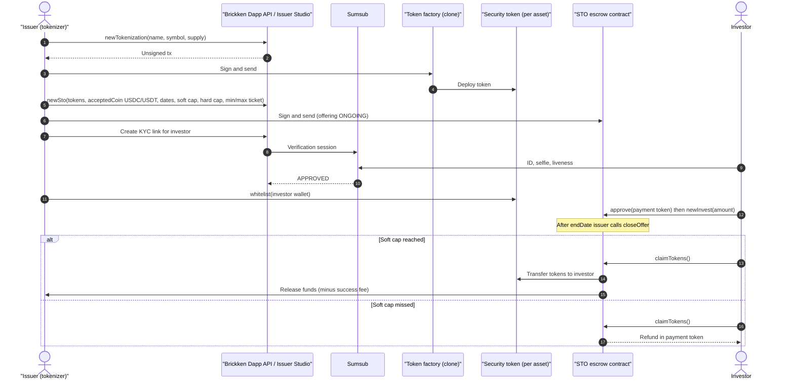
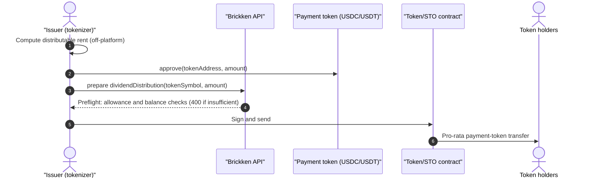
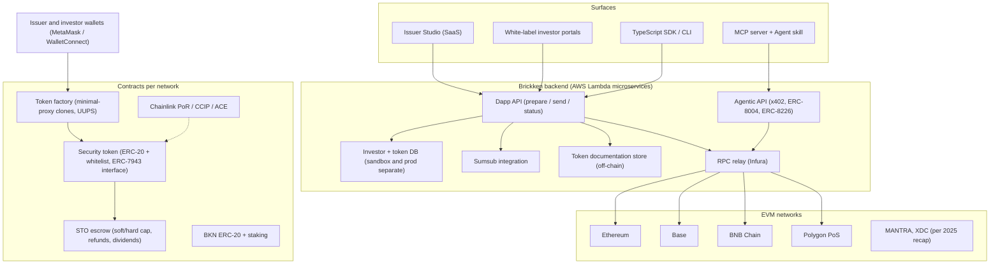

# Brickken — EU (Spain)

| Field | Value |
|---|---|
| Website | https://www.brickken.com · docs: https://docs.brickken.com · API: https://api.brickken.com (sandbox: api.sandbox.brickken.com) · partners: https://partners.brickken.com |
| HQ / legal entity | **Brickken Solutions, S.L.**, C/ Llacuna 162, mod. 302, 08018 Barcelona [C#7] |
| Founded | July 2020 (whitepaper) [C#5]; platform launched Mar 2023 [C#9] |
| Status as of Sep 2026 | **Active and growing**: EBITDA-positive in 2024; US$2.5m seed (2025) at US$22.5m post-money [C#9]; ISO 27001/27701/27018, "DORA-ready", EU Blockchain Sandbox participant [C#1]; launched Agentic API/MCP (AI-agent tokenisation) in 2026 [C#2] |
| Category | **Tokenization infra (white-label SaaS + API)** with self-serve Issuer Studio; multi-asset; real estate is the leading vertical [C#1][C#3] |
| Asset focus (RE) | Rental income rights, commercial equity, development projects, RE-backed debt [C#3]; RE issuers include Tendencia Total (ES), Tinos Cosmopolitan (GR), HiveBond SPV (UAE), E-Brick Finance (ES), XUUM (AR), Bosko (ES) [C#14] |
| Scale | **US$660m+ Total Tokenised Value, 150+ clients, 40+ countries** (Sep 2026 site) [C#1]; ~US$450m TTV and US$41m on-chain TVL (end-2025) [C#13]; US$260m+ (Mar 2025) [C#9]. TTV = issuer-declared asset value, not money raised [I] |
| Min. investment | Set by issuer per offering (`minInvestment`) [C#10] |
| Why it is in the Top 5 | The EU's highest-volume real-estate-heavy tokenisation *issuance engine* for SMEs and developers — many Spanish/European RE STOs run on it; public, detailed API that exposes exactly what an issuer admin can do; co-authored the ERC-7943 (uRWA) compliance-interface standard [C#13][C#8] |
| Research confidence | **High** on API/product/admin actions (docs); **Medium** on token contract internals (docs silent; whitepaper dated 2021); **Low** on legal wrappers (issuer-specific) |

---

## 1. Business model snapshot

- **Software, not intermediary.** Brickken sells tokenisation tooling to issuers ("tokenizers"): SaaS **Issuer Studio** (1–5 issuances, SMEs), **White-Label** (enterprise, multi-asset), **API** integration, plus a **partner marketplace** of law firms, placement agents, secondary markets, custodians, on-ramps and KYC providers [C#1][C#11][C#12].
- The issuer remains responsible for legal structuring and securities compliance in its host State; Brickken positions itself as protocol/software developer, with certified experts from "Brickken Academy" for localisation [C#5].
- **Revenue** (whitepaper model, 2021) [C#5]: fixed tokenisation fee (**US$5,000 payable in BKN**), **3% success fee** if soft cap is reached, 12–20% expert-service commission split by contract; investor-side **0.2% secondary fee** and **1.5% fiat-gateway fee**. Current site: "**$0 setup fee**", pricing on demo [C#3]. Agentic API: pay-per-call in USDC via **x402** (e.g., US$9.98 to create a token, US$0.10 per mint on Base) or API key [C#10].
- **BKN** utility token (ERC-20, 150m initial supply; listed Jul 2023; staking/wBKN) [C#5]; 19m+ BKN staked (13.3%) at end-2025; plan to "tokenise part of own equity" [C#13].

## 2. Legal & compliance structure

### 2.1 Issuing vehicle
- Chosen by each issuer: SPV equity, income/rental rights, participative/secured loans, fund units, bonds [C#3]. Brickken does not issue [C#5].

### 2.2 What the token legally represents
- Whatever the issuer's documents define; Brickken's contracts carry a documentation pointer that can be updated off-chain ("patch token documentation") [C#2][C#6].

### 2.3 Securities exemptions / licences
- Brickken holds **no investment-firm, ECSP or CASP licence** evidenced on its site/privacy policy [C#1][C#7] → its model depends on issuers using exemptions (e.g., offers below the prospectus-exemption threshold — since 5 June 2026 the Listing Act's harmonised €12m per issuer/12 months, Member State option €5m, replacing Spain's former €8m national threshold; Spain's choice unverified — or qualified-investor-only placements) and, where needed, regulated placement agents from its partner marketplace [C#12][I].
- **MiCA vs MiFID** [I]: security tokens issued on Brickken are MiFID II financial instruments → out of MiCA; **BKN** is a MiCA "other crypto-asset" (a white paper would be required for new offers/admissions after 30 Dec 2024 — not verified).
- Site advertises "automated regulatory reporting aligned with MiCA" [C#1] — marketing framing; the relevant regimes for the RE tokens are Prospectus Regulation / national securities law [I].
- **DLT Pilot Regime**: not used by Brickken; secondary trading is delegated to partner venues [C#12][I].

### 2.4 Regulators & licensed partners
- No regulator relationship disclosed beyond **EU Blockchain Sandbox** participation [C#1]. Partner marketplace exists to supply licensed placement agents/custodians [C#12].

### 2.5 KYC / AML / sanctions / travel rule
- **Sumsub** is the integrated KYC vendor: API creates a Sumsub verification link; compliance states `NOT_REQUIRED / NOT_STARTED / PENDING / APPROVED / REJECTED / ON_HOLD` [C#2][C#10]. KYB also built in [C#11].
- **On-chain per-token whitelist**: "a wallet must be whitelisted before it can hold or receive that token"; whitelist entries = investor email + address; `whitelistStatus=false` blacklists; one wallet per investor record (a different address is rejected) [C#10].
- `needKyc=false` (skip identity verification) is **sandbox-only**: the docs state that production calls with this flag are rejected, and that `needKyc` is fixed when the investor record is created and "cannot be downgraded" later [C#10]. In production, therefore, every investor record goes through Sumsub; whether the `whitelist` call is itself blocked for investors whose status is not `APPROVED` is not documented [gap] → issuer discipline still matters [I].
- No personal data on-chain (whitepaper) [C#5]. Travel rule: investors pay USDC/USDT from self-hosted wallets directly into escrow contracts; neither Brickken nor issuer is a CASP → no TFR messaging [I].

### 2.6 Investor eligibility & geo-restrictions
- Per issuer; investor types (`INVESTOR_PERSON` default; entities configurable) [C#10].

### 2.7 Tax handling & reporting
- Not provided by Brickken; issuers handle withholding (e.g., Spanish 19%) off-platform [I].

### 2.8 Disclosures & protections
- Token documentation link on-chain; "real-time auditable data" and cap-table exports [C#11]. ISO 27001/27701/27018 certifications (security & privacy) [C#1].
- No enforcement actions found [negative finding].

## 3. User types (personas & system roles)

| # | Role | Evidence |
|---|---|---|
| U1 | **Tokenizer / issuer** (company, identified by `tokenizerEmail` + `companyWalletAddress`) | [C#10] |
| U2 | Issuer team members (white-label/enterprise) | [C#1][I] |
| U3 | **Investor** (person or entity) with own wallet | [C#10] |
| U4 | Certified expert / partner (law firm, placement agent, custodian, on-ramp) | [C#5][C#12] |
| U5 | Developer/fintech integrating the API (API-key holder) | [C#6] |
| U6 | AI agent (ERC-8004 identity; ERC-8226 mandates; x402 payer) | [C#2][C#10] |
| U7 | BKN holder / staker | [C#5][C#13] |
| U8 | Brickken internal ops / compliance / support | [I] |

## 4. Actions by user type

| Role | Action (API method) | Channel | On/off-chain |
|---|---|---|---|
| U1 | Create token (`newTokenization`: name, symbol, type, supply) | Issuer Studio / API | On-chain (factory) [C#2][C#10] |
| U1 | Mint / burn (`mintToken`, `burnToken`) | Studio / API | On-chain [C#2] |
| U1 | Whitelist / blacklist investor wallets (`whitelist`) | Studio / API | On-chain [C#10] |
| U1 | Create offering (`newSto`: tokens, acceptedCoin, dates, soft/hard cap, min/max ticket) | Studio / API | On-chain escrow [C#10] |
| U1 | Close offering after end date (`closeOffer`) → success or rollback | Studio / API | On-chain [C#10] |
| U1 | Distribute dividends in payment token (`dividendDistribution`) | Studio / API | On-chain [C#10] |
| U1 | Issuer-initiated transfers (`transferFrom`, `transferTo`) | Studio / API | On-chain [C#2] |
| U1 | Update token documentation | Studio / API | Off-chain [C#2] |
| U1 | Generate KYC link (Sumsub) for investor | Studio / API | Off-chain [C#10] |
| U3 | KYC via Sumsub link; approve escrow; invest (`newInvest`); claim tokens or refund (`claimTokens`) | Investor portal / wallet | On-chain [C#10] |
| U5 | prepare → sign locally → send → poll status | REST / SDK / CLI / MCP | Mixed [C#6] |
| U6 | Register agent; create/mint token under mandate; paid via x402 | Agentic API | On-chain [C#10] |

## 5. Core flows

### 5.1 Onboarding & KYC
1. Issuer (tokenizer) account + KYB → connect company wallet [C#11][C#10].
2. Investor: issuer triggers `create KYC link` → Sumsub flow → status `APPROVED` [C#10].
3. Issuer whitelists investor wallet per token (email ↔ address) [C#10].

### 5.2 Primary offering (STO with escrow)

Evidence: [C#5][C#10]; price = maxRaiseUSD / tokenAmount; one ongoing offering per token; no early close [C#10].

### 5.3 Income distribution

Only the tokenizer may distribute; payouts in the configured stablecoin [C#10]; "amount, dates and recipients are defined in smart contracts" [C#3].

### 5.4 Secondary trading / transfer
- Token transfers only between whitelisted wallets [C#10]. Secondary venues via partners ("Marketplace" route; partner categories include secondary markets) [C#1][C#12]; issuer-driven transfers via `transferFrom/transferTo` [C#2]. The 2021 model foresaw a 0.2% secondary fee [C#5].

### 5.5 Redemption / exit
- `burnToken` for redemption/buy-back; refunds via escrow rollback [C#2][C#10].

### 5.6 Governance
- Protocol DAO with BKN voting planned (2021) [C#5]; no asset-level voting module evidenced [I].

### 5.7 Issuer onboarding
- Self-serve (Studio) or sales-led (white-label); experts from partner marketplace for legal/placement [C#11][C#12].

## 6. Reverse-engineered architecture

Narrative: Brickken is **non-custodial orchestration**: the backend prepares unsigned transactions, the issuer or investor signs locally, and the backend relays and tracks status [C#6]. Off-chain state (investor records, KYC status, documents) lives in Brickken's DB; on-chain state (whitelist, balances, escrow, dividends) on the chosen EVM chain. The 2021 whitepaper describes micro-frontends, Lambda functions, Infura relay, MetaMask, and a factory/escrow contract pair [C#5]; the 2025 recap adds Chainlink PoR/CCIP/ACE and five chains [C#13].

## 7. Tech stack

| Layer | Technology | Label | Source |
|---|---|---|---|
| Chains | Ethereum, Base, BNB Chain, Polygon (+ Sepolia, Amoy testnets); MANTRA, XDC also listed in 2025 recap | [C#6][C#13] | |
| Token standard | ERC-20 security token with per-token whitelist; Brickken states it co-authored **ERC-7943 (uRWA)** — freeze, forcedTransfer, canTransfer | [C#10]; co-authorship is Brickken's own claim [C#13] — the EIP (Final, created 10 Jun 2025) lists authors Lo Buglio, Martinez Molina and Colceriu without affiliations [C#8]; adoption of 7943 in production tokens [I] | |
| Factory/escrow | Minimal-proxy clones + UUPS upgradeability; STO escrow with soft/hard caps and refunds | [C#5] (2021) | |
| Oracles / interop | Chainlink Proof of Reserve, CCIP, ACE | [C#13] | |
| KYC | **Sumsub** | [C#2][C#10] | |
| Payment tokens | USDC, USDT (per offering `acceptedCoin`) | [C#10] | |
| Fiat | "FIAT integration" advertised; on-ramp via partners | [C#3][C#12] | Vendor unknown |
| Wallets | Self-custody (MetaMask etc.); local signing | [C#5][C#6] | |
| Backend | AWS Lambda microservices, micro-frontends; Infura | [C#5] | 2021 whitepaper |
| API | REST (OpenAPI x12), TypeScript SDK, CLI, MCP server, Postman | [C#2] | |
| Agent rails | x402 (USDC micropayments), ERC-8004 agent identity, ERC-8226 mandates | [C#2][C#10] | |
| Security/compliance | ISO 27001/27701/27018; DORA-ready | [C#1] | |

## 8. Money flows & revenue model
- Investor stablecoin → escrow → issuer on success; refund on failure [C#10].
- Brickken: setup/tokenisation fee (historically US$5k in BKN; now "$0 setup" + subscription/demo pricing), 3% success fee (whitepaper), secondary/fiat fees, API/x402 metering [C#3][C#5][C#10].
- Distributions: issuer-defined cadence in USDC/USDT [C#10].

## 9. Secondary market & liquidity mechanics
- Whitelist-restricted transfers; liquidity via partner secondary markets; no own regulated venue [C#10][C#12]. Liquidity quality depends on issuer; many SME issuances likely illiquid [I].

## 10. Risks, incidents, controversies, enforcement
- **Regulatory outsourcing**: securities compliance is the issuer's; KYC is Sumsub-gated in production (`needKyc=false` is sandbox-only [C#10]) but whitelisting decisions rest with the issuer; low-cost self-serve issuance can attract non-compliant offers [C#10][I].
- **Metric inflation**: "TTV" (asset value) ≠ capital raised; on-chain TVL (~US$41m end-2025) is an order of magnitude below TTV (~US$450m) [C#13].
- **Utility-token dependency** (BKN fees/staking) [C#5][C#13].
- **Upgradeable (UUPS) contracts** → admin-key risk [C#5][I].
- No incidents found [negative finding].

## 11. Extrapolated platform-owner ADMIN PANEL (EXTRAPOLATION — not observed)

Two layers: **(A) Brickken operator console** (multi-tenant super-admin) and **(B) Issuer Studio** (per-issuer admin), whose actions are directly evidenced by the Dapp API method list [C#2][C#10]. All [I] unless labelled.

### 11.1 Modules / pages

**B. Issuer Studio (evidence-heavy)**
| Module | Widgets / actions | Evidence |
|---|---|---|
| Asset & token setup wizard | Asset name, symbol, type, supply, chain selection, documentation upload | `newTokenization`, docs patch [C#2][C#10] |
| Cap table | Holders, balances, whitelisted vs pending, exports | Cap-table automation [C#11] |
| Investor CRM | Investor records (email, wallet, type), Sumsub status (6 states), KYC link generator, blacklist | [C#10] |
| Whitelist manager | Bulk whitelist/blacklist per token; conflict when wallet differs | [C#10] |
| Offering (STO) manager | Create offering (tokens, acceptedCoin, dates, soft/hard cap, min/max ticket), live progress bar, investor list, close after end date, success/rollback status | `newSto`, `closeOffer` [C#10] |
| Treasury & escrow | Funds in escrow, released funds, refunds claimed/unclaimed | Escrow [C#5][C#10] |
| Corporate actions | Dividend distribution wizard (payment-token approval, preflight check), mint/burn, issuer transfers | [C#2][C#10] |
| Reporting | Real-time auditable data, investor statements | [C#11] |
| Team & roles (white-label) | Users, permissions, API keys | Enterprise tier [C#11] |
| Branding (white-label) | Portal identity, domain | "Define your project's identity" [C#3] |

**A. Brickken operator console**
| Module | Widgets | Evidence |
|---|---|---|
| Tenant/issuer management | Issuers, plan (SaaS 1–5 issuances / White-label / API), KYB status, usage | Tiers [C#11] |
| API keys & metering | Keys per tenant, sandbox/prod, x402 revenue, rate limits | [C#6][C#10] |
| Network registry | Chains enabled, tokenizer addresses per chain, RPC health | `network info`, `tokenizer address` endpoints [C#2] |
| Transaction monitor | Prepared vs sent vs mined; failures; stuck txs | prepare/send/status pattern [C#6] |
| KYC ops (Sumsub) | Global review queue, ON_HOLD cases, sanctions hits | [C#10] |
| Compliance guardrails | Flag whitelist entries whose Sumsub status ≠ `APPROVED`, offerings above exemption thresholds, restricted jurisdictions (`needKyc=false` is already rejected in production) | [C#10][I] |
| Partner marketplace admin | Partner onboarding (law firms, placement agents, custodians) | [C#12] |
| Agent governance | Registered agents, mandates (grant/revoke/extend), agent enforcement freeze | ERC-8226 RAMS [C#2] |
| Metrics | TTV, TVL, clients, countries (public stats) | [C#1][C#13] |
| Security & audit | ISO 27001 evidence, access logs, DORA incident register | [C#1] |

### 11.2 Admin actions (maker-checker)
- Issuer: create token → open offering (**4-eyes** in white-label: ops maker, legal/compliance checker before `newSto` is signed).
- Issuer: whitelist batch (**maker-checker** vs Sumsub status; auto-block if not APPROVED unless documented exemption).
- Issuer: dividend distribution (**maker-checker**: finance prepares amount; second signer via multisig company wallet [S]).
- Issuer: mint/burn/forced transfer (**4-eyes**; court order / lost-wallet evidence attached).
- Operator: disable tenant / revoke API key / freeze agent mandate (**compliance approval**).

### 11.3 Admin roles (RBAC)
| Role | Layer | Scope |
|---|---|---|
| Brickken super-admin | A | Tenants, networks, pricing |
| Brickken compliance | A | KYC/KYB queue, guardrails, tenant suspension |
| Brickken support/solutions | A | Read tenant configs, tx monitor |
| Issuer owner | B | Everything for own tokens |
| Issuer compliance | B | Investor KYC review, whitelist approvals |
| Issuer finance | B | Escrow, distributions |
| Issuer IR / marketing | B | Investor comms, documents |
| API developer | B | Keys, sandbox |

### 11.4 Alerts / automations / reports
- Alerts: soft cap at risk near end date; offering reached hard cap; KYC ON_HOLD/REJECTED; wallet mismatch; insufficient allowance before distribution; unclaimed refunds; chain RPC degradation.
- Automations: KYC-approved → whitelist suggestion; closeOffer reminder at end date; distribution preflight.
- Reports: cap table export; offering summary; distribution ledger; per-tenant usage and x402 billing.

## 12. Builder takeaways (for RealX)
- **Copy:** prepare/sign/send non-custodial API pattern (keeps platform out of custody) [C#6]; escrow with soft/hard caps and automatic refunds [C#5][C#10]; explicit KYC state machine (6 states) [C#10]; per-token whitelist tied to email+wallet [C#10]; ERC-7943 as a lightweight compliance interface compatible with ERC-3643 naming [C#8]; sandbox environment with faucet [C#2].
- **Avoid:** whitelisting wallets whose KYC status is not `APPROVED` (Brickken already rejects `needKyc=false` in production [C#10] — copy that hard block); fees payable in a volatile utility token; marketing TTV as volume [C#5][C#10][C#13].
- **Differentiate:** bundle licensed placement (ECSP/MiFID partner) and fiat rails into the product rather than a directory; built-in tax/withholding; asset-level governance; EUR stablecoin (MiCA-compliant EMT) as default payment token.

## 13. Sources (accessed 23 Sep 2026)
1. Brickken home — https://www.brickken.com/
2. Brickken docs index (llms.txt) — https://docs.brickken.com/llms.txt
3. Brickken, Real Estate Tokenization — https://www.brickken.com/real-estate-tokenization
4. Brickken docs root — https://docs.brickken.com/
5. Brickken Whitepaper (Jun 2021) — https://www.brickken.com/whitepaper
6. Brickken Dapp API introduction — https://docs.brickken.com/api-reference/introduction
7. Brickken privacy policy — https://www.brickken.com/privacy-policy
8. EIP-7943 (uRWA) — https://eips.ethereum.org/EIPS/eip-7943
9. Brickken, "Brickken is Live on Polygon PoS" (19 Mar 2025) — https://www.brickken.com/post/brickken-is-live-on-polygon-pos
10. Brickken docs full text (llms-full.txt) — https://docs.brickken.com/llms-full.txt
11. Brickken, Asset Tokenization Platform — https://www.brickken.com/asset-tokenization-platform
12. Brickken Partners Marketplace — https://partners.brickken.com/
13. Brickken, "Brickken 2025: Building the Institutional Future of Tokenization" — https://www.brickken.com/post/brickken-2025-recap
14. Brickken, Live Tokenizations tracker — https://www.brickken.com/live-tokenizations
