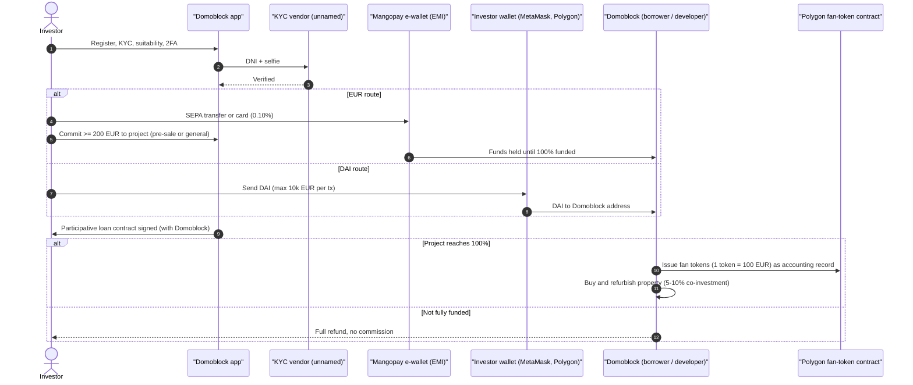
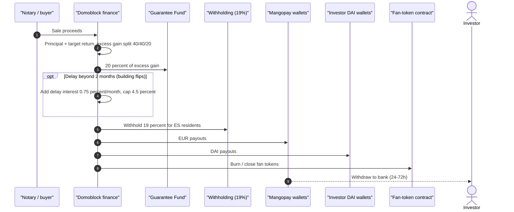
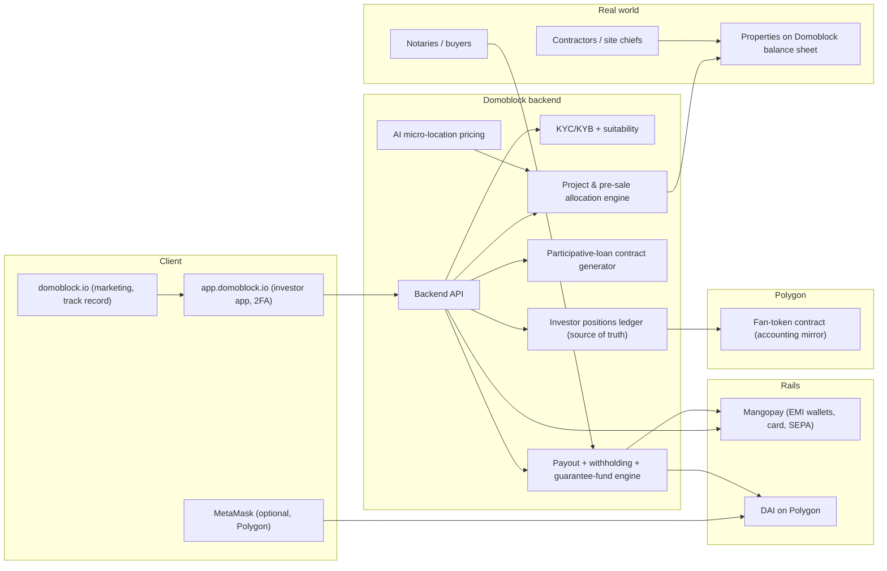

# Domoblock — EU (Spain)

| Field | Value |
|---|---|
| Website | https://domoblock.io · app: https://app.domoblock.io |
| HQ / legal entity | **Domoblock Real Estate Investment S.L.**, Valencia (share capital €3,000) [C#2][C#6]; new holding **Domoblock Capital Group S.L.** [C#2] |
| Founded | 2021 [C#1][C#2] (one review says 2022 [C#5]) |
| Status as of Sep 2026 | **Active**; 2FA mandatory since Mar 2026; launched "Domo-Uniq" (personal purchase assistance, €5,000 fee) in Sep 2026; new-development product in 2026; Madrid delays with compensation (Jun 2026) [C#1][C#2] |
| Category | **Hybrid: developer-operator with on-chain accounting tokens** — investors lend via participative loans; Polygon "fan tokens" mirror positions; deliberately **outside** the CNMV/ECSP perimeter |
| Asset focus | Residential **house flipping** and **building flipping** (buy-refurbish-sell, ~7.5–12 months), plus buy-renovate-rent and new development; Valencia, Castellón, Madrid, Zaragoza, Alicante, Almería; first international (Tulum, Mexico) [C#1][C#2] |
| Scale | **€59.08m financed, 3,412 investors, 71 projects financed, 41 completed, historical IRR 16.2%+** [C#4] (homepage shows "2,500+ investors" [C#3]) |
| Min. investment | **€200** per project; 1 token = €100 [C#1][C#2] |
| Why it is in the Top 5 | Among the largest Spanish retail real-estate programmes using blockchain tokens by amount financed; represents the **"regulatory-perimeter" archetype** (participative loans + non-security tokens + EMI wallet) that many EU start-ups use — essential for RealX to understand both as competition and as a compliance anti-pattern |
| Research confidence | **Medium** — own FAQ/disclaimers + two detailed third-party reviews; privacy/payment T&Cs blocked by robots.txt |

---

## 1. Business model snapshot

- Domoblock acts as an **integrated developer**, not an intermediary: it sources, buys, refurbishes and sells properties and **co-invests 5–10%** of each deal ("skin in the game") [C#1][C#2].
- Investors fund each project via a **participative loan to Domoblock** (not to a third-party promoter) [C#5]; the loan's variable interest = share of the flip profit [C#5].
- Economics [C#2]: no investor fees; Domoblock earns ~**3–4% of the financed amount** embedded in the project plus a **success fee** on gains above target. Since June 2025, excess gains are split **40% investors / 40% Domoblock / 20% Guarantee Fund** (previously 50/50).
- Access tiers: **Pre-venta** (~50% of each project) for experienced investors (≥€50k invested, or ≥5 projects with ≥€2,500) who get +0.5% bonus; then **Suscripción General** [C#2][C#5]. Projects often fund "in minutes" [C#7].
- Ancillary: referral programme; **Domo-Uniq** (€5,000 service to help individuals buy homes); **Prophero** partnership for WIP/NPL/REO deals [C#2].

## 2. Legal & compliance structure

### 2.1 Issuing vehicle
- The borrower is **Domoblock itself** (or group company); properties held on Domoblock's balance sheet; investors hold **economic rights** over the asset via the loan terms [C#2][C#5]. No per-project SPV evidenced [C#1].
> **QA note (Fable):** the home-page disclaimer [C#3] and FAQ [C#5] refer to a separate "Promotor del Proyecto" with whom Domoblock contracts ("no hay vínculo jurídico entre Inversor y Promotor"; Domoblock "asume directamente la obligación" towards investors and then obliges itself separately to the promoter). So "integrated developer" (§1) should be read as "Domoblock is the sole counterparty to investors"; whether Domoblock or a third-party promoter owns and executes each project is not established from the sources and may vary by deal.
- Contractual protections: right to rental cash flow if sale is delayed; no sale below offer price within 12 months; commitment not to mortgage assets (since project Domo-8) [C#2].

### 2.2 What the token legally represents
- **Nothing legally.** Domoblock's FAQ: tokens are "**fan tokens** … that only represent the accounting position", **not security tokens or financial instruments**; they cannot be traded between investors; any transfer needs Domoblock's written approval and a formal **loan assignment** contract [C#5]. Reviewers call them "tickets" rather than tokens under Spanish law [C#2], and "an accounting unit… that does not incorporate economic rights itself" [C#1].

### 2.3 Securities exemptions / licences
- Verbatim disclaimer: Domoblock "in no case offers financial instruments subject to CNMV supervision nor operates through an investment services entity (ESI)"; products are "not supervised or controlled by the CNMV"; it "does not provide participatory-financing (crowdfunding) services" and "does not intermediate between promoter and investor" [C#3].
- History: previously worked **with an ESI's oversight**, which ended with the transition to the **2023 Securities Markets Law (Ley 6/2023)** regime for security tokens [C#2].
- **Analyst view [I]:** The structure relies on (a) non-transferable participative loans (not "negotiable securities") and (b) Domoblock borrowing for its **own** projects (so it is not a crowdfunding intermediary under ECSPR, which covers intermediation between investors and third-party project owners). Tokens are made non-financial by removing transferability. This keeps it outside MiFID II, Prospectus Regulation, ECSPR and MiCA (a non-transferable accounting record is arguably not a crypto-asset offered to the public). The trade-off: **no regulatory investor protections**, no KIIS, no appropriateness test mandated by ECSPR (Domoblock nevertheless runs a suitability assessment [C#5]).
- Spanish consumer-credit/“préstamos entre particulares” rules and general contract law apply; the Bank of Spain/CNMV "chiringuito" risk list is a watch-point [S].

### 2.4 Regulators & licensed partners
- **Mangopay** (Luxembourg e-money institution) provides the integrated EUR wallet and card/transfer payments [C#2][C#5].
- Notaries for property purchase/sale (standard Spanish conveyancing) [I].
- No custodian for DAI (self-custody) [C#5].

### 2.5 KYC / AML / sanctions / travel rule
- KYC/AML + suitability assessment at registration [C#5]; individuals: DNI front/back + selfie; entities: KYB; residency Spain/EU, non-EU need NIE [C#2]. KYC vendor unnamed (privacy policy blocked) [gap]. Mangopay also performs KYC as the EMI [I: EMI obligation].
- DAI payments capped at **€10,000 per blockchain transaction** [C#5] — an AML risk-limiting control.
- As Domoblock is not a CASP, TFR travel-rule messaging doesn't apply; source-of-funds on DAI is Domoblock's AML duty only if it is an obliged entity under Law 10/2010 [I; unclear].

### 2.6 Investor eligibility & geo-restrictions
- Spain/EU residents; non-EU with NIE [C#2]. Pre-sale tier thresholds [C#2].

### 2.7 Tax handling & reporting
- **19% withholding** on profits for Spanish residents; declared as *rendimientos del capital mobiliario* (savings base) [C#1]; the FAQ confirms Domoblock withholds and files with the AEAT but does not state the rate [C#5]. Referral bonuses taxed as general income [C#5]. Implies Modelo 123/193 filings by Domoblock as payer [I].

### 2.8 Disclosures, protections, regulatory actions
- Track-record page with planned vs final duration/ROI/IRR per project [C#4]; risk warning of partial/total loss [C#3][C#4].
- **No deposit guarantee / investor compensation** coverage; investors are **subordinated creditors** in insolvency [C#2].
- Concerns noted by reviewers: no published annual accounts on the web, loss of ESI oversight, Madrid delays [C#2].
- No enforcement actions found [negative finding].

## 3. User types (personas & system roles)

| # | Role | Evidence |
|---|---|---|
| U1 | Retail investor — general subscription | [C#5] |
| U2 | Experienced investor — pre-sale tier (+0.5%) | [C#2][C#5] |
| U3 | EUR investor using Mangopay custodial wallet | [C#5] |
| U4 | Crypto investor paying/receiving **DAI** via MetaMask on Polygon | [C#5] |
| U5 | Corporate investor (KYB) | [C#2] |
| U6 | Referrer (refiere-y-gana) | [C#3] |
| U7 | Domo-Uniq client (home buyer) | [C#2] |
| U8 | Partner (Prophero) / contractors / notaries | [C#2][I] |
| A* | Domoblock staff: real-estate analysts, project managers/site chiefs, legal & accounting, customer success, developers | [C#6] |

## 4. Actions by user type

| Role | Action | Channel | On/off-chain |
|---|---|---|---|
| U1–U5 | Register, KYC/KYB, suitability test, enable 2FA | app.domoblock.io | Off-chain [C#5][C#2] |
| U3 | Top up Mangopay wallet by transfer or card (0.10% card fee) | App | Off-chain (EMI) [C#2] |
| U4 | Pay in DAI from own Polygon wallet (≤€10k per tx) | App + MetaMask | On-chain [C#5] |
| U1/U2 | Invest ≥€200 in pre-sale or general subscription | App | Off-chain loan contract + fan-token issuance on Polygon [C#5] |
| U1–U4 | Receive principal + return after sale (EUR to wallet → bank in 24–72h; DAI to wallet) | App / wallet | Off-chain / on-chain [C#5] |
| U1–U4 | Request transfer of position (exceptional; needs approval + assignment deed) | Support | Off-chain [C#5] |
| U6 | Refer friends for bonus | App | Off-chain [C#3] |

## 5. Core flows

### 5.1 Onboarding & KYC
Registration → identity (DNI + selfie) / KYB → suitability questionnaire → Mangopay wallet opened → optional MetaMask link for DAI → 2FA [C#2][C#5].

### 5.2 Primary investment

Evidence: [C#2][C#5]; all-or-nothing rule [C#5]; token issuance timing [I].

### 5.3 Income / exit distribution (bullet repayment after sale)

Evidence: [C#2][C#5]; token burn at close [I].

### 5.4 Secondary trading
- **None.** No secondary market; transfers only by approved loan assignment [C#2][C#5][C#7].

### 5.5 Redemption / exit
- Single bullet at property sale (~7.5–12 months); rental fallback if sale delayed; no below-offer sales within 12 months [C#1][C#2].

### 5.6 Governance
- None for investors; Domoblock controls all asset decisions [I].

### 5.7 Property onboarding
- In-house sourcing with "AI/Big Data micro-location pricing" [C#1]; pipeline shown as "Oportunidades" [C#3].

## 6. Reverse-engineered architecture

Narrative: The **off-chain ledger is the legal source of truth**; the Polygon fan-token is a transparency mirror [C#5][I]. Money moves through a regulated EMI (Mangopay) for EUR and directly on-chain for DAI. Blockchain here is marketing + auditability, not settlement of rights.

## 7. Tech stack

| Layer | Technology | Label | Source |
|---|---|---|---|
| Blockchain | Polygon PoS | [C#1][C#5] | |
| Token | "Fan token" accounting unit, 1 token = €100; standard not disclosed ([S] ERC-20 with owner-only transfers) | [C#5] / [S] | Polygonscan not checked (blocked earlier) |
| Stablecoin | DAI (payments and payouts) | [C#2][C#5] | |
| Wallets | Mangopay custodial EUR wallet; MetaMask for DAI | [C#5] | |
| Fiat rails | Mangopay — SEPA transfer and card (0.10%) | [C#2] | |
| KYC | DNI + selfie, KYB; vendor unknown | [C#2] | |
| Security | Mandatory 2FA (Mar 2026) | [C#2] | |
| Pricing analytics | AI/Big Data micro-location model | [C#1] | |
| Team | In-house full-stack devs + product owners | [C#6] | |
| Reviews | Trustpilot | [C#3] | |
| Cloud/backend | Unknown | [S] | |

## 8. Money flows & revenue model
- Investor EUR (Mangopay) / DAI → Domoblock → property acquisition + refurb (+5–10% own capital) → sale → principal + return (−19% withholding) back to wallet [C#2][C#5].
- Domoblock revenue: 3–4% embedded structuring margin + share of excess gains (40%) + Domo-Uniq fees (€5,000) [C#2]. Guarantee Fund (20% of excess gains) as a loss buffer [C#2].
- Distribution cadence: **bullet at exit** (not periodic); currency EUR or DAI [C#5].

## 9. Secondary market & liquidity mechanics
- None; illiquid until sale; short durations (7.5–12 months) are the liquidity substitute [C#1][C#2].

## 10. Risks, incidents, controversies, enforcement
- **No regulatory protection** (self-declared unsupervised product) and subordinated-creditor status [C#2][C#3].
- **Single-counterparty risk**: investors lend to Domoblock (€3k share capital opco) [C#2].
- **Execution delays** (Madrid, 2–4 months; delay interest compensation) [C#1][C#2].
- **Transparency gaps** (annual accounts not published online) [C#2].
- **Upside dilution** via Guarantee Fund change [C#2].
- **Misinformation in the ecosystem**: at least one web article falsely claims CNMV authorisation — reputational risk for the category (see search log D3).

## 11. Extrapolated platform-owner ADMIN PANEL (EXTRAPOLATION — not observed)

Anchored on Domoblock's features (pre-sale tiers, all-or-nothing funding, Mangopay/DAI dual rails, bullet payouts with delay interest, Guarantee Fund, 19% withholding, 2FA) and generic AML duties. All [I] unless labelled.

### 11.1 Modules / pages
| # | Module | Widgets | Evidence |
|---|---|---|---|
| 1 | Dashboard | € financed, investors (3,412), projects financed/completed, live funding bars, avg time-to-fund, delays count | Track record [C#4] |
| 2 | Investor CRM | KYC/KYB status, suitability result, tier (pre-sale eligible?), cumulative invested, referral tree, 2FA status | [C#2][C#5] |
| 3 | KYC/AML review | ID + selfie results, NIE check for non-EU, DAI source-of-funds, €10k/tx cap enforcement | [C#2][C#5] |
| 4 | Project pipeline & underwriting | Sourcing, AI price estimate, capex budget, target ROI/IRR/duration, co-investment %, approval | [C#1][C#2] |
| 5 | Offering manager | Pre-sale window (50%, +0.5% bonus, eligibility rules), general subscription, 100% target, auto-refund on failure | [C#2][C#5] |
| 6 | Contracts | Participative-loan contract generation/e-signature per investor; assignment deeds for approved transfers | [C#5] |
| 7 | Payments (Mangopay) | Wallet balances, pay-ins (SEPA/card), escrow per project, payouts, withdrawal queue (24–72h) | [C#5] |
| 8 | Crypto desk | DAI receipts per project, Polygon tx hashes, payout batches to wallets | [C#5] |
| 9 | Fan-token registry | Mint on funding close, burn on exit, reconciliation vs positions ledger | [C#5][I] |
| 10 | Works/project execution | Site progress, contractor invoices, delay forecasts | Site chiefs [C#6] |
| 11 | Exit & waterfall | Sale price, target vs actual, 40/40/20 excess split, delay interest (0.75%/month after 2 months, cap 4.5%), withholding, payouts | [C#2][C#5] |
| 12 | Guarantee Fund | Balance, inflows (20% of excess), draws to top-up low-return projects | [C#2] |
| 13 | Tax | 19% withholding ledger, investor certificates, AEAT filings | [C#5] |
| 14 | Track-record publisher | Planned vs final duration/ROI/IRR per project → public page | [C#4] |
| 15 | Referral & promotions | Bonuses (taxed as general income), fraud checks | [C#3][C#5] |
| 16 | Domo-Uniq CRM | Home-buyer clients, €5,000 fee, search status | [C#2] |

### 11.2 Admin actions (maker-checker)
- Approve project for publication (**4-eyes**: real-estate analyst + CEO/COO investment committee).
- Declare project funded / trigger refunds (**maker-checker** with Mangopay reconciliation).
- Approve position transfer (loan assignment) (**legal + compliance**) [C#5].
- Release exit payouts incl. delay interest and Guarantee Fund allocation (**finance maker, management checker**).
- Draw on Guarantee Fund (**management approval**).
- Freeze investor account (AML) (**compliance**).

### 11.3 Admin roles (RBAC)
| Role | Scope |
|---|---|
| Management (CEO/COO) | Investment committee, payouts approval, Guarantee Fund |
| Real-estate analyst | Underwriting, pricing, project sheets |
| Project manager / site chief | Works progress, delay forecasts |
| Legal & accounting | Contracts, assignments, withholding, filings |
| Compliance/KYC | KYC/KYB, AML, DAI source-of-funds |
| Customer success | Investor CRM, tickets, referral queries |
| Tech/product | Token registry, integrations |

### 11.4 Alerts / automations / reports
- Alerts: project not 100% funded at deadline; sale delayed > 2 months (auto-start delay interest); budget overrun; DAI tx > €10k attempt; failed Mangopay payout; Guarantee Fund below threshold.
- Automations: pre-sale bonus accrual; refunds on failed funding; token mint/burn; withholding certificates; track-record updates.
- Reports: per-project close-out report; investor tax certificates; monthly KPIs.

## 12. Builder takeaways (for RealX)
- **Copy:** dual rails (EMI e-wallet for EUR + stablecoin for crypto natives) [C#5]; all-or-nothing funding with automatic refunds [C#5]; pre-sale tier rewarding loyal investors [C#2]; public planned-vs-actual track record [C#4]; delay-interest compensation as a trust mechanism [C#5].
- **Avoid:** "fan tokens" that carry no rights (blockchain as theatre) and unsupervised perimeter structuring — it caps institutional partnerships, passporting and investor trust [C#3][C#5]; single-borrower concentration in a thinly capitalised opco [C#2]; DAI as sole on-chain rail post-MiCA (prefer MiCA-authorised EURC/EURCV) [I].
- **Differentiate:** make tokens the legal record (eWpG-style or ERC-3643 securities) with an ECSP licence (€5m/project cap fits €0.5–3m flips) and KIIS; ring-fence each project in an SPV; periodic reporting and audited accounts.

## 13. Sources (accessed 23 Sep 2026)
1. Finect, "Domoblock: análisis y opiniones de la plataforma de inversión inmobiliaria" — https://www.finect.com/usuario/davidcarmona/articulos/domoblock-analisis-y-opiniones-de-la-plataforma-de-inversion-inmobiliaria
2. Inversor07, "Opiniones DOMOBLOCK 2026" — https://inversor07.com/domoblock/
3. Domoblock home (links + verbatim disclaimers) — https://domoblock.io/
4. Domoblock Track Record — https://domoblock.io/track-record
5. Domoblock FAQ — https://domoblock.io/faq
6. Domoblock, Sobre nosotros — https://domoblock.io/sobre-nosotros
7. Invertir en Préstamos P2P, "Domoblock" — https://www.invertirenprestamosp2p.com/domoblock/
8. Finect, "Domoblock vs Reental: comparativa (2026)" — https://www.finect.com/usuario/davidcarmona/articulos/domoblock-vs-reental-comparativa-para-invertir-en-inmobiliario-2026
