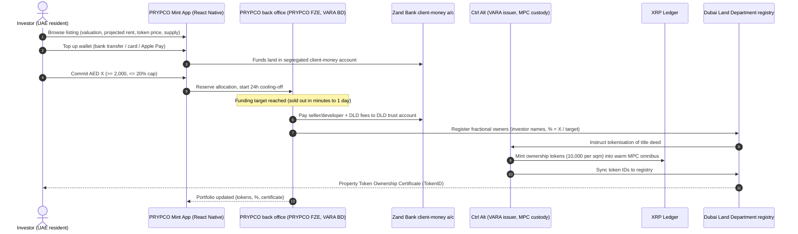
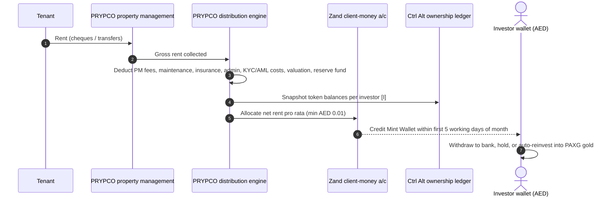
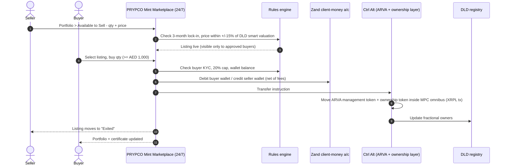
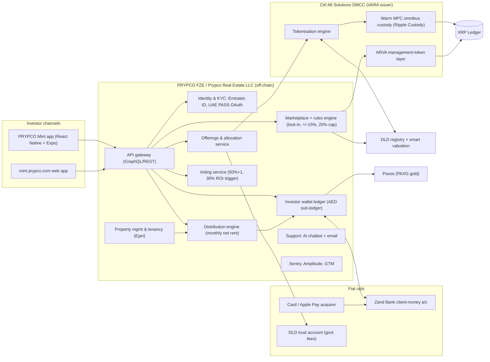

# PRYPCO Mint — MENA (United Arab Emirates, Dubai)

| Field | Value |
|---|---|
| Website | https://prypco.com/mint · web app https://mint.prypco.com · iOS/Android "PRYPCO Mint – Tokenized Assets" |
| HQ / legal entity | **PRYPCO FZE** (Dubai World Trade Centre free zone, reg. L-2048, Sheikh Rashid Tower) = VARA-licensed operator; **Prypco Real Estate LLC** (mainland, DET reg. 1018186) develops/manages the platform and is the App Store seller; ultimate parent **PRYPCO Holding Limited** (DIFC) [C#4][C#6][C#20] |
| Founded | PRYPCO group founded by Amira Sajwani (DAMAC family); Mint went live 24 May 2025 (VARA licences issued that day [C#7]; DLD's public announcement is dated 25 May 2025 [C#1]) [C#1][C#7][C#18] |
| Status as of Sep 2026 | **Active.** Phase 1 (primary) May 2025–Feb 2026; Phase 2 (secondary marketplace) live since 20 Feb 2026; tokenised gold added 19 Jun 2026 [C#10][C#11][C#17] |
| Category | **On-chain tokenised fractional — regulator pilot distribution platform** (DLD title-deed tokens on XRP Ledger, minted by Ctrl Alt; PRYPCO is the retail broker-dealer / front-end) |
| Asset focus | Completed, income-producing Dubai residential units (apartments), single-unit offerings; plus PAXG-backed gold [C#12][C#18][C#17] |
| Scale | ~10 properties fully funded; AED 18.5m (~US$5m) tokenised in Phase 1; ~7.8m tokens; investors from 50+ nationalities; first offering 224 investors / 44 nationalities, 70 % first-time Dubai buyers, avg ticket AED 10,714; fastest sell-out 1 min 58 s; waitlist 10,700+ (dates: May 2025–Feb 2026) [C#2][C#9][C#10][C#12] |
| Min. investment | **AED 2,000** per the current T&C (§4.4) and the help centre article dated 18 Jun 2026 [C#4][C#5]; the product page (Sep 2026) states a single "minimum investment amount is AED 1,000" without distinguishing primary from secondary [C#3]; LenderKit attributes the AED 1,000 minimum to the secondary marketplace only (cut from AED 2,000 in Jul 2026) [C#12]; gold AED 100 [C#3][C#17] |
| Why it is in the Top 5 | The only live, government-integrated real-estate tokenisation distribution platform in MENA with retail volume and a working secondary market; defines the Dubai "reference model" (DLD + VARA + CBUAE + DFF sandbox) every UAE entrant must copy |
| Research confidence | **High** for legal/fees/flows (primary T&C, VARA register, DLD releases); **Medium** for internal architecture; **Low** for vendors (KYC/cloud not disclosed) |

---

## 1. Business model snapshot

- **What investors buy:** a fraction of a specific Dubai apartment, recorded as a DLD-issued title-deed token on the XRP Ledger and evidenced by a **DLD "Property Token Ownership Certificate"** [C#2][C#4][C#8]. Properties are split into **10,000 tokens per square metre** (a 130 m² unit = 1.3m tokens, ~AED 2/token in the observed example) [C#3][C#13].
- **Who does what:** DLD is the registry and legal "issuer" of the title token; **Ctrl Alt Solutions DMCC** is DLD's "tokenisation engine" (mints, custodies and runs the secondary-market token layer); **PRYPCO FZE** is the investor-facing VARA broker-dealer that sources property, onboards investors, holds client money (at Zand Bank) and runs property management / distributions [C#4][C#8][C#7].
- **Revenue:** 2 % acquisition fee on funding target, 0.5 % management fee, 1 % exit fee on sale value, and an incentive fee of up to 15 % of the excess of Sale Value over the Funding Target, net of transaction costs (T&C §13.2). Separately, an ROI above 30 % triggers a mandatory sale vote (T&C §4.2) — the incentive fee is not conditional on that trigger [C#4]. PRYPCO also markets a **DLD fee of 2 % instead of the standard 4 %** as a buyer benefit [C#3].
- **Ecosystem cross-sell:** PRYPCO group also runs **PRYPCO Blocks** (DFSA crowdfunding, DIFC SPVs, AED 500 min, Shariah-certified), mortgages, Golden Visa services — Mint is the tokenised product line inside a broader "real-estate super-app" [C#21][C#16].
- **Pricing edge:** first unit (DAMAC Prive, Business Bay 2BR) was tokenised at AED 2.4m vs ~AED 3m market price → an embedded discount used as a marketing lever [C#18].

## 2. Legal & compliance structure

### 2.1 Issuing vehicle
- **No SPV in the Mint model** per the T&C: "Properties purchased in investor names directly with DLD"; investors acquire a "direct portion of the Property proportional to their investment" (investment ÷ funding target × 100) [C#4]. This is the key difference from PRYPCO Blocks (DIFC SPV shares) and from Stake/SmartCrowd (DIFC SPVs).
- A user blog describes an "SPV issues tokens" structure [C#13] — **conflicts** with the primary T&C; treat the T&C as authoritative [I: primary legal document outranks third-party blog].
- Tokens are "**issued by DLD and minted by DLD's tokenization engine, Ctrl Alt Solutions DMCC**" [C#4]. Ctrl Alt holds VARA **Category 1 VA Issuance** + Broker-Dealer (VL/25/05/002) [C#7].

### 2.2 What the token legally represents
- **Ownership token** = a fractional interest in the title deed, synchronised with the DLD registry; DLD issues a Property Token Ownership Certificate recording the investor as "Tokenholder" with a unique TokenID [C#2][C#8][C#24].
- **Phase 2 adds an ARVA ("Asset-Referenced Virtual Asset") "management token"** layer that governs secondary-market transfer eligibility and conditions; both layers recorded on XRPL and reconciled with DLD systems [C#8][C#9].
- VARA formally recognises ARVAs as a regulated category [C#25]; SCA position (2025; the SCA was renamed the UAE **Capital Market Authority, CMA** with effect from 1 Jan 2026 — see `01-regulatory/mena.md`): RWA tokens are not securities unless the underlying is a security [C#25] — this is why a direct fractional title interest can sit under VARA rather than CMA/DFSA securities rules [I].

### 2.3 Licences / exemptions
| Item | Detail | Label |
|---|---|---|
| PRYPCO FZE | VARA **Broker-Dealer Services**, VL/25/05/001, issued 24 May 2025, active | [C#7] |
| Ctrl Alt Solutions DMCC | VARA Broker-Dealer + **Category 1 VA Issuance**, VL/25/05/002, 24 May 2025 | [C#7][C#8] |
| Regulatory sandbox | DLD "Real Estate Evolution Space" (REES) / Real Estate Sandbox, with VARA, CBUAE and Dubai Future Foundation | [C#1][C#26] |
| Client money | Segregated Client Money Account under **VARA Client Money provisions**; no deposit protection | [C#4] |
| Advertising | RERA/Trakheesi permit per listing is plausible because Mint markets specific Dubai units | [I: DLD/RERA advertising rules apply to property marketing; not observed on pages] |

### 2.4 Regulators & licensed partners
- **DLD** (registry, title token issuer, valuation — "DLD smart valuation"), **VARA** (licensing/supervision of PRYPCO + Ctrl Alt), **CBUAE** (sandbox partner; dirham rails), **Dubai Future Foundation** [C#1][C#4].
- **Bank:** Zand Bank P.J.S.C. (client money account; "strategic banking partner") [C#4][C#18].
- **Custodian:** Ctrl Alt Solutions DMCC, tokens held in a "**warm multi-party-computation omnibus account**"; Ripple Custody provides the custody technology [C#4][C#8][C#9].
- **Government fees** routed to a **Trust Account in DLD's name** [C#4].
- **Gold:** Paxos Gold (PAXG) [C#6][C#17].

### 2.5 KYC / AML
- Emirates ID + proof of address; full KYC gates wallet top-up (guest browsing allowed) [C#12][C#13].
- **UAE PASS** login added in app v1.1.31 (Aug 2026) [C#6].
- CDD covers identity, residential address and **source of funds**; no deposits/withdrawals/investments until CDD complete; lapses trigger suspension [C#4].
- Only account-holder or authorised-representative funding accepted; no cash [C#4].
- KYC vendor: **not disclosed** (privacy policy names only categories) [C#20]. Emirates ID OCR + liveness via a UAE-hosted IDV vendor (e.g., UAE ICP/UAE PASS verification, Sumsub, Uqudo) is likely [S].
- Sanctions/travel rule: not explicit in T&C [C#4]; VARA AML rulebook requires screening and Travel Rule for VA transfers [I: VARA licensee obligation]; practically minimal because tokens never leave the omnibus custody [I].

### 2.6 Investor eligibility & geo-restrictions
- Real estate: **UAE residents with valid Emirates ID** per the DLD launch release, the help centre and press [C#1][C#5][C#10] — the T&C itself contains no residency or Emirates-ID clause [C#4]. Age: **18+** per T&C §14.1(iii) [C#4], but **21+** per the help centre article dated 18 Jun 2026 [C#5] — unresolved.
> **QA note (Fable):** the help-centre article (18 Jun 2026) post-dates the T&C wording and is product-specific, so the operational onboarding gate may be 21+ even though the contract says 18+. Re-verify in the live app before relying on 18+ as a benchmark.
- Gold: UAE residents and international investors with passport [C#5][C#17].
- **Per-investor cap: 20 % of any property's tokens** (T&C §4.5 phrases it as 20 % "of the value of the Property") [C#3][C#4][C#10].
- The T&C contemplates corporate investors (§15.1(iv)); no natural-persons-only restriction was found [C#4].

### 2.7 Tax
- Investor solely responsible; no withholding [C#4]. UAE has no personal income tax; VAT may apply to fees [I]. Consultancy-ME flagged tokenised RE tax treatment as an open question (not fetched).

### 2.8 Disclosures, protections, actions
- 24-hour cooling-off; 30-day notice for T&C changes; 14 business days for fee changes; re-confirmation within 5 business days on material change during commitment period [C#4].
- Complaints: support.mint@prypco.com, ack ≤ 7 days, resolution ≤ 30 days (max 8 weeks), records retained 8 years; disputes → **DIFC Courts** [C#4].
- **Business Continuity Plan** and **Cessation Plan** (PRYPCO supervises property sale and returns capital pro rata if wound down) [C#4].
- No regulatory enforcement found. Customer complaints on Trustpilot (3.2/5, 15 reviews): low realised payouts, AI-only support, a refund outstanding Aug 2025→Jul 2026 [C#22].
- **Shariah:** the product page lists "Shariah compliant" as a bare feature bullet in the combined real-estate-and-gold feature list [C#3]; no certifying body, fatwa or Shariah board is named, the T&C is silent [C#4], and the gold press release does not mention it [C#17] — treat as unsubstantiated marketing until a certificate is located [I].

## 3. User types (personas & system roles)

| Persona / role | Description | Evidence |
|---|---|---|
| Guest | Browses listings without KYC | [C#13] |
| Retail investor (UAE resident) | KYC'd, can fund wallet, buy primary, list/buy secondary, vote on sale | [C#4][C#15] |
| International gold investor | Passport-KYC'd, gold only | [C#5][C#17] |
| Developer / seller of units | "Properties from all developers are welcome" — sells units to the pool | [C#18] |
| PRYPCO operations (broker-dealer, property manager) | Sources, lists, manages tenants, distributes | [C#14][C#4] |
| Compliance officer | Owns complaints mailbox, CDD | [C#4] |
| Ctrl Alt (issuer/custodian) | Mints tokens, operates custody + ARVA layer | [C#8] |
| DLD (registry) | Issues certificate, valuation, fee trust account | [C#2][C#4] |
| Zand Bank | Client money account | [C#4] |

## 4. Actions each user type can exercise

| Role | Action | Channel/UI | On-chain / off-chain |
|---|---|---|---|
| Guest | Browse properties, see valuation, projected rent, token price, supply, documents | App/web | Off-chain |
| Investor | Register, KYC (Emirates ID, address, UAE PASS login) | App | Off-chain |
| Investor | Top up wallet (bank transfer, debit/credit card, Apple Pay) | App → Zand | Off-chain (AED) |
| Investor | Buy primary tokens (≥ AED 2,000, ≤ 20 % of property) | App | Off-chain order → on-chain mint/allocation to omnibus + DLD certificate |
| Investor | Cancel within 24 h cooling-off | App/support | Off-chain reversal before allocation [I] |
| Investor | Receive monthly rent into Mint Wallet; reinvest into gold | App | Off-chain ledger credit |
| Investor | List tokens (partial/full, price within ±15 % of DLD valuation) after 3-month lock-in | Portfolio › Available to Sell | Off-chain order book; on-chain ARVA/ownership transfer at settlement |
| Investor | Buy listed tokens (min AED 1,000) | Marketplace | same |
| Investor | Vote on sale (50 % + 1, 14-day window) | App | Off-chain (no on-chain governance observed) |
| Investor | Withdraw AED to own bank account | App | Off-chain |
| Investor | Complain / close account | Email/app | Off-chain |
| PRYPCO ops | List property, set funding target, run distribution, trigger vote, sell property | Back office | Mixed |
| Ctrl Alt | Mint ownership tokens, mint ARVA tokens, move tokens within omnibus, sync to DLD | Ctrl Alt platform | On-chain (XRPL) + DLD API |

## 5. Core flows

### 5.1 Onboarding & KYC
1. Sign up with email + personal details (or UAE PASS) [C#13][C#6].
2. Upload Emirates ID + proof of address; CDD incl. source of funds [C#12][C#4].
3. Accept Mint T&C (DIFC-law governed complaint route; VARA risk disclosures) [C#4].
4. Wallet unlocked for AED top-up [C#13].

### 5.2 Primary purchase

Steps 7–10 ordering (who instructs whom) is **[I]**: T&C confirm DLD issues / Ctrl Alt mints / omnibus custody / investor-name registration [C#4], but the exact API choreography is not published.

### 5.3 Income distribution

Cadence monthly (or quarterly at PRYPCO's discretion), paid in **AED**, deductions enumerated in T&C, rent-collection delays up to 3 months possible [C#4][C#14][C#17]. Balance snapshot from Ctrl Alt is **[I]** (holder records must drive pro-rata, and post-Phase 2 holdings change).

### 5.4 Secondary trading (Phase 2, since 20 Feb 2026)

Confirmed: 24/7, partial listings, ±15 % band, lock-in, Listed/Exited tabs, approved-buyer visibility, DLD sync, ARVA layer [C#3][C#4][C#8][C#15]. Matching is a **listing board (seller-set price, buyer takes)**, not a continuous order book [I: sell guide describes listings "visible to potential buyers" and "depends on finding a buyer"; no bids mentioned]. Trading fee: **not disclosed**; gold marketed as zero-fee [C#17].

### 5.5 Redemption / exit / property sale
- Sale vote: simple majority **50 % + 1**, 14-day window; vote automatically triggered at **30 % ROI**; PRYPCO may sell on investors' behalf at its discretion once threshold reached; 1 % exit fee + incentive fee up to 15 % of excess [C#4].
- No redemption against the platform; liquidity only via marketplace or property sale [C#4][I].

### 5.6 Governance
- Off-chain in-app voting for sale / term extension ("investor-voted extensions available") [C#4]. No DAO or on-chain vote.

### 5.7 Property listing onboarding
1. PRYPCO sources units from any developer or seller ("Properties from all developers are welcome") [C#18].
2. DLD valuation ("DLD smart valuation") sets the reference price and ±15 % band [C#4].
3. Listing page publishes valuation, projected rent, token price, total supply, supporting documents [C#5].
4. DLD approval for tokenisation within the REES pilot; token supply = 10,000 × sqm [C#3][I: pilot requires per-asset DLD sign-off].

## 6. Reverse-engineered architecture

**Narrative.** Mint is a **"custodial front-end on a sovereign registry"**. Everything the investor touches (wallet, orders, payouts, votes) is an off-chain PRYPCO ledger in AED [C#12][C#4]. The chain holds (a) title-deed ownership tokens and (b) ARVA management tokens, both in Ctrl Alt's MPC omnibus account, not in investor wallets [C#4][C#8]. Legal truth sits in the **DLD registry + certificate**; XRPL is the synchronised technical record [C#9]. Consequently, secondary trades are internal book transfers mirrored on-chain and in DLD — no public DEX, no self-custody, no stablecoin settlement [I].

## 7. Tech stack

| Layer | Technology | Label | Source / reasoning |
|---|---|---|---|
| Blockchain | XRP Ledger | [C#9][C#8] | Ctrl Alt/CoinDesk |
| Token standard | XRPL-native issued assets; exact type (trust-line IOU vs Multi-Purpose Token) not published | [I] | MPTs designed for RWA metadata/transfer control; not confirmed [C#23] only generic |
| Compliance/permissioning | Omnibus custody + off-chain rules engine; ARVA layer for transfer eligibility | [C#8][I] | |
| Identity | Emirates ID, UAE PASS login | [C#6][C#12] | App release notes |
| Wallets/custody | Ctrl Alt warm MPC omnibus; Ripple Custody tech | [C#4][C#8] | T&C + PR |
| Fiat rails | Zand Bank client-money account; bank transfer, debit/credit card, Apple Pay; AED only | [C#4][C#6] | |
| Stablecoin rails | None for real estate (no crypto deposits in pilot) | [C#12] | |
| KYC vendor | Not disclosed | — | Privacy policy silent [C#20] |
| Marketplace | In-app listing board, 24/7 | [C#15][C#16] | |
| Oracles/valuation | DLD smart valuation feed (price band reference) | [C#4] | Likely API integration [I] |
| Frontend | React Native + Expo, TypeScript, Redux/Zustand, EAS | [C#23] | General Catalyst job board |
| Backend | Firebase and/or GraphQL/REST (per job ad) | [I] | Job ad lists "Firebase, GraphQL, or REST" |
| Cloud | Unknown; privacy policy allows storage outside Middle East | [C#20] + [S] (AWS/GCP) | |
| Analytics/monitoring | Sentry, Amplitude, Google Tag Manager | [C#23][C#20] | |
| CRM/support | AI-based support bot + email | [C#22] | Trustpilot complaint |
| Gold | Paxos PAXG | [C#6][C#17] | |
| Property mgmt | In-house PRYPCO (tenant management, maintenance) | [C#14] | |

## 8. Money flows & revenue model

| Flow | Amount / rule | Label |
|---|---|---|
| Acquisition fee | 2 % of funding target | [C#4] |
| DLD registration | 2 % (marketed vs 4 % standard) → DLD trust account | [C#3][C#4] |
| Management fee | 0.5 % of funding target (periodicity not stated; annual likely) | [C#4] / [I] |
| Exit fee | 1 % of sale value | [C#4] |
| Incentive fee | up to 15 % of the excess of Sale Value over Funding Target, net of transaction costs (T&C §13.2); not conditional on the 30 % ROI threshold, which only triggers a sale vote (§4.2) | [C#4] |
| Operating deductions from rent | PM fees, maintenance, insurance, admin, KYC/AML, valuations, reserve fund | [C#4] |
| FX | Charges for currency conversion | [C#4] |
| Distributions | Monthly (or quarterly), AED, within first 5 working days | [C#4][C#14] |
| Projected return | 8–12 % net ROI incl. appreciation (marketing); 5–7 % rental yield quoted at launch | [C#3][C#18] |
| Secondary trading fee | Not disclosed | — |

## 9. Secondary market & liquidity mechanics
- Venue: PRYPCO Mint Marketplace inside the app, 24/7 "subject to compliance requirements" [C#11].
- Constraints: 3-month lock-in per property; price band ±15 % of latest DLD smart valuation; 20 % single-holder cap; approved-buyer visibility; AED 1,000 minimum buy [C#3][C#4][C#12].
- Settlement: internal AED ledger + ARVA/ownership token moves in omnibus + DLD update [C#8][I].
- Liquidity reality: seller-priced listings; "a successful sale depends on finding a buyer" [C#12]. No market maker or buy-back disclosed [I].
- Only one distributor (PRYPCO) is live on the DLD/Ctrl Alt rails, so the "market" is closed-loop; Ctrl Alt's CPO says the stack is built for "PRYPCO **and others**" [C#8] → future cross-platform liquidity is plausible [S].

## 10. Risks, incidents, controversies
- **Concentration/affiliation:** PRYPCO founded by Amira Sajwani (DAMAC), T&C hosted on DAMAC Living storage, first tokenised unit was a DAMAC Prive apartment [C#18][C#4] — related-party pricing/conflict risk [I].
- **Service quality:** Trustpilot complaints on payout retention, refunds, AI-only support [C#22].
- **Documentation inconsistencies:** min ticket (product page AED 1,000 vs T&C/help centre AED 2,000), min age (T&C 18 vs help centre 21), lock-in (T&C 3 months vs blog "none"), vote threshold (51 % vs 50 %+1), SPV vs direct title, and a "Shariah compliant" product-page bullet with no certifier named [C#3][C#4][C#5][C#13].
- **Custody concentration:** all tokens in one warm MPC omnibus at Ctrl Alt; no deposit protection [C#4].
- **Pilot status:** DLD e-service still describes the programme as a pilot under REES [C#26]; rules may change.
- No enforcement actions found.

## 11. Extrapolated platform-owner ADMIN PANEL  *(EXTRAPOLATION — not observed)*

Anchors: observed user features (wallet, monthly payouts, marketplace, votes, certificates, gold), T&C obligations (CDD, cooling-off, lock-in, complaints SLAs, client money, BCP/cessation), VARA broker-dealer rules, and the split with Ctrl Alt/DLD.

### 11.1 Modules / pages and key widgets
| # | Module | Key widgets | Evidence driving it |
|---|---|---|---|
| 1 | **Ops dashboard** | Funds raised today, live offerings %-funded, waitlist size, marketplace volume, pending KYC, pending withdrawals, complaints SLA clock | Sell-outs in minutes, 10,700 waitlist [C#10] |
| 2 | **Investor CRM & KYC** | Profile, Emirates ID expiry, UAE PASS link, CDD/source-of-funds status, risk rating, 20 % cap usage, suspension flag | CDD gating & suspension [C#4] |
| 3 | **Offering builder** | Property data, DLD valuation, sqm→token supply calculator (10,000/sqm), funding target, fee schedule, projected rent, documents, RERA/Trakheesi permit no., waitlist & allocation rules | Listing fields [C#5]; token formula [C#3] |
| 4 | **Allocation & cooling-off** | Commitments queue, 24-h cooling-off timers, oversubscription pro-rata/first-come logic, refund queue | 24-h cooling-off [C#4] |
| 5 | **Registry & tokenisation console** (integration with Ctrl Alt + DLD) | Mint requests, DLD registration status, certificate issuance per investor, TokenID map, XRPL tx hashes, omnibus reconciliation | DLD-issued tokens/certificates [C#2][C#4] |
| 6 | **Client money & wallet ledger** | Zand balance vs sum of investor wallets (daily 3-way recon), deposits by rail (card/Apple Pay/bank), withdrawals queue, FX | Segregated client money [C#4] |
| 7 | **Distribution engine** | Rent roll by property, deduction lines (PM, maintenance, insurance, reserve), net distributable, per-investor preview, AED 0.01 threshold, payout run history | Monthly net distributions [C#4][C#14] |
| 8 | **Marketplace supervision** | Live listings, price-band breaches blocked, lock-in calendar, trade blotter, surveillance flags (wash trades, self-dealing, rapid relisting), halt switch | ±15 %, lock-in, 24/7 "subject to compliance" [C#4][C#11] |
| 9 | **Governance / votes** | Vote creation (sale, term extension), 14-day window, quorum/50 %+1 tally, 30 % ROI trigger monitor | Voting rules [C#4] |
| 10 | **Property management** | Tenancy (Ejari), rent collection status, arrears, maintenance tickets, insurance, reserve fund | PRYPCO handles tenant mgmt [C#14] |
| 11 | **Complaints & support** | Ticket queue, 7-day ack / 30-day resolution SLA timers, escalation to Compliance Officer, 8-year retention | Complaints policy [C#4] |
| 12 | **Compliance & regulatory reporting** | VARA periodic returns, AML/STR log, sanctions hits, client-money reports, marketing approvals | VARA BD licence [C#7] |
| 13 | **Gold module** | PAXG positions, Paxos reconciliation, rent→gold reinvest instructions | Gold launch [C#17] |
| 14 | **Content & comms** | Listing pages, push notifications, T&C versioning with 30-day notice, material-change reconfirmation (5 business days) | T&C change rules [C#4] |
| 15 | **BCP / cessation** | Run-book, investor contact export, wind-down property-sale tracker | BCP & Cessation Plan [C#4] |

### 11.2 Admin actions (maker-checker where plausible)
- Create/publish offering (maker: Investments; checker: Compliance + Finance) — publication of token supply and price is irreversible once minted [I].
- Approve KYC exceptions / unsuspend (maker: KYC analyst; checker: MLRO).
- Trigger mint & DLD registration after funding close (maker: Ops; checker: Finance confirms client-money funds matched).
- Run monthly distribution (maker: Finance prepares; checker: Head of Finance approves; system blocks if Zand recon ≠ 0).
- Approve withdrawals above threshold (4-eyes).
- Halt marketplace / freeze investor tokens (Compliance; dual approval; instruction to Ctrl Alt for omnibus sub-account freeze).
- Update DLD valuation reference (system import; manual override requires dual approval).
- Launch sale vote / execute sale after vote (maker: Asset Mgmt; checker: CEO + Compliance).
- Issue refunds during cooling-off (single approval under threshold).

### 11.3 RBAC roles
| Role | Can do |
|---|---|
| Super-admin (CTO) | Config, role management; no money movement |
| Investments / Asset manager | Offering builder, property data, votes |
| Compliance officer / MLRO | KYC decisions, STRs, freezes, marketing approvals, complaints oversight |
| KYC analyst | Review docs, request info |
| Finance / Treasury | Client-money recon, distributions (maker), withdrawals |
| Head of Finance | Checker on distributions, withdrawals > limit |
| Property manager | Tenancy, arrears, maintenance, rent roll |
| Customer support | Read-only investor view, tickets |
| Auditor / regulator view | Read-only exports |
| Integration service accounts | Ctrl Alt, DLD, Zand, Paxos API scopes |

### 11.4 Alerts, automations, reports
- Alerts: Emirates ID expiry; 20 % cap breach attempt; listing outside band; recon break Zand ↔ ledger ↔ omnibus; rent arrears > 30 days; ROI crossed 30 % (auto-vote); complaint SLA day 5/25; failed DLD sync.
- Automations: lock-in release after 3 months; cooling-off expiry → allocation; monthly distribution calendar (first 5 working days); gold auto-reinvest.
- Reports: VARA returns; client-money daily; investor statements & certificates; property P&L; marketplace volume/price vs valuation; complaints register.

## 12. Builder takeaways (RealX)
- **Copy:** registry-linked title token + regulator certificate (trust > tech); tiny tickets with 20 % cap; hard ±15 % price band pegged to an official valuation (keeps regulators comfortable); 3-month lock-in; monthly AED payouts to an in-app wallet with reinvest options; UAE PASS login.
- **Avoid:** inconsistent public docs; AI-only support for money complaints; single-distributor liquidity; opaque trading fees.
- **Differentiate:** become a second distributor on the DLD/Ctrl Alt rails (Ctrl Alt explicitly courts "others"); add bid-side (buy orders) and market-making; non-resident access when DLD opens it; **certified** Shariah compliance with a named board and published certificate for the tokenised product (PRYPCO Blocks names its certifier; Mint's product page only carries an unsubstantiated "Shariah compliant" bullet [C#3][C#21]); transparent fee calculator.

## 13. Sources (accessed 23 Sep 2026)
1. DLD — "DLD launches the MENA's first tokenized real estate project through the 'Prypco Mint' platform" (25 May 2025) — https://dubailand.gov.ae/en/news-media/dld-launches-the-mena-s-first-tokenized-real-estate-project-through-the-prypco-mint-platform
2. DLD — "Dubai Land Department Unveils First-of-Its-Kind Property Token Ownership Certificate" (29 May 2025) — https://dubailand.gov.ae/en/news-media/dubai-land-department-unveils-first-of-its-kind-property-token-ownership-certificate
3. PRYPCO — Mint product page — https://prypco.com/mint
4. PRYPCO — Mint Terms & Conditions — https://prypco.com/mint/terms-and-conditions (also DAMAC-hosted PDF: https://digitalprojsa.blob.core.windows.net/damacliving/assets/static/en/PRYPCO_EXCLUSIVE_TNC_URL.pdf)
5. PRYPCO Help Centre — "Tokenized real estate with PRYPCO Mint" — https://help.prypco.com/en/articles/13784933-tokenized-real-estate-with-prypco-mint
6. Apple App Store — PRYPCO Mint – Tokenized Assets — https://apps.apple.com/us/app/prypco-mint-tokenized-assets/id6747388513
7. VARA Public Register — https://www.vara.ae/en/licenses-and-register/public-register/
8. Ctrl Alt — "Ctrl Alt and Dubai Land Department Launch Phase Two…" (20 Feb 2026) — https://www.ctrl-alt.co/press-releases/ctrl-alt-dld-phase-two
9. CoinDesk — "Dubai real estate tokenization project opens secondary trading with Ripple support" (20 Feb 2026) — https://www.coindesk.com/business/2026/02/20/dubai-unveils-secondary-market-for-usd5-million-tokenized-real-estate-via-xrp-ledger
10. Metropolitan — "DLD Activates Property Tokenization Phase 2" — https://metropolitan.realestate/media/news/dld-property-tokenization-phase-2-secondary-market-dubai/
11. Gulf News — "PRYPCO rolls out Dubai marketplace after nod for property stakes trading" (Feb 2026) — https://gulfnews.com/business/property/prypco-rolls-out-dubai-marketplace-after-nod-for-property-stakes-trading-1.500438076
12. LenderKit — "Prypco Mint Review 2026" — https://lenderkit.com/blog/prypco-mint-review-dubais-first-tokenized-real-estate-platform/
13. Tokenizer.Estate blog — "My Experience with Prypco Mint…" — https://blog.tokenizer.estate/my-experience-with-prypco-mint-real-estate-tokenization-in-dubai-through-the-eyes-of-a-beginner/
14. PRYPCO blog — "Earn passive income in Dubai with PRYPCO Mint" — https://prypco.com/blogs/earn-passive-income-in-dubai-prypco-mint
15. PRYPCO blog — "How to sell your property tokens on PRYPCO Mint Marketplace" — https://prypco.com/blogs/how-to-sell-your-property-tokens-on-prypco-mint-marketplace
16. Zawya — "PRYPCO Mint launches marketplace for tokenized property…" (Feb 2026) — https://www.zawya.com/en/press-release/companies-news/prypco-mint-launches-marketplace-for-tokenized-property-expanding-access-and-liquidity-for-investors-msz6fxb3
17. Zawya — "PRYPCO Mint launches Gold…" (press release dated 12 Jun 2026; gold live for eligible users from 19 Jun 2026) — https://www.zawya.com/en/press-release/companies-news/prypco-mint-launches-gold-becoming-the-regions-first-platform-to-combine-tokenized-real-estate-and-gold-investing-r1d2mt64
18. Khaleej Times — "Own Dubai property from Dh2,000…" (2 Jun 2025) — https://www.khaleejtimes.com/business/property/dubai-developers-list-tokenised-properties-prypco-mint
19. Paragraph (Sabai Protocol) — "Successful and Failed Tokenization Projects. 2026 Update" — https://paragraph.com/@sabai-protocol/successful-and-failed-tokenization-projects-2026-update
20. PRYPCO — Privacy Policy — https://prypco.com/privacy-policy
21. PRYPCO — Blocks product page — https://prypco.com/blocks
22. Trustpilot — PRYPCO reviews — https://www.trustpilot.com/review/prypco.com
23. General Catalyst job board — "React Native Developer (Expo)" @ Prypco — https://jobs.generalcatalyst.com/companies/prypco-2/jobs/67420443-react-native-developer-expo-experience-required ; and TokenizedLiving — "XRPL Real Estate Tokenization…" — https://tokenizedliving.com/xrpl-tokenization-ripple-targets-30-trillion-real-estate-market/
24. Chartered Investment — "Tokenized real estate in Dubai: From pilot to platform?" (23 Jun 2025) — https://chartered-investment.com/en/media/news/tokenized-real-estate-in-dubai-from-pilot-to-platform/
25. Forbes — "UAE Crypto Regulations 2025 Recap: VARA, RWA Tokens And 2026 Outlook" (29 Dec 2025) — https://www.forbes.com/sites/irinaheaver/2025/12/29/uae-crypto-regulations-2025-recap-vara-rwa-tokens-and-2026-outlook/
26. DLD — Real Estate Tokenization e-service page — https://dubailand.gov.ae/en/eservices/real-estate-tokenization/
