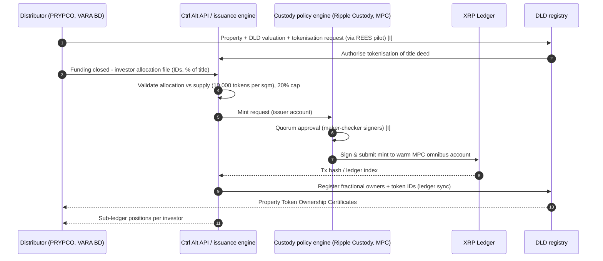
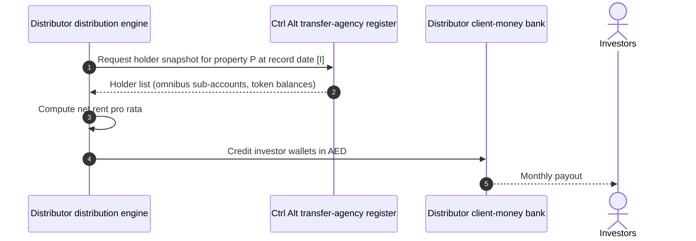
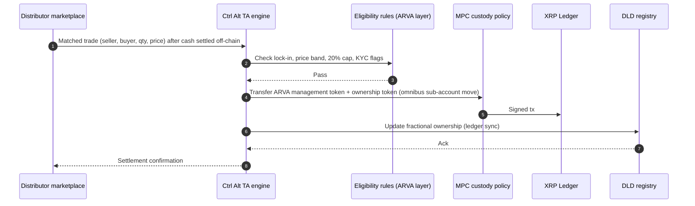
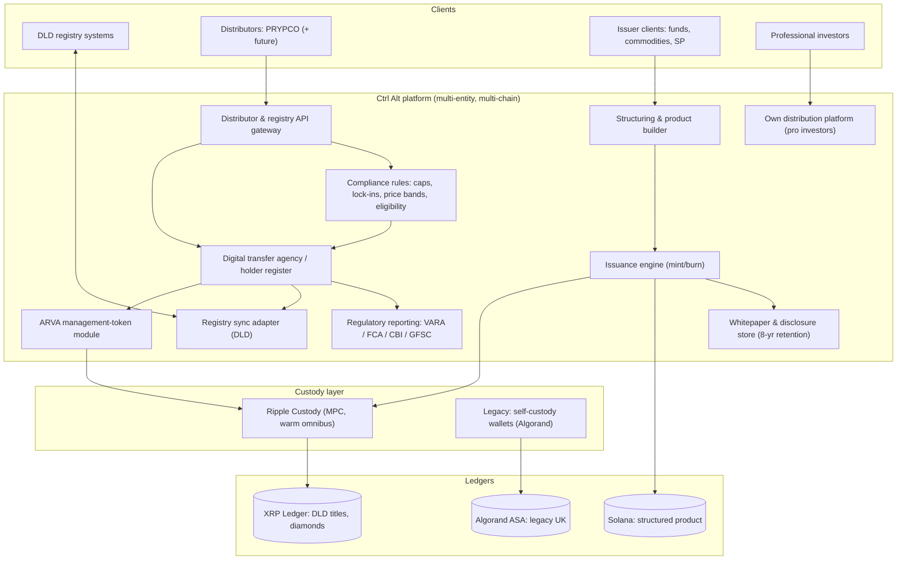

# Ctrl Alt Solutions — MENA (United Arab Emirates, Dubai; group HQ UK)

| Field | Value |
|---|---|
| Website | https://www.ctrl-alt.co |
| HQ / legal entity | **Ctrl Alt Solutions FZCO, DMCC company no. DMCC199928** (per the group's About page) — styled "**Ctrl Alt Solutions DMCC**" on the VARA public register; both names refer to the same DMCC free-zone company holding VARA licence VL/25/05/002 (a styling difference, not two entities) = UAE issuer/broker-dealer. Group: **Alt Ltd / Ctrl Alt Ltd** (England & Wales, FCA FRN 1045023), **Ctrl Alt Technologies Ltd** (Ireland, CBI C00571300, MiFID), **Ctrl Alt Corporate Services Ltd** (Guernsey, GFSC fiduciary & digital transfer agency) [C#1][C#2][C#7][C#13] |
| Founded | 2022, by Matt Ong (CEO; ex-Morgan Stanley, Credit Suisse) [C#2] |
| Status as of Sep 2026 | **Active & expanding.** Exclusive tokenisation engine for DLD (Phase 1 May 2025, Phase 2 Feb 2026); FCA (Apr 2026), CBI MiFID (Jul 2026), GFSC (Aug 2026) authorisations [C#3][C#5] |
| Category | **Tokenisation infrastructure (white-label issuer + custody + transfer agency)** for a government registry and for distributors; B2B2C; also licensed VARA issuer |
| Asset focus | Real-estate title deeds (DLD), diamonds (Billiton ~US$280m), funds (Mirae MoU), structured products (Solana), private credit, litigation finance [C#8][C#9][C#11][C#17] |
| Scale | Tokenised assets: US$295m (1 May 2025) → US$650m (Jan 2026) → US$1.4bn (Apr 2026) → US$1.8bn+ (Sep 2026 homepage) across all asset classes; DLD share: 10 properties, AED 18.5m (~US$5m), ~7.8m tokens [C#1][C#8][C#9][C#11][C#15] |
| Min. investment | N/A (B2B). Retail min on DLD rails set by distributor (PRYPCO: AED 2,000 at launch and in its T&C; AED 1,000 shown on PRYPCO's product page as of Sep 2026 — see `01-prypco-mint.md`) [C#4][C#20] |
| Why it is in the Top 5 | It is the **issuer of record / tokenisation engine behind the only government title-deed tokenisation in MENA**; first VARA "Category 1 VA Issuance" licensee; any new Dubai distributor (incl. RealX) would plug into its rails. It is the best MENA evidence for what the *infra/issuer* admin console looks like |
| Research confidence | **Medium-High** for licensing/roles (register + PRs); **Medium** for architecture (press + T&C); **Low** for internal stack (no job ads/vendors disclosed) |

---

## 1. Business model snapshot

- **Role in Dubai:** "Designated tokenisation provider" that structured, minted and placed DLD title-deed tokens on XRPL, integrated directly with DLD to "synchronise digital and traditional real estate ledgers" [C#4][C#9]. In PRYPCO's T&C it is described as "**DLD's tokenization engine**" and custodian of all tokens [C#20].
- **Distributor model:** Ctrl Alt tokenises; external **distributors** (PRYPCO first) handle sales, KYC and payments; ownership changes are returned by the distributor to the issuer for on-chain reflection [C#19]. CPO Matt Acheson: "We manage the underlying complexity… so that distribution platforms like PRYPCO **and others** can deliver smooth, fractional real estate experiences" [C#5].
- **Product lines (group):** asset tokenisation & structuring; distribution platform; custom tech builds & APIs; fiduciary and **digital transfer agency** services; target clients: asset/wealth managers, banks, governments, fintechs, family offices (professional/institutional) [C#1].
- **Revenue model [I]:** structuring/issuance fees per asset, per-token/AUM-based platform fees, custody fees, transfer-agency fees, and B2B API licensing to distributors (typical white-label tokenisation economics; no fee schedule published). **[S]** DLD pilot economics likely include a per-transaction fee on secondary transfers shared with the distributor.

## 2. Legal & compliance structure

### 2.1 Issuing vehicle
- **DLD rails:** no SPV; title fractions registered in investor names at DLD; tokens "issued by DLD and minted by… Ctrl Alt" [C#20]. Ctrl Alt acts as the *technical and regulated* issuer (VARA Category 1 VA Issuance) of the on-chain representation [C#13].
- **Non-DLD deals:** Guernsey vehicles (structured product; Carey Olsen) [C#9]; historically Liechtenstein share companies for UK retail tokens [C#12].

### 2.2 What the token represents
- **Ownership token** = digital representation of a fractional title deed, synchronised with DLD registry [C#4][C#5].
- **ARVA management token** (Phase 2) = Asset-Referenced Virtual Asset used to "facilitate compliant secondary transfers" alongside ownership tokens — a "**dual-token architecture**" [C#5][C#15].
- Under VARA's Issuance Rulebook, ARVAs are **Category 1** and require a VARA licence to issue; Annex 2 imposes reserve, custody segregation, AED redemption, 6-monthly audit, monthly disclosure and capital (≥ max(AED 1.5m, 2 % of reserves)) rules [C#14]. How those reserve rules map onto a title-referenced management token is **not published** — [I] the DLD title itself is the "reserve", held in the registry, with the legal opinion/segregation requirement satisfied by investor-name registration.

### 2.3 Licences
| Entity | Licence | Label |
|---|---|---|
| Ctrl Alt Solutions DMCC (UAE) | VARA VL/25/05/002 — **Broker-Dealer Services + Category 1 VA Issuance**, issued 24 May 2025, active; "first VASP authorised to conduct Issuer-related services" | [C#13][C#6] |
| Ctrl Alt Ltd (UK) | FCA FRN 1045023 (authorised Apr 2026; previously Appointed Representative of Khepri Ltd FRN 692447) | [C#1][C#3][C#12] |
| Ctrl Alt Technologies Ltd (IE) | Central Bank of Ireland C00571300, MiFID (Jul 2026) | [C#7][C#2] |
| Ctrl Alt Corporate Services Ltd (GG) | GFSC fiduciary & digital transfer agency (Aug 2026) | [C#2][C#3] |

### 2.4 Regulators & partners
- **DLD** (client, registry), **VARA** (licensing), **Dubai Future Foundation**, **CBUAE** (sandbox) [C#4][C#9].
- **Ripple** — custody technology for DLD title-deed tokens; also on diamonds [C#6][C#18][C#17].
- **DMCC** (partner; diamonds coordination) [C#1][C#17]; **SEI**, **Molten** listed partners [C#1]; **Mirae Asset GI** MoU [C#7]; **Solana Foundation**, **Carey Olsen** [C#8].
- Historical UK stack: **trustshare** escrow (FCA agent of PayrNet) [C#12].

### 2.5 KYC / AML
- On DLD rails, **distributors perform KYC and payments**; Ctrl Alt receives transfer instructions [C#19]. [I] Ctrl Alt still needs issuer-level AML (VARA Compliance & Risk Management Rulebook) and distributor due diligence (VARA Issuance Rulebook makes Licensed Distributors responsible for validating issuer compliance in Cat 2; mirror duties apply in Cat 1) [C#14].
- KYC vendor: not disclosed [C#10].

### 2.6 Investor eligibility
- Direct Ctrl Alt platform: **professional investors / eligible counterparties** only [C#1][C#8].
- Retail reaches Ctrl Alt-issued DLD tokens **only via distributors** (UAE residents w/ Emirates ID on PRYPCO) [C#19][C#20].

### 2.7 Tax — not disclosed; issuer-level reporting obligations [S].

### 2.8 Disclosures / actions
- Standard VARA risk warning ("Virtual Assets may lose their value in full or in part… do not benefit from any form of financial protection") [C#9].
- Whitepaper obligations under VARA Issuance Rulebook Schedule 1 (issuer info, rights, redemption, DLT, distributor, offer details; 8-year retention) [C#14] — no public DLD token whitepaper located [I: likely filed with VARA/DLD rather than published].
- No enforcement actions found.

## 3. User types

| Persona / role | Description | Evidence |
|---|---|---|
| Government registry client (DLD) | Commissions tokenisation, receives ledger sync | [C#4] |
| Distributor (PRYPCO; future "others") | Retail front-end: KYC, payments, marketplace UI | [C#5][C#19] |
| Asset originator / issuer client | Fund managers (Mirae), commodity owners (Billiton), UK issuers | [C#7][C#8][C#17] |
| Professional investor | Direct access to Ctrl Alt distribution platform | [C#1] |
| Custody tech provider (Ripple) | MPC custody tech | [C#6] |
| Ctrl Alt ops: structuring, issuance, custody ops, transfer agent, compliance | Internal | [C#1][C#2] |
| Regulators (VARA, FCA, CBI, GFSC) | Supervisory access | [C#13] |

## 4. Actions by user type

| Role | Action | Channel | On/off-chain |
|---|---|---|---|
| DLD | Approve a title for tokenisation; receive token↔title mapping | System integration | Off-chain → on-chain |
| Distributor | Submit funded allocation (investor IDs, %s) | API [I] | Off-chain |
| Ctrl Alt issuance | Mint ownership tokens (supply = 10,000 × sqm per DLD rule) into MPC omnibus | Issuance console [I] | On-chain XRPL |
| Distributor | Submit secondary trade instruction | API [I] | Off-chain |
| Ctrl Alt TA | Validate, move ARVA + ownership tokens, update DLD | Transfer-agency console [I] | On-chain + registry |
| Ctrl Alt custody ops | Policy approvals for MPC signing | Ripple Custody console [I] | On-chain signing |
| Issuer client | Structure a product, upload docs, set eligibility | Platform [C#1] | Off-chain |
| Professional investor | Invest via Ctrl Alt platform | Web [C#1] | Mixed |
| Compliance | Freeze/unfreeze, regulatory reporting | Console [I] | On-chain (freeze) + off-chain |

## 5. Core flows

### 5.1 Onboarding (distributor & issuer)
1. Distributor must hold its own VARA licence (PRYPCO: Broker-Dealer VL/25/05/001) [C#13].
2. Commercial & technical onboarding to Ctrl Alt APIs; DLD approval to act as distributor within the REES pilot [I: only one distributor live; DLD positions distributors as "DLD's partners" — CEO quote [C#4]].
3. Issuer clients (funds, commodities) onboarded via KYB and structuring (Guernsey/UAE vehicles) [C#8][C#7].

### 5.2 Primary issuance (DLD rails)

### 5.3 Income distribution
Ctrl Alt does **not** pay rent on the DLD rails; the distributor collects and distributes AED (PRYPCO → Zand wallet) [C#20]. Ctrl Alt's role is to supply the **holder register snapshot** [I].

### 5.4 Secondary transfer (Phase 2 dual-token)

Confirmed: dual token, XRPL recording, Ripple Custody, DLD synchronisation [C#5][C#15]. Unlock Blockchain notes ownership changes were initially "not automated" (distributor returns to issuer) [C#19] → [I] Phase 2 introduced the ARVA layer precisely to automate/regularise this under VARA rules.

### 5.5 Redemption / sale
Property sale & vote handled by distributor; Ctrl Alt burns/transfers tokens and updates DLD at completion [I].

### 5.6 Governance — none on-chain [I].

### 5.7 Asset onboarding (non-DLD)
Structuring (vehicle, legal counsel), whitepaper (VARA Schedule 1 for UAE Cat 1/Cat 2), chain selection (XRPL, Solana; Algorand historically), custody set-up, distribution [C#8][C#12][C#14].

## 6. Reverse-engineered architecture

**Narrative.** Ctrl Alt is a **chain-agnostic issuance + transfer-agency layer** with an MPC custody backend. On the DLD rails it holds every investor's tokens in one warm MPC omnibus (per PRYPCO T&C) and maintains an internal holder register that maps sub-accounts to distributor customers [C#20][I]. The DLD registry remains legal truth; Ctrl Alt's sync adapter keeps XRPL and DLD in lock-step [C#4]. Multi-jurisdiction licences let the same engine serve UAE (VARA), UK (FCA), EU (MiFID via Ireland) and Guernsey vehicles [C#1][C#2].

## 7. Tech stack

| Layer | Technology | Label | Source / reasoning |
|---|---|---|---|
| Blockchain | XRP Ledger (DLD, diamonds); Solana (structured product); Algorand (legacy UK) | [C#4][C#8][C#12][C#17] | |
| Token standard | XRPL issued tokens (IOU vs MPT not published); Solana SPL/Token-2022 not specified; Algorand Standard Asset (legacy) | [C#12] + [I] | XRPL MPT is the XRPL primitive for RWA with transfer controls; unconfirmed |
| Compliance/permissioning | Off-chain rules + ARVA management token; omnibus custody means on-chain permissioning is secondary | [C#5][I] | |
| Custody | Ripple Custody tech; warm MPC omnibus | [C#6][C#20] | |
| Identity | Delegated to distributors (Emirates ID/UAE PASS via PRYPCO) | [C#19] | |
| Fiat rails | Distributor-side (Zand for PRYPCO); legacy trustshare/PayrNet escrow (UK) | [C#20][C#12] | |
| Stablecoin rails | None on DLD rails; RLUSD mentioned only as ecosystem context | [C#6] | |
| KYC vendor | Not disclosed | — | [C#10] |
| Registry integration | Direct DLD system integration | [C#4] | |
| Frontend/backend/cloud | Not disclosed; no job ads found | — | [C#11] careers page empty |
| Legal | Carey Olsen (Guernsey) | [C#8] | |

## 8. Money flows & revenue model
- Ctrl Alt does not touch investor AED on DLD rails [I from C#20: client money sits at PRYPCO/Zand].
- Revenue: structuring, issuance, custody, TA and API fees [I]; no public tariff.
- Growth metric: tokenised assets 6× in 16 months (US$295m → US$1.8bn) [C#9][C#1].

## 9. Secondary market & liquidity mechanics
- Ctrl Alt provides the **settlement layer** for distributor marketplaces; secondary liquidity pools are distributor-specific today (PRYPCO only) [C#5][C#15].
- [I] If more distributors join, Ctrl Alt's shared register could enable **cross-distributor liquidity** (one DLD token set, many front-ends) — the strategic moat.
- Diamonds: secondary access requires VARA approval, not yet defined [C#17].

## 10. Risks, incidents, controversies
- **Single-point-of-failure:** exclusive engine + single omnibus custody for all DLD tokens [C#19][C#20].
- **Entity naming** ("Ctrl Alt Solutions DMCC" on the VARA register vs "Ctrl Alt Solutions FZCO" on the group site) — reconciled: the About page gives DMCC company no. DMCC199928 for the FZCO, i.e. one DMCC-registered entity; only the styling differs [C#2][C#13].
- **Manual steps** in ownership changes flagged at launch [C#19].
- **Association with MANTRA/DAMAC** $1bn deal (MANTRA's OM token collapsed in Apr 2025) noted by Unlock Blockchain [C#19] — reputational context only.
- No enforcement actions found.

## 11. Extrapolated ADMIN PANEL (issuer / infra console)  *(EXTRAPOLATION — not observed)*

Anchors: VARA Cat 1 issuer + broker-dealer duties [C#13][C#14]; DLD sync [C#4]; MPC omnibus custody [C#20]; dual-token secondary [C#5]; multi-tenant distributors [C#5][C#19]; multi-jurisdiction entities [C#2].

### 11.1 Modules & widgets
| # | Module | Widgets | Evidence |
|---|---|---|---|
| 1 | **Tenant / distributor management** | Distributors list, VARA licence no., API keys & scopes, webhook health, SLA, volume by distributor | "PRYPCO and others" [C#5] |
| 2 | **Asset registry** | Asset cards (DLD title ref, sqm, token supply, chain, issuer account), status (draft → approved → minted → trading → sold) | DLD titles [C#4] |
| 3 | **Issuance console** | Mint/burn requests, supply calculator, whitepaper link, approval chain, XRPL tx hashes | Cat 1 issuer [C#13][C#14] |
| 4 | **Registry sync monitor (DLD)** | Pending syncs, failures, reconciliation (DLD owners vs holder register vs on-chain balances) | Ledger sync [C#4] |
| 5 | **Transfer agency / holder register** | Sub-account positions per distributor customer, record-date snapshots, corporate actions | TA licence [C#2] |
| 6 | **Transfer rules engine** | Rule sets per asset (lock-in, ±15 % band, 20 % cap, residency), rule-change log | Phase 2 rules [C#5] + PRYPCO rules |
| 7 | **ARVA module** | ARVA supply per asset, linkage to ownership tokens, disclosures (monthly), audit pack (6-monthly) | VARA Annex 2 [C#14] |
| 8 | **Custody operations** | MPC policy, signer quorum, pending signatures, wallet balances, key ceremonies, incident log | Ripple Custody [C#6] |
| 9 | **Compliance** | Freeze/unfreeze, sanctions hits from distributors, STR log, distributor due diligence | VARA CRM Rulebook [C#14] |
| 10 | **Disclosure & whitepaper vault** | Versioned whitepapers (machine-readable), 8-year retention | Rule III.B [C#14] |
| 11 | **Regulatory reporting** | VARA/FCA/CBI/GFSC returns per entity, capital adequacy (AED 1.5m floor) | Licences [C#2][C#14] |
| 12 | **Product structuring (non-DLD)** | Vehicle, jurisdiction, chain selector, investor eligibility (pro only), docs | Solana/Guernsey [C#8] |

### 11.2 Admin actions (4-eyes)
- Mint / burn (maker: Issuance ops; checker: Head of Issuance + Compliance; MPC quorum as final control).
- Change transfer rule for an asset (maker: Product; checker: Compliance; DLD notification).
- Onboard distributor / rotate API keys (maker: Partnerships; checker: CISO).
- Freeze positions (Compliance; dual approval; auto-notify distributor + DLD).
- Force-resync with DLD / manual reconciliation adjustment (maker: Ops; checker: Head of Ops; audit trail).
- Publish/replace whitepaper (maker: Legal; checker: Compliance).

### 11.3 RBAC
Super-admin (no signing rights) · Issuance officer · Transfer-agency officer · Custody signer (MPC key holder) · Compliance/MLRO · Distributor-relations manager · Regulatory reporting analyst · Read-only regulator/auditor · Distributor service account (API) · DLD service account.

### 11.4 Alerts / automations / reports
- Alerts: DLD sync failure; on-chain vs register mismatch; signer quorum pending > X min; distributor webhook down; rule breach attempts; supply changes.
- Automations: record-date snapshots for distributors; monthly ARVA disclosure; 6-monthly audit data pack; nightly 3-way reconciliation (XRPL ↔ holder register ↔ DLD).
- Reports: tokenised AUM by asset class/jurisdiction (source of the US$1.8bn headline), distributor volume, transfer logs for regulators.

## 12. Builder takeaways (RealX)
- **Copy:** separate *issuer/TA* from *distributor* (clean licensing: issuer = VARA Cat 1; distributor = VARA broker-dealer); registry-sync adapter as a first-class service; dual-token design (ownership vs transfer-control) to satisfy ARVA rules without touching the title token.
- **Avoid:** single omnibus custody for all retail holdings without on-chain sub-account transparency; manual ownership-change steps.
- **Differentiate / partner:** RealX can **be a distributor on Ctrl Alt's DLD rails** (fastest route to title-linked tokens in Dubai) rather than rebuilding issuance; negotiate cross-distributor order-book access; offer investor-visible on-chain proofs (per-investor sub-account attestations).

## 13. Sources (accessed 23 Sep 2026)
1. Ctrl Alt — homepage — https://www.ctrl-alt.co/
2. Ctrl Alt — About — https://www.ctrl-alt.co/about
3. Ctrl Alt — Press releases index — https://www.ctrl-alt.co/press-releases
4. Ctrl Alt — "Ctrl Alt and Dubai Land Department go live with tokenized real estate" (24 May 2025) — https://www.ctrl-alt.co/press-releases/ctrl-alt-dld
5. Ctrl Alt — "…Launch Phase Two… Enabling Secondary Market Trading" (20 Feb 2026) — https://www.ctrl-alt.co/press-releases/ctrl-alt-dld-phase-two
6. Ctrl Alt — "Ripple Partners with Ctrl Alt to Support Real Estate Tokenization in Dubai" (16 Jul 2025) — https://www.ctrl-alt.co/press-releases/ripple-expands-global-custody-footprint-into-middle-east-with-ctrl-alt
7. Ctrl Alt — "Mirae Asset Global Investments Signs MoU with Ctrl Alt…" (22 Jan 2026) — https://www.ctrl-alt.co/press-releases/mirae-asset-ctrl-alt-mou
8. Ctrl Alt — "Ctrl Alt Launch the First Tokenized Structured Product on Solana" (30 Apr 2026) — https://www.ctrl-alt.co/press-releases/first-tokenized-structured-product-on-solana
9. PR Newswire — "Ctrl Alt and Dubai Land Department Go Live… Forecasts $16B Market by 2033" (May 2025) — https://www.prnewswire.com/news-releases/ctrl-alt-and-dubai-land-department-go-live-with-tokenized-real-estate-forecasts-16b-market-by-2033-302464840.html
10. Ctrl Alt — Privacy Policy — https://www.ctrl-alt.co/privacy-policy
11. Ctrl Alt — Careers — https://www.ctrl-alt.co/careers
12. Ctrl Alt — Terms (legacy UK platform: Algorand, self-custody, trustshare) — https://www.ctrl-alt.co/terms
13. VARA — Public Register — https://www.vara.ae/en/licenses-and-register/public-register/
14. VARA — Virtual Asset Issuance Rulebook (ver. 19 May 2025, effective 19 Jun 2025) — https://rulebooks.vara.ae/sites/default/files/en_net_file_store/VARA_EN_293_VER20250519.pdf (index: https://rulebooks.vara.ae/rulebook/virtual-asset-issuance-rulebook)
15. Crowdfund Insider — "Dubai Enables Secondary Trading… Phase Two Launch" (Feb 2026) — https://www.crowdfundinsider.com/2026/02/263183-dubai-enables-secondary-trading-in-real-estate-tokenization-with-ctrl-alt-and-dld-phase-two-launch/
16. CoinDesk — "Dubai… opens secondary trading with Ripple support" (20 Feb 2026) — https://www.coindesk.com/business/2026/02/20/dubai-unveils-secondary-market-for-usd5-million-tokenized-real-estate-via-xrp-ledger
17. The CC Press — "XRP Ledger adds $280M diamond tokens as Ctrl Alt issues" (27 Feb 2026) — https://theccpress.com/xrp-ledger-adds-280m-diamond-tokens-as-ctrl-alt-issues/
18. PYMNTS — "Ripple and Ctrl Alt Team to Support Real Estate Tokenization" (Jul 2025) — https://www.pymnts.com/blockchain/2025/ripple-and-ctrl-alt-team-to-support-real-estate-tokenization/
19. Unlock Blockchain — "Dubai Land Department Launches Real Estate Tokenization with Ctrl Alt" — https://www.unlock-bc.com/en/dld-real-estate-tokenization-ctrl-al
20. PRYPCO — Mint Terms & Conditions — https://prypco.com/mint/terms-and-conditions
