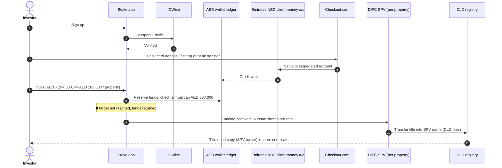
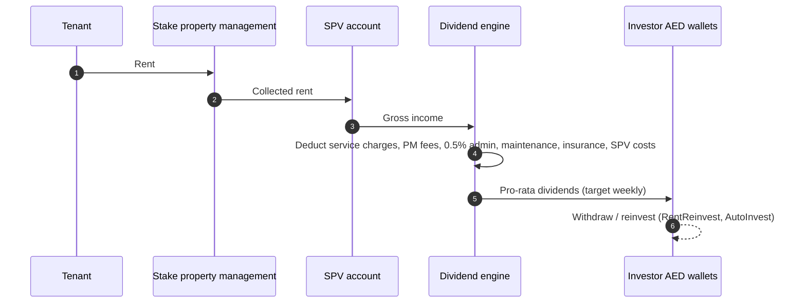
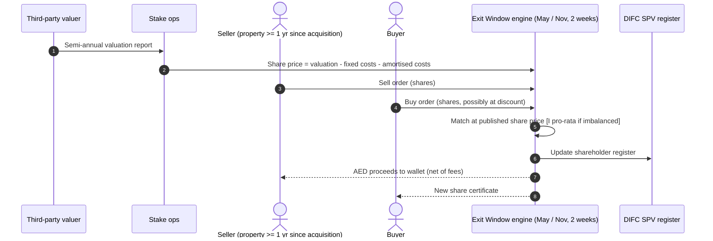
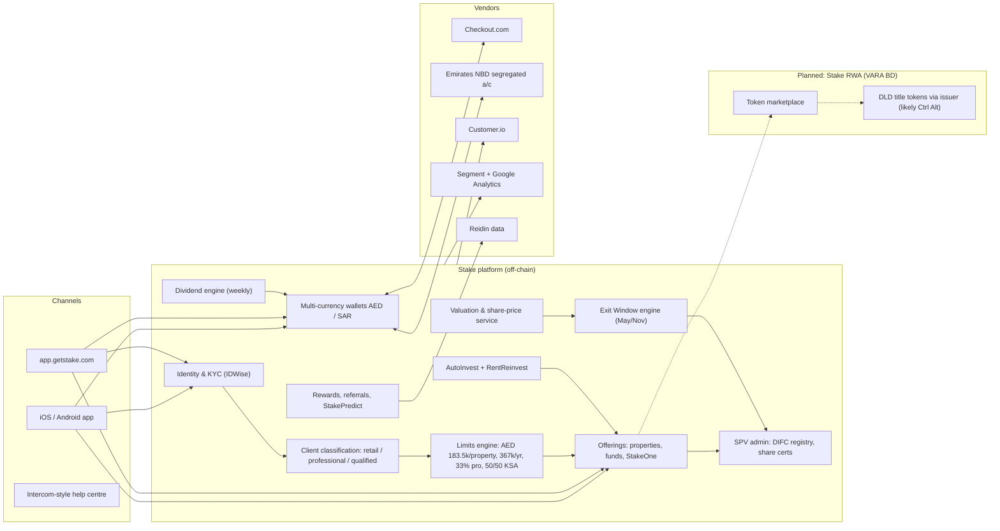

# Stake — MENA (United Arab Emirates, Dubai; Saudi Arabia)

| Field | Value |
|---|---|
| Website | https://getstake.com · app https://app.getstake.com · help https://help.getstake.com |
| HQ / legal entity | **Stake Properties Limited** (DIFC; DFSA licence F005879 — Operator of a Property Investment Crowdfunding Platform, Islamic Window); **Hessa Menfea Financial Technology Company** (Riyadh; CMA permit 2023-53-5 per privacy policy / "05-53-2023" per website); **Stake One Real Estate Brokerage L.L.C.** (Dubai, licence 1530632); tokenisation vehicle referred to as **"Stake RWA"** [C#1][C#14][C#4] |
| Founded | 2021 (UAE); KSA 2024; US industrial product Oct 2025 [C#2][C#3] |
| Status as of Sep 2026 | **Active; tokenisation pending.** VARA **In-Principle Approval** (broker-dealer) Jan 2026; not yet on VARA public register as of Sep 2026 [C#4][C#26] |
| Category | **Off-chain digital fractional (DIFC SPV shares) + CMA fund distribution; tokenised pilot planned** |
| Asset focus | Ready Dubai residential (incl. Fix-n-Flip, below-market-value strategies), Saudi single-asset private RE funds, US industrial, whole-property purchases (StakeOne) [C#1][C#2][C#24] |
| Scale | 2m+ users, 211 nationalities; 250,000+ investments; 500–600+ properties funded; 20 full exits; AED 1.4bn (~US$381m) cumulative transactions; AED 55m+ (~US$15m) rent paid (Feb 2026; homepage shows AED 31m+ — likely older/UAE-only figure); KSA: 3 funds closed, SAR 416m deployed, 6,930 international investors; GMV CAGR 130 %+ [C#1][C#2][C#3][C#5] |
| Min. investment | AED 500 [C#10] |
| Why it is in the Top 5 | Largest MENA digital fractional RE platform by users/volume, dual-regulated (DFSA + CMA), backed by Emirates NBD, Mubadala, Property Finder, Wa'ed (Aramco) — and now a **VARA-IPA tokenisation entrant** that has said every token will carry DLD ownership documents. It is the UX/compliance baseline a tokenised Dubai entrant must beat |
| Research confidence | **High** for current off-chain model (help centre + privacy policy); **Low-Medium** for tokenised design (announcements only) |

---

## 1. Business model snapshot
- **Today:** investors buy **shares in a DIFC SPV** that owns one Dubai property (title deed in SPV name) — classic crowdfunding under DFSA rules [C#7][C#8]. Weekly (target) net rent to an AED wallet; 5-year typical term; bi-annual **Exit Windows** for secondary sales [C#18][C#11].
- **Saudi:** Stake acts as a CMA-regulated intermediary distributing units of **single-asset private real-estate funds** managed by third-party fund managers (Al Khuzama, Al Yasmeen funds) [C#1][C#16].
- **StakeOne:** whole-property purchases via a mainland brokerage entity [C#1][C#14].
- **Tokenisation (planned):** "Stake RWA" received VARA IPA as a VA broker-dealer; "Every token comes with official ownership documents issued by the Dubai Land Department. Every transaction is recorded on the blockchain"; internal marketplace for token trading; UAE-first pilot then global; Series B funds earmarked for tokenisation and for participation in **Saudi Arabia's national property tokenisation platform** and the PropTech sandbox [C#4][C#5][C#2].
- **Revenue:** acquisition 1.5 %, KYC/AML 0.2 % + 0.1 % p.a., admin 0.5 % p.a., exit 2.5 %, performance 7 % of appreciation [C#6].

## 2. Legal & compliance structure

### 2.1 Issuing vehicle
- One **DIFC SPV per property**; RERA/DLD limit of max 4 registered owners per title deed forces the SPV wrapper [C#7].
- SPVs "free from any debt, lien, or encumbrance", registered on DIFC Public Register (non-regulated section) [C#8][C#19].
- KSA: CMA private funds (fund manager holds asset; Stake does not have decision authority) [C#16].

### 2.2 What the investor owns
- UAE: **SPV shares** + copy of DLD title deed in SPV's name + share certificate [C#7][C#19].
- KSA: fund **units** [C#16].
- Planned tokens: on-chain token with DLD ownership documents [C#4] — [I] this implies Stake will either (a) become a distributor on the DLD/Ctrl Alt title-token rails (direct fractional title, no SPV), or (b) tokenise SPV shares and attach DLD deed evidence. (a) is more consistent with "official ownership documents issued by DLD" per token and with Ctrl Alt's invitation to "others" (see 02-ctrl-alt.md).

### 2.3 Licences / exemptions
| Entity | Licence | Label |
|---|---|---|
| Stake Properties Ltd (DIFC) | DFSA F005879, Operator of a Property Investment Crowdfunding Platform; Islamic Window endorsement; licensed 1 Nov 2020 | [C#14][C#1][C#23] |
| Hessa Menfea FinTech Co. (KSA) | CMA FinTech Lab permit (2023-53-5); "registered in and regulated by CMA". The CMA's FinTech ExPermit list names "**Stake Financial Technology Company**" under "Investment and Real Estate Funds Distribution Platform", permit date 13/06/2023 — presumed to be the same permit; the legal-name mapping (Hessa Menfea ↔ Stake Financial Technology) is not confirmed by either source | [C#14][C#15][C#27] |
| Stake One RE Brokerage LLC | Dubai brokerage licence 1530632 (RERA/DET) | [C#14] |
| Stake RWA | **VARA IPA** — VA Broker-Dealer (Jan 2026); full licence not yet on register | [C#4][C#26] |

### 2.4 Regulators & partners
- DFSA, CMA, VARA (IPA), DLD (title deeds), DIFC Registrar [C#8][C#19].
- **Emirates NBD** — client-money bank (segregated, DFSA Client Money Rules) **and** Series B lead investor [C#17][C#2].
- Third-party valuer (unnamed) semi-annual [C#12]; Reidin data (StakePredict) [C#20].

### 2.5 KYC / AML
- **IDWise** (passport + selfie capture "as required by DFSA and CMA") [C#14].
- Documents: passport + proof of address (UAE); National ID/Iqama or passport (KSA) [C#13][C#22].
- KYC/AML costs charged to investors (0.2 % + 0.1 % p.a.) — unusual explicit pass-through [C#6].
- Excluded nationalities (UAE product): Bangladesh, Cuba, Iran, Libya, Myanmar, Nigeria, North Korea, Syria, Yemen; some passports require UAE residency [C#13]. KSA exclusions incl. Israel [C#22].

### 2.6 Investor eligibility & limits
- 18+; **non-residents allowed** (unlike PRYPCO Mint) [C#13].
- DFSA crowdfunding caps: retail **AED 183,500 (US$50k) per property and AED 367,000 (US$100k) per year**; Professional Clients up to 33 % of a property, no annual cap [C#10][C#23].
- KSA: 50 % of each fund reserved for qualified investors, 50 % retail (CMA rule) [C#21].
- Credit card deposits only for Professional investors [C#9].

### 2.7 Tax
- Help articles on UAE tax, KSA withholding tax and **Zakat handling** on funds exist [C#24] (content not fetched) — KSA distributions to non-residents likely subject to withholding [I].

### 2.8 Protections & disclosures
- DFSA client-money rules; SPV bankruptcy remoteness; **Business Cessation Plan** supervised by DFSA; administrator to appoint replacement SPV manager [C#8].
- Documents verifiable independently on DLD e-services and DIFC Public Register [C#19].
- Complaint route article exists [C#24]. No enforcement actions found.

## 3. User types
| Persona / role | Evidence |
|---|---|
| Guest / prospect (signup < 3 min) | [C#1] |
| Retail investor (UAE product; global incl. non-residents) | [C#13] |
| Professional Client (higher limits, credit card) | [C#10][C#9] |
| KSA retail / qualified investor (SAR wallet) | [C#21][C#22] |
| StakeOne whole-property buyer | [C#1] |
| Golden Visa applicant (via investments) | [C#24] |
| Stake staff: acquisitions, asset/property management, SPV admin, compliance, finance | [C#7][C#18] |
| Third-party KSA fund manager | [C#16] |
| Future token holder (VARA pilot) | [C#4] |

## 4. Actions by user type
| Role | Action | Channel | On/off-chain |
|---|---|---|---|
| Investor | Sign up, IDWise passport/selfie, POA | App/web | Off-chain |
| Investor | Deposit AED (bank transfer, debit card, Wise; credit card for pro) / SAR; transfer AED↔SAR | Wallet | Off-chain |
| Investor | Buy SPV shares (≥ AED 500, ≤ caps) / fund units | App | Off-chain |
| Investor | AutoInvest by theme (card charged on schedule); RentReinvest | App | Off-chain |
| Investor | Receive weekly/monthly net rent; withdraw | Wallet | Off-chain |
| Investor | Sell/buy in Exit Windows (May & Nov) once the property has passed its 1-yr lock-in from initial acquisition (shares bought in a window can be resold in the next one) | App | Off-chain |
| Investor | Verify title deed (DLD) and shareholding (DIFC register) | External portals | Off-chain |
| Investor | Refer friends, loyalty tiers, cashback up to 3 %, StakePredict | App | Off-chain |
| Stake ops | Acquire property, incorporate SPV, register title, manage tenants, value semi-annually, sell at term | Back office | Off-chain |
| Future | Buy/sell tokens with DLD ownership docs on internal marketplace | App | On-chain settlement [C#4] |

## 5. Core flows

### 5.1 Onboarding
Signup → IDWise capture → POA → risk checks → wallet enabled; classification as Retail vs Professional (self-certification + evidence) [C#13][C#14][C#10].

### 5.2 Primary purchase (current SPV model)

### 5.3 Income distribution

Weekly target and deduction list [C#18]; homepage says "monthly rental income to Stake wallet" [C#1] — cadence has shifted over time (weekly target now) [I].

### 5.4 Secondary trading — Exit Windows

Confirmed: timing, lock-in, pricing formula, properties-only [C#11][C#12]. Matching/allocation when sell > buy is **not documented** [I pro-rata or FIFO].

### 5.5 Exit at term
Property sold at term end (≈5 yrs), proceeds less transaction costs, 2.5 % exit fee and 7 % performance fee distributed; SPV dissolved [C#18][C#6].

### 5.6 Governance
No investor voting documented; Stake administers SPVs for the full term [C#7]. KSA: fund manager decides sales [C#16].

### 5.7 Property sourcing
Curated by Stake (help: "How are properties selected"); strategies include Fix-n-Flip and below-market-value [C#24]. Ellington Properties (developer) is an investor → developer pipeline [C#2][I].

### 5.8 Planned tokenised flow (VARA pilot) — **[I]/[S]**
Likely mirrors PRYPCO: VARA broker-dealer "Stake RWA" as distributor; DLD title token minted by the DLD's tokenisation engine; internal marketplace; UAE residents first [C#4][I].

## 6. Reverse-engineered architecture

**Narrative.** Stake is a **multi-entity, multi-currency brokerage ledger** with a DIFC corporate-registry back end. All ownership changes are corporate-register updates in DIFC SPVs; DLD is touched only at acquisition/exit [C#7][C#19]. Its sophistication is in limits/classification, automation (AutoInvest, RentReinvest), engagement (rewards, StakePredict) and multi-market wallets — not in blockchain. The tokenisation track will add a VARA-regulated sub-stack [C#4].

## 7. Tech stack
| Layer | Technology | Label | Source |
|---|---|---|---|
| Blockchain / token standard | None today; planned "recorded on the blockchain" (chain not named) | [C#4] | Likely XRPL if on DLD rails [I] |
| Compliance/permissioning | Off-chain limits engine | [C#10][C#21] | |
| Identity/KYC | IDWise | [C#14] | Privacy policy |
| Wallets/custody | Custodial AED/SAR e-wallet ledger; client money at Emirates NBD | [C#17] | |
| Fiat rails | Bank transfer, debit/credit card via Checkout.com, Wise | [C#9][C#14] | |
| Stablecoin rails | None | [I] | |
| Marketplace | Periodic call-auction-style Exit Windows | [C#11][I] | |
| Valuation | Third-party valuer semi-annual; Reidin data | [C#12][C#20] | |
| CRM/messaging | Customer.io; help centre is Intercom (URL pattern `/en/articles/<id>-slug`) | [C#14] + [I] | |
| Analytics | Segment, Google Analytics | [C#14] | |
| Frontend/backend/cloud | Not disclosed | — | |

## 8. Money flows & revenue model
| Item | Rule | Label |
|---|---|---|
| Acquisition | 1.5 % | [C#6] |
| KYC/AML | 0.2 % upfront + 0.1 % p.a. from yr 2 | [C#6] |
| Admin | 0.5 % p.a. | [C#6] |
| Exit | 2.5 % at sale | [C#6] |
| Performance | 7 % of appreciation | [C#6] |
| Fixed acquisition costs (DLD transfer, DIFC licensing, KYC) | Borne by primary buyers only, excluded from secondary price | [C#12] |
| Distribution | Weekly target, AED; SAR for funds | [C#18][C#24] |
| Reported returns (2025) | 10 % avg total, 5.3 % rental yield, 5.4 % appreciation | [C#1] |
| Rewards | Cashback up to 3 %, referral, 6.5 % first-investment promo | [C#1] |

## 9. Secondary market & liquidity
- Twice-yearly, 2-week Exit Windows (May, Nov); 1-year lock-in counted from the property's initial acquisition (not from each investor's purchase — shares bought in an Exit Window can be resold in the following window); single published share price from independent valuation; properties only [C#11][C#12].
- Funds: no exit windows (hold to maturity) [C#11].
- Tokenised pilot promises an "internal marketplace" (continuous trading) [C#4].

## 10. Risks, incidents, controversies
- No enforcement actions found. Metric inconsistencies across sources (rent paid AED 31m vs 55m; properties 500 vs 600) [C#1][C#3].
- Liquidity constrained to 4 weeks/year; valuation-set pricing (no price discovery) [C#11][C#12].
- Emirates NBD is both bank and lead investor (concentration) [C#2][C#17].

## 11. Extrapolated ADMIN PANEL  *(EXTRAPOLATION — not observed)*

### 11.1 Modules & widgets
| # | Module | Widgets | Evidence |
|---|---|---|---|
| 1 | Growth & ops dashboard | GMV, funded %, new users by nationality, AutoInvest AUM, wallet balances | 2m users, 130 % GMV CAGR [C#2] |
| 2 | KYC & classification | IDWise results, POA review, nationality/residency blocks, Professional Client evidence, KSA qualified status | [C#13][C#10][C#21] |
| 3 | Limits engine | Per-investor usage vs AED 183.5k/367k, 33 % pro cap, KSA 50/50 tranche monitor | [C#10][C#21] |
| 4 | Offering / SPV builder | Property data, SPV incorporation checklist (DIFC), title transfer status (DLD), target & fees, strategy tag (Fix-n-Flip, BMV) | [C#7][C#24] |
| 5 | Fund distribution (KSA) | Fund manager docs, unit allocation, SAR wallet, withholding tax, Zakat | [C#16][C#24] |
| 6 | Wallet & client money | ENBD recon (AED/SAR), Checkout.com settlements, withdrawals queue, AED↔SAR transfers | [C#17][C#14] |
| 7 | Dividend engine | Rent roll per SPV, deduction lines, weekly run preview, RentReinvest routing | [C#18] |
| 8 | Exit Window manager | Window calendar, valuation upload, share-price calculator (valuation − fixed − amortised), order book, matching/pro-rata, settlement to DIFC register | [C#11][C#12] |
| 9 | SPV corporate secretarial | Share registers, certificates, DIFC filings, dissolution | [C#19][C#8] |
| 10 | Property management | Tenancies, arrears, maintenance, insurance | [C#18] |
| 11 | Rewards & engagement | Cashback, referral payouts, loyalty tiers, StakePredict rounds & Reidin validation | [C#1][C#20] |
| 12 | Compliance & reporting | DFSA/CMA returns, cessation-plan readiness, complaints, AML alerts | [C#8] |
| 13 | Tokenisation (new) | VARA BD obligations, token positions, marketplace surveillance, DLD certificate status | [C#4] |

### 11.2 Maker-checker actions
Publish offering (Acquisitions → Compliance); approve Professional classification (KYC → MLRO); run weekly dividends (Finance → Head of Finance); set exit-window share price (Valuation → CFO); approve large withdrawals; dissolve SPV & distribute sale proceeds (Ops → CFO + Compliance).

### 11.3 RBAC
Super-admin · Acquisitions · Asset/property manager · SPV company secretary · Finance/treasury (maker) · CFO (checker) · KYC analyst · MLRO/Compliance · KSA fund-distribution officer · Growth/rewards manager · Support (read-only) · Auditor/regulator (read-only).

### 11.4 Alerts / automations / reports
Cap breaches; KYC doc expiry; ENBD recon breaks; arrears; exit-window order imbalance; valuation deviation > X % vs purchase; AutoInvest card failures. Reports: DFSA crowdfunding returns, CMA reports, investor statements, SPV accounts, tax/Zakat statements.

## 12. Builder takeaways (RealX)
- **Copy:** explicit caps engine (DFSA retail limits), multi-currency wallets, AutoInvest/RentReinvest, independent-valuation pricing, verifiable docs (DLD + DIFC register links), strong bank partner as investor.
- **Avoid:** 4-weeks-a-year liquidity; opaque matching; pass-through KYC fees can irritate users.
- **Differentiate:** Stake is racing to tokenise — RealX's edge would need to be continuous tokenised liquidity on DLD rails *plus* non-resident access and Shariah certification, with Stake-level automation.

## 13. Sources (accessed 23 Sep 2026)
1. Stake — homepage — https://getstake.com/
2. Stake — "Building the future of global real estate: Stake secures USD 31M in Series B" (17 Feb 2026) — https://getstake.com/content-hub/blog/articles/series-b
3. Khaleej Times — "Stake raises Dh113.7 million in Series B funding…" (Feb 2026) — https://www.khaleejtimes.com/business/property/stake-raises-dh1137m-in-series-b-funding-emirates-nbd-mubadala-buy-stake
4. LARA on the Block — "UAE based Stake… receives in principle approval from Dubai's VARA" (15 Jan 2026) — https://laraontheblock.com/uae-based-stake-for-real-estate-investment-receives-in-principle-approval-from-dubais-vara/
5. Bitget News — "Stake to invest in AI and tokenization after raising $31 million…" — https://www.bitget.com/news/detail/12560605203223
6. Stake Help — "What are Stake's fees?" — http://help.getstake.com/en/articles/6768318-what-are-stake-s-fees
7. Stake Help — "What is a Special Purpose Vehicle (SPV)?" — http://help.getstake.com/en/articles/6768345-what-is-a-special-purpose-vehicle-spv
8. Stake Help — "If Stake were to go bankrupt…" — http://help.getstake.com/en/articles/7891192-if-stake-were-to-go-bankrupt-what-are-the-measures-in-place-to-protect-my-investments
9. Stake Help — "How can I deposit to my AED wallet?" — http://help.getstake.com/en/articles/8259535-how-can-i-deposit-to-my-aed-wallet
10. Stake Help — "How much can I invest?" — http://help.getstake.com/en/articles/8245677-how-much-can-i-invest
11. Stake Help — "What is an Exit Window?" — http://help.getstake.com/en/articles/7831598-what-is-an-exit-window
12. Stake Help — "How is the share price determined?" — http://help.getstake.com/en/articles/7831696-how-is-the-share-price-determined
13. Stake Help — "Who can invest in UAE?" — http://help.getstake.com/en/articles/6570336-who-can-invest-in-uae
14. Stake — Privacy Policy — https://getstake.com/privacy-policy
15. Stake Help — "Is Stake regulated in Saudi Arabia?" — http://help.getstake.com/en/articles/10210906-is-stake-regulated-in-saudi-arabia
16. Stake Help — "What role does Stake play?" — http://help.getstake.com/en/articles/10242539-what-role-does-stake-play
17. Stake Help — "Where is my AED wallet balance stored?" — http://help.getstake.com/en/articles/8259576-where-is-my-aed-wallet-balance-stored
18. Stake Help — "How do returns work?" — http://help.getstake.com/en/articles/8259623-how-do-returns-work
19. Stake Help — "How can I verify my ownership documents?" — http://help.getstake.com/en/articles/8434450-how-can-i-verify-my-ownership-documents
20. Stake Help — "What is StakePredict?" — http://help.getstake.com/en/articles/15516006-what-is-stakepredict
21. Stake Help — "Investment Allocation for Funds: Qualified vs. Retail Investors" — http://help.getstake.com/en/articles/10230998-investment-allocation-for-funds-qualified-vs-retail-investors
22. Stake Help — "Who can invest in Saudi Arabia?" — http://help.getstake.com/en/articles/10232773-who-can-invest-in-saudi-arabia
23. UAE Expert Hub — "Fractional Property Dubai: Which Platforms Are Licensed" — https://www.uaeexperthub.com/fractional-property-investment-dubai-licensed-platforms/
24. Stake Help — Properties collection index (and Funds collection) — http://help.getstake.com/en/collections/10713802-properties ; http://help.getstake.com/en/collections/8137645-funds
25. LegalNodes — "Fractional Real Estate Ownership in the UAE…" — https://www.legalnodes.com/article/fractional-real-estate-ownership-in-the-uae-tokenization-crowdfunding-and-reit-models
26. VARA — Public Register (Stake not listed as of Sep 2026) — https://www.vara.ae/en/licenses-and-register/public-register/
27. Saudi CMA — FinTech ExPermit companies list ("Stake Financial Technology Company", Investment and Real Estate Funds Distribution Platform, 13/06/2023) — https://cma.gov.sa/en/Market/fintech/Pages/ExpFinTechs.aspx (added at QA, 23 Sep 2026)
