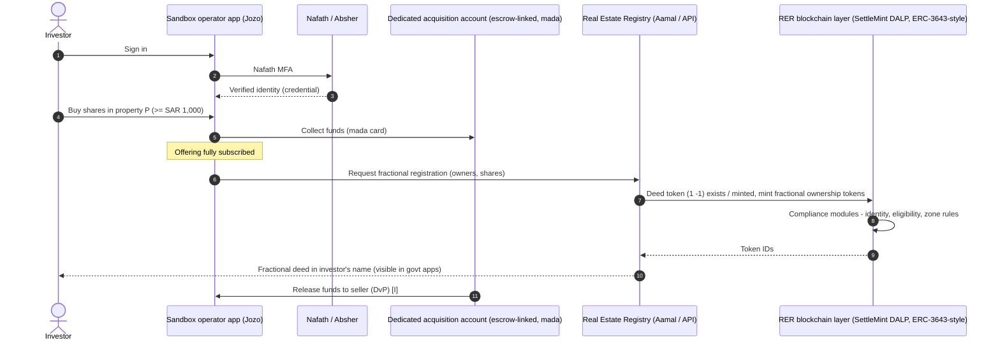
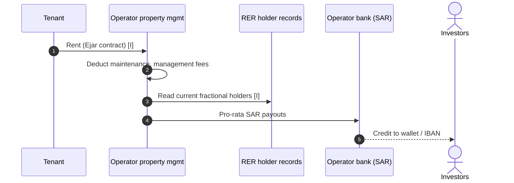
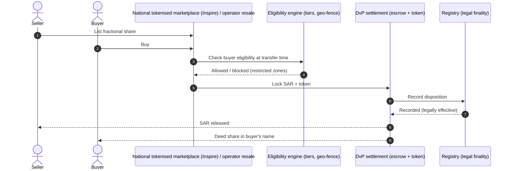
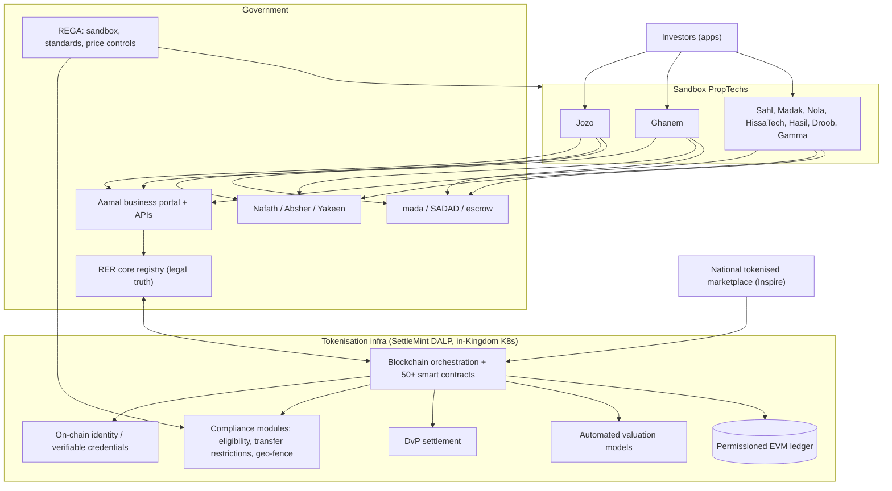

# Saudi National Real-Estate Tokenisation (REGA / Real Estate Registry + SettleMint) and its sandbox operators (Jozo, Ghanem, Sahl, Madak …) — MENA (Saudi Arabia)

| Field | Value |
|---|---|
| Website | REGA https://rega.gov.sa · Real Estate Registry (RER) / Aamal business portal · SettleMint https://www.settlemint.com · Jozo https://jozo.sa/en/ |
| HQ / legal entity | **Real Estate General Authority (REGA)** — regulator & sandbox owner; **National Real Estate Registration Services Co. ("Real Estate Registry", RER)** — registry operator; **SettleMint** — tokenisation infra (DALP); **Inspire for Solutions Development** — marketplace developer; sandbox operators e.g. **Jozo** (Riyadh) [C#1][C#2][C#3][C#9] |
| Founded | Saudi PropTech Hub (SPH) 27 Oct 2024; national tokenisation infra operational 20–21 Nov 2025; sandbox 2nd edition 13 Feb 2026 [C#8][C#2][C#7] |
| Status as of Sep 2026 | **Live as a regulated pilot.** Registry-linked fractional deeds issued by sandbox operators (Jozo "first private platform to issue fractional deeds"); national tokenised marketplace (secondary trading) still being built; full framework expected from mid-2026 (status of final executive regulations **unconfirmed** as of Sep 2026) [C#9][C#11][C#6] |
| Category | **Regulator pilot + sovereign tokenisation infra**, with **on-chain-registry-linked fractional deeds** distributed by licensed-in-sandbox PropTechs |
| Asset focus | Residential/rental property; NHC-developed stock; Riyadh assets near Vision 2030 projects [C#1][C#9][C#11] |
| Scale | First tokenised deed trade (NHC ↔ investors) Nov 2025; first "sovereign-native" deed transfer (NHC/REDF, droppRWA) Feb 2026; **9 sandbox platforms** operating (first batch); SettleMint supported 4 PropTechs (Sahl, "Madek" [sic — spelled "Madak" in C#12], Ghanem, Jozo) by Feb 2026; Jozo seed SAR 8.3m (Apr 2026). No aggregate AUM/investor numbers published [C#1][C#5][C#7][C#18][C#10] |
| Min. investment | SAR 1,000 (Jozo; Ghanem per Enterprise AM); some sources cite ~SAR 5,000 [C#9][C#6][C#11] |
| Why it is in the Top 5 | The only MENA regime where **the national land registry itself is the token ledger of record** ("registry-as-truth"), with a published national tokenisation technical standard, ERC-3643-style compliance and an open-API roadmap — the largest addressable market in the GCC and the most important design reference for RealX's Saudi strategy |
| Research confidence | **Medium** (government releases + infra vendor PR + operator site); **Low** for volumes, secondary-market rules and final legal framework |

---

## 1. Business model snapshot
- **Government layer:** REGA sets rules and runs the **PropTech Regulatory Sandbox** (SPH); RER operates the title registry, now a **hybrid registry + blockchain orchestration layer** built with SettleMint; Inspire builds the national tokenised marketplace [C#2][C#3][C#7].
- **Private layer:** sandbox PropTechs (Jozo, Ghanem, Sahl, Madak, Nola, HissaTech, Hasil, Droob, Gamma Universe) acquire rental properties, split them into **fractional deeds registered in investors' names** via RER, and run property management and distributions [C#12][C#9].
- **Economics:** operator fees (not disclosed); RER/REGA registration fees; **Real Estate Transaction Tax (RETT) 5 %** on transfers; non-Saudi transfers may incur up to 5 % additional fee [C#12][C#13].
- **Investor pitch (Jozo):** ~8.2 % rental yield + ~30 % appreciation over 3–4 years, from SAR 1,000, Shariah-reviewed [C#9].

## 2. Legal & compliance structure

### 2.1 Issuing vehicle
- **Direct fractional deeds**: "Investors receive official deeds in their names from the real estate registry" (Jozo) [C#9]; tokens "linked to official records" [C#1]; Raghdan: tokenised properties are "registered directly in official government title deeds", unlike beneficial-interest tokens elsewhere [C#12].
- A vendor page claims an **SPV/LLC wrapper** is used [C#13] — **conflicts** with Jozo and REGA framing; treat as unverified [I: primary operator statement preferred].
- **Dual-token model**: a 1:1 **deed token** (legal title, linked to RER) + separate **fractional ownership tokens** [C#5][C#15].
- Operator collects client funds "in a dedicated account for asset acquisition" before deed issuance [C#10].

### 2.2 What the token legally represents
- Under the Real Estate Registration Law the register has "**absolute probative force**" and dispositions are only effective once recorded → **settlement = registry update, not token transfer** [C#14].
- Tokens are "machine-readable digital tokens linked to official records" with legal standing equal to paper deeds (Ghanem CEO: "the same legal weight as a physical piece of paper") [C#1][C#6].

### 2.3 Licences / exemptions
| Element | Detail | Label |
|---|---|---|
| Sandbox | REGA PropTech Sandbox (SPH), 2nd edition 13 Feb 2026 incl. fractional-ownership-in-tokenisation track; stages: application → readiness → testing 6–24 months → exit to market | [C#7] |
| Standards | REGA tokenisation technical standards announced for early 2026; reported published Jan 2026 | [C#1][C#11] |
| Sandbox supervision | Continuous audits, **weekly reports**; graduation requires viable business model (profitability, local hiring, governance) and investor protections; final approval tied to the pending national tokenisation law | [C#6] |
| CMA role | Reported: yield-bearing tokens may be securities under CMA; joint REGA–CMA supervision claimed by secondary sources; REGA-only per others | [C#11][C#13] vs [C#12] — **unresolved** |
| Foreign ownership | Real Estate Ownership System for Non-Saudis in force **22 Jan 2026** per REGA's own release ("has officially entered into force" as of that date); secondary sources say 21 Jan 2026. Designated zones; in Makkah/Madinah ownership is limited to Saudi companies and Muslim individuals; Geographical Zones Document promised for Q1 2026 | [C#20] (primary) vs [C#13][C#12] |
| Cybersecurity | NCA standards compliance for national platform | [C#16][C#3] |

### 2.4 Regulators & partners
REGA, RER, Ministry of Municipalities & Housing (sponsor), NHC (first issuer), REDF, SettleMint, Inspire, droppRWA (Feb 2026 deed transfer infra), Shariyah Review Bureau (Jozo) [C#1][C#2][C#5][C#9].

### 2.5 KYC / AML
- **Nafath** (national digital identity, NIC) mandatory; **Absher** integration; **Yakeen** (identity data) referenced [C#9][C#11][C#4][C#16].
- Every resident receives a "digitally verified blockchain credential" (W3C Verifiable Credentials, eIDAS 2.0 interop) and every property a unique on-chain identity [C#4][C#3].
- **Eligibility enforced at each transfer** via geo-fencing and eligibility tiers; system can "block transactions in restricted zones" based on residency and religious status (Makkah/Madinah rules) [C#6][C#14].

### 2.6 Investor eligibility
- Saudi citizens (incl. abroad), residents; non-Saudis gradually (designated zones; non-Saudi capability "in the next 5 months" as of Apr 2026, i.e. around Sep 2026 — whether that milestone was met is **not verified** as of 23 Sep 2026) [C#12][C#6][I].
- Target groups: middle-class, micro-investors, diversifiers, foreigners [C#6].

### 2.7 Tax
RETT 5 % applies to tokenised transfers; Zakat considerations for Saudi investors [C#12][I].

### 2.8 Protections
REGA price controls pre-launch; sandbox audits; dedicated client-fund accounts; registry finality [C#6][C#10]. No enforcement actions found.

## 3. User types

| Persona / role | Evidence |
|---|---|
| REGA (regulator, sandbox) | [C#7] |
| RER (registry operator; Aamal business portal users: developers, corporates, financiers) | [C#15] |
| Government issuers (NHC, REDF) | [C#1][C#5] |
| Sandbox PropTech operators (Jozo, Ghanem, …) | [C#12] |
| Retail investor (Saudi/resident; later non-Saudi) | [C#9][C#6] |
| Infra vendors (SettleMint, Inspire, droppRWA) | [C#2][C#5] |
| Banks / payment networks (mada, SADAD, escrow) | [C#3][C#16] |
| Shariah reviewer | [C#9] |

## 4. Actions by user type

| Role | Action | Channel | On/off-chain |
|---|---|---|---|
| Investor | Log in with Nafath; KYC | Operator app | Off-chain identity → on-chain credential [C#4] |
| Investor | Pay via mada card (escrow-linked) | Operator app | Off-chain |
| Investor | Buy fractional share (≥ SAR 1,000) | Operator app | Registry + token issuance |
| Investor | Receive rent distributions; track portfolio | Operator app | Off-chain |
| Investor | Sell shares via platform ("exit by selling shares through the platform") | Operator app | Registry update [C#10] |
| Operator | Acquire property, submit fractionalisation to RER, file weekly reports | Aamal/API + REGA portal | Mixed |
| RER | Tokenise deed (1:1), mint fractional tokens, update register | RER + SettleMint | On-chain (permissioned EVM) |
| REGA | Admit/graduate sandbox firms, set price controls, geo-rules | Regulator | Off-chain |

## 5. Core flows

### 5.1 Onboarding
Nafath authentication → Yakeen/Absher identity data → operator KYC/AML → verifiable credential bound to investor → eligibility tier (citizen/resident/non-Saudi; zone rules) [C#4][C#6][C#11].

### 5.2 Primary purchase (sandbox operator, e.g., Jozo)

Deed-in-name, RER support, dedicated account, Nafath, mada [C#9][C#10]; DvP settlement and embedded compliance [C#5][C#4]; exact API choreography [I].

### 5.3 Income distribution

Operator "handles property operations, maintenance, rent collection, and return distribution" [C#9]; cadence not disclosed [—]; holder read from registry [I from registry-as-truth].

### 5.4 Secondary transfer (national marketplace — in development)

Status: "No trading platforms operational yet" (Apr 2026) [C#6]; marketplace governance rules to be finalised in 6–12 months [C#6]; operator-level resale exists at Jozo ("exit by selling shares through the platform") [C#10]. Transfer-time eligibility and register-as-settlement are confirmed design principles [C#14][C#6].
> **QA note (Fable):** the latest evidence on the national marketplace and on the "full framework from mid-2026" target is dated Apr 2026 (C#6); no source later than Aug 2026 was fetched. As of 23 Sep 2026 the marketplace status, the final tokenisation law/executive regulations and the CMA's role remain **unverified** — re-check rega.gov.sa and spa.gov.sa before relying on §5.4/§9.

### 5.5 Exit
Operator-led property sale at end of 3–4-year horizon [C#9][I].

### 5.6 Governance — not disclosed.

### 5.7 Issuer/listing onboarding
Operator multi-stage vetting (search, feasibility, documents, condition) [C#9]; RER Aamal handles registrations, splits/merges, RRR [C#15]; REGA price controls pre-launch [C#6].

## 6. Reverse-engineered architecture

**Narrative.** Saudi Arabia inverted the Dubai model: instead of a licensed private issuer (Ctrl Alt) syncing *to* the registry, the **registry operator itself runs the tokenisation stack** (SettleMint DALP; "registry-as-truth"; hybrid of RER core + blockchain orchestration) and private PropTechs are *front-ends in a sandbox* [C#2][C#3][C#14]. Compliance lives on-chain (enhanced **ERC-3643**, "more than 50 interconnected smart contracts governing identity verification, transfer restrictions, investor eligibility and lifecycle controls") and runs in **Saudi data centres on Kubernetes** [C#4]. Legal finality is the registry entry [C#14].

## 7. Tech stack

| Layer | Technology | Label | Source |
|---|---|---|---|
| Blockchain | Permissioned/public EVM supported by DALP; network name not disclosed | [C#17] + [I] permissioned EVM given sovereign hosting | |
| Token standard | "Enhanced ERC-3643" | [C#4] | SettleMint CEO interview |
| Token model | 1:1 deed token + fractional ownership tokens | [C#5][C#15] | |
| Compliance | 50+ smart contracts; DALP has 12 on-chain compliance module types | [C#4][C#17] | |
| Identity | Nafath, Absher, Yakeen; W3C VC / eIDAS 2.0 | [C#3][C#4][C#16] | |
| Custody | DALP integrates Fireblocks, Ripple Custody/Metaco, DFNS, Utila, Luna HSM — which one RER uses is **not disclosed** | [C#17] | |
| Settlement | Atomic DvP; "escrow-linked payment verification" | [C#5][C#3] | |
| Fiat rails | mada, SADAD | [C#16][C#3] | |
| Stablecoins | None disclosed; Tether/Hadron courting Saudi RWA separately (Aug 2026) | [C#18] | |
| Valuation | Embedded AVMs | [C#3] | |
| Hosting | Kubernetes, containerised, in-Kingdom data centres; NCA standards | [C#4][C#16] | |
| Marketplace | Inspire for Solutions Development | [C#2] | |
| Registry APIs | RER Aamal business portal (API linkage; no public OpenAPI) | [C#15] | |
| Operator stack (Jozo) | Mobile app, Nafath login, mada | [C#9] | |

## 8. Money flows & revenue model
- Investor → operator dedicated acquisition account (SAR, mada) → seller at registration (DvP) [C#10][C#5].
- Rent → operator → investors pro rata (SAR) [C#9].
- Government: registration fees; RETT 5 %; non-Saudi surcharge up to 5 % [C#12][C#13].
- Operator fees: not disclosed [—].

## 9. Secondary market & liquidity
- National marketplace not yet live as of Apr 2026; operator-level resale exists [C#6][C#10].
- Structural limit flagged: liquidity fails when fractionalisation exceeds qualified buyer base; exceptions (inheritance, court orders, corrections) must be built into workflows [C#14].

## 10. Risks, incidents, controversies
- **Legal framework in flux** (final tokenisation law / executive regulations pending as of last evidence) [C#6][C#12].
- **Regulatory perimeter ambiguity** REGA vs CMA [C#11][C#13].
- **Two infra narratives** (SettleMint national infra vs droppRWA "sovereign-native" deed transfer) — ecosystem roles not fully clear [C#2][C#5].
- Source conflict on SPV vs direct deed [C#9][C#13].
- No incidents found.

## 11. Extrapolated ADMIN PANELS  *(EXTRAPOLATION — not observed)*

Two consoles matter: (A) the **sandbox operator back office** (what RealX would build in KSA) and (B) the **registry/regulator console** it must interoperate with.

### 11.1 (A) Operator back office — modules
| # | Module | Widgets | Evidence |
|---|---|---|---|
| 1 | Investor & Nafath KYC | Nafath status, Yakeen data, eligibility tier (citizen/resident/non-Saudi), zone restrictions | [C#6][C#11] |
| 2 | Property pipeline & vetting | Multi-stage checklist (search, feasibility, docs, condition), REGA price-control check | [C#9][C#6] |
| 3 | Offering & subscription | Target, SAR 1,000 min, per-investor caps, dedicated-account balance | [C#9][C#10] |
| 4 | RER registration console | Aamal submissions, fractional deed status per investor, deed/token IDs, rejection handling | [C#15] |
| 5 | Payments & escrow | mada/SADAD receipts, escrow release (DvP), refunds | [C#3][C#16] |
| 6 | Distribution engine | Rent roll, deductions, pro-rata SAR payouts, Zakat statements | [C#9] |
| 7 | Resale desk | Listings, eligibility check at transfer, RER update tracking | [C#10][C#14] |
| 8 | Sandbox reporting | **Weekly REGA report builder**, KPIs (profitability, Saudisation/local hiring, complaints), audit evidence room | [C#6] |
| 9 | Shariah compliance | SRB certificates per product, purification | [C#9] |
| 10 | Exceptions desk | Inheritance, court orders, corrections workflows | [C#14] |

### 11.2 (B) Registry / regulator console — modules (RER/REGA side)
Sandbox participant registry & KPIs; tokenisation standards conformance checks; national token ledger explorer (deed token ↔ fractional tokens); eligibility/geo-fence policy manager; price-control bands; AVM valuations; marketplace supervision; API client management (Open API Phase III) [C#3][C#6][C#7].

### 11.3 Admin actions (4-eyes)
Operator: approve offering (Investments → Compliance + Shariah); submit fractional registration (Ops → Head of Registry Liaison); release escrow (Finance → CFO, only after RER confirmation); process inheritance transfer (Legal → Compliance). Registry: approve operator API scopes; change eligibility policy (policy officer → REGA approver).

### 11.4 RBAC
Operator: Super-admin · Investments · Registry liaison · Finance (maker/checker) · Compliance/MLRO · Shariah officer · Property manager · Support · REGA auditor (read-only). Registry: Policy admin · Sandbox supervisor · API admin · Auditor.

### 11.5 Alerts / automations / reports
Weekly sandbox report auto-generation; registry rejection alerts; Nafath credential expiry; eligibility-policy changes pushed to operators; escrow ageing; Zakat/RETT calculation reports.

## 12. Builder takeaways (RealX)
- **Copy:** registry-as-truth; transfer-time eligibility (not just onboarding); Nafath-first UX; DvP with escrow; exception workflows designed up front.
- **Avoid:** assuming token transfer = legal transfer; building a parallel ledger that can drift from the registry.
- **Differentiate / enter:** apply to a future REGA sandbox cohort (2nd edition closed 30 Apr 2026; testing 6–24 months), build on RER Aamal APIs; pair with a CMA-regulated fund/distribution entity (Stake's model) for yield products; target non-Saudi investors as designated zones open.

## 13. Sources (accessed 23 Sep 2026)
1. SPA — "REGA Announces Completion of First Real Estate Tokenization, Establishes First Global Regulatory Standard…" (19 Nov 2025) — https://www.spa.gov.sa/en/N2448380
2. SettleMint News — "Kingdom of Saudi Arabia launches national real estate tokenization infrastructure: A global first" (20 Nov 2025) — https://news.settlemint.com/news/kingdom-of-saudi-arabia-launches-national-real-estate-tokenization-infrastructure-a-global-first
3. Zawya — same release (government news) — https://www.zawya.com/en/press-release/government-news/kingdom-of-saudi-arabia-launches-national-real-estate-tokenization-infrastructure-a-global-first-jyw8j10k
4. Gulf Business — "The infrastructure play behind Saudi's real estate tokenisation strategy" (2026 interview, Adam Popat) — https://gulfbusiness.com/en/2026/interviews/infrastructure-of-saudi-real-estate-tokenisation/
5. Gulf Business — "Saudi Arabia executes world's first tokenised property deed" (5 Feb 2026) — https://gulfbusiness.com/en/2026/tech/saudi-arabia-sovereign-native-tokenised-property/
6. Enterprise AM — "Under the hood of the Kingdom's shift to digital real estate deeds" (6 Apr 2026) — https://enterpriseam.com/ksa/2026/04/06/under-the-hood-of-the-kingdoms-shift-to-digital-real-estate-deeds/
7. SPA — "REGA Launches Regulatory Sandbox Featuring Real Estate Tokenization" (13 Feb 2026) — https://www.spa.gov.sa/en/N2511536
8. REGA — "REGA Launches Saudi PropTech Hub (SPH)" (27 Oct 2024) — https://rega.gov.sa/en/media-center/news-announcements/rega-launches-saudi-proptech-hub-sph/
9. Jozo — homepage — https://jozo.sa/en/
10. Tokenizer.Estate News — "Saudi Proptech Jozo Raises $2.2M…" (Apr 2026) — https://news.tokenizer.estate/saudi-proptech-jozo-raises-2-2m-seed-for-fractional-real-estate-tokenization/
11. Bayut KSA blog — "Real Estate Tokenization in Saudi Arabia 2026" — https://www.bayut.sa/blog/en/marketing-intelligence/real-estate-tokenization-in-saudi-arabia-2026-new-era-of-property-ownership/
12. Raghdan Real Estate — "Real Estate Tokenization in Saudi Arabia 2026 — The Complete Guide" — https://raghdan.sa/en/news/real-estate-tokenization-in-saudi-arabia-2026-the-complete-guide/
13. Tokenizer.Estate — "Real Estate Tokenization in Saudi Arabia | CMA & REGA" (vendor page) — https://tokenizer.estate/saudi-arabia
14. Tokenizer.Estate blog — "Saudi Arabia 2026: Real Estate Tokenization Goes National" — https://blog.tokenizer.estate/saudi-arabia-2026-real-estate-tokenization-goes-national/
15. WebMob Info — "Real Estate Tokenization for Saudi Arabia's Aamal Registry" — https://www.webmobinfo.ch/blog/real-estate-tokenization-platform-for-saudi-aamal-registry
16. SQ Magazine — "Saudi Arabia Launches World's First National Blockchain Platform for Real Estate" — https://sqmagazine.co.uk/saudi-arabia-blockchain-real-estate-tokenization/
17. SettleMint — homepage (DALP) — https://www.settlemint.com/
18. Crypto Daily — "Tether Takes Tokenization Into Saudi Real Estate" (Aug 2026) — https://cryptodaily.co.uk/2026/08/tether-tokenization-saudi-real-estate
19. Stake — Series B blog (Stake to join Saudi national tokenisation platform & sandbox) — https://getstake.com/content-hub/blog/articles/series-b
20. REGA — "Non-Saudi property ownership system enters into force as of today" (22 Jan 2026) — https://rega.gov.sa/en/media-center/news-announcements/rega-non-saudi-property-ownership-system-enters-into-force-as-of-today/ (added at QA, 23 Sep 2026)
