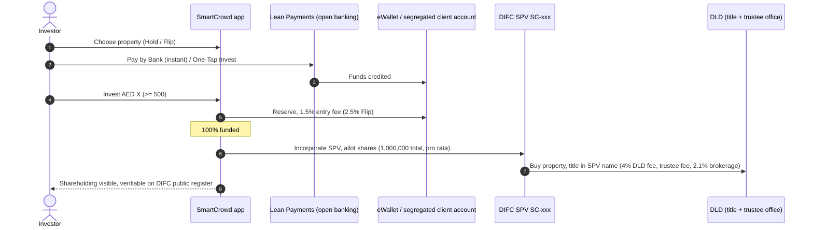
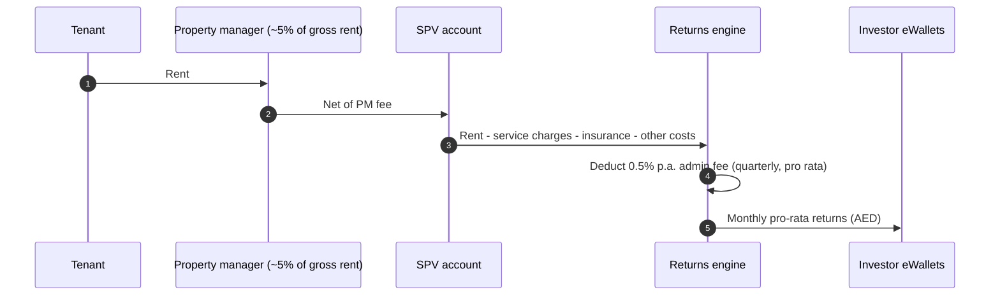
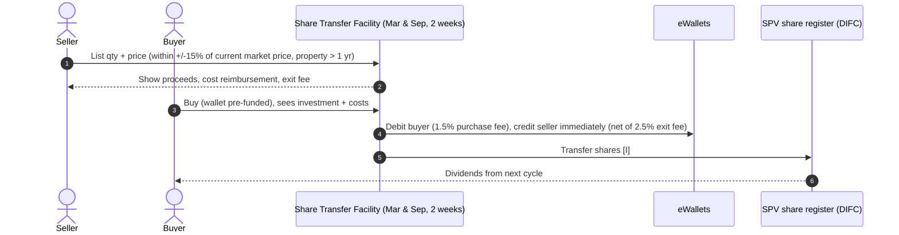
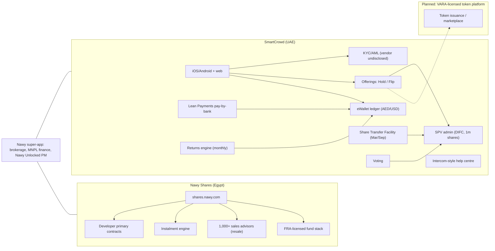

# SmartCrowd / Nawy Shares (Nawy group) — MENA (UAE, Dubai; Egypt)

| Field | Value |
|---|---|
| Website | https://www.smartcrowd.ae · help https://help-center.smartcrowd.ae · Egypt: https://shares.nawy.com |
| HQ / legal entity | **Smart Crowd Limited** (DIFC, Fintech Hive; DFSA ref. **F004285**, "Operating a Crowdfunding Platform", licensed 19 Apr 2018, with Retail Client, Client Assets and **Islamic Window** endorsements [C#23]); parent **SmartCrowd Holding Ltd**; majority-owned by **Nawy** (Egypt) since Jul 2025; **Nawy Shares** = group's fractional brand (Egypt; and the name under which the VARA IPA was granted) [C#1][C#6][C#16][C#2][C#3] |
| Founded | SmartCrowd 2018 (MENA's first regulated RE crowdfunding platform) [C#1][C#2]; Nawy Shares c. late 2023/2024 [I: ~18 months of FRA collaboration before Jun 2025, C#10] |
| Status as of Sep 2026 | **Active (off-chain).** VARA **In-Principle Approval** for a tokenised real-estate platform (5 Feb 2026) — not yet on VARA register as of Sep 2026. Nawy Shares holds 4 FRA licences in Egypt (Apr 2026) [C#3][C#17][C#11] |
| Category | **Off-chain digital fractional** (UAE: DIFC SPV shares under DFSA crowdfunding; Egypt: civil-code common ownership + FRA fund licences) with a **VARA tokenisation pipeline** |
| Asset focus | UAE: ready residential "Hold" (≤ 5 yrs) and "Flip" (12–18 months) incl. overseas flips (e.g., Miami); Egypt: off-plan units from top developers on instalments [C#1][C#8][C#9] |
| Scale | SmartCrowd: US$110m+ transactions, US$40m+ returns distributed, investors from 130+ countries (Jul 2025); homepage 176 properties funded / 77 exited; AED 220m in exits (Feb 2026); 2026 target AED 500m transactions. Nawy group: GMV US$1.4bn in 2024, US$3bn to date; Nawy Shares 405 properties / 35 projects / 16 developers listed [C#2][C#1][C#3][C#12][C#13][C#9] |
| Min. investment | AED 500 (UAE); Egypt ≈ US$500 / "one share", instalments from ~EGP 5,000/month [C#1][C#12][C#9] |
| Why it is in the Top 5 | Pioneer and longest-running regulated fractional RE platform in MENA (since 2018), >75 exits (the region's deepest exit track record), now part of Africa's largest proptech with a VARA tokenisation IPA and an Egyptian FRA-licensed fractional arm — the best MENA case of a crowdfunding incumbent migrating to tokens across two regulatory regimes |
| Research confidence | **High** for UAE crowdfunding mechanics (own help centre); **Medium** for Egypt; **Low** for tokenised design (IPA announcement only) |

---

## 1. Business model snapshot
- **UAE (SmartCrowd):** investors pool into a DIFC SPV per property (1,000,000 shares; SPV name "SC-…" on DLD title deed) → monthly net rent → exit via investor vote (~5 yrs) or **Share Transfer Facility (STF)** twice a year [C#1][C#5][C#20].
- **Two strategies:** *Hold* (6–12 % p.a. target) and *Flip* (15–20 % annualised target; 60/40 profit split above 10 % hurdle) [C#1][C#4].
- **Egypt (Nawy Shares):** Nawy Shares buys units from developers under primary contracts and sells fractional "shares" on a common-ownership basis (Civil Code No. 131/1948), payable by instalments; exits handled by Nawy's 1,000+ sales advisors [C#9]. FRA has built a "regulated umbrella" via investment funds + underwriting/promotion licences; Nawy Shares now holds fund issuance, fund management, promotion & underwriting, and subscriptions-receipt licences [C#10][C#11].
- **Tokenisation (planned):** Nawy Shares/SmartCrowd VARA IPA "for tokenised real estate platform" — "fractional property ownership on-chain to improve security, transparency and tradability" [C#3].
- **Group synergy:** Nawy super-app (brokerage, Move-Now-Pay-Later financing, property management "Nawy Unlocked", fractional) [C#12][C#13].

## 2. Legal & compliance structure

### 2.1 Issuing vehicle
- UAE: **one DIFC SPV per property**, 1m shares; title in SPV name; trustee fee AED 2,100–4,200 per property (DLD trustee office) [C#4][C#5].
- Egypt: platform-bought unit held in common ownership by share-holders (Civil Code) — transitioning to FRA-licensed **fund** model [C#9][C#10][C#11].

### 2.2 What the investor owns
UAE: SPV shares, verifiable on DIFC public register [C#5]. Egypt: undivided co-ownership share or fund units [C#9][C#11]. Future: on-chain tokens under VARA (legal link to DLD title **not disclosed**) [C#3].

### 2.3 Licences
| Entity | Licence | Label |
|---|---|---|
| Smart Crowd Ltd | DFSA ref. F004285 — "Operating a Crowdfunding Platform" (register wording; property crowdfunding in practice), licensed 19 Apr 2018; endorsements: Retail Clients, Holding or Controlling Client Assets, **Operating an Islamic Window** | [C#23][C#16][C#6] |
| Nawy Shares (UAE) | VARA In-Principle Approval (5 Feb 2026), "final step before full authorisation" | [C#3] |
| Nawy Shares (Egypt) | FRA: fund issuance, fund management, promotion & underwriting, subscriptions receipt (4th licence Apr 2026) | [C#11] |
| SmartCrowd × RTA | 2024 MoU for blockchain/NFT-based public-asset investment (no launch evidence) | [C#15] |

### 2.4 Regulators & partners
DFSA, DIFC Registrar, DLD (title/trustee), VARA (IPA), Egypt FRA; **Lean Payments** (open-banking pay-by-bank) [C#14]; Dubai RTA (MoU) [C#15].

### 2.5 KYC / AML
- KYC 1–2 business days (third-party review) [C#8]; vendor **not disclosed** (privacy policy generic) [C#7].
- Entry fee covers "escrow services, anti-money laundering compliance checks…"; no separate KYC fee [C#4] (contrast Stake).
- Egypt: "phone, ID and bank card" [C#9].

### 2.6 Eligibility & limits
- International investors accepted (130+ countries) [C#2][C#8].
- DFSA crowdfunding retail caps (US$50k per property / US$100k p.a.) apply to DFSA platforms [C#6] — [I] applies to SmartCrowd as a DFSA crowdfunding operator.

### 2.7 Tax — not disclosed for UAE; Egypt not disclosed.

### 2.8 Protections & disclosures
Segregated client accounts [C#8]; Disclosures collection (regulatory, risk, financial) [C#14]; key-risks page [C#1]. No enforcement actions found.
- **Shariah:** the DFSA register shows an "Operating an Islamic Window" endorsement [C#23], but the homepage does not market Shariah compliance and no Shariah board or certificate is named [C#1] — whether individual offerings are Shariah-screened is not disclosed [I].

## 3. User types
| Persona / role | Evidence |
|---|---|
| Retail investor (global) | [C#1][C#2] |
| Professional investor (higher limits) | [I from DFSA regime] |
| STF seller / buyer | [C#20] |
| Voting shareholder | [C#1][C#22] |
| Egyptian instalment buyer (Nawy Shares) | [C#9] |
| Developer partner (Egypt: DMG, TMG, Tatweer Misr, Emaar Misr, SODIC, Palm Hills) | [C#9] |
| Nawy sales advisor (resale) | [C#9] |
| Platform ops (acquisition, SPV admin, property mgmt, compliance) | [C#4] |

## 4. Actions by user type
| Role | Action | Channel | On/off-chain |
|---|---|---|---|
| Investor | Register (3–5 min), KYC | App/web | Off-chain |
| Investor | Deposit via **Pay by Bank (Lean)**, One-Tap Invest; eWallet withdrawals | App | Off-chain |
| Investor | Invest ≥ AED 500 in Hold/Flip | App | Off-chain |
| Investor | Receive monthly returns | eWallet | Off-chain |
| Investor | Vote to sell (majority) | App | Off-chain |
| Seller | List shares in STF (property > 1 yr, price ±15 % of market), edit/cancel | "Listed For Sale" tab | Off-chain |
| Buyer | Buy STF shares with pre-funded wallet | App | Off-chain |
| Egypt investor | Pick shares, pay by card / instalments; exit via advisors | shares.nawy.com | Off-chain |
| Future | Buy/trade tokens | VARA platform | On-chain [C#3] |

## 5. Core flows

### 5.1 Onboarding
Register → ID + address docs → AML checks → eWallet enabled; link bank via Lean for instant pay-by-bank [C#1][C#14].

### 5.2 Primary purchase

### 5.3 Income distribution

Monthly distributions, deductions and admin-fee timing [C#1][C#4].

### 5.4 Secondary — Share Transfer Facility

Confirmed: windows, ±15 %, >1 yr eligibility, fees, immediate credit, edit/cancel [C#18][C#19][C#20][C#22]. Matching appears first-come on seller listings [I: buyer picks listed shares; no auction described]. "Cost reimbursement" = buyer reimburses seller's share of unamortised acquisition costs [I from article title].

### 5.5 Exit
Majority vote to sell at ~5 years (or earlier for profit); Flip exits in 12–18 months; 2.5 % exit fee; Flip profit split 60/40 above 10 % hurdle [C#1][C#4]. Track record: e.g., Miami flip 45 % ROI in 11 months; 41.31 % avg net ROI [C#22].

### 5.6 Governance
Off-chain shareholder votes on sale [C#1].

### 5.7 Sourcing
In-house sourcing & due diligence covered by entry fee [C#4]; affordable communities (JVC, Arjan, Dubai South…) [C#8].

### 5.8 Egypt flow (Nawy Shares)
Sign up → choose property & shares → pay by bank card (instalments, sometimes 0 % down) → Nawy Shares holds unit via developer primary contract → resale by Nawy advisors when exit conditions met [C#9].

## 6. Reverse-engineered architecture

**Narrative.** Two off-chain ledgers under one group: a DIFC corporate-registry model in Dubai and a civil-code/fund model in Egypt. Neither has on-chain components today [C#1][C#9]. The VARA IPA indicates a third, token-native stack for Dubai; given only PRYPCO+Ctrl Alt are live on DLD rails, SmartCrowd would either distribute DLD title tokens via Ctrl Alt or tokenise SPV shares under a VARA issuance model [S].

## 7. Tech stack
| Layer | Technology | Label | Source |
|---|---|---|---|
| Blockchain / token | None today; future VARA platform (chain undisclosed) | [C#3] | |
| Fiat rails | Lean Payments (open banking), eWallet; AED/USD | [C#14][C#8] | |
| KYC | Undisclosed | — | [C#7] |
| Help desk | Intercom-style help centre (URL pattern `/en/articles/<id>-slug`) | [I] | |
| Mobile | iOS/Android apps | [C#8] | |
| Egypt payments | Bank cards, instalments | [C#9] | |
| Analytics/cloud | Not disclosed | — | |

## 8. Money flows & revenue model
| Item | UAE Hold | UAE Flip | Label |
|---|---|---|---|
| Entry | 1.5 % | 2.5 % | [C#4] |
| Admin | 0.5 % p.a. (quarterly from wallet) | — | [C#4] |
| Exit | 2.5 % | — | [C#4] |
| Performance | none | 40 % of profit above 10 % hurdle | [C#4] |
| Pass-through costs | DLD 4 %, trustee AED 2.1–4.2k, brokerage 2.1 %, PM ~5 % of rent, service charges, insurance | same | [C#4] |
| STF | 1.5 % buyer, 2.5 % seller, 0.5 % p.a. continues | — | [C#19] |
| Distributions | Monthly, AED | at exit | [C#1] |
(Third-party review claims 2 % mgmt fee and 1.5 % seller fee [C#8] — **conflicts** with SmartCrowd's own fee pages; own pages preferred.)

## 9. Secondary market & liquidity
- STF: 2 × 2-week windows (March, September), ±15 % of current market price, property > 1 yr, partial sales allowed, immediate wallet credit [C#18][C#20].
- Average time to sell 1–3 weeks (review) [C#8].
- Egypt: advisor-led resale [C#9].

## 10. Risks, incidents, controversies
- Ownership change (Nawy majority) and leadership change (CEO Riz Ahmed per 2025 coverage vs co-founder CEO Siddiq Farid in 2024) [C#13][C#15].
- Stale/inconsistent public stats (exits page "40+ exits / AED 22m" vs homepage 77 exited vs "AED 220m in exits") [C#22][C#1][C#3].
- Egypt model relies on civil-code co-ownership of off-plan units — developer delivery risk [C#9][I].
- No enforcement actions found.

## 11. Extrapolated ADMIN PANEL  *(EXTRAPOLATION — not observed)*

### 11.1 Modules & widgets
| # | Module | Widgets | Evidence |
|---|---|---|---|
| 1 | Portfolio dashboard | Funded/exited/live counts, AUM, ROI league (Hold vs Flip), distributions paid | [C#1][C#22] |
| 2 | Investor KYC/AML | Queue (1–2 day SLA), country risk, DFSA cap usage | [C#8][C#16] |
| 3 | Payments | Lean pay-by-bank reconciliation, reversals, One-Tap Invest bank coverage, withdrawals | [C#14] |
| 4 | Offering builder | Strategy (Hold/Flip), target, 1m-share allotment, fee preview, pass-through cost budget | [C#4][C#5] |
| 5 | SPV secretarial | "SC-" SPV incorporation, DIFC register, DLD title/trustee booking | [C#5][C#4] |
| 6 | Returns engine | Monthly run, PM ~5 % fee, quarterly 0.5 % admin fee deduction | [C#4] |
| 7 | STF manager | Window scheduler (Mar/Sep), market-price reference, ±15 % validator, listings, cost-reimbursement calc, settlement | [C#18][C#20] |
| 8 | Voting & exits | Vote creation, tally, sale execution, Flip hurdle/profit-split calculator | [C#1][C#4] |
| 9 | Disclosures & reporting | DFSA returns, risk disclosures, investor statements | [C#14] |
| 10 | Egypt (Nawy Shares) | Developer contracts, instalment schedules, FRA fund reporting, advisor resale pipeline | [C#9][C#11] |
| 11 | Tokenisation (new) | VARA obligations, token registry, marketplace surveillance | [C#3] |

### 11.2 Maker-checker actions
Publish offering; approve SPV share allotment; monthly returns run; set STF reference price; execute sale after vote; Flip profit-split payout; Egypt instalment default handling.

### 11.3 RBAC
Super-admin · Acquisitions · SPV secretary · Finance (maker) · CFO (checker) · Compliance/MLRO · Property manager · Support · Egypt ops · Auditor/regulator (read-only).

### 11.4 Alerts / automations / reports
STF window open/close automation; price-band violations; Lean payment failures; arrears; DFSA cap breaches; instalment arrears (Egypt); vote deadlines.

## 12. Builder takeaways (RealX)
- **Copy:** Flip product with hurdle + profit split (differentiated returns); pay-by-bank via open banking (Lean) for instant, low-cost deposits; strict ±15 % secondary band; public exit track record.
- **Avoid:** stale public stats; twice-a-year liquidity.
- **Differentiate:** tokenised continuous market plus Egypt-style instalments for off-plan (Nawy's key innovation) could be a strong combo for Dubai off-plan tokenisation.

## 13. Sources (accessed 23 Sep 2026)
1. SmartCrowd — homepage — https://www.smartcrowd.ae/
2. Nawy — "Nawy in UAE: Majority Stake Acquisition of SmartCrowd" — https://www.nawy.com/blog/119746-nawy-in-uae
3. TradingView/Zawya — "SmartCrowd, a Nawy Company, secures VARA in-principle approval for tokenised real estate platform" (5 Feb 2026) — https://www.tradingview.com/news/reuters.com,2026-02-05:newsml_Zaw52PDQp:0-zawya-pressr-smartcrowd-a-nawy-company-secures-vara-in-principle-approval-for-tokenised-real-estate-platform/
4. SmartCrowd — "Investment fees and costs" — https://www.smartcrowd.ae/smartcrowd-investment-fees-and-costs/
5. SmartCrowd — "Investments structure" — https://www.smartcrowd.ae/smartcrowd-investments-structure/
6. UAE Expert Hub — "Fractional Property Dubai: Which Platforms Are Licensed" — https://www.uaeexperthub.com/fractional-property-investment-dubai-licensed-platforms/
7. SmartCrowd — Privacy Policy — https://www.smartcrowd.ae/privacy-policy/
8. Oliva — "SmartCrowd Dubai: Platform Review 2026" — https://joinoliva.com/en/learn/blog/smartcrowd-dubai-platform-review-2026
9. Nawy Shares — homepage — https://shares.nawy.com/
10. Daily News Egypt — "From vision to framework: Egypt moves to regulate fractional real estate investment…" (15 Jun 2025) — https://www.dailynewsegypt.com/2025/06/15/from-vision-to-framework-egypt-moves-to-regulate-fractional-real-estate-investment-as-nawy-shares-leads-way/ ; Invest-Gate — https://invest-gate.me/news/nawy-shares-leads-efforts-to-regulate-fractional-real-estate-investment-in-egypt-under-fra-leadership/
11. TradingView/Zawya — "Nawy Shares reinforces its market-leading position" (21 Apr 2026) — https://www.tradingview.com/news/reuters.com,2026-04-21:newsml_Zaw7KY07g:0-zawya-nawy-shares-reinforces-its-market-leading-position/
12. TechCrunch — "Egypt's Nawy… raises $52M…" (11 May 2025) — https://techcrunch.com/2025/05/11/egypts-nawy-lands-a-52m-series-a-to-take-on-mena/
13. Wamda — "Nawy enters GCC proptech market by acquiring Dubai's SmartCrowd" (9 Jul 2025) — https://www.wamda.com/2025/07/nawy-enters-gcc-proptech-market-acquiring-dubai-smartcrowd
14. SmartCrowd Help Centre — index & "Pay by Bank (Instant Transfers)" collection — https://help-center.smartcrowd.ae/ ; https://help-center.smartcrowd.ae/en/collections/12573929-pay-by-bank-instant-transfers
15. Unlock Blockchain — "Dubai: Tokenized Public Investment via RTA & SmartCrowd" (May 2024) — https://www.unlock-bc.com/123616/dubai-tokenized-public-investment-rta-smartcrowd/
16. LegalNodes — "Fractional Real Estate Ownership in the UAE…" — https://www.legalnodes.com/article/fractional-real-estate-ownership-in-the-uae-tokenization-crowdfunding-and-reit-models
17. VARA — Public Register (SmartCrowd/Nawy not listed as of Sep 2026) — https://www.vara.ae/en/licenses-and-register/public-register/
18. SmartCrowd Help — "What is the Share Transfer Facility?" — https://help-center.smartcrowd.ae/en/articles/7991967-what-is-the-share-transfer-facility
19. SmartCrowd Help — "What are the fees involved in share transfer transactions?" — https://help-center.smartcrowd.ae/en/articles/7992086-what-are-the-fees-involved-in-share-transfer-transactions
20. SmartCrowd Help — "Can sellers… sell at any price…?" — https://help-center.smartcrowd.ae/en/articles/7992082-can-sellers-on-the-share-transfer-facility-sell-at-any-price-they-like-are-there-restrictions-in-place ; STF collection — https://help-center.smartcrowd.ae/en/collections/4080235-share-transfer-facility
21. SmartCrowd blog — "A Simple Guide to Real Estate Tokenization in Dubai" — https://www.smartcrowd.ae/blog/market-trends/a-simple-guide-to-real-estate-tokenization-in-dubai/
22. SmartCrowd — "Exits & returns" — https://www.smartcrowd.ae/exits-returns/
23. DFSA — Public Register entry "Smart Crowd Limited" (F004285; licensed 19 Apr 2018; Operating a Crowdfunding Platform; Retail, Client Assets and Islamic Window endorsements) — https://www.dfsa.ae/public-register/firms/smart-crowd-limited (added at QA, 23 Sep 2026)
