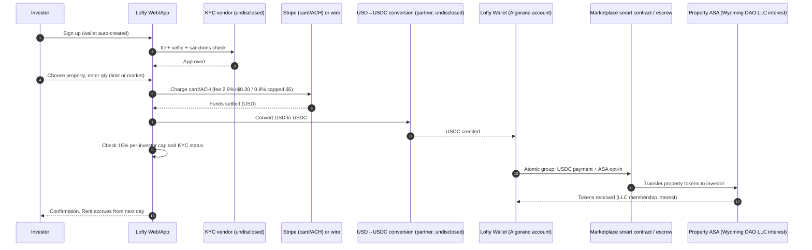
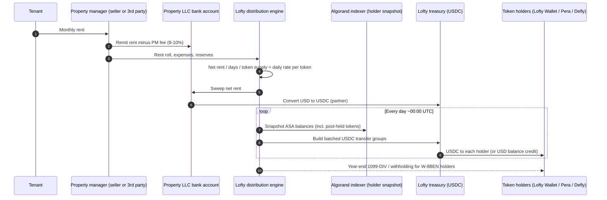
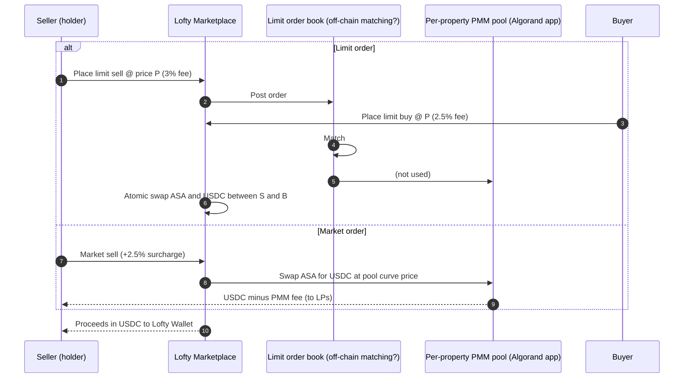
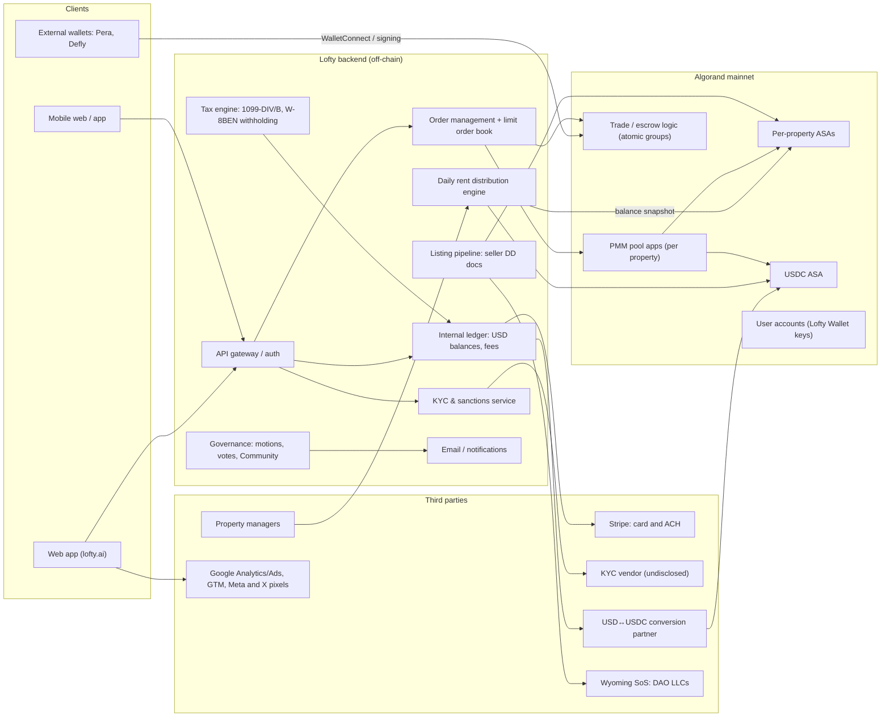

# Lofty — United States (USA)

| Field | Value |
|---|---|
| Website | https://www.lofty.ai |
| HQ / legal entity | Lofty AI, Inc. (Los Angeles, CA; Y Combinator S19) [C#2][C#13]. Each property held by a separate Wyoming LLC, often styled "Lofty Holding <address> DAO LLC" [C#1][C#8] |
| Founded | 2018 (company) [C#9][C#13]; Algorand marketplace launched 2021 [C#9] |
| Status as of Sep 2026 | **Active**. Marketplace live, TVL ~US$101M on DefiLlama [C#11] |
| Category | On-chain tokenized fractional (peer-to-peer marketplace) |
| Asset focus | US single-family and small multifamily rentals, some short-term rentals |
| Scale (AUM, properties, investors, volume) | "$100M+ total invested", "$5.2M+ distributed", "40K+ investors" (homepage, Sep 2026) [C#2]; TVL $101.1M, 100% on Algorand [C#11]; 180+ properties tokenized across 21 states (Sep 2026) [C#9] vs 111 properties visible on marketplace (May 2026) [C#1]; the two counts differ because one is cumulative and one is currently listed [I]; $1.7M of rent paid in 2025 [C#1] |
| Min. investment | ~$50 per token [C#2][C#9] |
| Why it is in the Top 5 | Largest **live** US on-chain fractional real-estate marketplace after RealT's 2026 collapse. Retail access at $50, daily USDC rent, 24/7 secondary trading with an on-chain liquidity pool (PMM), and per-property DAO LLC governance. Scores highest on the on-chain depth, secondary-liquidity and status criteria |
| Research confidence | **Medium-High** for product and flows; **Medium** for legal basis (Lofty does not publish its securities exemption); **Low** for internal stack |

---

## 1. Business model snapshot

- **Marketplace, not a fund.** Lofty says it does not own the properties. It runs a technology platform where **property sellers** (landlords and operators) list part of the equity in a rental and retail investors buy tokens that represent membership interests in that property's LLC [C#12][C#15]. A seller keeps **at least 10%** of the equity and can sell up to 90% at a price the seller chooses [C#15].
- **Revenue** comes from transaction fees: a 2.5% buyer fee and a 3% seller fee on limit orders, a +2.5% market-order surcharge on each side, and a property-listing fee charged to sellers (reported as 3% of equity sold [C#1] or 5% [C#9], so the sources conflict). There are also payment-rail fees: ACH at 0.8% capped at $5, card at 2.9% + $0.30, and free wires over $50k [C#1][C#9]. Lofty reports **0% management, AUM and performance fees** [C#9][C#14].
- **Investor value proposition.** $50 minimum, rent paid **daily** in USD or USDC, trading at any hour, and the right to vote on property decisions [C#2][C#5].
- **Unit economics.** Reported ~$1.5M revenue in 2024 and ~16 employees [C#1][C#9] (Y Combinator's company page lists a team size of 7 [C#13], so headcount is uncertain). The last disclosed funding was a Seed IV round in May 2023 [C#1]. That points to a lean, fee-funded operation that has not raised a Series A [I].

## 2. Legal & compliance structure

### 2.1 Issuing vehicle
- **One Wyoming LLC per property**, organised under Wyoming's DAO LLC statute (W.S. 17-31) [C#8][C#16]. Example: "Lofty Holding 3933 Walsh Street DAO LLC", registered in Missouri as a foreign LLC in 2022 [C#8].
- Registered-agent anonymity: in St. Louis, the listed agent turned out to be a persona used by the commercial agent Registered Agents Inc., so a local official could not identify the owners [C#8].

### 2.2 What the token legally represents
- Each property token is an **Algorand Standard Asset (ASA)** representing a fractional **membership interest in the property LLC** [C#7][C#9][C#16].
- Voting weight equals ownership percentage. **No investor may hold more than 15%** of a property's tokens [C#5][C#14].

### 2.3 Securities exemptions, licences and registrations
- **No Form D, Form 1-A or Reg CF filing** exists for the retail marketplace. Lofty does not publish which exemption, if any, it relies on [C#1][C#9]. The Terms state Lofty is "not registered with the SEC as a national securities exchange" and say that nothing on the site is an offer of securities [C#3].
- In an Oct 2023 interview, the CEO said the platform "is designated to avoid selling securities" [C#12]. The posture appears to be: tokens are sold by the property seller, and Lofty is only a software venue [I, from #3 and #12].
- **No Reg D channel either.** EDGAR full-text search returns 13 Form D filings by "<code> Fund I/II, a series of Lofty Ventures Syndicate, LP" (2021–2026), but these are **unrelated AngelList-style venture-capital funds** (industry group "Venture Capital Fund"; general partner "Fund GP, LLC"; agent Belltower Fund Group, Ltd.; addresses in Seattle/Lynnwood, WA; no mention of Lofty AI, Inc., Jerry Chu or Max Ball) [C#1][C#19]. They must not be attributed to Lofty AI, Inc. (Los Angeles) [C#1]. So Lofty has **no SEC filing of any kind** that can be linked to it.
  > **QA note (Fable):** the earlier draft described these as Lofty's "separate Reg D channel"; corrected on 23 Sep 2026 after reading the Form D primary_doc.xml for GH-1119 Fund I (CIK 2108431).
- **State action.** The California DFPI took an enforcement action dated **14 Nov 2022** against Lofty AI, Inc., Jerry Chu and Max James Ball [C#10]. Secondary sources describe it as a **consent order barring new token purchases by California residents** [C#9]. The primary PDF was blocked (HTTP 403), so the order's exact terms are unverified.
- **Takeaway for RealX.** Lofty's entire retail product rests on an undisclosed legal theory. In the reviewers' words, it is a "regulatory bet" [C#1]. It is the largest structural risk in the model [I].

### 2.4 Regulators & licensed partners
| Function | Partner | Label |
|---|---|---|
| Broker-dealer / ATS | None. Lofty says it is not a BD or RIA [C#2] | C |
| Transfer agent | None disclosed. The on-chain ASA ledger acts as the register of LLC members [I] | I |
| Custodian | None. The Terms claim the wallet is non-custodial [C#3] | C |
| Payments | Stripe [C#4] | C |
| Stablecoin | USDC on Algorand (Circle) [C#3][C#9] | C |
| Property managers | Seller-managed, or third-party managers such as HomeRiver Group (named in tenant complaints) [C#1][C#15] | C |
| Arbitration | JAMS, Los Angeles; Delaware governing law [C#3] | C |

### 2.5 KYC / AML / sanctions
- Buying or holding tokens requires KYC: identity documents plus a selfie, usually approved "within minutes" [C#9]. Users must be 18 or older [C#14].
- The KYC vendor is **not disclosed**, and the privacy policy names no identity vendor [C#4]. A doc-plus-selfie flow that clears in minutes is typical of Persona, Onfido or Veriff [S].
- Sanctions: users represent that they are not in comprehensively sanctioned jurisdictions [C#3], and OFAC-sanctioned jurisdictions are excluded [C#9].
- Staking USDC in a PMM liquidity pool **does not require KYC** [C#1][C#9]. Only buying and holding property tokens does, so there is a permissionless DeFi edge beside a KYC-gated core [I].
- No travel-rule tooling is disclosed. Lofty's non-custodial stance is probably meant to keep it out of FinCEN MSB scope [I].

### 2.6 Investor eligibility & geo-restrictions
- No accreditation is required for the retail marketplace [C#9]. Non-US investors are accepted except from sanctioned countries [C#14]. California residents are restricted under the DFPI order [C#9].

### 2.7 Tax handling & reporting
- US investors receive one consolidated **1099-DIV** for the portfolio, plus a **1099-B** if they sold [C#1].
- Non-US investors face **30% withholding by default, or 15%** with an ITIN and W-8BEN in treaty countries [C#1][C#9].
- **Inference:** 1099-DIV reporting and FDAP-style dividend withholding (rather than Schedule K-1 and effectively-connected-income withholding under §1446) suggest the property LLCs **elect to be taxed as C-corporations**. The elected structure turns rent into "dividends" and spares retail holders K-1s and state filing obligations [I, reasoning from #1 and #9. No election document found].

### 2.8 Disclosures, protections, regulatory actions
- Each listing publishes an inspection, an appraisal and due-diligence documents [C#15].
- California DFPI action, 2022 [C#10].
- No SEC enforcement action has been announced [C#1][C#9].
- Operating reserves per property are reported as opaque [C#1].

## 3. User types (personas & system roles)

| Persona | Description | Evidence |
|---|---|---|
| Retail investor (US) | KYC'd, not necessarily accredited; buys, sells, votes and receives daily rent | C#2, C#9 |
| Retail investor (non-US) | Same rights; files W-8BEN; subject to withholding | C#1, C#9 |
| Liquidity provider (LP) | Stakes USDC or property tokens into per-property PMM pools and earns PMM fees. No KYC needed for USDC staking | C#6, C#9 |
| Property seller / sponsor | Passes a background check, lists up to 90% equity, sets the price, retains ≥10%, may self-manage | C#15 |
| Property manager | Third party or the seller. Posts updates in the property's Community channel and is replaceable by vote | C#5 |
| Governance participant | Any token holder can file or second a motion and vote | C#5 |
| Lofty operations staff | Runs listings, KYC, marketplace, distributions and support | I |
| ~~Accredited syndicate LP~~ | Removed by QA: the "Lofty Ventures Syndicate, LP" Form Ds on EDGAR belong to an unrelated VC syndicate, not to Lofty AI (see §2.3). Lofty has no accredited-only product on record | C#1, C#19 |

## 4. Actions each user type can exercise

| Role | Action | Channel / UI | On-chain / off-chain |
|---|---|---|---|
| Investor | Sign up, complete KYC, add ACH, card or wire | Web/app | Off-chain |
| Investor | Fund wallet (fiat is converted to USDC) | Web/app → Stripe → USDC | Hybrid |
| Investor | Buy tokens (limit or market order) | Marketplace | On-chain settlement in USDC [C#3] |
| Investor | Sell tokens (limit or market; the PMM fills market orders) | Marketplace | On-chain |
| Investor | Receive daily rent (USD or USDC) | Automatic, no claim needed [C#9] | On-chain USDC transfer or off-chain USD balance |
| Investor | Withdraw USDC to an external Algorand wallet, or move tokens to Pera or Defly | Wallet | On-chain [C#9] |
| Investor | File or second motions, discuss and vote | Email + Community | Off-chain [C#5] |
| LP | Stake USDC or property tokens into the pool; unstake (with an imbalance penalty) | PMM UI | On-chain smart contract [C#6] |
| Seller | Apply, pass background check, upload inspection/appraisal, set price and % sold | Seller portal / ops | Off-chain → ASA minted [I] |
| Property manager | Post updates, submit rent and expenses | Community + ops | Off-chain |
| Lofty ops | Mint ASAs, list properties, run distributions, enforce the 15% cap, KYC gating | Admin (extrapolated) | Hybrid |

## 5. Core flows

### 5.1 Onboarding & KYC
1. The user signs up (about 2 minutes) and the app **creates an Algorand wallet automatically** [C#2][C#7].
2. KYC: ID document plus selfie, with automated approval in minutes [C#9]. Sanctions and jurisdiction checks run at the same time [C#3].
3. The user adds a payment method. Stripe processes cards and bank transfers [C#4]. ACH at 0.8% capped at $5 matches Stripe's ACH Direct Debit pricing exactly, and card at 2.9% + $0.30 matches Stripe's standard card pricing [I].
4. Optionally, the user links an external wallet (Pera or Defly) [C#9].

### 5.2 Primary purchase

Notes: the USDC settlement is confirmed [C#2][C#3]. The atomic-group mechanics are [I], because Algorand ASA transfers require opt-in and atomic transfers are the idiomatic way to do delivery-versus-payment (DvP) on Algorand. The conversion partner is [S].

### 5.3 Income distribution (daily)
1. Tenants pay rent to the property manager, who remits to the property LLC's operating account [I].
2. Net rent is calculated after property management (8–10% of gross), vacancy reserves and maintenance [C#9].
3. Lofty's distribution engine divides the net amount into a **daily** accrual per token and pays each holder around **midnight UTC** in USD or USDC, with optional reinvestment [C#1][C#9].
4. Distributions start the day after a property is fully funded [C#9].

Label: the daily cadence, currency and timing are [C#1][C#9]. The snapshot and batching mechanics are [I]. How tokens staked in the PMM are treated for rent is not disclosed [S].

### 5.4 Secondary trading (order book + PMM)
- **Order book** since launch: limit orders at any price, matched peer-to-peer [C#14].
- **PMM (Proactive Market Maker)**, launched **25 Jan 2024**: per-property liquidity pools of USDC and property tokens fill market orders instantly. A contract rule caps staked tokens at **20% of circulating supply**. PMM fees go to LPs. Large orders see slippage, and withdrawing during pool imbalance carries a penalty [C#6][C#1].
- At launch the PMM did not trade against open limit orders; that was planned for a later version [C#6].
- Reported fill times: seconds in deep pools, hours in thin ones [C#9].

### 5.5 Redemption / exit / property sale
- There is no redemption. Holders exit by selling on the marketplace [C#14]. A property sale needs a governance vote (for example, the St. Louis DAO voted to sell 3933 Walsh St on 17 Sep 2025) [C#8][C#5].
- On a sale, proceeds net of costs are presumably distributed pro rata in USDC and the ASA is retired [I].
- An independent reviewer found that "only one or two" properties had sold for more than their purchase price [C#1].

### 5.6 Governance / voting
- Robert's Rules: a motion is filed, then seconded, then open for **48h discussion** (24h if urgent), then a **72h vote** (24h if urgent). Voting is off-chain via email and the Community platform. Voting power equals ownership, and a failed proposal waits 90 days before it can return [C#5].
- Scope: major repairs, rent changes, property sales and replacing the property manager [C#5].

### 5.7 Issuer / property listing onboarding
1. The seller passes a background check [C#15].
2. An inspection, an appraisal and a due-diligence pack are produced and published [C#15].
3. A Wyoming DAO LLC is formed and title is conveyed to it, with foreign registration in the property's state [C#8][I].
4. A per-property ASA is minted and the seller sets the price and the % sold (≤90%) [C#15][I].
5. Management is by the seller or a third party [C#15].

## 6. Reverse-engineered architecture

**On-chain vs off-chain split.**
- On-chain: token ownership (ASAs), USDC settlement of trades, PMM pools and daily USDC rent transfers [C#3][C#6][C#9].
- Off-chain: KYC, the 15% cap check (probably enforced in the app, and possibly also through ASA freeze or clawback) [I], governance, rent accounting, tax reporting, listing due diligence, and the LLC and title records.
- The Terms' reference to a "lofty governance token" that upgrades the "Protocol" looks like DeFi-protocol boilerplate. No live governance token was found [C#3][I].

## 7. Tech stack

| Layer | Technology | Label | Source / reasoning |
|---|---|---|---|
| Blockchain | Algorand L1 (~4s finality, ~0.001 ALGO fee) | C | #7, #9 |
| Token standard | ASA per property (fungible, whole-unit tokens) | C | #7 |
| Compliance controls | ASA clawback/freeze addresses held by Lofty for KYC gating, the 15% cap, lost-key recovery and court orders | I | Terms say KYC is required to hold tokens; Algorand's native pattern for this is ASA freeze and clawback. Not verified on an explorer |
| Smart contracts | Algorand apps (TEAL/PyTeal) for the PMM, with a 20% staking cap coded in | C (existence) / I (language) | #6 |
| Identity | Undisclosed KYC vendor (doc + selfie) | C (flow) / S (vendor) | #9 |
| Wallet | App-generated Algorand account ("Lofty Wallet"), described as non-custodial and recoverable into any Algorand wallet; external Pera/Defly | C | #3, #7, #9. Coinpaprika calls the default wallet "custodial", which contradicts the Terms, so the key-management model is unverified |
| Fiat rails | Stripe for card and ACH; bank wire at $50k+ | C | #4, #1 |
| Stablecoin | USDC on Algorand | C | #3 |
| Marketplace | Hybrid limit order book + PMM pools | C | #1, #6 |
| Oracles | None disclosed. PMM pricing reference unknown (likely last trade or listing price) | S | #6 silent |
| Frontend | Web app. Framework unknown | S | — |
| Backend | Unknown. Needs an order-matching service, indexer and distribution cron | I | Functional necessity |
| Cloud | Unknown | S | — |
| Analytics / ads | Google Analytics, Google Ads, GTM, Meta Pixel, X Pixel | C | #4 |
| Community / governance | Property "Community" channels plus email | C | #5 |
| Property management | Seller or third-party PM (e.g., HomeRiver Group) | C | #1, #15 |
| Legal entity formation | Commercial registered agent (Registered Agents Inc.) in Wyoming | C | #8 |

## 8. Money flows & revenue model

| Flow | Payer → payee | Amount | Label |
|---|---|---|---|
| Deposit | Investor → Stripe/Lofty | ACH 0.8% capped $5; card 2.9% + $0.30; wire free (≥$50k) | C#1 |
| Buy fee | Buyer → Lofty | 2.5% (limit) | C#1 |
| Sell fee | Seller → Lofty | 3% (limit) | C#1 |
| Market-order surcharge | Trader → Lofty / LPs | +2.5% per side, plus PMM fee to LPs | C#1, C#6 |
| Listing fee | Property seller → Lofty | 3% of equity sold [C#1] or 5% [C#9] | C (conflicting) |
| Property management | LLC → PM | 8–10% of gross rent | C#9 |
| Rent | LLC → holders | Daily, USD or USDC | C#9 |
| Withholding | Non-US holder → IRS (via Lofty) | 30%, or 15% with treaty | C#1 |

Round-trip cost ranges from **5.5% (limit both ways) to 10.5% (market both ways)** [C#1].

## 9. Secondary market & liquidity mechanics
- Trading runs around the clock. The order book and the PMM run in parallel, and depth varies by property: pools are deepest in TX, FL, GA and TN [C#9].
- The pool cap of 20% of circulating supply limits how much of each property can sit in AMM-style liquidity [C#6].
- The venue is not a registered exchange or ATS [C#3]. Trades are described as user-initiated and "unsolicited" to avoid broker characterisation [C#3][I].
- The Lofty team has built other Algorand DeFi apps (founders spun out "Alpha Arcade", a prediction-market dApp, in 2025) [C#1]. A lending UI was "under development" as of Apr 2026 [C#9].

## 10. Risks, incidents, controversies, enforcement

| Item | Detail | Label |
|---|---|---|
| Securities-law exposure | No federal filing for retail sales of LLC interests to non-accredited investors | C#1 |
| California DFPI order | Nov 2022; restricts California residents | C#10, C#9 |
| Property-condition issues | St. Louis: squatters and board-up notices in 2025; the alderwoman could not identify the owner; the DAO voted to sell | C#8 |
| Tenant complaints | "80+ days without heat" review involving HomeRiver Group (unverified by court records) | C#1 |
| Reserve opacity | Users report that operating reserves are not transparent | C#1 |
| Wallet ecosystem risk | MyAlgo wallet dropped after its 2023 exploit | C#1 |
| Performance vs marketing | Marketed average yield ~11%, marketplace-wide average 9.2%; few profitable exits | C#9, C#1 |
| Contagion | RealT's 2026 collapse puts scrutiny on the whole model; Lofty published a RealT liquidation explainer | C#17 |

## 11. Extrapolated platform-owner ADMIN PANEL (EXTRAPOLATION — not observed)

> Everything below is inferred from Lofty's user-facing features and legal obligations. Lofty's back office has not been publicly documented.

### 11.1 Modules / pages and key widgets

| # | Module | Key widgets | Evidence driving it |
|---|---|---|---|
| 1 | **Ops dashboard** | TVL (on-chain), daily rent paid, orders/fills in the last 24h, PMM pool depth heatmap, KYC queue, failed payouts | Daily rent [C#9]; PMM [C#6]; TVL [C#11] |
| 2 | **Investors & KYC** | Profile, KYC result, sanctions hits, country (CA flag), W-9/W-8BEN status, linked wallets, holdings, 15%-cap utilisation | KYC for holding [C#9]; CA restriction [C#9]; 15% cap [C#5] |
| 3 | **Seller & listing pipeline** | Kanban: applied → background check → inspection → appraisal → LLC formed → title recorded → ASA minted → live. Doc uploader; seller-retention check (≥10%) | Seller flow [C#15] |
| 4 | **Entity registry (LLCs)** | Wyoming DAO LLC record, foreign registrations, registered agent, EIN, tax election, operating agreement version, bank account | DAO LLC per property [C#8] |
| 5 | **Token control (ASA)** | Mint, freeze or unfreeze an account, clawback, re-issue to a recovered wallet, supply reconciliation | ASA pattern [I]; recovery via any Algorand wallet [C#3] |
| 6 | **Marketplace ops** | Order book viewer, halt or resume trading per property, fee schedule editor, surveillance (wash trades, self-trades), large-order alerts | Order book + fees [C#1] |
| 7 | **PMM / liquidity** | Pool balances, the 20% cap, fee parameters, imbalance status, LP positions, withdrawal penalties | PMM rules [C#6] |
| 8 | **Rent & distributions** | Rent-roll ingestion from PMs, expense and reserve ledger, daily rate calculator, payout batch status, retries, reinvest settings | Daily payout [C#9] |
| 9 | **Treasury & payments** | Stripe settlements, wire inbox, USDC hot/treasury wallet balances, conversion ledger, reconciliation breaks | Stripe [C#4]; USDC [C#3] |
| 10 | **Governance** | Motion list (filed, seconded, discussion, voting, decided), timers (48/72h or 24h urgent), quorum and outcome, 90-day cooldown, execution tracker (e.g., "sell property") | Governance rules [C#5] |
| 11 | **Property operations** | PM assignment, maintenance tickets, capex approvals, code-violation and municipal-notice tracker, insurance, property-tax calendar | St. Louis case [C#8]; heat complaint [C#1] |
| 12 | **Tax centre** | 1099-DIV/1099-B generation, 1042-S for non-US holders, withholding rates (30%/15%), IRS deposits, TIN matching | Tax forms [C#1] |
| 13 | **Content & disclosures** | Property page editor, DD document versions, risk disclosures, yield display rules | DD docs [C#15]; yield marketing gap [C#9] |
| 14 | **Support/CRM** | Tickets, wallet-recovery requests, complaint tagging | Trustpilot volume [C#1] |
| 15 | **Audit & compliance** | Immutable admin-action log, sanctions re-screen jobs, geo-block rules, regulator correspondence (DFPI) | DFPI order [C#10] |

### 11.2 Admin actions (with maker-checker where plausible)

| Action | Maker | Checker | Why 4-eyes |
|---|---|---|---|
| Publish listing / mint ASA | Listings analyst | Head of Ops | Irreversible supply creation |
| Freeze or clawback tokens | Compliance analyst | Compliance lead + Eng on-call | Affects property rights |
| Approve daily-rate change for a property | Distribution ops | Finance lead | Changes cash paid to thousands |
| Release payout batch after a failure | Distribution ops | Finance lead | Double-payment risk |
| Change fee schedule / PMM parameters | Product | CFO | Revenue and investor-cost impact |
| Halt trading on a property | Market ops | Head of Ops | Market-integrity event |
| Execute governance outcome (sell, change PM) | Governance ops | Legal | Binding LLC action |
| Override KYC or sanctions match | KYC analyst | MLRO / Compliance lead | AML exposure |
| Treasury transfers above threshold | Treasury ops | CFO | Hot-wallet risk |

### 11.3 Admin roles (RBAC)
- **Super-admin** (break-glass only). **Compliance lead** (KYC overrides, freeze/clawback approval, sanctions). **KYC analyst** (reviews queue). **Listings analyst** (seller pipeline). **Property ops** (PMs, maintenance, municipal notices). **Distribution ops** (rent ledger, payout batches). **Treasury** (wallets, conversions). **Market ops** (order book, PMM, halts). **Governance ops** (motions, execution). **Tax ops** (1099/1042-S). **Support agent** (read-only plus ticketing). **Auditor** (read-only everything). **Engineering on-call** (signing-key operations with approval).

### 11.4 Alerts / automations / reports
- **Alerts:** failed nightly payout; PMM pool imbalance above threshold; single wallet approaching the 15% cap; sanctions re-screen hit; any property with no rent posted for more than X days; municipal violation logged; unusual order velocity; USDC treasury below the next 7 days of rent.
- **Automations:** nightly holder snapshot and payout; auto-start the discussion window when a motion is seconded; auto-close votes; 90-day cooldown lock; W-8BEN expiry reminders; year-end 1099 generation.
- **Reports:** per-property P&L and reserve report (a response to the transparency complaints); investor tax pack; fee revenue by rail; distribution yield vs marketed yield; KYC funnel; LP yield report.

## 12. Builder takeaways (copy / avoid / differentiate)

**Copy**
- $50 tokens and **daily** USDC rent: a strong engagement loop [C#9].
- A hybrid **order book + per-property liquidity pool** with a staking cap, which gives instant fills without ceding control of the cap table [C#6].
- Robert's-Rules **governance with timers**, as a defensible, auditable decision process [C#5].
- Seller-sourced supply with the seller **retaining ≥10%** for skin in the game [C#15].

**Avoid**
- An **undisclosed securities exemption** for retail. RealX should pick an explicit path (Reg A+ Tier 2 for retail, Reg D 506(c) for accredited, Reg S for non-US) and a registered BD/ATS or transfer agent [C#1].
- Opaque reserves and absentee management. Municipal violations and squatters are existential in DAO-owned SFR (see also RealT) [C#8].
- Anonymised registered agents, which frustrate city officials and invite hostility [C#8].
- Round trips of 5.5–10.5%, which are expensive against a ~9% yield [C#1].

**Differentiate**
- Publish **per-property ledgers and reserve balances** on-chain or in a verifiable report.
- Move **governance votes on-chain** (snapshot-signed) while keeping legal execution off-chain.
- Build a municipal-compliance monitor (code violations, tax, water) into the product.
- Use a standard compliance token framework (e.g., ERC-3643 or ASA with documented clawback) and an SEC-registered transfer agent so that tokens are legally the register.

## 13. Sources (accessed 23 Sep 2026)

1. CrowdfundedWealth — "Lofty Review 2026: The $50 Tokenized Real Estate Platform (The Good, The Friction, The Regulatory Bet)" — https://www.crowdfundedwealth.com/reviews/lofty-review
2. Lofty — Homepage — https://www.lofty.ai/
3. Lofty — Terms & Conditions — https://www.lofty.ai/terms
4. Lofty — Privacy Policy — https://www.lofty.ai/privacy
5. Lofty Help — "Token holders make all property decisions via our Governance system" — https://www.lofty.ai/help/articles/6140351-token-holders-make-all-property-decisions-via-our-governance-system
6. Lofty Help — "How does Lofty's PMM (Proactive Market Maker) and Liquidity Pools work?" — https://www.lofty.ai/help/articles/8724946-how-does-lofty-s-pmm-proactive-market-maker-and-liquidity-pools-work (QA, 23 Sep 2026: this URL now resolves to a generic "how it works" page; the 25 Jan 2024 launch date and no-KYC staking are also confirmed by #1, but the 20%-of-supply staking cap could not be re-verified)
7. Algorand — Case study "How Algorand helped Lofty transform the real estate industry" — https://algorand.co/case-studies/lofty-transform-real-estate-industry
8. St. Louis Magazine — "Bitcoin-style real estate investment comes to St. Louis, and neighbors aren't happy" — https://www.stlmag.com/news/dao-st-louis-real-estate-lofty/
9. Coinpaprika — "Lofty AI Review: Tokenized US Real Estate from $50" (2026) — https://coinpaprika.com/education/lofty-ai-review/
10. California DFPI — Enforcement action: Lofty AI, Inc. (11/14/2022) — https://dfpi.ca.gov/enforcement_action/lofty-ai-inc/ (the consent-order PDF was blocked, HTTP 403)
11. DefiLlama — Lofty protocol — https://defillama.com/protocol/lofty
12. 5 GOATs (Medium) — "Exploring Tokenization, Secondary Markets and Regulation. Interview with Lofty AI CEO Jerry Chu" (4 Oct 2023) — https://medium.com/@5goats/exploring-tokenization-secondary-markets-and-regulation-interview-with-lofty-ai-ceo-jerry-chu-8dfa0aeaad9c
13. Y Combinator — Lofty company page — https://www.ycombinator.com/companies/lofty/jobs
14. Lofty Help — "How Lofty's AMM is Different From Other AMM's" — https://www.lofty.ai/help/articles/8726072-how-lofty-s-amm-is-different-from-other-amm-s
15. Lofty Help — "Easily Pull Equity Out of Your Property" — https://www.lofty.ai/help/articles/7025226-easily-pull-equity-out-of-your-property
16. eco.com — "Tokenized real estate 2026: RealT, Lofty, Propy compared" — https://eco.com/support/en/articles/15254024-tokenized-real-estate-2026-realt-lofty-propy-compared
17. Lofty Blog — "The RealT Liquidation Explained" — https://www.lofty.ai/blog/realt-liquidation-explained
18. Sabai Protocol (Paragraph) — "Successful and Failed Tokenization Projects. 2026 Update" — https://paragraph.com/@sabai-protocol/successful-and-failed-tokenization-projects-2026-update
19. SEC EDGAR — Form D, "GH-1119 Fund I, a series of Lofty Ventures Syndicate, LP" (CIK 2108431, filed 3 Mar 2026; issuer in Lynnwood WA; GP "Fund GP, LLC"; agent Belltower Fund Group, Ltd.; industry group Venture Capital Fund; no reference to Lofty AI) — https://www.sec.gov/Archives/edgar/data/0002108431/000210843126000001/primary_doc.xml ; full-text listing: https://efts.sec.gov/LATEST/search-index?q=%22Lofty%20Ventures%22&forms=D (added by QA, accessed 23 Sep 2026)
