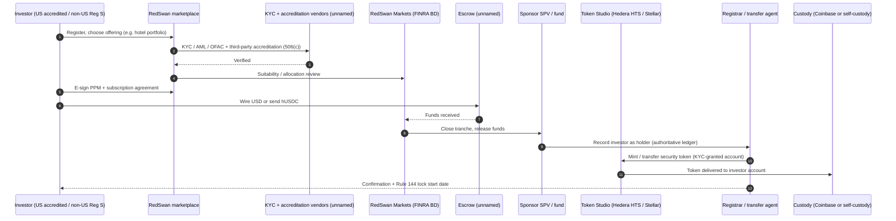
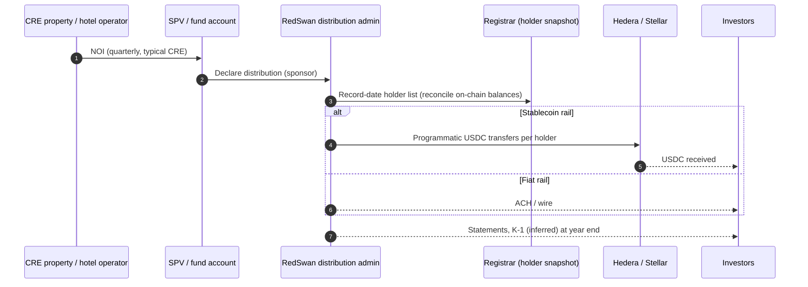
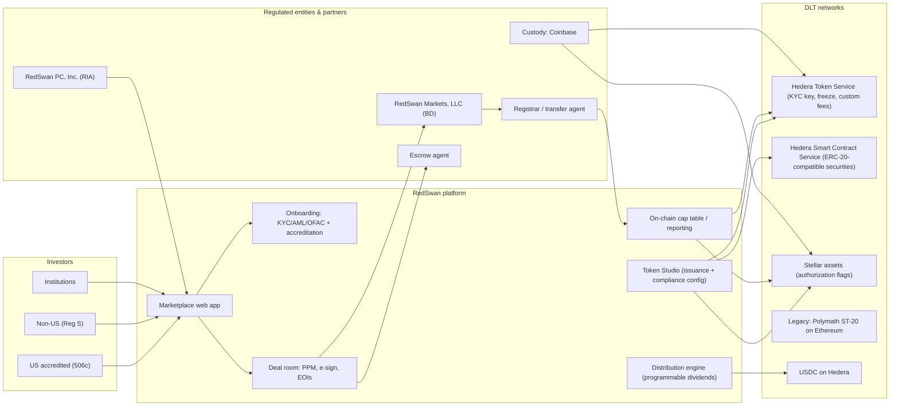

# RedSwan (RedSwan CRE / RedSwan Digital Real Estate) — United States (USA)

| Field | Value |
|---|---|
| Website | https://redswan.io |
| HQ / legal entity | RedSwan PC, Inc. (platform/technology provider; the website says it is an SEC-registered investment adviser) and **RedSwan Markets, LLC** (SEC-registered broker-dealer, FINRA/SIPC). 4201 Main St, Suite 203, Houston, TX 77002 [C#1] |
| Founded | ~2019 ("7 years of tokenization expertise") [C#1] |
| Status as of Sep 2026 | **Active**. New offerings Nov 2025 [C#8]; advisory board expanded Jun 2026 and regulatory commentary Aug 2026 [C#7][C#15] |
| Category | On-chain tokenized fractional (institutional / accredited CRE marketplace, plus a "Token Studio" issuance tool) |
| Asset focus | Commercial real estate: hospitality, multifamily, logistics, diversified income funds. Also carbon-credit forwards [C#1][C#8] |
| Scale (claims vs verified) | **Claims:** "$4B in tokenized real estate assets with a $5.2B pipeline" and "13,000 registered global users" [C#1]; "$5B+" on platform [C#2]; "over $100 million" tokenized to date (Oct 2025 press) [C#12]. **Verified:** individual offerings of $170M (hotels) and $89.4M (multifamily) presented in Nov 2025 [C#8]; $100M of CRE on Stellar [C#9]. **The multi-billion figures are unaudited and inconsistent across sources** [I] |
| Min. investment | Not disclosed [C#1] |
| Why it is in the Top 5 | The most complete **regulated US tokenised-CRE stack** among live platforms. It combines an **affiliated FINRA broker-dealer**, an RIA, Reg D 506(c) + Reg S dual-track offerings with third-party accreditation verification, a transfer agent/registrar reconciled to on-chain cap tables, and **multi-chain issuance** (Polymath/Ethereum → Hedera → Stellar). It is the reference model for the "compliant institutional" archetype |
| Research confidence | **Medium** for regulatory structure (official docs + EDGAR); **Low-Medium** for scale and tech detail (marketing-heavy, few technical disclosures) |

---

## 1. Business model snapshot
- **A two-sided marketplace for CRE digital securities.** Sponsors such as Altus Equity Group bring deals or funds. RedSwan tokenises them in its **Token Studio**, and RedSwan Markets places them with verified accredited US investors (Reg D 506(c)) and non-US investors (Reg S) [C#1][C#8][C#10].
- **Revenue:** not publicly disclosed. It is **inferred** to include BD placement fees on raises, tokenisation/issuance fees to sponsors (Token Studio), advisory fees through the RIA, and possibly administration fees for distributions [I, from the entity roles in #1 and #11].
- **Own capital:** RedSwan PC raised through **Reg CF** (Form C 2021, 2023; C/A 2024) and **Reg D 506(c)** (2020, 2024) [C#3].
- **Regional funds:** US, Africa and GCC funds [C#2], including the **RedSwan GCC Tokenized Fund, LP** (Form D, Jul 2024, 506(b) with 3(c)(1)/3(c)(7) investment-company exclusions) [C#3].

## 2. Legal & compliance structure

### 2.1 Issuing vehicle
- **Per-deal SPVs or funds sponsored by third parties.** Tokens represent "actual ownership interests in specific deals/entities", "genuine equity participation, not merely economics" [C#11].
- Example: the Altus Opportunity Fund, a diversified portfolio in which each token is a fractional fund interest [C#10].
- The GCC fund is a Delaware-style LP relying on 3(c)(1)/3(c)(7) [C#3].

### 2.2 What the token legally represents
- An **issuer-sponsored tokenised security**: equity or LP/LLC interest in the SPV or fund. The registrar keeps "the authoritative ledger reconciling on-chain and off-chain records" [C#11].
- This matches the SEC staff's "issuer-sponsored tokenization" model, which RedSwan cites [C#11].

### 2.3 Securities exemptions / licences
| Item | Detail | Label |
|---|---|---|
| US offerings | **Reg D Rule 506(c)**: verified accredited investors only; general solicitation permitted | C#8, C#4 |
| Non-US | **Reg S** | C#1, C#8 |
| Resale | "Subject to transfer and resale restrictions, including holding-period limitations under **Rule 144**" | C#8 |
| Accreditation | "Third party verification" required | C#4 |
| Company raise | Reg CF (Form C) + Reg D 506(c) | C#3 |
| Fund | 506(b) + 3(c)(1)/3(c)(7) (GCC fund) | C#3 |
| BD | **RedSwan Markets, LLC**, FINRA member BD approved May 2024. It "handles security issuance and investor compliance workflows" and is described as licensed for 506(c) and Reg CF | C#13, C#8, C#11 |
| RIA | RedSwan PC, Inc. is described as an "SEC Registered Investment Advisor". The ToS says RedSwan PC is not a BD, funding portal or "investment manager" — **inconsistent** | C#1, C#4 |

### 2.4 Regulated partners
| Function | Partner | Label |
|---|---|---|
| Broker-dealer | RedSwan Markets, LLC (affiliate) | C#1 |
| Transfer agent / registrar | Unnamed registrar maintaining lifecycle records | C#11 |
| Custody | "Coinbase and institutional-grade infrastructure" | C#11 |
| Chains | Hedera (HTS/HSCS), Stellar; earlier Polymath (Ethereum) | C#2, C#9, C#14 |
| Stablecoin | hUSDC (USDC on Hedera) accepted | C#6 |
| Escrow | "Escrow integrated into marketplace workflow" (provider unnamed) | C#11 |
| ATS | None. "There is currently not an active secondary market" | C#1, C#8 |

### 2.5 KYC / AML / accreditation / sanctions
- The privacy policy lists vendors that "verify the identity and accredited investor status of users", plus AML checks and **OFAC/sanctions screening**. It names no vendors [C#5].
- Data collected includes government IDs, SSN/TIN, net-worth and income documents, **crypto wallet addresses**, and KYC/AML results [C#5].
- **HTS native KYC flag:** Hedera Token Service lets an issuer grant or revoke KYC per account per token. RedSwan cites "built-in KYC/AML" in HTS [C#2][C#6]. RedSwan probably sets a KYC key and freeze key on each security token so that only verified accounts can receive it [I].
- Accreditation verification: the vendor is unknown [S: VerifyInvestor, Parallel Markets or BD in-house].

### 2.6 Eligibility & geo
- US: accredited investors only [C#4][C#10]. Non-US: Reg S persons, KYC required [C#1].

### 2.7 Tax
- Not disclosed. Pass-through SPVs and funds suggest **Schedule K-1** reporting for US holders. Non-US LP holders would face §1446 ECI withholding, and a sale of US real property interests triggers FIRPTA [I]. For non-US investors RedSwan's funds may use blocker corporations [S].

### 2.8 Disclosures & actions
- The site disclaimer says "There is currently not an active secondary market for digital assets of the type featured on RedSwan" [C#1][C#10], which contradicts marketing about "24/7 secondary market liquidity" [C#9].
- No enforcement actions were found (FINRA BrokerCheck could not be checked).

## 3. User types
| Persona | Description | Evidence |
|---|---|---|
| US accredited investor | Verified under 506(c); subscribes to offerings | C#4, C#8 |
| Non-US investor (Reg S) | KYC'd; subscribes under Reg S | C#1 |
| Institutional investor | "Dedicated access and guidance" | C#1 |
| Sponsor / issuer | Brings deals or funds (e.g., Altus Equity Group); uses Token Studio | C#10, C#6 |
| Registered rep (RedSwan Markets) | Handles issuance and investor compliance workflows | C#8 |
| RIA advisory (RedSwan PC) | Advisory relationship | C#1 |
| Registrar / TA | Maintains authoritative ledger | C#11 |
| Custodian | Coinbase (custody partner) | C#11 |
| RedSwan admin | Runs the platform, KYC and cap tables | I |

## 4. Actions by role
| Role | Action | Channel | On/Off-chain |
|---|---|---|---|
| Investor | Register; KYC/AML/OFAC; accreditation verification (third party) | Marketplace | Off-chain [C#4][C#5] |
| Investor | Submit expression of interest / subscribe; e-sign PPM and subscription docs | Marketplace | Off-chain [C#10] |
| Investor | Fund via USD (wire/ACH) or hUSDC | Escrow | Off-chain / on-chain [C#6][C#11] |
| Investor | Receive tokens into a custodial (Coinbase) or self-custody wallet | Registrar → chain | On-chain [C#11][I] |
| Investor | Receive distributions ("programmable dividend distributions") | Automatic | On-chain or off-chain [C#8] |
| Investor | Transfer or resell only after Rule 144 holding periods, through "controlled secondary venues" when available | — | On-chain, permissioned [C#8] |
| Sponsor | Mint security tokens in Token Studio (Hedera/Stellar), configure compliance | Token Studio | On-chain [C#6][C#9] |
| BD | Approve investor suitability, accreditation, allocation | Back office | Off-chain |
| Registrar | Reconcile on-chain and off-chain cap tables | Back office | Hybrid [C#11] |

## 5. Core flows

### 5.1 Onboarding
1. Register on the marketplace [C#4].
2. KYC, AML and OFAC checks through vendors [C#5].
3. US persons: accredited-investor status verified by a third party (income, net worth or entity), as 506(c) requires [C#4].
4. The wallet address is collected and whitelisted via the HTS KYC grant or a Stellar trustline authorisation [C#5][I].

### 5.2 Primary subscription

Label: KYC, accreditation, BD, registrar, escrow and custody roles are [C#4][C#5][C#8][C#11]. The sequence order and the mint-after-register step are [I], following from the "registrar maintains authoritative ledger" model.

### 5.3 Income distribution

Label: "programmable dividend distributions" [C#8]. The cadence, currency and K-1 are [I]/[S]. No distribution history is published.

### 5.4 Secondary trading
- **None active** [C#1][C#8]. Future trading is planned "through controlled secondary venues" after Rule 144 holding periods [C#8]. No ATS partner was found. Tokens on Stellar or Hedera could technically trade on-chain, but authorisation flags and the KYC key would restrict counterparties to verified accounts [I].

### 5.5 Exit
- Exit comes at sponsor-driven sale or refinancing under the PPM [C#10][I].

### 5.6 Governance
- Governance follows the SPV or fund documents (sponsor/GP control). There is no on-chain voting [I].

### 5.7 Issuer onboarding (Token Studio)
1. The sponsor applies and is diligenced by RedSwan and the BD [I].
2. A PPM is drafted; Form D is filed by the issuer [I]. The asset-level SPVs' Form Ds were not located under "RedSwan" names, so they were probably filed under sponsor names [I].
3. The security token is minted with HTS native compliance (KYC grant, freeze, and "royalties enforced on-chain", i.e., custom fees) or as an HSCS ERC-20-compatible contract. On Stellar, it is an asset with authorisation flags [C#6][C#9][I].
4. The deal is listed on the marketplace for EOIs or subscriptions [C#10].

## 6. Reverse-engineered architecture

**On-chain vs off-chain.**
- On-chain: token issuance, KYC-gated account permissions, programmable distributions, cap-table reporting [C#6][C#8].
- Off-chain (authoritative): the registrar ledger, the BD's compliance workflow, escrow, PPMs and subscription documents [C#11].
- This is the **"blockchain as record-keeping format"** model that RedSwan explicitly endorses [C#11].

## 7. Tech stack
| Layer | Technology | Label | Source |
|---|---|---|---|
| Blockchain | Hedera (primary since 2023), Stellar (since 2025), Ethereum via Polymath (legacy) | C | #2, #9, #14 |
| Token standard | HTS native tokens; HSCS ERC-20-compatible securities; Stellar assets; Polymath ST-20 (ERC-1400 family) historically | C (HTS/HSCS/Stellar) / I (ST-20 from the Polymath relationship) | #6, #9, #14 |
| Compliance controls | HTS KYC grant, freeze, custom fees ("royalties enforced on-chain"); Stellar AUTH_REQUIRED/clawback | C (KYC, royalties) / I (freeze, Stellar flags) | #6 |
| Identity | Unnamed KYC, AML, OFAC and accreditation vendors | C (exist) / S (names) | #5 |
| Wallets / custody | Coinbase custody partner; self-custody wallets probably HashPack/Freighter | C / S | #11 |
| Fiat rails | USD (wire/ACH) via escrow | C / I | #6, #11 |
| Stablecoin | USDC on Hedera | C | #6 |
| Marketplace | Primary only; no secondary | C | #1 |
| Registrar | Unnamed transfer agent | C | #11 |
| Frontend / backend / cloud | WordPress marketing site (wp-content paths) [C#1]; app stack unknown | C / S | #1 |
| Open-source | Planned open-source Hedera token standard on GitHub | C (intent) | #6 |

## 8. Money flows & revenue model
| Flow | Detail | Label |
|---|---|---|
| Subscription | Investor → escrow (USD or hUSDC) → SPV | C#6, C#11 |
| Placement fee | Sponsor → RedSwan Markets | I |
| Tokenisation fee | Sponsor → RedSwan PC (Token Studio) | I |
| Distributions | SPV → holders, programmable | C#8 |
| Custody fee | Investor or issuer → Coinbase | S |

## 9. Secondary market & liquidity
- There is **no active secondary market** [C#1]. Liquidity promises such as "24/7" on Stellar [C#9] are aspirational. Rule 144 holding periods apply [C#8].
- The **SEC's proposed "Regulation Crypto Assets"** (18 Aug 2026; comments due 20 Oct 2026 per RedSwan's post — the SEC release itself says 60 days after Federal Register publication) might pre-empt some state resale rules. RedSwan notes it does not resolve ATS or exchange registration [C#15]. This is a secondary source summary; see `01-regulatory/us.md`, which confirms from the SEC release that tokenized securities are **outside** the proposed exemptions.

## 10. Risks, incidents, controversies
- **Scale-claim inconsistency:** $100M+ [C#12] vs $4B [C#1] vs $5B+ [C#2]. The claims are unaudited, and the figures probably include the value of properties whose sponsors signed up rather than capital raised [I].
- **Liquidity gap:** marketing says 24/7 while the disclaimer says there is no market [C#9][C#1].
- **Entity-role ambiguity:** RIA per the website vs "not an investment manager" in the ToS [C#1][C#4].
- **Product sprawl:** carbon-credit forwards alongside CRE [C#8].
- No enforcement found (BrokerCheck not checked).

## 11. Extrapolated platform-owner ADMIN PANEL (EXTRAPOLATION — not observed)

| # | Module | Widgets / functions | Evidence |
|---|---|---|---|
| 1 | Pipeline & sponsor CRM | Sponsor onboarding, deal intake, DD checklist, fee agreements | Third-party sponsors [C#10] |
| 2 | Offering manager | Offering setup (506(c) / Reg S / 506(b) fund), PPM versions, Form D tracker, blue-sky notice filings, raise progress, tranche closings | [C#3][C#8] |
| 3 | Investor onboarding | KYC/AML/OFAC queue, **accreditation verification queue** (third-party letters, expiry after 90 days), Reg S attestation, wallet-address registry | [C#4][C#5] |
| 4 | BD compliance console | Suitability, allocation approvals, communications review (FINRA 2210), complaint log, OSJ supervision | BD [C#1][C#13] |
| 5 | **Token Studio** | Choose chain (Hedera/Stellar), configure HTS keys (KYC, freeze, wipe, supply, pause, fee schedule) or Stellar flags (auth required, revocable, clawback), mint/burn, **Rule 144 lock dates** | [C#6][C#8][C#9] |
| 6 | Cap table & registrar sync | On-chain vs registrar reconciliation, break reports, corporate actions | [C#11] |
| 7 | Escrow & funding | Wire/USDC receipts, matching to subscriptions, release approvals | [C#6][C#11] |
| 8 | Distributions | Declare per SPV, record date, USDC or ACH rail choice, batch execution, failed payments | [C#8] |
| 9 | Custody operations | Coinbase custody account mapping, deposit/withdrawal approvals | [C#11] |
| 10 | Investor reporting | Statements, K-1 distribution, sponsor reports, on-chain reporting feed | [C#8] |
| 11 | Secondary readiness | Holding-period tracker, eligible-for-resale list, future ATS connector | [C#8] |
| 12 | Regional funds | US / GCC / Africa fund administration, 3(c)(1)/3(c)(7) investor-count limits | [C#2][C#3] |
| 13 | Audit & records | 17a-4 compliant archives, admin audit log | BD recordkeeping [I] |

**Maker-checker:**
- Token mint or burn and changes to HTS keys: issuance ops → Chief Compliance Officer + multisig.
- Escrow release: ops → FINOP/CFO.
- Accreditation override: analyst → CCO.
- Distribution batch: fund admin → CFO.
- Marketing material publication: marketing → registered principal (FINRA 2210).
- Wallet freeze or clawback: compliance → legal.

**RBAC:** CCO; registered principal; registered representative; KYC/accreditation analyst; issuance engineer; fund administrator; treasury/FINOP; sponsor (external, own deals only); investor-relations; auditor/regulator read-only.

**Alerts / automations / reports:**
- Alerts: accreditation letter expiry; OFAC hit on re-screen; on-chain vs registrar mismatch; transfer attempt to a non-KYC'd account (HTS rejection); Rule 144 unlock dates; 3(c)(1) approaching 100 beneficial owners.
- Reports: Form D/blue-sky calendar; FOCUS/net-capital inputs for the BD; raise funnel; distribution reconciliation; sponsor performance.

## 12. Builder takeaways
**Copy:**
- An **own or affiliated broker-dealer** and a registrar-as-truth with the chain as a mirror. That is the SEC's issuer-sponsored model, and it is what institutions accept [C#11].
- **Dual-track 506(c) + Reg S** [C#8].
- **Chain-native compliance** (HTS KYC grant and freeze, Stellar authorisation) instead of bespoke contracts, which is cheaper to audit [C#6].

**Avoid:**
- Inflated or inconsistent AUM claims [C#1][C#2][C#12].
- Advertising liquidity that does not exist [C#9].
- Chain-hopping (Ethereum → Hedera → Stellar), which fragments holders and tooling [C#14][C#6][C#9].

**Differentiate:**
- Publish **audited raise and AUM** figures and on-chain proof of cap tables.
- Launch with an ATS partner so resale after Rule 144 is real on day one.
- Offer retail access via Reg A+ alongside 506(c), which RedSwan lacks.

## 13. Sources (accessed 23 Sep 2026)
1. RedSwan — Homepage — https://redswan.io/
2. Hedera — "RedSwan brings institutional real estate on-chain with Hedera" (case study) — https://hedera.com/case-study/redswan/
3. SEC EDGAR full-text search — "RedSwan" (Forms D, 1-A, C) — https://efts.sec.gov/LATEST/search-index?q=%22RedSwan%22&forms=D,1-A,C
4. RedSwan — Terms of Service (PDF, May 2026) — https://redswan.io/wp-content/uploads/2026/05/Terms-of-Service.pdf
5. RedSwan — Privacy Policy (PDF, May 2026) — https://redswan.io/wp-content/uploads/2026/05/RedSwan-Privacy-Policy.pdf
6. RedSwan (Medium) — "RedSwan CRE Builds its Token Studio on Hedera for Real-World Asset Tokenization" (31 May 2023) — https://redswandigitalre.medium.com/redswan-cre-builds-its-token-studio-on-hedera-for-real-world-asset-tokenization-5944f203e3b
7. RedSwan — News index — https://redswan.io/news/
8. RedSwan — "RedSwan Digital Real Estate Presents New Tranche of Tokenized Asset Portfolios" (10 Nov 2025) — https://redswan.io/redswan-digital-real-estate-presents-new-tranche-of-tokenized-asset-portfolios/
9. RedSwan — "RedSwan Digital Real Estate Brings $100M of Tokenized Real Estate to the Stellar Network" (Mar 2025) — https://redswan.io/redswan-digital-real-estate-brings-100m-of-tokenized-real-estate-to-the-stellar-network/
10. RedSwan — "The Future of Real Estate Investment: Altus Opportunity Fund Tokenized by RedSwan. Minted on Hedera" (May 2025) — https://redswan.io/the-future-of-real-estate-investment-altus-opportunity-fund-tokenized-by-redswan-minted-on-hedera/
11. RedSwan — "Tokenized Securities: Same Rules, Smarter Rails – And Where RedSwan Fits In" (Feb 2026) — https://redswan.io/tokenized-securities-same-rules-smarter-rails-and-where-redswan-fits-in/
12. Genfinity — "NYC Skyline Makes History: First Building Tokenized Through RedSwan Digital with Hedera" (9 Oct 2025) — https://genfinity.io/2025/10/09/nyc-skyline-first-building-tokenized-redswan-digital/
13. Weekly Real Estate News — "Tokenization Platform RedSwan CRE Secures FINRA Membership" (21 May 2024) — https://wrenews.com/tokenization-platform-redswan-cre-secures-finra-membership/
14. Polymath — "How RedSwan CRE has Tokenized Commercial Real Estate" (title seen in search results; the page now redirects to polymath.network) — https://info.polymath.network/redswan-tokenizing-commercial-real-estate-polymath
15. RedSwan — "The SEC Writes A New Rulebook For Crypto" (Aug 2026) — https://redswan.io/the-sec-writes-a-new-rulebook-for-crypto/
