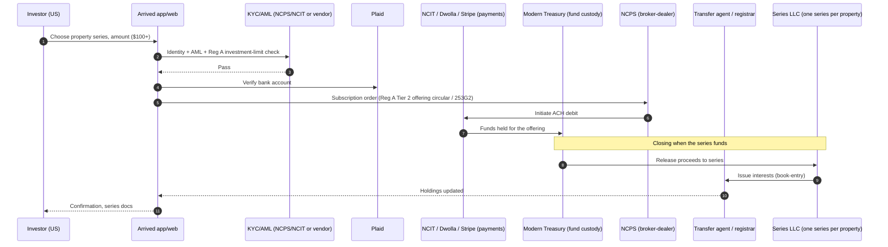
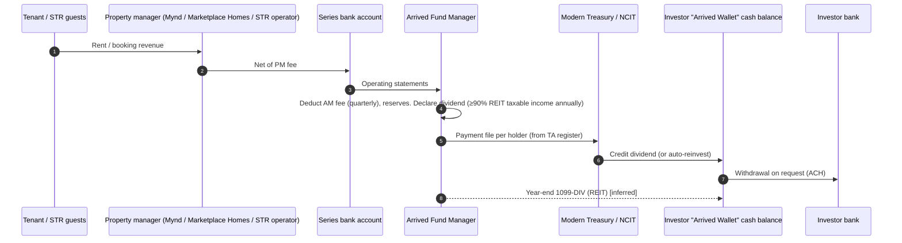
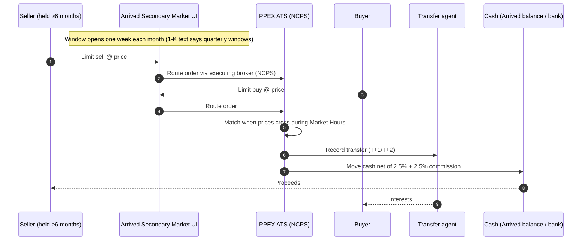
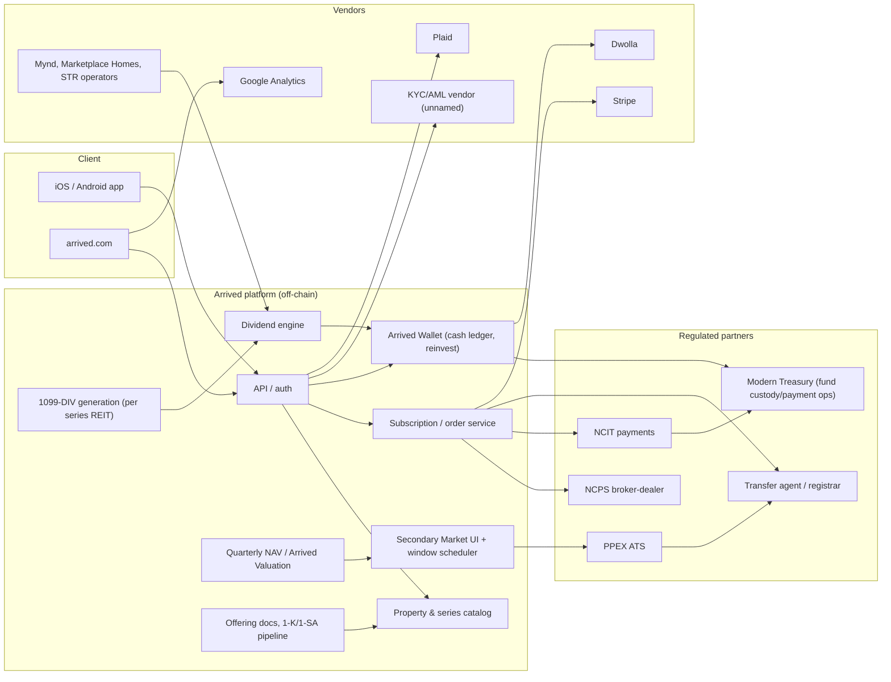

# Arrived (Arrived Homes) — United States (USA) · Off-chain benchmark

| Field | Value |
|---|---|
| Website | https://arrived.com |
| HQ / legal entity | Arrived Holdings, Inc. (sponsor, Delaware), 1700 Westlake Ave N, Seattle, WA. Issuers are Delaware **series LLCs**: Arrived Homes, LLC; Arrived Homes II–5; Arrived STR and STR 2; Arrived SFR Genesis Fund; Arrived Debt Fund. Manager: Arrived Fund Manager, LLC [C#1][C#2][C#3] |
| Founded | Issuer formed Jul 2020 [C#1] |
| Status as of Sep 2026 | **Active and growing**. FY2025 1-K filed 30 Apr 2026 [C#2]. Secondary market live with monthly trading windows [C#4][C#5] |
| Category | **Fractional (off-chain ledger)**. No blockchain or tokens [C#5][C#6] |
| Asset focus | Single-family rentals, vacation rentals (STR), an SFR fund and a private-credit fund |
| Scale | 885k+ sign-ups, $300M+ invested, 550+ properties in 65 cities (Nov 2025) [C#6]. 850k+ investors [C#7]. Arrived Homes, LLC alone: **248 series** and $5.75M consolidated 2025 rental income [C#1] |
| Min. investment | $100 [C#8] |
| Why it is in the Top 5 | Included **as the off-chain benchmark**. Arrived is the US scale leader in retail fractional real estate and the best-documented compliant template for selling single-property interests to **non-accredited** Americans: Reg A+ Tier 2, a series LLC, a per-series REIT election, broker-dealer + ATS secondary, and blue-sky filings. Any tokenised RealX offer to US retail has to match this compliance stack and beat its UX (monthly windows, T+1/T+2) |
| Research confidence | **High** (primary SEC filing + ToS + privacy policy) |

---

## 1. Business model snapshot
- **Sponsor-originated inventory.** The manager and its affiliates source, renovate and lease homes, then sell them to a new **series**. The price can carry a "potential premium" and the deal is not negotiated at arm's length [C#1].
- **Revenue:**
  - Sourcing fee of up to 3.5% for long-term rentals and 5% for STR, built into the price [C#8].
  - Asset-management fee of 0.6% of purchase price per year, paid quarterly (1-K) [C#1]. Reviews quote 0.15%/quarter [C#8].
  - A **6–7% disposition fee** on sale [C#1].
  - Secondary executing-broker commission of up to 5% (2.5% buy + 2.5% sell) [C#1].
  - Property management goes to third parties (Marketplace Homes $70/month; Mynd 6% or $84 minimum) [C#1]. Reviews also report 8% of gross rent for LTR and 15–25% for STR [C#8].
- **Products:** single-property series, vacation-rental series, the **Single Family Residential Fund** (quarterly redemptions after 6 months) and the **Real Estate Income Fund** (short-term residential loans, ~8.1–8.4% yield in 2025, monthly distributions) [C#8].
- **Funding:** $27M Series B (Nov 2025, led by Neo, with Forerunner and Bezos Expeditions), $60M+ total [C#6][C#7].

## 2. Legal & compliance structure

### 2.1 Issuing vehicle
- A **Delaware series LLC**: each property is a separate **series** with segregated assets and liabilities. "The purchase of interests in a particular series is an investment only in that series" [C#1][C#8].
- Several parallel master LLCs (Arrived Homes, II, 3, 4, 5; STR; STR 2; SFR Genesis Fund; Debt Fund) [C#3]. New master issuers are probably launched to reset Reg A's $75M-per-12-months issuer cap and to separate product types [I].

### 2.2 What the interest represents
- **Membership interests in a series**, recorded in book-entry form by a third-party transfer agent/registrar [C#1]. No tokens are issued [C#6].

### 2.3 Securities exemptions / filings
- **Regulation A+ Tier 2** (Form 1-A, 253G2 offering-circular supplements, 1-K, 1-SA, 1-U). EDGAR full-text search for "Arrived Homes" returns 176 1-A, 60 253G2, 55 1-K and 22 1-SA hits [C#3][C#1]. QA caveat: these are full-text hits, so a minority come from unrelated Reg A issuers that mention Arrived as a competitor (e.g., Landa, Cityfunds); the Arrived issuer set itself is Arrived Homes, LLC / II / 3 / 4 / 5, Arrived STR and STR 2, Arrived SFR Genesis Fund, Arrived Debt Fund and **Arrived Seattle Fund, LLC** (CIK 2065598, not listed in the header) [C#3].
- Tier 2 lets **non-accredited investors** participate, subject to the 10%-of-income-or-net-worth limit [C#8].
- **Blue sky:** manual exemptions or direct filings for secondary trades [C#1]. **Washington DFI consent order (May 2025)** against eight Arrived entities for failing to notice-file Reg A offerings: $40,000 fine plus costs and a cease-and-desist [C#8].

### 2.4 Regulated partners
| Function | Partner | Label |
|---|---|---|
| Broker-dealer | **North Capital Private Securities (NCPS)**, SEC-registered, FINRA/SIPC | C#9 |
| Payment processing | **North Capital Investment Technology (NCIT)** (EFTs), Stripe, Dwolla | C#9, C#10 |
| Bank linking | Plaid | C#10 |
| Investor-fund custody | **Modern Treasury, Inc.** (third-party holder of investor funds) | C#1 |
| ATS | **PPEX ATS**, operated by NCPS | C#1 |
| Transfer agent | Third-party registrar (unnamed) | C#1 |
| Property managers | Marketplace Homes, Mynd | C#1 |
| Arbitration | JAMS, Seattle | C#9 |

### 2.5 KYC / AML / sanctions
- The privacy policy mentions unnamed identity-verification and AML/KYC vendors [C#10]. Identity and bank data are shared with NCPS/NCIT [C#9]. It is plausible that NCPS/NCIT's Transact API performs KYC/AML (it bundles KYC/AML and accreditation checks) [I]. Plaid handles bank-account verification [C#10].
- Arrived appears to stay out of FinCEN MSB scope by having NCIT and Modern Treasury move and hold funds [I].

### 2.6 Eligibility & geo
- **US residents only**, 18 or older, and only in states where Arrived or its broker-dealer is registered [C#9]. No Reg S channel was found [I].

### 2.7 Tax
- Each series "intends to elect and qualify to be taxed as a separate REIT" and must distribute at least 90% of REIT taxable income [C#1]. That means investors get **1099-DIV** rather than K-1s, and there is no state-level filing burden for retail investors [I, following from the REIT election].
- For RealX this is the key design pattern: **per-asset REIT election inside a series LLC** [C#1].

### 2.8 Disclosures, protections, actions
- Quarterly **NAV per interest**, set by the manager's internal team (property value, market rents, comps, 5-year amortisation of fees), is explicitly **not GAAP fair value** [C#1].
- 1-K, 1-SA and 1-U reporting [C#1].
- WA DFI consent order (2025) [C#8]. "No material legal proceedings" (1-K FY2025) [C#1].
  > **QA note (Fable):** the WA DFI order is confirmed only via the review [C#8] (May 2025, eight Arrived entities, $40k plus costs, notice-filing failure). The regulator's own order was not located during QA (dfi.wa.gov enforcement listing returned 404); obtain the order number and text before citing it externally.
- BBB complaints about shares not selling in secondary windows [C#8].

## 3. User types
| Persona | Description | Evidence |
|---|---|---|
| Retail investor (US, non-accredited) | Buys series shares from $100; receives dividends | C#8 |
| Accredited investor | Same product; not subject to the Tier 2 10% limit | I |
| IRA investor | Invests through a self-directed IRA partner | S (a common Reg A feature; not verified) |
| Secondary buyer/seller | Places limit orders during monthly windows | C#4 |
| Fund investor | SFR Fund / Real Estate Income Fund; quarterly redemption requests | C#8 |
| Manager / sponsor | Sources properties, sets NAV, runs distributions | C#1 |
| Executing broker / ATS | NCPS / PPEX ATS | C#1 |
| Property manager | Marketplace Homes, Mynd, STR operators | C#1 |
| Tenant | Pays rent and passes a credit application | C#1 |

## 4. Actions by role
| Role | Action | Channel | Ledger |
|---|---|---|---|
| Investor | Sign up, KYC, link bank (Plaid) | App/web | Off-chain |
| Investor | Buy series interests (primary) | App → NCPS/NCIT → escrow | Off-chain (TA book-entry) |
| Investor | Receive dividends and auto-reinvest into the "Arrived Wallet" cash balance | App | Off-chain [C#1] |
| Investor | Place limit buy/sell during the monthly window | Secondary Market → PPEX ATS | Off-chain [C#4][C#1] |
| Investor | Request fund redemption (quarterly, after 6 months) | App | Off-chain [C#8] |
| Manager | Acquire property, form series, file 253G2, set price and NAV | Internal | Off-chain |
| NCPS | Execute and clear trades (T+1/T+2) | ATS | Off-chain [C#1] |

## 5. Core flows

### 5.1 Onboarding & KYC
1. Sign up; confirm US residency and state eligibility [C#9].
2. Identity is verified through an unnamed vendor, possibly via NCPS/NCIT [C#10][I].
3. Link a bank account through Plaid [C#10].
4. Answer Reg A investor-limit questions (10% of income or net worth unless accredited) [I, regulatory necessity].

### 5.2 Primary purchase

### 5.3 Income distribution

The cadence is "monthly or other periodic basis as determined by the manager" (1-K) [C#1]. Reviews report quarterly for individual properties and monthly for the income fund [C#8], so the two sources conflict and the cadence probably varies by product [I].

### 5.4 Secondary trading

Evidence: [C#1] for PPEX, T+1/T+2 and the commission; [C#4][C#5] for the monthly window, limit orders and the 6-month hold. Eligibility starts after the first "Arrived Valuation" [C#5]. Blue-sky: trades rely on manual or isolated non-issuer exemptions [C#1].

### 5.5 Exit
- Planned hold is 5–7 years for LTR and up to 15 years for STR. On sale the manager takes a 6–7% disposition fee and proceeds are distributed [C#8][C#1].
- Funds offer quarterly redemptions after 6 months [C#8].

### 5.6 Governance
- Manager-controlled. Investors have no operational votes, and the manager can only be removed under the limited terms of the operating agreement [I, typical Reg A series-LLC structure; 1-K notes the non-arm's-length agreements] [C#1].

### 5.7 Property onboarding
1. The manager applies its buy-box: cap rate above 5%, 3+ bed / 2+ bath, under 30 years old, $200–400k, repairs under 20% of price [C#1].
2. An affiliate may buy and renovate first, then resell to the series [C#1].
3. The series is designated, a 253G2 supplement filed and the offering opened [C#3][I].
4. A PM is assigned and leasing starts [C#1].

## 6. Reverse-engineered architecture

## 7. Tech stack
| Layer | Technology | Label | Source |
|---|---|---|---|
| Blockchain / token | None | C | #5, #6 |
| Legal register | Third-party transfer agent (book entry) | C | #1 |
| Broker-dealer / ATS | NCPS / PPEX ATS | C | #1, #9 |
| Payments | NCIT, Stripe, Dwolla; Modern Treasury for fund custody and payment ops | C | #9, #10, #1 |
| Bank link | Plaid | C | #10 |
| KYC | Unnamed vendor, possibly NCPS Transact API | C (exists) / I (provider) | #10 |
| Analytics | Google Analytics + ad partners | C | #10 |
| Apps | Web + mobile ("mobile wallet" feature) | C | #1 |
| Valuation | Internal quarterly NAV model | C | #1 |
| Cloud / CRM / support chat | Unnamed "chat box providers", cloud hosting | C (categories) | #10 |

## 8. Money flows & revenue model
| Flow | Detail | Label |
|---|---|---|
| Sourcing fee | ≤3.5% LTR / 5% STR, in the price | C#8 |
| Asset management | 0.6% of purchase price per year, paid quarterly | C#1 |
| Disposition | 6–7% of sale price | C#1 |
| Secondary commission | ≤5% (2.5% each side) to the executing broker | C#1 |
| Property management | Fixed monthly or % of rent | C#1 |
| Affiliate resale premium | Manager may sell renovated homes to a series at a premium | C#1 |
| Dividends | Periodic (monthly or quarterly), in USD to the Arrived Wallet / bank | C#1, C#8 |

## 9. Secondary market & liquidity
- A **periodic-auction-like** design: one-week monthly windows, continuous matching inside the window, limit orders only. It runs on a registered ATS through a registered BD [C#1][C#4].
- 57k orders were placed in the first 3 weeks [C#6]. Complaints say listed shares often do not fill or trade at discounts [C#8].
- The 1-K describes quarterly windows while the product currently runs monthly ones. The cadence seems to have been increased after the Nov 2025 launch [I].

## 10. Risks, incidents, controversies
- **WA DFI consent order (May 2025):** notice-filing failures, $40k [C#8].
- **Conflicts of interest:** affiliate resale premiums, non-arm's-length management agreements, NAV set by the manager [C#1].
- **Low yields:** 2025 SFR average dividend ~3.9% and STR ~2.3–2.5% [C#8].
- **Liquidity complaints** (BBB) [C#8].

## 11. Extrapolated platform-owner ADMIN PANEL (EXTRAPOLATION — not observed)

| # | Module | Widgets / functions | Evidence |
|---|---|---|---|
| 1 | Offering manager | Series creation, 1-A/253G2 filing tracker, **$75M/12-month Tier 2 cap meter per issuer**, offering open/close, oversubscription handling | 176 1-A / 60 253G2 [C#3] |
| 2 | **Blue-sky compliance** | State-by-state notice-filing status per issuer, fee calendar, blocked-state rules for the secondary market | WA DFI order [C#8]; blue-sky text [C#1] |
| 3 | Investor & KYC | KYC/AML status (NCPS), Plaid link, **Reg A 10% investment-limit calculator**, accreditation flag, state of residence | Tier 2 rules [C#8]; ToS [C#9] |
| 4 | Acquisitions pipeline | Buy-box scoring (cap rate, beds/baths, age, price, repair budget), affiliate purchase and renovation tracker, premium disclosure | Buy-box [C#1] |
| 5 | Property operations | PM assignment (Mynd, Marketplace Homes), occupancy (95.9%), maintenance, STR booking revenue | [C#1][C#8] |
| 6 | NAV & valuation | Quarterly NAV per series, appraisal uploads, fee-amortisation schedule, **valuation committee sign-off** | NAV methodology [C#1] |
| 7 | Dividends | Declare per series, REIT 90% test tracker, payment file to Modern Treasury/NCIT, reinvestment | REIT election [C#1] |
| 8 | Wallet / cash ledger | Investor cash balances, withdrawals, returns and failed ACH | Mobile wallet [C#1]; Dwolla [C#10] |
| 9 | Secondary market ops | Window calendar, eligible-series list (fully funded, valuation done, 6-month hold), order-book monitor, fill stats, ATS reconciliation with NCPS/TA | [C#4][C#5][C#1] |
| 10 | Fund redemptions | Quarterly redemption queue, gating/pro-rata logic | Funds [C#8] |
| 11 | Regulatory reporting | 1-K, 1-SA, 1-U drafting and auditor workflow | [C#1] |
| 12 | Tax | 1099-DIV per REIT series, REIT qualification tests | [C#1] |
| 13 | Complaints & support | BBB/FINRA complaint tracker, escalation to NCPS compliance | BBB [C#8] |
| 14 | Audit log & RBAC | Immutable admin log | Regulatory necessity [I] |

**Maker-checker:**
- NAV publication: valuation analyst → valuation committee.
- Dividend declaration: asset manager → CFO.
- Opening an offering or filing a 253G2: capital markets → legal.
- Blue-sky filing sign-off: compliance → legal.
- Secondary window open/close and eligibility list: market ops → NCPS compliance.
- Affiliate-to-series sale price: acquisitions → independent reviewer.

**RBAC:** capital markets; legal/compliance; KYC ops; acquisitions; asset management; property ops; valuation; finance/treasury; tax; secondary-market ops; support; auditor (read-only); partner (NCPS) read-only view.

**Alerts / reports:**
- Alerts: issuer nearing its $75M cap; state notice-filing expiry; series dividend yield below target; unfilled secondary sell orders above X%; REIT distribution shortfall; failed ACH.
- Reports: quarterly NAV pack; investor statements; 1-K/1-SA data room; window liquidity report (orders, fills, discounts to NAV).

## 12. Builder takeaways
**Copy:**
- **Series LLC + per-series REIT election + Reg A+ Tier 2.** This is the cleanest known way to sell single-property interests to US retail investors with 1099-DIV tax simplicity [C#1].
- Registered BD + ATS for the secondary [C#1].
- A third-party fund custodian (Modern Treasury) that keeps the platform out of money transmission [C#1].

**Avoid:**
- Blue-sky slippage: build a state-filing engine from day one [C#8].
- Opaque affiliate resale premiums [C#1].
- Windowed liquidity that disappoints investors [C#8].

**Differentiate (the tokenisation angle):**
- Put the transfer agent's register **on-chain**, using an SEC-registered transfer agent with a permissioned token (ERC-3643/ERC-1400).
- Keep the ATS, but settle trades **T+0 atomically** in a regulated stablecoin (GENIUS-Act-compliant USDC) and offer continuous rather than windowed trading.
- Show NAV and property data on-chain with attestations.

## 13. Sources (accessed 23 Sep 2026)
1. SEC EDGAR — Arrived Homes, LLC Form 1-K for FY2025 (filed 30 Apr 2026) — https://www.sec.gov/Archives/edgar/data/1821720/000121390026050390/ea028816201-1k_arrived.htm
2. SEC EDGAR full-text search — Arrived Homes 1-K filings — https://efts.sec.gov/LATEST/search-index?q=%22Arrived%20Homes%22%20%22transfer%20agent%22&forms=1-K
3. SEC EDGAR full-text search — Arrived issuers (1-A, 1-K, 1-SA, 253G2) — https://efts.sec.gov/LATEST/search-index?q=%22Arrived%20Homes%22&forms=1-A,1-K,1-SA,253G2
4. Arrived Help Center — "How does the Arrived Secondary Market work?" — https://help.arrived.com/en/articles/10513713-how-does-the-arrived-secondary-market-work
5. Arrived Blog — "Arrived Secondary Market: Buy & Sell Shares of Individual Properties" (5 Feb 2025) — https://arrived.com/blog/arrived-secondary-market
6. Arrived Blog — "Arrived Raises $27 Million in New Funding to Launch the Stock Market for Real Estate" (6 Nov 2025) — https://arrived.com/blog/series-b-fundraise
7. National Mortgage Professional — "Bezos-Backed Arrived Launches Real Estate Stock Market Platform" (12 Nov 2025) — https://nationalmortgageprofessional.com/news/bezos-backed-arrived-launches-real-estate-stock-market-platform
8. Angel Investors Network — "Arrived Homes Review 2026: Fees, Risks and Returns" — https://angelinvestorsnetwork.com/real-estate/arrived-homes-review-2026
9. Arrived — Terms of Service — https://arrived.com/terms-of-service
10. Arrived — Privacy Policy — https://arrived.com/privacy-policy
