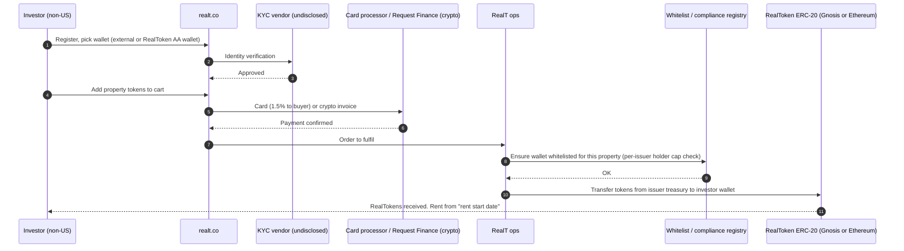
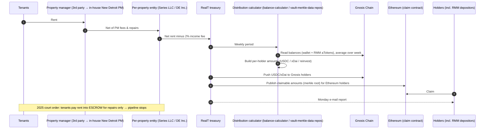
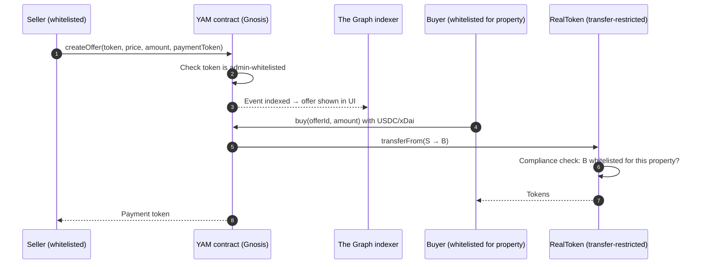
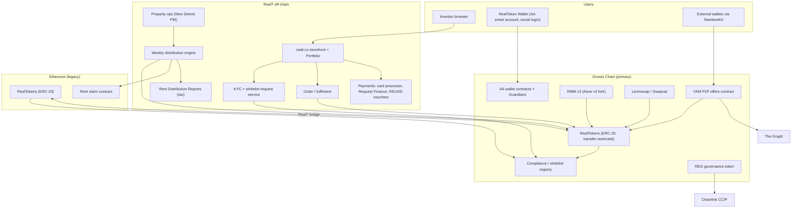

# RealT (RealToken) — United States (USA) · ⚠️ In voluntary liquidation

| Field | Value |
|---|---|
| Website | https://realt.co. US visitors are redirected to a geo-gate saying "This website is not open to US citizens or residents" [C#7] |
| HQ / legal entity | RealToken Inc., 980 N. Federal Hwy, Suite #110, Boca Raton, FL 33432 [C#7]. Founders Jean-Marc and Remy Jacobson [C#5]. Properties held by ~165 affiliated entities [C#6][C#17] |
| Founded | 2019 [C#5] |
| Status as of Sep 2026 | **Voluntary liquidation announced 2 Jul 2026** [C#1][C#5]. A court-appointed special fiduciary (Charles Bullock) has controlled ~700 Detroit properties since Apr 2026 [C#1][C#28]. Weekly distributions were formally suspended in Feb 2026 [C#5]. New sales, rent and RMM liquidity are halted, and only the YAM P2P market still works [C#16] |
| Category | On-chain tokenized fractional (DeFi-integrated) |
| Asset focus | Detroit-concentrated single-family and small multifamily rentals, plus some other US cities. Expanded into debt, construction and factoring tokens in 2024–25 [C#20] |
| Scale | ~$140M raised; ~700 Detroit properties; 14,000–22,000 investors affected [C#1]. "20,000+ token holders" and "$29M distributed since inception" [C#8]. Claimed 65,000 registered investors [C#17]. $93M raised for Detroit alone per the city's suit [C#6] |
| Min. investment | ~$50 per token [C#8] |
| Why it is in the Top 5 | The **largest and most technically complete US on-chain real-estate tokeniser ever built**: per-property issuers, Reg D + Reg S, ERC-20 tokens on Ethereum and Gnosis, weekly stablecoin rent, an Aave-fork lending market (RMM), a P2P market (YAM), an account-abstraction wallet and a governance token. Its 2025–26 collapse is the **most important cautionary case** for RealX. It ranks #4 rather than higher only because the Sep-2026 status criterion penalises it |
| Research confidence | **High** for collapse timeline and DeFi architecture; **Medium** for legal wrapper evolution; **Low** for vendors (realt.co is geo-blocked from US fetches) |

---

## 1. Business model snapshot
- RealT bought (or claimed to buy) US rental homes, mainly in Detroit, put each into a separate entity, and sold tokens for the equity to a mostly **non-US retail audience** (heavily French and European) [C#6][C#1].
- Tokens were priced so that **rent was paid weekly in stablecoins** [C#24]. Holders could borrow against their tokens in RealT's own lending market (RMM), trade peer-to-peer on YAM and trade on Gnosis DEXs [C#8][C#25].
- **Revenue:** a **10% listing fee** (markup on the property price) and a **2% fee on income** [C#8]. Offering memoranda also disclosed property-management fees, company-management fees, expense reimbursements, selling commissions in early offerings and repair-management fees [C#28]. RealT later brought property management in-house ("New Detroit PM", about five staff by 2026) [C#9].
- **Scope creep:** debt tokenization and construction tokens (Jun 2024), factoring (May 2025), and revenue from Panama, BVI and Switzerland entities in the 2025 reports [C#20][C#21].

## 2. Legal & compliance structure

### 2.1 Issuing vehicle (evolved over time)
| Period | Vehicle | Label |
|---|---|---|
| 2019–2021 | **Delaware Series LLC** (each property a series). Tokens are LLC membership interests | C#28, C#4 |
| Mixed | Some properties in Wyoming LLCs | C#4 |
| 2022 | **Per-property Delaware corporations** named "RealToken <address>, Inc." Tokens represent **common shares** | C#27, C#28 |
| 2024–25 | Debt, construction and factoring token vehicles, some offshore (Panama, BVI, Switzerland revenue sources) | C#20, C#21 |

The City of Detroit's suit named **165 affiliated corporate defendants** [C#6][C#12].

### 2.2 What the token legally represents
- An ERC-20-compatible token representing an LLC membership interest (early series) or **common stock** in a per-property Delaware corporation (later) [C#28].

### 2.3 Securities exemptions / filings
- **Reg D Rule 506(c)** for accredited US investors. EDGAR full-text search shows **17 Form D filings** (19 Jul to 8 Sep 2022) by "RealToken <address>, Inc." Delaware corporations: **16 under 506(c) and 1 under 506(b)** [C#27].
- **Reg S** for non-US investors. From June 2022, offerings were structured as Reg S and **excluded US residents** [C#28]. Today the US site is geo-blocked [C#7].
- **Exchange Act §12(g) management:** RealT capped each property at **2,000 holders** and refused new whitelisting once a property hit the cap. In a 14 Nov 2024 community call RealT said the rule was "no longer current" [C#19]. RealT was treating each property issuer's holder count as the registration trigger [I].
- No broker-dealer, ATS or transfer agent was disclosed. RealToken Inc. states it is not a registered BD or investment adviser [C#7].

### 2.4 Regulators & partners
| Function | Partner | Label |
|---|---|---|
| Crypto payments | Request Finance (from Apr 2024; Coinbase Commerce removed) [C#23] | C |
| Card payments | Undisclosed processor. Buyer pays 1.5%; Visa unavailable Aug 2024–Apr 2025 [C#23] | C |
| Lending market | RMM v3, an Aave v3 fork on Gnosis with whitelisted liquidators [C#25][C#10] | C |
| Indexing | The Graph (YAM) [C#26] | C |
| Cross-chain | Chainlink CCIP for the REG token [C#14] | C |
| Audit | ABDK (REG and CCIP contracts) [C#14]. YAM uses Slither static analysis [C#13] | C |
| Property management | Third-party managers until ~2024, then in-house "New Detroit PM" [C#17][C#9] | C |
| Court fiduciary | Charles Bullock (Apr 2026) [C#1][C#28] | C |

### 2.5 KYC / AML / whitelisting
- KYC is required. Each wallet must be **whitelisted per property** before it can receive that RealToken, including on secondary markets [C#18][C#28]. Requests go through Portfolio > Properties > Whitelist, at most **28 tokens per day**, and take **1–2 days** [C#18].
- A new wallet (for example, after the AA-wallet v3 migration) must be re-whitelisted by RealT [C#22].
- Non-whitelisted users could not trade RealTokens on Uniswap [C#28].
- KYC vendor: not disclosed in accessible sources [S: a Sumsub/Onfido-class vendor].
- Sanctions and travel-rule controls were not documented.

### 2.6 Investor eligibility & geo
- **Non-US persons only (Reg S)** since 2022. Early US accredited investors came in under 506(c) [C#28][C#7].

### 2.7 Tax handling & reporting
- RealT issues an annual **"Rent Distribution Report"** that splits dividends from return of capital by property and, from 2025, lists revenue by country (USA, Panama, BVI, Switzerland) [C#21]. RealT "classif[ies] distributions as return of capital or dividends" [C#8].
- **Inference:** with Delaware C-corporations as issuers, the entity pays US corporate tax and dividends to non-US holders are FDAP income subject to 30% withholding (reduced by treaty). This avoids ECI and K-1s for foreign holders [I].
- **FIRPTA risk:** a corporation whose assets are mostly US real property is a **USRPHC**, so a foreign holder selling shares may owe FIRPTA tax (15% withholding by the buyer). The "regularly traded on an established securities market" exception probably does not cover YAM or DEX trades. No FIRPTA handling for peer-to-peer trades was found, so this is a latent compliance gap [I].

### 2.8 Disclosures, actions & litigation
| Date | Event | Label |
|---|---|---|
| 2 Jul 2025 | **City of Detroit v. RealT** filed in Wayne County Circuit Court. It covers 408 properties (53 "unquestionably harmful"), names the Jacobsons personally and 165 entities, and is described as "the largest nuisance abatement lawsuit ever filed by the City of Detroit". It seeks $500k in blight tickets | C#6, C#17 |
| 2025 | Judge Annette Berry's TRO: **rent paid into escrow, for repairs only**; evictions barred at non-compliant properties; 58 vacant properties to be secured within 30 days | C#12 |
| Late 2025 | Weekly distributions "largely halted" | C#5 |
| Jan 2026 | City's receivership motion dismissed without prejudice | C#2 |
| Feb 2026 | Distributions formally suspended | C#5 |
| Mar 2026 | 300+ properties face tax foreclosure; RealT says "The model no longer works" | C#2, C#9 |
| Apr 2026 | Special fiduciary Charles Bullock appointed over ~700 properties | C#1, C#28 |
| 2 Jul 2026 | **Voluntary liquidation** announced: sell every asset. About $640k in escrow | C#1, C#5 |
| 2026 | French class action coordinated by the Delomel law firm and a criminal complaint to the financial prosecutor of the Paris judicial court [C#5]; Crypto Briefing puts the group at "around 400 French nationals" [C#1], whereas RealOpen says French investors are "roughly 14,000 of the total" [C#5] — the two figures describe different things (claimants vs. French holders) and the claimant count is unverified. Allegations by former collaborators that some marketed properties **were never actually purchased** by RealT entities: "an allegation, not a finding", now part of the litigation [C#3][C#5] | C#1, C#3, C#5 |
| — | Recovery order: fiduciary costs, repairs, back taxes and legal obligations come **before** token holders | C#3 |

> **QA note (Fable):** Michigan Public (source 2, per search-log S6) reported a trial date of 27 May 2026 in the Detroit case; no source in this file records what happened at or after that date, and the dockets were not checked. Re-verify the case status and any judgment before relying on the timeline.

## 3. User types
| Persona | Description | Evidence |
|---|---|---|
| Non-US retail investor | KYC'd and whitelisted per property; buys, holds and receives weekly rent | C#18, C#24 |
| US accredited investor (legacy) | Bought pre-2022 under 506(c) | C#27, C#28 |
| DeFi user / borrower | Deposits RealTokens into RMM and borrows USDC/WXDAI | C#25 |
| Lender (RMM supplier) | Supplies USDC/WXDAI to RMM for yield | C#10 |
| Liquidator | **Whitelisted** RMM liquidator | C#25 |
| YAM trader | Creates or fills P2P offers (sell, buy, swap) | C#26 |
| REG holder | Governance token holder | C#14 |
| AA-wallet user | Social-login smart account; RealT is a recovery Guardian | C#22 |
| RealT ops / property manager | Acquisitions, entity formation, whitelisting, rent, repairs | I |
| City / court fiduciary (external) | Now controls rents and properties | C#12, C#1 |

## 4. Actions by role
| Role | Action | Channel | On/Off-chain |
|---|---|---|---|
| Investor | KYC, whitelist wallet per property | realt.co Portfolio | Off-chain approval → on-chain whitelist write [I] |
| Investor | Buy primary tokens (card, crypto via Request Finance, REUSD voucher) | realt.co | Off-chain payment → on-chain token transfer |
| Investor | Receive weekly rent (USDC or xDai), opt into reinvestment | Automatic (Gnosis); claim on Ethereum | On-chain [C#24] |
| Investor | Bridge RealTokens between Ethereum and Gnosis | RealT bridge | On-chain [C#20 index] |
| Investor | Deposit to RMM, borrow USDC/WXDAI | rmm.realtoken.network | On-chain [C#25] |
| Investor | Sell or buy on YAM, Levinswap or Swapcat | yam.realtoken.network, DEXs | On-chain [C#8] |
| Investor | Vote on property decisions (as marketed) | RealT | Off-chain [C#17] |
| Liquidator | Liquidate under-collateralised RMM positions | RMM | On-chain, whitelisted [C#25] |
| RealT admin | Whitelist tokens on YAM | YAM admin | On-chain [C#13] |
| RealT admin | Upgrade REG/CCIP contracts (ADMIN/UPGRADER roles) | Contracts | On-chain [C#14] |

## 5. Core flows

### 5.1 Onboarding & KYC
1. The user creates a realt.co account and chooses an external wallet (RainbowKit-style connect) or a **RealToken Wallet** (social-login smart account on Gnosis, with RealT as a recovery Guardian) [C#11][C#22].
2. KYC is completed and the user's wallet address is registered [C#18].
3. For each property the user wants, a whitelist request is submitted and executed within 1–2 days [C#18].

### 5.2 Primary purchase

### 5.3 Income distribution (weekly, pre-2026)
- Rent was computed per token on the **average quantity held during the week**, including tokens deposited in RMM. Payment was in **USDC or xDai** (or auto-reinvested into more RealTokens) on Gnosis, and **claimed** on Ethereum. A report e-mail went out every Monday [C#24].

Label: the cadence, currency, averaging and reinvestment are [C#24]. The Ethereum claim is [C#20 index]. Merkle-based claims and the calculator roles are [I], based on the repo names balance-calculator and vault-merkle-data [C#11].

### 5.4 Secondary trading
- **YAM** ("Yet Another Market", Dec 2022) is a P2P offer contract (sell, buy or swap RealTokens against other assets). An **admin whitelists which tokens** can be listed. It is indexed by The Graph and still works in 2026 [C#13][C#26][C#16].
- **DEXs:** Levinswap and Swapcat on Gnosis; Uniswap was historically restricted to whitelisted wallets [C#8][C#28].
- **RMM** gives liquidity without selling. RMM v2 (Apr 2022, Aave v2 fork) was followed by **RMM v3 (Aave v3 fork, live 8 Feb 2024)**, where RealTokens are collateral and holders borrow USDC or WXDAI. Liquidators are whitelisted [C#25][C#11].

### 5.5 Redemption / exit / property sale
- There is no redemption. Exits come through YAM, DEXs or property sales [C#8].
- In the **liquidation**, the fiduciary and the company sell assets. Proceeds go first to fiduciary costs, repairs, back taxes and legal obligations; any remainder goes to token holders [C#3]. The escrow held only about $640k [C#1].

### 5.6 Governance
- Holders were marketed a right to "vote on property decisions" [C#17]. The **REG** token (RealToken Ecosystem Governance) launched through four "ACPI" community price-discovery mechanisms. It is upgradeable (OpenZeppelin), bridged via Chainlink CCIP and audited by ABDK [C#14][C#15].

### 5.7 Property onboarding (reconstructed)
1. Acquisition, often of low-cost Detroit homes [C#6].
2. Entity formed: a series, or a per-property DE Inc. [C#27][C#28].
3. Form D filed (US 506(c)) and/or Reg S offering [C#27].
4. ERC-20 deployed or minted on Ethereum or Gnosis; token added to the whitelist and YAM lists [I][C#13].
5. Listed with a 10% markup; "rent start date" set [C#8][C#24].

## 6. Reverse-engineered architecture

**On-chain:** ownership records, transfer compliance (whitelist), weekly payouts, P2P trading, lending and liquidations, governance token.
**Off-chain:** KYC, whitelist approvals, property operations, rent collection, accounting and tax, the legal entities and titles. **The collapse happened entirely off-chain**, while the on-chain layer kept working (YAM is still live) [C#16].

## 7. Tech stack
| Layer | Technology | Label | Source / reasoning |
|---|---|---|---|
| Blockchain | Gnosis Chain (primary), Ethereum (legacy) | C | #5, #8 |
| Token standard | ERC-20-compatible, transfer-restricted by a whitelist | C | #28, #18 |
| Compliance contracts | Per-property wallet whitelist and registry. Possibly Mt Pelerin "Bridge Protocol" (ComplianceRegistry/Processor/rules) | C (whitelist) / S (Mt Pelerin, from prior knowledge, not verified) | #18 |
| Identity | Undisclosed KYC vendor | S | — |
| Wallets | RealToken Wallet (AA smart account, social login, Guardians) + external wallets through a RainbowKit fork | C | #22, #11 |
| Fiat rails | Card (processor undisclosed, 1.5% to buyer) | C | #23 |
| Crypto rails | Request Finance; formerly Coinbase Commerce; REUSD vouchers | C | #23 |
| Stablecoins | USDC, xDai/WXDAI | C | #24, #25 |
| Lending | RMM v3 (Aave v3 fork); RMM v2 (Aave v2 fork) | C | #25, #11 |
| Marketplace | YAM (Solidity, Hardhat, admin token whitelist) | C | #13 |
| Indexing | The Graph | C | #26 |
| Cross-chain | Chainlink CCIP (REG); RealT bridge (RealTokens) | C | #14, #20 |
| Governance | REG token, OZ upgradeable, ABDK audit, ACPI launch | C | #14, #15 |
| Frontend | TypeScript (yam-interface, realt-interface-commons) | C | #11 |
| Dev tooling | Hardhat, Waffle, Chai, Slither | C | #13, #15 |
| Oracles | RealToken prices set by RealT on reappraisal; RMM valuation presumably uses a RealT-controlled price feed | I | #7 mentions reappraisals; the Aave fork needs an oracle |
| Community tooling | dashboard.realtoken.community, ehpst (third party) | C | #18, #19 |

## 8. Money flows & revenue model
| Flow | Detail | Label |
|---|---|---|
| Listing markup | 10% | C#8 |
| Income fee | 2% of rent | C#8 |
| Card fee | 1.5% to buyer (RealT absorbed 50% from Oct 2023) | C#23 |
| PM fees | Paid to third-party then in-house PM; repair-management fees | C#28 |
| Distribution | Weekly, USDC or xDai, or reinvested | C#24 |
| RMM | Borrow interest to suppliers; liquidation penalties | C#25 |

## 9. Secondary market & liquidity mechanics
- The deepest DeFi liquidity stack of any US real-estate tokeniser: YAM, DEX pools, RMM borrowing and a cross-chain bridge [C#8][C#25].
- **The liquidity was not backed by property quality.** By 2026 tokens traded "far less than their original value" and produced no income [C#2][C#9]. Lending against tokens whose oracle was set by the issuer created reflexive risk once cash flows stopped [I].

## 10. Risks, incidents, controversies, enforcement
- See the §2.8 timeline. Root causes, as documented:
  - Deferred maintenance and code violations; no certificates of compliance on any of the 408 properties in the suit [C#6].
  - Unpaid property taxes, water bills and blight fines [C#2].
  - Failures by third-party PMs, which RealT blamed [C#17].
  - Allegations that some tokenised properties were never owned [C#3][C#5].
- **Structural lessons:**
  1. Token holders are equity behind the city, the fiduciary and tax creditors [C#3].
  2. A municipal court can redirect rent (escrow), which stops on-chain yield instantly [C#12].
  3. Concentration in a single city (Detroit) plus absentee foreign investors left no local accountability [I].
  4. Whitelisting and 12(g) caps handled securities form, but nothing in the stack handled **property substance** [I].

## 11. Extrapolated platform-owner ADMIN PANEL (EXTRAPOLATION — not observed)

> Inferred from RealT's user-facing features, contracts and legal obligations. It includes the modules RealT evidently lacked (marked ⚑), whose absence contributed to the collapse.

### 11.1 Modules and widgets
| # | Module | Widgets / functions | Evidence |
|---|---|---|---|
| 1 | Investor & KYC | KYC status, residency (US block), wallet list, AA-wallet Guardian status | Reg S US exclusion [C#28]; AA wallet [C#22] |
| 2 | **Whitelist manager** | Per-wallet, per-property request queue (≤28/day per user), bulk approve, de-whitelist, **per-issuer holder counter vs 2,000 cap** | [C#18][C#19] |
| 3 | Issuance & token registry | Property → entity → token addresses (Gnosis/Ethereum), supply, rent start date, price, bridge status | Token types [C#20]; bridge |
| 4 | Offering compliance | Form D tracker (506(c)/(b)), Reg S legends, offering memorandum versions, blue-sky notices | [C#27][C#28] |
| 5 | Payments & orders | Card and Request Finance invoices, REUSD vouchers, refund queue, fulfilment | [C#23] |
| 6 | **Weekly distribution** | Rent ledger per property, fee deduction (2%), average-balance calculator (incl. RMM aTokens), payout batch (USDC/xDai), reinvest orders, Ethereum claim root publication | [C#24] |
| 7 | RMM risk console | Collateral factors, RealToken price oracle updates, liquidator whitelist, utilisation, bad-debt monitor, pause | [C#25] |
| 8 | YAM admin | Token whitelist for YAM listing, offer monitoring | [C#13] |
| 9 | Governance / REG | REG supply, CCIP routes (ADMIN/UPGRADER roles), proposals | [C#14] |
| 10 | Property operations | PM assignment, work orders, occupancy, capex | [C#9] |
| 11 ⚑ | **Municipal compliance** | Certificate-of-compliance status, code violations, blight tickets, water bills, property-tax delinquency and foreclosure countdown | Detroit suit [C#6][C#2] |
| 12 ⚑ | **Title & asset verification** | Deed recorded to issuer, title-insurance policy, reconciliation of token supply to recorded deeds | "Never owned" allegations [C#3] |
| 13 | Tax reports | Annual Rent Distribution Report (dividends vs return of capital), withholding, FIRPTA flags | [C#21] |
| 14 | Litigation & legal hold | Court orders (escrow), fiduciary instructions, lis pendens per property | [C#12][C#2] |
| 15 | Liquidation / wind-down | Asset-sale pipeline, proceeds waterfall (fiduciary, repairs, taxes, then holders), final distribution, token burn / freeze | [C#3][C#1] |

### 11.2 Maker-checker actions
- Whitelisting a wallet above a holder-count threshold: compliance analyst makes, compliance lead checks.
- Minting or bridging supply: ops makes, CTO + finance check (multisig).
- RMM price-oracle update: valuation analyst makes, risk committee checks. **An issuer-set oracle is a conflict of interest and needs independent sign-off.**
- Weekly payout batch release: distribution ops makes, finance lead checks.
- YAM token whitelist and REG contract upgrades: engineer makes, multisig checks (ADMIN/UPGRADER separation [C#14]).
- Property sale / liquidation disbursement: fiduciary or legal makes, board checks.

### 11.3 Admin roles
Compliance lead; KYC/whitelist analyst; issuance ops; treasury/distribution ops; DeFi risk manager (RMM); marketplace admin (YAM); governance/contract admin (ADMIN, UPGRADER); property ops manager; municipal-compliance officer ⚑; title officer ⚑; tax ops; legal (litigation hold); support; auditor (read-only).

### 11.4 Alerts / automations / reports
- **Alerts:** property-tax delinquency more than 30 days ⚑; new code violation or blight ticket ⚑; vacancy above 60 days; rent collected below X% of scheduled; property approaching the 2,000-holder cap; RMM utilisation or health-factor spikes; oracle deviation from the last YAM trade; court order received.
- **Automations:** weekly payout; Monday report e-mail [C#24]; whitelist execution batches; claim-root publication on Ethereum.
- **Reports:** per-property P&L and reserves; deed-to-token reconciliation ⚑; municipal compliance scorecard ⚑; investor tax pack; liquidation waterfall statement.

## 12. Builder takeaways
**Copy (the technology was good):**
- Per-property issuers with an explicit **holder-cap monitor** (12(g)).
- **Per-property whitelist** enforced in the token.
- Weekly stablecoin rent with **average-balance** accounting that counts DeFi-deposited tokens [C#24].
- A P2P offer contract with an issuer-controlled token whitelist [C#13].
- An AA wallet with social login and issuer-held Guardians [C#22].

**Avoid:**
- Single-city concentration in distressed housing stock.
- Unmonitored third-party PMs.
- Opaque entity sprawl (165 entities).
- Lending markets priced by **issuer-set oracles**.
- Offshore scope creep (factoring, BVI/Panama) while the core portfolio degrades.
- Treating geo-blocking of US persons as a full compliance answer: the properties, entities and courts are all US.

**Differentiate:**
- **Proof-of-property:** on-chain attestation of deed recording, title insurance, tax-paid status and a certificate of compliance per property, updated from county and city APIs.
- **Independent fiduciary or trustee** and ring-fenced reserve accounts per property.
- A **municipal-compliance SLA** in investor disclosures.
- FIRPTA-aware secondary trading for foreign holders.
- A pre-agreed **wind-down smart-contract waterfall**.

## 13. Sources (accessed 23 Sep 2026)
1. Crypto Briefing — "Crypto real estate empire collapses as $140 million tokenized property venture enters liquidation" (28 Jul 2026) — https://cryptobriefing.com/realt-crypto-real-estate-collapse/
2. Michigan Public — "'The model no longer works:' Crypto landlord's Detroit enterprise is crumbling" (20 Mar 2026) — https://www.michiganpublic.org/social-justice/2026-03-20/the-model-no-longer-works-crypto-landlords-detroit-enterprise-is-crumbling
3. Lofty Blog — "The RealT Liquidation Explained" — https://www.lofty.ai/blog/realt-liquidation-explained
4. eco.com — "Tokenized real estate 2026: RealT, Lofty, Propy compared" — https://eco.com/support/en/articles/15254024-tokenized-real-estate-2026-realt-lofty-propy-compared
5. RealOpen — "RealT Review 2026 — Anatomy of a Tokenization Collapse" — https://realopen.com/resources/tokenized-real-estate/realt
6. Outlier Media — "Detroit sues crypto landlord RealT over blight, tenant harm" (Jul 2025) — https://outliermedia.org/realt-lawsuit-detroit-sues-crypto-landlord/
7. RealT US geo-gate page — https://realtusa.pulse.is/ (redirect from https://realt.co/)
8. Mogul — "RealT Review 2026: Risks, Suspended Payouts & U.S. …" — https://www.mogul.club/post/realt-review
9. BridgeDetroit — "Crypto landlord RealT's Detroit enterprise owes city millions" (21 Mar 2026) — https://www.bridgedetroit.com/realt-detroit-crypto-landlord-owes-city-millions/
10. RMM (RealToken Money Market) — https://rmm.realtoken.network/
11. GitHub — real-token organisation — https://github.com/real-token
12. City of Detroit — "City scores major win for tenants living in troubled Real Token properties…" (2025) — https://detroitmi.gov/news/city-scores-major-win-tenants-living-troubled-real-token-properties-are-subject-sweeping-lawsuit
13. GitHub — real-token/realtoken-yam-core — https://github.com/real-token/realtoken-yam-core
14. GitHub — real-token/reg-ccip-core — https://github.com/real-token/reg-ccip-core
15. GitHub — real-token/Realtoken-protocol-v1-contract-step0 — https://github.com/real-token/Realtoken-protocol-v1-contract-step0
16. RealT Community Wiki (home, status banner) — https://community-realt.gitbook.io/tuto-community
17. BridgeDetroit — "Detroit sues Real Token real estate firm with hundreds of violations" (Jul 2025) — https://www.bridgedetroit.com/detroit-sues-blockchain-real-estate-firm/
18. RealT Community Wiki — "Procédure de Whitelisting" — https://community-realt.gitbook.io/tuto-community/site-realt/procedure-de-whitelisting.md
19. RealT Community Wiki — "Limite 2000 holders" — https://community-realt.gitbook.io/tuto-community/site-realt/limite-2000-holders.md
20. RealT Community Wiki — "Types de RealTokens" + llms.txt index — https://community-realt.gitbook.io/tuto-community/site-realt/types-de-realtokens.md
21. RealT Community Wiki — "Impôts et Taxes" — https://community-realt.gitbook.io/tuto-community/site-realt/impots.md
22. RealT Community Wiki — "V3 du smart contract" (RealToken Wallet) — https://community-realt.gitbook.io/tuto-community/site-realt/option-realtoken-wallet-account-abstraction/v3-du-smart-contract.md
23. RealT Community Wiki — "Modes de paiement RealT" — https://community-realt.gitbook.io/tuto-community/site-realt/acheter-des-realtokens/mode-de-paiement-realt.md
24. RealT Community Wiki — "Email hebdo de vos loyers" — https://community-realt.gitbook.io/tuto-community/site-realt/rapport-hebdo-des-loyers.md
25. RealT Community Wiki — "RMM v3 (Février 2024)" — https://community-realt.gitbook.io/tuto-community/defi-realt/rmm/rmm-v3.md ; collateral/borrow assets and "la liquidation est ouverte à tous les wallets whitelistés" are on the sibling pages https://community-realt.gitbook.io/tuto-community/defi-realt/rmm.md and https://community-realt.gitbook.io/tuto-community/defi-realt/rmm/evaluation-du-delais-avant-liquidation.md (QA, 23 Sep 2026)
26. RealT Community Wiki — "YAM (RealT)" — https://community-realt.gitbook.io/tuto-community/defi-realt/dex-swap/yam.md
27. SEC EDGAR full-text search — Form D filings matching "RealToken" — https://efts.sec.gov/LATEST/search-index?q=%22RealToken%22&forms=D
28. Mogul — "RealT Limitations: Risks & Lessons for Investors (2026)" — https://www.mogul.club/post/realt-limitations
