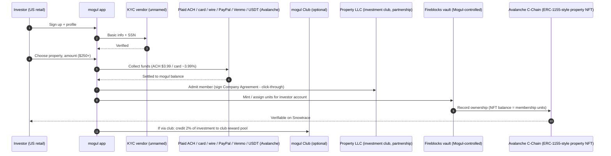
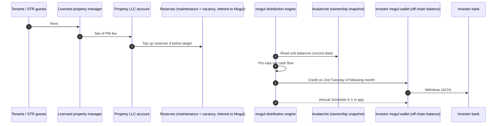
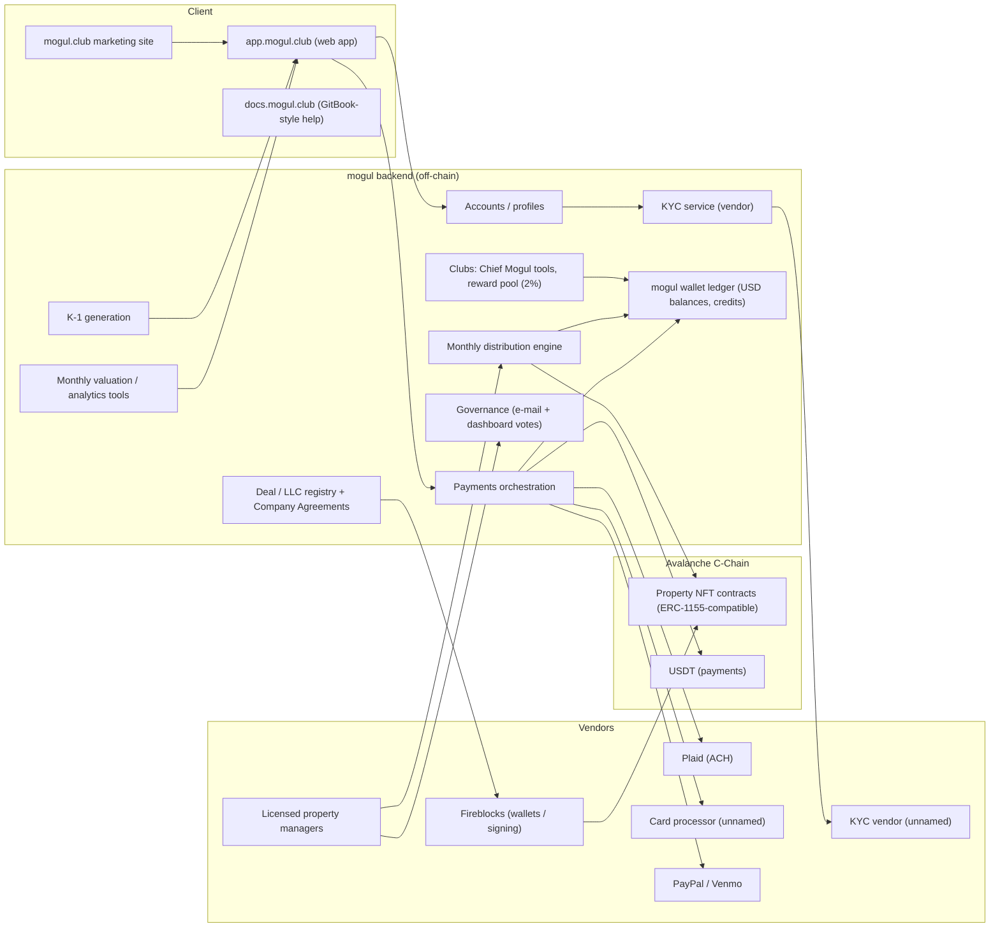

# mogul (mogul.club) — United States (USA)

| Field | Value |
|---|---|
| Website | https://www.mogul.club · app: https://app.mogul.club · docs: https://docs.mogul.club |
| HQ / legal entity | mogul Technologies, Inc. (Washington, DC) [C#1][C#3]. One "Property LLC"/"PropCo LLC" per property, organised as an **investment club** [C#3][C#4] |
| Founded | 2021 company; platform launched Apr 2023 [C#5]. Domain registered 30 Apr 2023 [C#8] |
| Status as of Sep 2026 | **Active**. $90M in assets as of 1 Jun 2026 [C#1]; "$3,181,675 invested last month" (homepage, Sep 2026) [C#2]. Signs of strain: Trustpilot 2.2/5 and website traffic down ~88% over 12 months [C#8] |
| Category | On-chain tokenized fractional (Avalanche ownership records; fiat-first UX) |
| Asset focus | Single-family, short-term, mid-term rentals and sale-leasebacks, mostly Sun Belt (TX, AZ, FL) [C#2][C#9] |
| Scale | $90M assets, 40K+ users, 60+ properties (Apr–Jun 2026) [C#1][C#5]. $22M AUM in May 2025 [C#6], so roughly 4x growth in 12 months [I] |
| Min. investment | $250 per property [C#2][C#6] |
| Why it is in the Top 5 | The **fastest-growing live US on-chain retail real-estate platform** of 2025–26. It uses the Avalanche C-Chain, where "operating agreements state that records of ownership are held on the Avalanche blockchain", with **Fireblocks** wallet infrastructure. Legally it takes a **distinctive and risky path**: an "investment club" structure without SEC filings, plus a community "Clubs" growth engine. It is essential reading for RealX on what *not* to rely on legally, and on how to build fiat-first UX over a chain |
| Research confidence | **Medium** (official docs + ToS; no SEC filings to verify; chain details from press) |

---

## 1. Business model snapshot
- **Sponsor-originated deals.** Mogul (ex-Goldman Sachs founders) sources properties with a 12% hurdle rate and says it approves "less than 1%" of sourced deals. Each property goes into its own Property LLC [C#6][C#9][C#2].
- **Fees:**
  - **5% one-time**, capitalised into the deal: a 3% closing fee plus up to 2% setup [C#2][C#4].
  - Property management of 2.5% of rental income (Apr 2026 FAQ) [C#5].
  - **Interest earned on reserve accounts accrues to Mogul** [C#4].
  - Card, ACH and other rail fees are passed to investors [C#10].
- **Marketing claims:** "18.8% average annual returns" (IRR, unverified; no completed exits as of 12 Sep 2026) [C#5][C#2].
- **Growth engine: "mogul Clubs".** User-led communities run by a "Chief Mogul". **2% of qualifying member investments** is credited to the club reward pool as platform credits [C#12][C#13].

## 2. Legal & compliance structure

### 2.1 Issuing vehicle
- A **Property LLC ("PropCo")** per property, **taxed as a partnership**, with an operating agreement filed at state level and ownership recorded locally [C#2][C#7].
- Capitalisation covers equity, maintenance reserves and a vacancy reserve of 8–12 months, plus transaction costs [C#2][C#11].
- Mogul acts as **initial manager** and can be removed under the Company Agreement [C#4].

### 2.2 What the token legally represents
- A "proprietary on-chain property NFT that represents their fractional membership interest in the LLC" (ERC-1155-compatible custom contract on the Avalanche C-Chain) [C#6].
- Operating agreements state: "Records of ownership of the Company are held on the Avalanche Blockchain platform" [C#7]. **The chain is contractually designated as the membership register** [C#7].
- The app describes the holding as "digital confirmation of membership interest in the property-specific LLC" [C#14].

### 2.3 Securities exemptions / licences
- **No SEC filings found.** EDGAR full-text search for "mogul Technologies" returns 0 Form D, C or 1-A hits [C#15]. Filings under other entity names (e.g., individual Property LLCs) were not searched.
- **Legal theory: investment club.** Members "participate in the investment making decision process" and get "one vote plus the number of votes equal to the number of units held" [C#4]. The idea is that active member participation keeps LLC interests outside the *Howey* "efforts of others" prong. Mogul warns: "the Securities and Exchange Commission has not approved the same directly as an investment club" and "may deem the transactions … to be deemed securities" [C#2][C#3][C#4].
- **Tension with the facts** [I]:
  - Mogul sources, underwrites and manages properties.
  - Decisions under $1,000 are taken by the PM alone.
  - **Non-responses default to the manager's recommendation** [C#11].
  - Investors are passive $250 retail tickets.
  These features resemble the investor reliance that *Howey* and *Williamson v. Tucker* treat as a security.
- **Club rewards** of 2% of member investment volume paid to club leaders look like transaction-based compensation. If the interests are securities, this raises **unregistered broker** questions [I, from C#13].
- No broker-dealer or funding portal is involved. Mogul says it "is not a registered broker-dealer or investment advisor" [C#2][C#3].

### 2.4 Partners
| Function | Partner | Label |
|---|---|---|
| Wallet / key infrastructure | **Fireblocks** | C#7 |
| Blockchain | Avalanche C-Chain (Ava Labs partnership) | C#6 |
| Bank linking / ACH | **Plaid** ($3.99 flat ACH fee) | C#10 |
| Other rails | Card (~3.99%), wire, **Venmo, PayPal, USDT on Avalanche** | C#10 |
| KYC | Third-party "trusted vendor" (unnamed); basic info + SSN | C#16 |
| Property managers | "Licensed property managers" (unnamed) | C#2 |
| Transfer agent / BD / ATS | None | C#2, C#15 |

### 2.5 KYC / AML / sanctions
- A third-party vendor collects basic information plus an **SSN**, "or equivalent ID if non-US" [C#16].
- The ToS requires users to comply with the **Bank Secrecy Act** and AML statutes [C#4]. Mogul holds customer balances in a "mogul wallet" and accepts USDT, PayPal and Venmo, which raises money-transmission and MSB questions unless a licensed partner holds the funds [I].
- No OFAC or travel-rule disclosure was found.

### 2.6 Eligibility & geo
- **US only** per the ToS [C#4] and the competitor comparison [C#9]. The docs mention "equivalent ID if non-US" [C#16], so the sources are inconsistent.
- No accreditation requirement is stated; retail at $250 [C#2][C#9].

### 2.7 Tax
- The PropCo is taxed as a partnership, so investors receive **Schedule K-1s** through the app [C#2][C#14]. Mogul markets depreciation pass-through as a tax advantage over REIT dividends [C#2].
- For RealX, K-1s at $250 tickets across many properties are a **UX and cost burden**: multi-state filings, late K-1s [I].

### 2.8 Disclosures & protections
- Monthly valuations with "third-party appraisal-level data" [C#14].
- Reserves are pre-funded, so there are no capital calls [C#11].
- Investors are not liable for mortgage debt [C#2].
- A broad **liability waiver**: "you expressly WAIVE ALL CLAIMS you may have against mogul or the club…" [C#2].
- Delaware law; jury-trial waiver [C#4].

## 3. User types
| Persona | Description | Evidence |
|---|---|---|
| Retail investor (US) | $250+ per property; votes; receives monthly income; gets K-1 | C#2, C#14 |
| Chief Mogul (club founder) | Creates a public or private club, invites and moderates members, allocates club rewards | C#12, C#13 |
| Club member | Invests through club channels; shares in the 2% reward pool | C#12, C#13 |
| Manager (Mogul) | Initial manager of each Property LLC; removable | C#4 |
| Property manager | Licensed PM; decides under $1,000; prepares proposals | C#11 |
| Lienholder / servicer | Mortgage on some properties | C#4 |
| Mogul ops | Underwriting, onboarding, distributions, valuations | I |

## 4. Actions by role
| Role | Action | Channel | On/Off-chain |
|---|---|---|---|
| Investor | Sign up, KYC (SSN) | App | Off-chain [C#16] |
| Investor | Fund via ACH (Plaid), card, wire, Venmo, PayPal or USDT (Avalanche) | App | Off-chain / on-chain (USDT) [C#10] |
| Investor | Invest in a property "in under 30 seconds" | App | Off-chain order → on-chain NFT record [C#2][C#6] |
| Investor | Receive monthly distribution (2nd Tuesday) into the mogul wallet | App | Off-chain ledger [C#11][C#14] |
| Investor | Vote on decisions over $1,000, sale and strategy shifts | E-mail + dashboard | Off-chain [C#11] |
| Investor | Verify ownership on Snowtrace | Explorer | On-chain [C#7] |
| Investor | Transfer interest | Only with Mogul + LLC consent | Off-chain approval [C#4] |
| Chief Mogul | Create club, approve members, set reward split | Clubs UI | Off-chain [C#12][C#13] |
| PM | Propose capex with quotes and two options | Dashboard | Off-chain [C#11] |
| Mogul | Manage LLCs, reserves, valuations, K-1s, mint NFTs | Admin | Hybrid [I] |

## 5. Core flows

### 5.1 Onboarding
1. Create an account by e-mail, set a profile and goals, run KYC through a vendor (SSN), then browse [C#16].
2. A wallet is provisioned on Fireblocks infrastructure. Custody is held by Mogul through Fireblocks, and investors do not self-custody [C#7][I].

### 5.2 Primary purchase

Labels: [C#2][C#6][C#7][C#10][C#13][C#16]. The mint/assign order and whether the NFT sits in a per-investor or omnibus Fireblocks vault are [I]/[S].

### 5.3 Income distribution

Labels: cadence and wallet [C#11][C#14]; reserves [C#2][C#11]; reserve interest to Mogul [C#4]; K-1 [C#14]; snapshot from chain [I].

### 5.4 Secondary trading
- **Not available.** The market is "coming soon" and early exit is not possible [C#11][C#5]. Transfers need written consent from Mogul and the Property LLC [C#4].

### 5.5 Exit
- Planned hold of 5–7 years. Owners vote to sell, a super-majority triggers listing, offers are voted on, and net proceeds go to investor wallets pro rata [C#11]. No completed sale had been disclosed as of 12 Sep 2026 [C#5].

### 5.6 Governance
- Voting weight follows LLC ownership. The PM proposes quotes and two options, a vote runs by e-mail and dashboard with a deadline, and super-majority thresholds come from the OA. **Non-responses count as the manager's recommendation** [C#11].
- ToS formula: one vote per member plus one per unit [C#4]. This conflicts with the docs' pro-rata description [C#14].

### 5.7 Property onboarding
1. Sourcing and underwriting against a 12% hurdle, under 1% approval [C#9][C#6].
2. PropCo LLC formed, with the OA stating the Avalanche register [C#7].
3. Capital stack: equity plus reserves plus transaction costs; some properties carry mortgages [C#2][C#4].
4. Listed in the app with analysis tools [C#2].

## 6. Reverse-engineered architecture

**On-chain vs off-chain.**
- On-chain: the ownership register (contractually authoritative per the OAs) and USDT deposits [C#7][C#10].
- Off-chain: all cash (the mogul wallet), distributions, voting, KYC and transfer consent.
- The chain is used **"mostly as an administrative mechanism"** [C#5]. Investors do not hold keys and cannot transfer freely [C#4][I].

## 7. Tech stack
| Layer | Technology | Label | Source |
|---|---|---|---|
| Blockchain | Avalanche C-Chain (L1 mainnet, not a subnet) | C | #6 |
| Token standard | ERC-1155-compatible custom property NFT | C | #6 |
| Compliance controls | Off-chain transfer consent; on-chain minting controlled by Mogul's Fireblocks signer | C (consent) / I (signer) | #4, #7 |
| Wallet / custody | Fireblocks infrastructure; custodial | C (Fireblocks) / I (custodial) | #7 |
| Identity | Unnamed KYC vendor (SSN) | C / S | #16 |
| Fiat rails | Plaid ACH, card, wire, PayPal, Venmo | C | #10 |
| Stablecoin | USDT on Avalanche (deposits) | C | #10 |
| Explorer | Snowtrace | C | #7 |
| Help centre | docs.mogul.club with llms.txt (GitBook-style) | C | #17 |
| Frontend / backend / cloud | Unknown | S | — |
| Scheduling | Calendly for consultations | C | #3 |

## 8. Money flows & revenue model
| Flow | Amount | Label |
|---|---|---|
| Closing fee | 3% of purchase price | C#4 |
| Setup fee | Up to 2% | C#4 |
| Property management | 2.5% of rental income (Apr 2026 FAQ) | C#5 |
| Reserve interest | Accrues to Mogul | C#4 |
| ACH / card | $3.99 flat / ~3.99% | C#10 |
| Club rewards | 2% of qualifying investment → club pool (credits) | C#13 |
| Distributions | Monthly, 2nd Tuesday, USD to mogul wallet | C#11, C#14 |

## 9. Secondary market & liquidity
- None. Investors are locked for 5–7 years until an owner-voted sale. A secondary market is "coming soon" [C#11]. Because the chain is the register, a future secondary could be an on-chain transfer with Mogul-approved counterparties, but without a BD or ATS that would add to the securities-law exposure [I].

## 10. Risks, incidents, controversies
| Risk | Detail | Label |
|---|---|---|
| Securities classification | Investment-club theory with no SEC filing; Mogul's own disclaimer flags the risk | C#2, C#4, C#15 |
| Club rewards | 2% volume-based rewards could be treated as unregistered broker compensation | I (from C#13) |
| Default-to-manager voting | Weakens the "active participation" argument | C#11 → I |
| Custody / money transmission | Holds USD balances and accepts USDT, PayPal and Venmo | C#10 → I |
| Performance unverified | 18.8% IRR with no exits | C#5 |
| Reputation | Trustpilot 2.2–2.4; traffic −88% | C#8, C#5 |
| Conflicts | Reserve interest to Mogul; Mogul is manager | C#4 |

## 11. Extrapolated platform-owner ADMIN PANEL (EXTRAPOLATION — not observed)

| # | Module | Widgets / functions | Evidence |
|---|---|---|---|
| 1 | Growth dashboard | Invested this month ($3.18M), new users, club leaderboard, conversion funnel | Homepage stat [C#2] |
| 2 | Deal underwriting | Sourcing pipeline, hurdle-rate model (12%), approval rate (<1%), analysis-tool outputs | [C#9][C#6] |
| 3 | Entity / LLC manager | PropCo formation, OA versions (with the Avalanche-register clause), EIN, bank, lender info | [C#7][C#4] |
| 4 | Token registry (Avalanche) | Contract per property, mint/burn via **Fireblocks policy engine**, holder snapshots, Snowtrace links | [C#6][C#7] |
| 5 | Investors & KYC | KYC status (SSN), US residency flag, funding methods, wallet balances, K-1 delivery status | [C#16][C#14] |
| 6 | Payments & wallet ledger | Plaid ACH, card, wire, PayPal/Venmo, USDT deposit matching, refunds (card 45 days, ACH 60 days), withdrawals | [C#10][C#4] |
| 7 | Reserves | Maintenance and vacancy reserve balances vs target (8–12 months), interest accrual (to Mogul) | [C#2][C#4] |
| 8 | Distributions | Monthly run (2nd Tuesday), PM remittance import, pro-rata calculator, credit to wallet | [C#11] |
| 9 | Governance | Proposal builder (PM quotes + 2 options), voting deadline, super-majority calculator, **default-to-manager tally**, sale workflow | [C#11] |
| 10 | Clubs admin | Club list, Chief Mogul approvals, reward pool ledger (2%), payout split config, moderation | [C#12][C#13] |
| 11 | Valuations | Monthly valuation updates, third-party data feeds | [C#14] |
| 12 | Tax | K-1 generation per PropCo, partnership returns | [C#14] |
| 13 | Transfer consent | Requests to assign interests; approve or deny (Mogul + LLC consent) | [C#4] |
| 14 | Compliance | BSA/AML checks, suspicious-activity flags on PayPal/Venmo/USDT inflows | ToS BSA clause [C#4] |

**Maker-checker:**
- Mint or burn property NFTs: ops → Fireblocks policy approver (quorum).
- Monthly distribution release: finance → CEO/CFO.
- Reserve withdrawal above threshold: asset manager → finance.
- Club reward payout: growth → finance + compliance (broker-comp review).
- Transfer consent: investor relations → legal.
- USDT withdrawal: treasury → second Fireblocks signer.

**RBAC:** founder/admin; underwriting analyst; asset manager; finance/treasury; compliance/KYC; community manager (clubs); investor support; PM (external, own properties only); Chief Mogul (external, own club only); auditor/read-only.

**Alerts / reports:**
- Alerts: reserve below 8 months of fixed costs; PM remittance missing by the 5th; vote with low participation (default-to-manager triggered); club reward spike; KYC failure; USDT deposit from a flagged address.
- Reports: monthly investor statement; K-1 status; club growth report; property yield vs underwriting; fee income including reserve interest.

## 12. Builder takeaways
**Copy:**
- **Fiat-first UX over a chain.** ACH, card and PayPal funding, with the chain invisible except for Snowtrace verification [C#10][C#7].
- **Fireblocks policy engine** for issuer-controlled minting [C#7].
- **Contractually designating the chain as the LLC register** in the OA [C#7].
- Pre-funded reserves to avoid capital calls [C#11].
- A community "clubs" growth loop [C#12].

**Avoid:**
- Relying on an **investment-club theory** for $250 passive retail tickets [C#4].
- Volume-based club rewards that look like broker compensation [C#13].
- Default-to-manager votes [C#11].
- Keeping reserve interest (a conflict) [C#4].
- Holding customer cash and crypto without a licensed custodian or money-transmitter partner [C#10].

**Differentiate:**
- Use Reg A+ Tier 2 (or Reg CF for small raises) through a funding portal or BD so the same UX is legally robust.
- Put reward programmes through a registered BD or make them non-transaction-based.
- Consider REIT or C-corp elections to issue 1099s instead of K-1s.
- Launch an ATS-backed secondary.

## 13. Sources (accessed 23 Sep 2026)
1. mogul — About — https://www.mogul.club/about
2. mogul — Homepage — https://www.mogul.club/
3. mogul — App landing — https://app.mogul.club/
4. mogul — Terms of Service — https://app.mogul.club/terms-of-service
5. CrowdfundedWealth — "mogul.club Review 2026: 18.8% IRR — Unverified (No Exits Yet)" — https://www.crowdfundedwealth.com/reviews/mogul-club-review
6. Blockworks — "Mogul puts real estate investments on Avalanche" (29 May 2025) — https://blockworks.com/news/tokenized-real-estate-app-mogul
7. mogul Blog — "Blockchain & Real Estate: How mogul Delivers Efficiency, Security, and Transparency" — https://www.mogul.club/post/blockchain-real-estate
8. Traders Union — "mogul Review – Is it Safe and Legit? (July 2026)" — https://tradersunion.com/reviews/mogul-club/
9. Lofty — "Mogul Club Review 2026" (competitor comparison) — https://www.lofty.ai/compare/mogul
10. mogul Docs — "Secure Investment Flow" — https://docs.mogul.club/faq/platform/secure-investment-flow.md
11. mogul Docs — "Returns, Exits & Reserves" and "Governance & Voting" — https://docs.mogul.club/faq/real-estate/returns-exit-reserves.md ; https://docs.mogul.club/faq/real-estate/governance-voting.md
12. mogul Docs — "Roles & Participation" (Clubs) — https://docs.mogul.club/faq/mogul-clubs/roles-and-participation.md
13. mogul Docs — "Rewards" (Clubs) — https://docs.mogul.club/faq/mogul-clubs/rewards-and-mechanics.md
14. mogul Docs — "After You Invest" — https://docs.mogul.club/faq/platform/after-you-invest.md
15. SEC EDGAR full-text search — "mogul Technologies" (Forms D, C, 1-A) — https://efts.sec.gov/LATEST/search-index?q=%22mogul%20Technologies%22&forms=D,C,1-A (0 hits)
16. mogul Docs — "Getting Started" — https://docs.mogul.club/faq/platform/getting-started.md
17. mogul Docs — Index (llms.txt) — https://docs.mogul.club/llms.txt
