# End-to-End Flows: Canonical Flows with Archetype Variants

**Date:** 23 Sep 2026.

**Evidence key.**
- Labels are carried over from source files and never upgraded: [C] confirmed, [I] inferred, [S] speculative.
- File codes are defined in `00-executive-summary.md`. `[I syn]` = a design choice made in this synthesis.
- Archetypes A1–A7 are defined in `00-executive-summary.md` §2.
- Each canonical sequence is RealX's recommended design [I syn]. Each variants table records what the platforms actually do, with evidence labels.

**Flows**
1. Issuer / property onboarding and listing
2. Investor onboarding
3. Primary subscription
4. Token minting and allocation
5. Income distribution
6. Secondary trading, with per-transfer compliance checks
7. Lending against tokens
8. Governance votes and property sale / exit
9. Wallet recovery and forced transfer
10. Wind-down and liquidation

---

## 1. Issuer / property onboarding and listing

**Canonical steps [I syn]**
1. Sponsor KYB, including UBO checks.
2. Property due diligence: title search and title insurance, inspection, independent appraisal, **municipal compliance baseline** (taxes, code violations, utilities), tenancy review, insurance.
3. Structuring: SPV, series, trust or registry, plus the tax election.
4. Legal classification and choice of exemption.
5. Offering documents.
6. Token and compliance-rule configuration.
7. Marketing approval.
8. Listing.

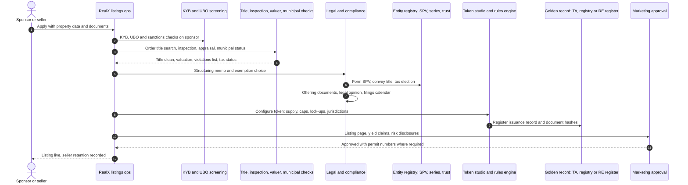

### Variants

| Archetype | Platform practice | Evidence |
|---|---|---|
| A1 | **Lofty:** seller background check; inspection, appraisal and DD pack published; Wyoming DAO LLC formed; ASA minted; seller keeps ≥10% | [C us/01 §5.7, §1] |
| A1 | **RealT:** acquisition of low-cost Detroit homes; entity formed; Form D and/or Reg S; ERC-20 deployed; 10% markup | [C us/04 §5.7] |
| A2 | **RedSwan:** sponsor due diligence by the BD, PPM, Form D, then mint in Token Studio with HTS keys | [I us/02 §5.7] |
| A2 | **Propvest:** in-house origination; external appraiser (valuation was later criticised); prospectus supplement | [C eu/03 §5.7; I eu/03 §5.7] |
| A3 | **PRYPCO:** DLD smart valuation sets the reference price; token supply = 10,000 per m²; DLD approval under REES | [C me/01 §5.7; I me/01 §5.7] |
| A3 | **Saudi operators:** multi-stage vetting, REGA price controls before launch, registration through RER Aamal | [C me/04 §5.7] |
| A4 | **Arrived:** buy-box (cap rate >5%, 3+ bed, under 30 years old, $200–400k); affiliate may renovate first and resell at a premium; 253G2 supplement | [C us/03 §5.7] |
| A4 | **Stake / SmartCrowd:** DIFC SPV incorporated; title registered in the SPV's name at DLD (trustee office for SmartCrowd) | [C me/03 §5.2; C me/05 §5.2] |
| A5 | **BrickX:** a separate Additional Disclosure Document per trust. **Assetora:** fixed-price campaign, then a Supplementary PDS once the target is reached | [C au/01 §5.7; C au/05 §5.2] |
| A6 | **Blocksquare:** owner application; corporate resolution; notary (Luxembourg framework); IPFS hash; `createNewPropTokenForCPAndLI`. **Brickken:** self-serve `newTokenization` | [C eu/02 §5.2; C eu/04 §4] |
| A7 | **Domoblock:** in-house sourcing with "AI micro-location" pricing; Domoblock co-invests 5–10% | [C eu/05 §5.7, §1] |

**Key controls:**
- **Deed-to-token reconciliation and title insurance.** RealT faces allegations that some properties it tokenised were "never owned" [C us/04 §2.8].
- **Municipal compliance baseline.** Detroit found no compliance certificates on any of the 408 properties in its suit [C us/04 §10].
- **Related-party pricing disclosure:**
  - Arrived: affiliate resale premium [C us/03 §10].
  - PRYPCO: DAMAC affiliation [I me/01 §10].
- **Independent valuation.** Propvest's appraiser was criticised [C eu/03 §2.8].

---

## 2. Investor onboarding (KYC / KYB / accreditation / suitability)

**Canonical steps [I syn]**
1. Sign-up.
2. Residency and age gate.
3. Identity check: document + liveness, or government ID.
4. Sanctions, PEP and adverse-media screening.
5. Risk rating.
6. Classification: retail / accredited / professional / qualified / wholesale.
7. Suitability or knowledge test.
8. Tax self-certification.
9. Wallet: create or link, then screen it.
10. On-chain identity registration or credential.
11. Link a funding method.

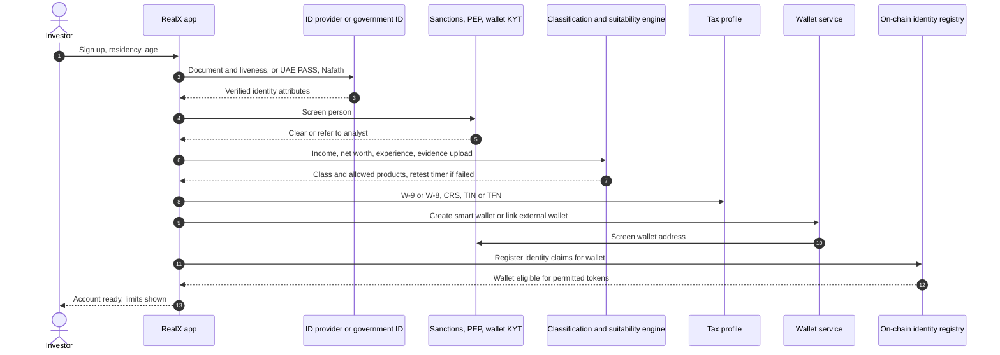

### Variants by jurisdiction and platform

| Region | Required elements | Platform practice | Evidence |
|---|---|---|---|
| US | CIP/CDD; OFAC screening of persons and wallets; 506(c) accreditation (third-party letter, or the NAL path of $200k natural person / $1M entity); Reg A/CF investment limits; W-9/W-8 | RedSwan: third-party accreditation. Arrived: Reg A 10% limit check. Lofty: ID + selfie in minutes. mogul: SSN | [C reg/us §3–4; C us/02 §5.1; I us/03 §5.1; C us/01 §5.1; C us/05 §5.1] |
| EU | AMLD CDD; MiFID categorisation plus appropriateness; ECSP knowledge test, loss simulation, 4-day reflection; wallet-ownership proof above €1,000 | Propvest: MiFID questionnaire. Brickken: six-state Sumsub machine. Reental: ~30% of sign-ups complete KYC. Blocksquare: ~24h SLA | [C reg/eu §3–4; I eu/03 §5.1; C eu/04 §2.5; C eu/01 §2.5; C eu/02 §2.5] |
| UAE | Emirates ID / UAE PASS; source of funds; VARA classification (Retail / Qualified / Institutional); suitability test with ≥1-week retest lockout; 8-year records | PRYPCO: Emirates ID, address and source of funds; UAE PASS since Aug 2026. Stake: IDWise with professional evidence | [C reg/me §3; C me/01 §5.1; C me/03 §5.1] |
| KSA | Nafath MFA; Yakeen/Absher data; verifiable credential; eligibility tier (citizen / resident / non-Saudi, zone rules) | Jozo and other sandbox operators | [C me/04 §5.1] |
| AU | eIDV (DVS); TFN; FATCA/CRS; wholesale certificate (valid 2 years); residency/FIRB flag; TMD questionnaire | BrickX: Equifax ID Matrix and residency check. Tokeniser: Averer credentials with wholesale proof | [C au/01 §5.1; C au/03 §5.1; I reg/au §3] |

**Key design choice.** Make identity a **reusable credential** bound to the wallet, so that the token itself enforces eligibility at every transfer. This follows ERC-3643 Identity Registry Storage ("one KYC, many tokens"), Redbelly/Averer verifiable credentials, and Blocksquare's single account across marketplaces [C inf/std §1.4; C au/02 §5.1; C eu/02 §2.5].

---

## 3. Primary subscription (fiat or stablecoin, escrow, min/max raise, refund)

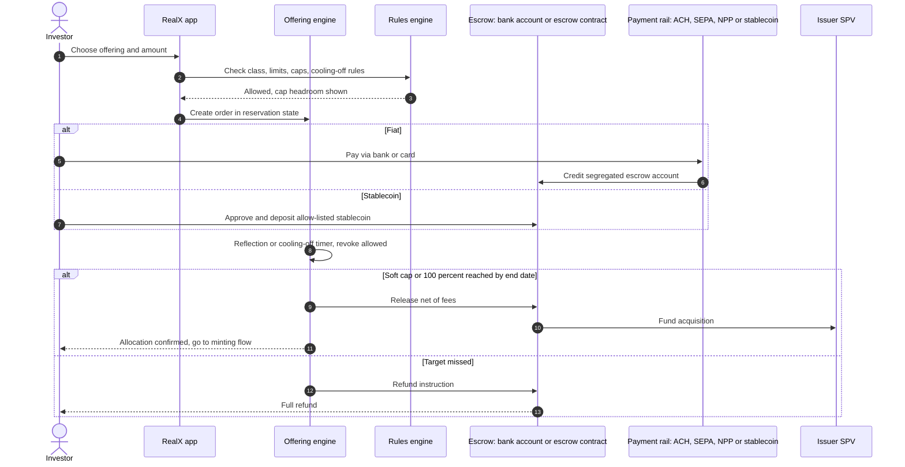

### Variants

| Archetype | Escrow, target and refund | Payment | Evidence |
|---|---|---|---|
| A1 | Reental: funds released only at 100% funding. Lofty: purchase settles atomically on-chain | Reental: USDT (min €100) or bank transfer with proof upload (min €500). Lofty: Stripe fiat converted to USDC | [C eu/01 §5.2; I eu/01 §5.2; C us/01 §5.2] |
| A2 | RedSwan: escrow, BD closes tranche. Propvest: Mangopay to SPV, issuer pays up to 3.5% commission | RedSwan: USD wire or hUSDC. Propvest: SEPA from €25 | [C us/02 §5.2; C eu/03 §5.2] |
| A3 | PRYPCO: 24h cooling-off; seller and DLD fees paid into a DLD trust account; sells out in minutes. Saudi: dedicated acquisition account, DvP at registration | PRYPCO: bank, card, Apple Pay (AED). Saudi: mada | [C me/01 §5.2; C me/04 §5.2] |
| A4 | Arrived: funds held at Modern Treasury until the series closes. Stake: funds returned if the target is missed | Arrived: ACH via NCIT. Stake: card or bank | [C us/03 §5.2; C me/03 §5.2] |
| A5 | BrickX: pre-order, with up to A$20k advanced while a deposit clears (buy-only during that window). Assetora: bids until target, then SPDS confirmation | BrickX: PayID. Assetora: bank | [C au/01 §5.2; C au/05 §5.2] |
| A6 | Brickken: on-chain escrow; soft/hard cap; `closeOffer`, then `claimTokens` or refund. Blocksquare: finalise-and-mint or revert-and-refund | USDC/USDT; EUR via the operator | [C eu/04 §5.2; C inf/wl §5] |
| A7 | Domoblock: all-or-nothing with full refund; pre-sale tier | Mangopay EUR, or DAI capped at €10k per transaction | [C eu/05 §5.2] |

**Regulatory hooks:**
- US Reg CF needs a qualified third-party escrow, and BD min/max offerings follow Rule 15c2-4 [I reg/us §5].
- ECSPR imposes a 4-day reflection period and explicit consent above €1,000 or 5% of net worth [C reg/eu §3].
- UAE funds go to a segregated client-money account; off-plan sales fall under the Dubai escrow law [I reg/me §5].

---

## 4. Token minting and allocation

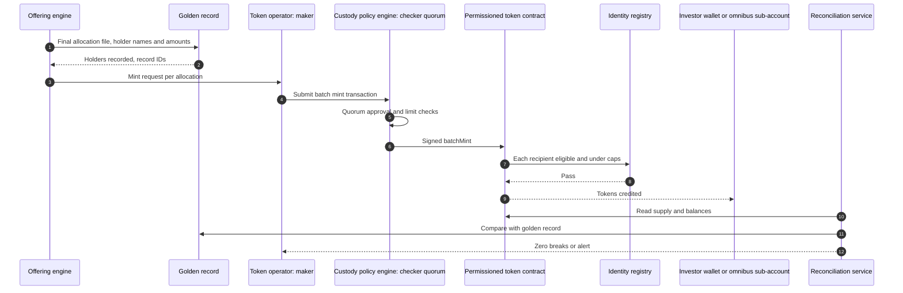

### Variants

| Pattern | Platforms | Evidence |
|---|---|---|
| Register first, then mint or transfer to an eligible account | RedSwan (registrar records, then the HTS token moves to a KYC-granted account) | [I us/02 §5.2] |
| Registry-instructed mint into an omnibus account | DLD instructs Ctrl Alt to mint 10,000 tokens per m² into a warm MPC omnibus; token IDs synced back to DLD; certificate issued | [C me/01 §5.2; I me/01 §5.2] |
| Deed token plus fractional tokens minted by the registry | Saudi RER with SettleMint compliance modules | [C me/04 §5.2] |
| Atomic group (payment + token opt-in) | Lofty: USDC payment and ASA opt-in in one atomic group | [I us/01 §5.2] |
| Claim from escrow after the offering closes | Brickken `claimTokens`; Blocksquare finalise-and-mint | [C eu/04 §5.2; C inf/wl §5] |
| Operator mint via MPC signer | mogul (Fireblocks policy engine) | [I us/05 §5.2] |
| Manual assignment after fiat reconciliation | Reental bank-transfer path | [C eu/01 §5.2] |
| Off-chain unit issue at settlement | BrickX, Assetora, Arrived, Stake, SmartCrowd | [C au/01 §5.2; C au/05 §5.2; C us/03 §5.2; C me/03 §5.2; C me/05 §5.2] |

**Controls:**
- **Supply equals the golden record.** Holder caps are checked at mint, not only at transfer: Lofty 15%, PRYPCO 20%, BrickX 5% [C us/01 §2.2; C me/01 §2.6; C au/01 §2.6].
- **Maker-checker comes from the custody policy engine, not the issuer UI** [C inf/adm headline 2].

---

## 5. Income distribution (rent → SPV → payout engine → wallets or bank, with withholding)

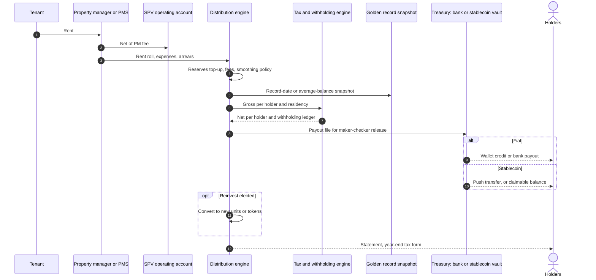

### Variants

| Platform | Cadence · currency | Mechanism | Evidence |
|---|---|---|---|
| Lofty | **Daily**, USD or USDC, around 00:00 UTC | Daily accrual per token; snapshot of ASA balances; batched USDC; reinvest option | [C us/01 §5.3; I us/01 §5.3] |
| RealT | **Weekly**, USDC or xDai (pre-2026) | Average balance over the week, including RMM deposits; push on Gnosis, claim on Ethereum. **Stopped when a court sent rent to escrow** | [C us/04 §5.3; I us/04 §5.3] |
| Reental | Monthly, USDT | (rent − opex) / tokens; 19% withholding; auto-reinvest | [C eu/01 §5.3] |
| Blocksquare | Monthly / quarterly / annual, DAI/USDC/USDT | `addRevenue` by admin or CP only; holders claim or operator pushes | [C eu/02 §5.3] |
| Propvest | Quarterly, EUR (often zero recently) | Snapshot from custodian; Mangopay payout | [C eu/03 §5.3] |
| Domoblock | Bullet at exit, EUR or DAI | Delay interest of 0.75%/month after 2 months, capped at 4.5% | [C eu/05 §5.3] |
| PRYPCO Mint | Monthly (or quarterly), AED, within the first 5 working days | Enumerated deductions; AED 0.01 minimum; reinvest into PAXG gold | [C me/01 §5.3] |
| Stake | Target weekly, AED | Deductions include a 0.5% admin fee; RentReinvest | [C me/03 §5.3] |
| SmartCrowd | Monthly, AED | Quarterly 0.5% admin-fee deduction | [C me/05 §5.3] |
| BrickX | Monthly, A$, within 10 business days | **Smoothing policy; about a 3-month cash reserve**; Smart Invest auto-reinvest | [C au/01 §5.3] |
| mogul | Monthly (2nd Tuesday), USD wallet | Reserves of 8–12 months are topped up first; interest on reserves goes to mogul | [C us/05 §5.3] |
| Arrived | Monthly or quarterly (varies), USD | REIT test (≥90% of taxable income distributed); payment file from Modern Treasury/NCIT | [C us/03 §5.3] |
| Redbelly / Tokeniser / Canvas | Set by the issuer. AUDM or wholesale CBDC (pilot) | Record-date snapshot; programmable payouts | [I au/02 §5.3; C au/03 §5.3; C au/04 §5.3] |

**Controls:**
- **Reconciliation must be zero before release** [I me/01 §11.2].
- **Rent-arrears and vacancy alerts** [I au/05 §11.4].
- **Court-order hold state.** Rent can be redirected by a court [C us/04 §2.8].
- **Withholding by residency:**
  - US 30%/15% [C us/01 §2.7].
  - Spain 19% [C eu/01 §2.7].
  - Australia MIT withholding 15%/30% and TFN [I reg/au §8].

---

## 6. Secondary trading, with compliance checks per transfer

### 6.1 Generic flow for all venue types

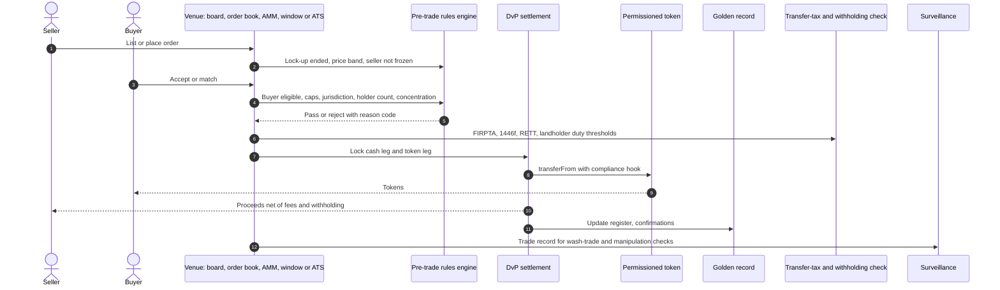

### 6.2 AMM variant: the pool must itself be an eligible holder

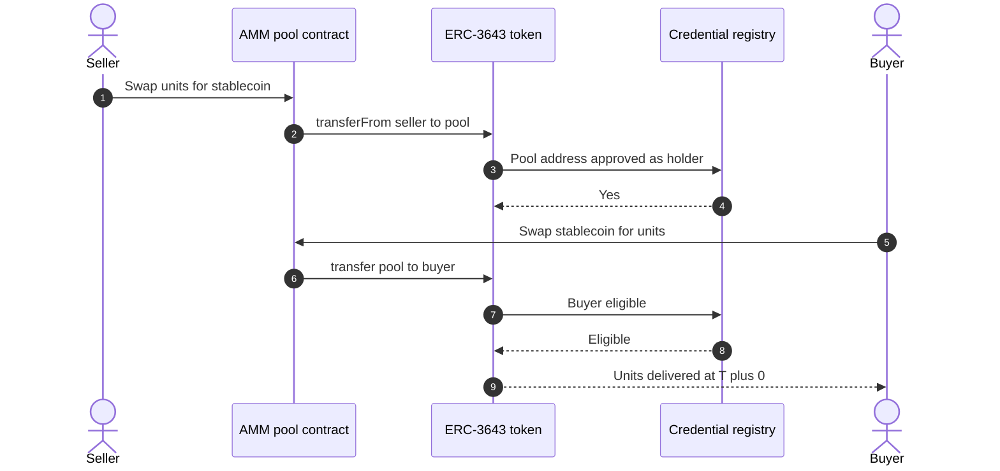

Pattern taken from Tokeniser/Liquidise; the pool-eligibility step is [I] [I au/03 §5.4]. Lofty's PMM caps pool holdings at 20% of supply [C us/01 §5.4].

### 6.3 Venue models observed

| Model | Platforms | Guardrails | Licensing | Outcome |
|---|---|---|---|---|
| Continuous order book | Lofty (plus PMM); BrickX (off-chain, price-time priority) | Lofty: none on price; 15% cap. BrickX: sell floor ≥80% of valuation, halts, 5% cap | Lofty is **not** an ATS [C us/01 §9]. BrickX's legal basis is unconfirmed [S au/01 §2.3] | Premiums and discounts to NAV are normal [C au/01 §5.4] |
| AMM / pools | Lofty PMM; Liquidise; Oceanpoint (POINT planned) | Staking cap; eligible pool | "Exempt public protocol" theory is untested [I au/03 §2.3] | Lofty fills in seconds in deep pools, hours in thin ones [C us/01 §5.4] |
| P2P listing board | PRYPCO (±15% of DLD valuation, 3-month lock-in); Reental RNT P2P; RealT YAM; Propvest Handelsplatz; Assetora; Blocksquare | Price bands at PRYPCO and SmartCrowd | PRYPCO under VARA BD; others unregistered or brokered bilateral [C me/01 §9; C eu/03 §5.4] | Propvest at 75–80% of par [C eu/03 §9] |
| Periodic windows | Arrived (monthly, one week); Stake (May/Nov); SmartCrowd (Mar/Sep) | Holding period (6 months / 1 year); valuation-set price (Stake) | Arrived on PPEX ATS; the others under DFSA | Complaints about unfilled orders (Arrived) [C us/03 §9] |
| Licensed ATS / DLT venue | Arrived (PPEX, T+1/T+2) | BD-routed | ATS | **No platform yet combines an ATS with on-chain T+0** [C us/sum §7.5] |
| Bilateral DvP / repo | Canvas | Allowlist | Acacia relief | Institutional liquidity through collateral use [C au/04 §9] |

### 6.4 Per-transfer compliance checks

| Check | Enforced where | Evidence |
|---|---|---|
| Buyer identity / whitelist | Token (ERC-3643 identity registry; RealT per-property whitelist; HTS KYC key) | [C inf/std §1.4; C us/04 §2.5] |
| Jurisdiction / residency / zone | Token modules; Saudi geo-fence checked at every transfer | [C me/04 §2.5] |
| Lock-up / holding period | Token (Rule 144, Reg S, DigiShares buy/sell restriction dates); PRYPCO 3 months | [C reg/us §6; C inf/wl §1; C me/01 §9] |
| Per-holder cap | Token or venue: Lofty 15%, PRYPCO 20%, BrickX 5% | [C us/01 §2.2; C me/01 §2.6; C au/01 §2.6] |
| Holder count (US §12(g); AU MIS >20 members) | Threshold monitor; RealT's 2,000 cap | [C us/04 §2.3; I reg/x A5 #27] |
| Concentration for transfer taxes (EU RETT; AU landholder duty; FIRB foreign %) | Pre-trade block | [I reg/eu §8; I reg/au §8] |
| Price band vs NAV | Venue: PRYPCO and SmartCrowd ±15%; BrickX 80% floor | [C me/01 §9; C me/05 §9; C au/01 §9] |
| Sanctions / KYT on both counterparties | Screening hub | [C reg/x A4 #20] |
| Withholding on foreign sellers (FIRPTA 15%, §1446(f) 10%) | Settlement | [I reg/us §8]. RealT gap [I us/04 §2.7] |
| Travel-rule data on the cash leg | Travel-rule console (UAE ≥AED 3,500; EU no de minimis) | [C reg/me §4; C reg/eu §4] |

---

## 7. Lending against tokens

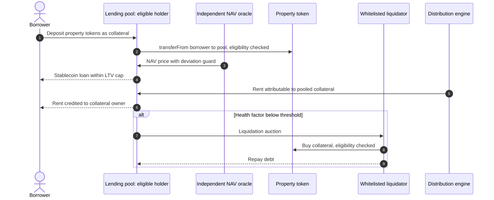

| Platform | Design | Risk observed | Evidence |
|---|---|---|---|
| RealT | RMM v3 (Aave v3 fork) on Gnosis; USDC/WXDAI; whitelisted liquidators; rent counted on deposited tokens | **Issuer-set oracle became reflexive once cash flows stopped**; RMM liquidity halted during liquidation | [C us/04 §5.4; I us/04 §9; C us/04 hdr] |
| Reental | RNTlend / Reenlever (Aave-based); up to 75% LTV; 250+ borrowers; US$6.5m liquidity | Whitepaper itself flags oracle manipulation risk | [C eu/01 §9; C eu/01 §10] |
| Tokeniser / Liquidise | Leverage add-on; collateralisation | Untested regulatory theory | [C au/03 §4; I au/03 §10] |
| Canvas | Repo and collateralised lending against SPV shares; wholesale CBDC cash leg | Pilot-only relief | [C au/04 §5.4; C au/04 §10] |
| Lofty | Lending UI "under development" (Apr 2026) | — | [C us/01 §9] |

**Recommendation [I syn]:** phase 3 only. Use an **independent valuation oracle**, deviation alerts against trade prices, conservative LTVs, and liquidators restricted to eligible holders. Obtain licensing advice on credit, lending and market activity first.

---

## 8. Governance votes and property sale / exit

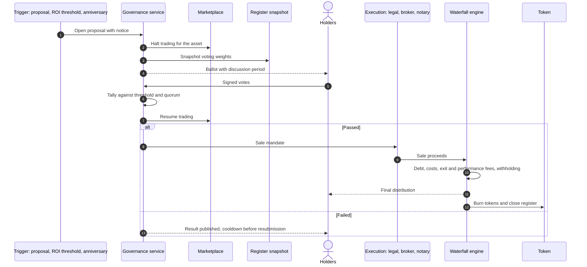

### Variants

| Platform | Vote rules | Sale waterfall / fees | Evidence |
|---|---|---|---|
| Lofty | Motion must be seconded; 48h discussion (24h if urgent); 72h vote (24h if urgent); 90-day cooldown after failure; off-chain (email + community) | Presumed pro-rata USDC | [C us/01 §5.6; I us/01 §5.5] |
| mogul | Pro-rata voting (the ToS formula conflicts); **non-responses count as the manager's recommendation**; super-majority to list | Net proceeds pro rata; no exits yet | [C us/05 §5.5–5.6] |
| PRYPCO Mint | 50% + 1 over 14 days; **vote auto-triggered at 30% ROI** | 1% exit fee; up to 15% performance fee above 30% ROI | [C me/01 §5.5] |
| SmartCrowd | Majority vote to sell (~5 years) | 2.5% exit fee; Flip deals 60/40 above a 10% hurdle | [C me/05 §5.5] |
| BrickX | 75% at any time; 50% at each 5-year anniversary; **trading halted during meetings**; Mosman vote failed | Debt repaid, then net proceeds; trust terminates | [C au/01 §5.5; I au/01 §5.5] |
| Assetora | 75% during the initial term, 50% afterwards | — | [C au/05 §5.5] |
| Reental | Reental decides; investors consulted only if the sale is below forecast | Investors 60% of gain, Reental 40% (minimum €2,500) | [C eu/01 §5.5; C eu/01 §5.6] |
| Propvest | Bondholder law (SchVG) [S]; KapMUG organising | Investors 80% of gain, Propvest 20% | [S eu/03 §5.6; C eu/03 §5.5] |
| Domoblock | None | 40% investors / 40% Domoblock / 20% Guarantee Fund of excess gain | [C eu/05 §1] |
| Arrived, Stake | Manager-controlled | Arrived: 6–7% disposition fee. Stake: 2.5% exit fee + 7% of appreciation | [C us/03 §5.5; C me/03 §5.5] |

**Observations [I syn]:**
- **No platform records asset-level votes on-chain.** Signed snapshot votes are an easy transparency gain.
- **Design against failed-exit deadlock**, e.g. BrickX Mosman at 39.77% [C au/01 §2.8].
- **Avoid default-to-manager tallies.** They weaken investor-control arguments [C us/05 §10].

---

## 9. Wallet recovery and forced transfer

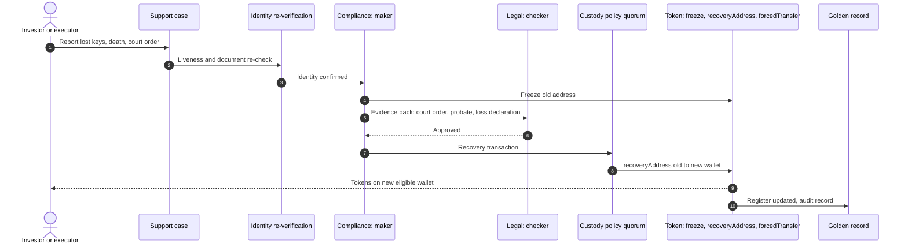

### Variants

| Mechanism | Platforms / standards | Evidence |
|---|---|---|
| ERC-3643 `recoveryAddress` / `forcedTransfer` | Tokeny Recovery; Tokeniser; Saudi "enhanced ERC-3643" | [C inf/std §1.4; C inf/wl §2; C me/04 §7] |
| "Destroy and reissue" by the transfer agent | Securitize (death, divorce, lost keys) | [C inf/wl §3] |
| Guardian recovery of an AA wallet; re-whitelisting a new wallet | RealT (RealT as Guardian; v3 migration needed re-whitelisting) | [C us/04 §5.1; C us/04 §2.5] |
| Passkey sync (iCloud / Google) | Reental HumanWallet | [C eu/01 §5.1] |
| Burn and re-mint after identity re-verification | Reental back office | [I eu/01 §11.2] |
| ASA clawback / re-issue | Lofty | [I us/01 §7] |
| Internal ledger adjustment (custodial) | PRYPCO (freeze via an instruction to Ctrl Alt for the omnibus sub-account); mogul | [I me/01 §11.2; I us/05 §11] |
| Exceptions desk for inheritance, court orders and corrections | Saudi operators | [C me/04 §9; I me/04 §11.1] |
| Confiscation / edits | Brickken Issuer Studio | [C inf/wl §4] |

**Controls:** dual approval, legal evidence upload, investor notice, and immutable audit. The US TA proposal would put forced-transfer and re-issue under TA control with 6-year retention [C reg/us §5].

---

## 10. Wind-down and liquidation (lessons from RealT, Assetora, Propvest)

### What went wrong

**RealT** [C us/04 §2.8, §5.5; F6]:
- Detroit's nuisance suit covered 408 properties.
- A TRO sent rent to escrow for repairs only.
- Payouts had largely stopped by end-2025 and were formally suspended in Feb 2026.
- More than 300 properties faced tax foreclosure.
- A court fiduciary was appointed in Apr 2026, and voluntary liquidation was announced on 2 Jul 2026.
- The recovery order puts fiduciary costs, repairs, back taxes and legal obligations **before** token holders. Only ~$640k sat in escrow.
- **The YAM contract kept working the whole time.**

**Assetora** [C au/05 §2.8]:
- NDIS sub-funds could not find tenants.
- The trustee withdrew the PDS and suspended the marketplace; inflows were halted for about 13 months.
- The RE changed, and the listed parent was suspended on ASX.

**Propvest** [C eu/03 §2.8, §9]:
- Distributions were zero for many quarters.
- Offers sat at 75–80% of par.
- Investors organised KapMUG collective steps.

**Positive templates:**
- PRYPCO's Business Continuity Plan and Cessation Plan: PRYPCO supervises the property sale and returns capital pro rata [C me/01 §2.8].
- Stake's DFSA-supervised Business Cessation Plan, under which an administrator appoints a replacement SPV manager [C me/03 §2.8].

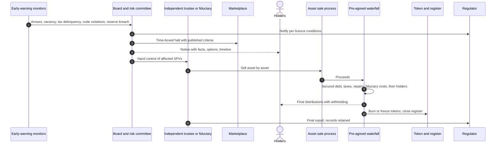

### Wind-down design requirements [I syn]

| Requirement | Why (evidence) |
|---|---|
| Separate reserve accounts per property, visible to investors | RealT's escrow held only ~$640k [C us/04 §5.5]. Lofty investors complained reserves were opaque [C us/01 §2.8] |
| Municipal-compliance and tax-delinquency monitors that trigger escalation | Detroit suit; 300+ properties facing tax foreclosure [C us/04 §2.8] |
| Pre-agreed waterfall in the offering documents, mirrored in a contract | RealT: creditors come ahead of holders [C us/04 §2.8]; "wind-down smart-contract waterfall" proposed [I us/04 §12] |
| Halt powers that are time-boxed, with published reopening criteria | Assetora froze for 13 months [C au/05 §2.8]; BrickX halts only during meetings [C au/01 §5.4] |
| An independent trustee or RE, with no operator self-dealing | Assetora's move from an independent trustee to an in-house RE removed a check [I au/05 §10] |
| Cessation plan and runbook tested annually | PRYPCO; Stake/DFSA [C me/01 §2.8; C me/03 §2.8] |
| Geographic and asset-type concentration limits | Detroit concentration [I us/04 §10]; NDIS niche assets [C au/05 §10] |
| Cross-border holder communications and claims handling | About 400 French RealT investors pursuing claims [C reg/us §11] |
