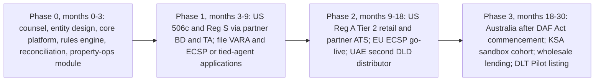

# Implications for RealX: Builder Playbook

**Date:** 23 Sep 2026 · Research, not legal advice.

**Evidence key.**
- Labels are carried over from the source files and never upgraded: [C] confirmed, [I] inferred, [S] speculative.
- File codes are defined in `00-executive-summary.md`. `[I syn]` = a recommendation made in this synthesis. F1–F6 = synthesis re-check fetches.
- Each recommendation cites the platform evidence behind it.

---

## 1. Copy / avoid / differentiate

### 1.1 Copy

| Pattern | From | Why it works | Evidence |
|---|---|---|---|
| Series LLC, a REIT election per series, Reg A+ Tier 2, and a BD + ATS | Arrived | Sells single-property interests to non-accredited US investors; investors get a 1099, not a K-1 | [C us/03 §12] |
| Registrar is the source of truth; affiliated BD; dual 506(c) + Reg S offerings | RedSwan | The SEC's issuer-sponsored model; accepted by institutions | [C us/02 §12] |
| $50 tokens, daily stablecoin rent, governance with timers, seller keeps ≥10% | Lofty | Engagement loop and skin in the game | [C us/01 §12] |
| Per-property whitelist, holder-cap monitor, average-balance rent accounting (including DeFi deposits) | RealT | The technical layer worked | [C us/04 §12] |
| Fiat-first UX over a chain; the operating agreement designates the chain as the register; pre-funded reserves | mogul | Chain invisible to users; no capital calls | [C us/05 §12] |
| Passkey smart wallet with sponsored gas; stablecoin plus bank payment paths; monthly payouts with auto-reinvest; public KPI posts | Reental | No seed phrase; low ticket via stablecoin | [C eu/01 §12] |
| 100,000 tokens per property; IPFS-anchored legal docs; claim-or-push distribution contract; one KYC across many marketplaces | Blocksquare | Simple % ownership; auditable | [C eu/02 §12] |
| "Licensed-partner sandwich": EMI + depot bank + crypto custodian, so the platform never holds client assets; €25 savings plan | Propvest | Bank-grade custody chain; recurring inflows | [C eu/03 §12] |
| Escrow with soft/hard cap and automatic refunds; six-state KYC machine; non-custodial prepare/sign/send API | Brickken | Explicit failure handling; keeps the platform out of custody | [C eu/04 §12] |
| All-or-nothing funding; delay-interest compensation; public planned-vs-actual track record | Domoblock | Trust mechanisms, even though the legal wrapper is not a model | [C eu/05 §12] |
| Title token tied to a government registry, with a certificate; ±15% price band against official valuation; 20% holder cap; 3-month lock-in; UAE PASS login | PRYPCO Mint | Regulator comfort; trust above tech | [C me/01 §12; F4] |
| Issuer/TA separated from distributor; registry-sync adapter; dual-token (ownership + transfer control) | Ctrl Alt | Clean licensing split | [C me/02 §12] |
| Explicit limits engine; AutoInvest / RentReinvest; pricing from independent valuation; ownership documents investors can verify | Stake | Automation and verifiability | [C me/03 §12] |
| Registry as truth; eligibility checked at every transfer; exceptions desk (inheritance, court orders) | Saudi RER | Legal finality | [C me/04 §12] |
| "Flip" product with a hurdle and profit split; open-banking pay-by-bank | SmartCrowd | A second return profile; cheap deposits | [C me/05 §12] |
| One trust per property inside a registered MIS, with a custodian; 80% price floor plus trading halts; exit vote every 5 years | BrickX | Proven Australian retail wrapper | [C au/01 §12] |
| Eligibility via credentials (verifiable credentials + ZK proofs); programmable AUD-stablecoin payouts | Redbelly | Privacy-preserving; maps to residency and FIRB gating | [C au/02 §12] |
| ERC-3643 tokens where the AMM pool is itself an eligible holder; transparent per-investor SaaS pricing | Tokeniser | Clean pattern for compliant liquidity | [C au/03 §12; I au/03 §5.4] |
| Choose early between a direct-ownership token and an SPV-claim token; offer repo/collateral utility to wholesale investors | Canvas | Institutional liquidity without selling | [C au/04 §12] |
| One registered MIS with a sub-fund per asset; a TMD library; mobile feed UX | Assetora | Faster and cheaper launches under a supplementary PDS | [C au/05 §12] |

### 1.2 Avoid

| Anti-pattern | Seen at | Consequence | Evidence |
|---|---|---|---|
| Selling to retail on an undisclosed exemption | Lofty | CA DFPI action; a "regulatory bet" | [C us/01 §2.3] |
| Investment-club theory; club rewards tied to volume; votes that default to the manager; operator keeps reserve interest | mogul | Securities and broker-compensation exposure; conflicts | [C us/05 §12; I us/05 §2.3] |
| Single-city distressed stock; unmonitored PMs; oracles set by the issuer; 165 entities; offshore scope creep | RealT | Detroit suit, court fiduciary, liquidation | [C us/04 §12] |
| Inflated AUM; advertising liquidity that does not exist; hopping between chains | RedSwan | Credibility loss | [C us/02 §12] |
| Missed blue-sky filings; opaque premiums on affiliate sales; windowed liquidity that disappoints | Arrived | WA DFI fine; BBB complaints | [C us/03 §12] |
| Utility-token staking that gates access to securities; USDT payouts in the EU; disclosures on Google Drive; manual proof-of-payment reconciliation | Reental | MiCA/MiFID conduct risk; off-ramp friction | [C eu/01 §12] |
| A "MiCA not MiFID" thesis for revenue-share tokens; fees paid in the property token itself; Ownable admin keys | Blocksquare | Classification and admin-key risk | [C eu/02 §12] |
| Target returns the assets cannot meet; a single appraiser; seller-priced secondary with no market maker | Propvest | Trades at 75–80% of par; KapMUG action | [C eu/03 §12] |
| `needKyc=false` allowed in production; fees in a volatile utility token; marketing TTV as if it were volume | Brickken | Compliance leakage | [C eu/04 §12] |
| Tokens that carry no rights; a thinly capitalised operator as the only borrower | Domoblock | No investor protection | [C eu/05 §12] |
| Inconsistent public documents; AI-only support for money complaints; undisclosed trading fees | PRYPCO Mint | Trustpilot complaints | [C me/01 §12] |
| All retail tokens in one omnibus without sub-account transparency; manual ownership changes | Ctrl Alt | Single point of failure | [C me/02 §12] |
| Liquidity only 4 weeks a year; passing KYC fees to investors | Stake | Investor frustration | [C me/03 §12] |
| A parallel ledger that can drift from the registry | Saudi RER | Legal mismatch | [C me/04 §12] |
| Stale public statistics | SmartCrowd | Credibility | [C me/05 §12] |
| RE keeps wallet float interest; unclear voting UX | BrickX | Trust and optics; failed exits | [C au/01 §12] |
| Headline "on-chain assets" that mix pipeline with issued assets | Redbelly | Credibility | [C au/02 §12] |
| Relying on an "exempt public protocol" theory for AMMs; settling in a proprietary token | Tokeniser | Market-licence exposure | [C au/03 §12] |
| Building a retail product on pilot-only relief | Canvas | Relief expires | [C au/04 §12] |
| Niche single-tenant assets; a marketplace frozen for 13 months; claiming "tokenised" with no chain footprint | Assetora | Freeze; ASX suspension | [C au/05 §12] |

### 1.3 Differentiate (RealX's proposed edge) [I syn]

1. **Proof of property.** Attest on-chain, per property, and refresh from county/city or registry APIs:
   - deed or registry record;
   - title insurance;
   - tax-paid status;
   - insurance;
   - code-compliance status;
   - reserve balance.

   This is the direct answer to RealT [I us/04 §12] and to Lofty's opaque reserves [C us/01 §2.8].
2. **Audited, verifiable metrics.** Publish capital raised (not "tokenised value"), per-property ledgers and payout history. It is cheap to do, and competitors' headline claims exceed verified figures by roughly 10–75×: Brickken TTV vs on-chain TVL ~11× on a like-for-like end-2025 basis (US$450m vs US$41m; ~16× if the Sep 2026 US$660m+ TTV is set against the end-2025 TVL); RedSwan ~40–50×; Redbelly ~74× [C us/02; C au/02; C eu/04 hdr, §10].
3. **Continuous licensed liquidity.** NAV-banded trading with T+0 stablecoin DvP on a licensed venue, plus a disclosed market-making reserve. No platform offers this today [C us/sum §7.5].
4. **The token is the legal register wherever the law allows it:**
   - **US:** the transfer agent's DLT master file [C reg/us §5].
   - **Spain / Germany:** the national DLT register [C reg/eu §2].
   - **UAE / KSA:** registry-synced title [C me/01; C me/04].
5. **Governance that works.** Signed snapshot votes, published thresholds and quorum, and anti-deadlock rules. Examples of the rules: a 5-year liquidity event with a fallback auction; no defaulting to the manager. This addresses BrickX's Mosman outcome and mogul's default-to-manager votes [C au/01 §2.8; C us/05 §5.6].
6. **One product, four regimes, via one rules engine** [C reg/x design principle].
7. **A local wedge in each region:**
   - EU: ECSP passport plus EURC.
   - UAE: a second DLD distributor with bids and market-making.
   - KSA: a sandbox operator.
   - Australia: the first retail MIS-wrapped property token, ready for the TCP regime [I syn; see regional-comparison.md §3].
8. **A Shariah-certified product line for the GCC.** PRYPCO Blocks has certification; PRYPCO Mint does not advertise it [C me/01 §12].

---

## 2. Phased go-to-market by region

**Assumption.** The founder's home base and capital are not stated (see §5). The default sequence below optimises time-to-first-revenue plus legal robustness, using the scorecard in `regional-comparison.md` §6. Alternative leads are listed after it.

| Phase / region | Licence pathway | Partners | Product scope | Timeline indicators (source labels) |
|---|---|---|---|---|
| **Phase 0: foundations** (months 0–3) | Legal opinions on classification per region; entity and tax-wrapper design | US securities counsel; EU (ES/DE/LU); VARA counsel; Australian financial-services counsel | Rules engine, golden-record reconciliation, property-operations and municipal module, KYC stack, admin console with maker-checker | Build [I syn] |
| **Phase 1, US: accredited and offshore** (months 3–9) | **Reg D 506(c) + Reg S** per SPV; partner BD; SEC-registered TA as golden record; Form D within 15 days; blue-sky notices | Partner BD (a rent-a-stack option); TA (Securitize, Vertalo or Texture); bank escrow or Modern Treasury; accreditation provider (iCapital or Verify Investor) | Primary issuance only. Per-property LLC with REIT or C-corp election. ERC-3643 token as the TA's DLT mirror. USD rails; USDC only once GENIUS-permitted | Partner route in "weeks" [I reg/us §2]. Own BD: FINRA NMA takes 4–9 months and ~$125–175k capital [C reg/us §2]. Legal $25–75k per SPV [S reg/us §2] |
| **Phase 1, parallel filings** | **VARA broker-dealer** application and talks with DLD / Ctrl Alt about becoming a distributor. **EU:** tied-agent agreement now, and file an ECSP application | Ctrl Alt ("PRYPCO and others") [C me/02 §1]; a MiFID firm as tied-agent principal | — | VARA licensing 6–12 months [S reg/me §2]. Stake's and SmartCrowd's IPAs were still off the register after 7–8 months [C me/sum §5.5]. ECSP: 6–12 months [S reg/eu §2] |
| **Phase 2, US: retail and secondary** (months 9–18) | **Reg A+ Tier 2** ($75M per 12 months; Form 1-A; audited statements); partner ATS for resale after holding periods | Partner ATS (tZERO, Securitize Markets, Texture) [C inf/ven §11]; auditor | $50–$100 tickets; series LLC with per-series REIT; windowed secondary first, then continuous; aim for T+0 settlement | Reg A qualification: 3–6 months of SEC review, 4–9 months overall, $100–300k [S reg/us §2] |
| **Phase 2, EU** | **ECSP licence** (€5M per project owner per 12 months; KIIS; entry test; 4-day reflection; passport). Use a national DLT register if available | EMI (Mangopay or Lemonway); qualified custodian; EURC | Debt-like notes per SPV; bulletin-board secondary; monthly EUR/EURC distributions; withholding engine | 6–12 months for the licence [S reg/eu §2] |
| **Phase 2, UAE** | VARA broker-dealer acting as the **second DLD distributor** | Ctrl Alt (issuance, custody, TA); Zand or Emirates NBD (client money); DLD | Residents-only DLD title tokens; AED payouts; **bid-side orders and market-making** within ±15% bands; Shariah-certified line | Depends on DLD's pilot admitting distributors [I me/02 §5.1]. AED 1,000 minimum is the benchmark [F4] |
| **Phase 3, Australia** (months 18–30) | RE-for-hire or CAR first; wholesale unregistered MIS, then an umbrella registered MIS with per-asset sub-funds. **DAF Act TCP/DAP** from 8 Apr 2027, with a 6-month AFSL transition to ~8 Oct 2027 | Professional RE; custodian (Perpetual/AET-type); registry (IQ-EQ-type); AUDM/AUDD; possibly Redbelly/Tokeniser | ERC-3643 mirror of the unit register; resident-only; per-holder caps below landholder-duty thresholds; NAV-floored board | AFSL 6–12+ months [S reg/au §2]. DAF Act dates [C F5] |
| **Phase 3, KSA** | Apply to the next REGA sandbox cohort; optionally a CMA fund-distribution permit for yield products | RER Aamal APIs; SettleMint stack; a Shariah board | Fractional deeds in investors' names; SAR via mada; per-operator resale | 6–24 months of testing with weekly reports [C me/04 §2.3]. The 2nd-edition window closed 30 Apr 2026 [C me/04 §12] |
| **Phase 3, cross-region** | Lending against tokens (wholesale first); listing on an EU DLT Pilot venue | Chainlink NAV / proof of reserve; 21X | Borrowing against tokens with an independent oracle | After liquidity is stable [I syn] |

**Alternative leads [I syn]:**
- **If RealX is GCC-based with local capital:** lead with the UAE as a distributor (Phase 1), and use DFSA crowdfunding or an ADGM route as a bridge while VARA is pending [C reg/me §2].
- **If RealX is EU-based:** lead with a tied agent, then ECSP. EU scores highest on retail reach and legal robustness [I syn; see regional-comparison.md §6].
- **If RealX is Australia-based:** start wholesale now and time the retail launch to the DAF Act commencement (8 Apr 2027) [C F5].

---

## 3. The 15 must-have capabilities for v1 [I syn]

| # | Capability | Minimum v1 scope | Evidence driving it |
|---|---|---|---|
| 1 | **Jurisdiction-parameterised rules engine** | Eligibility, residency and zones, holder caps, lock-ups, holder-count and concentration thresholds (US §12(g), RETT, landholder duty, FIRB). Enforced both in the token and off-chain | [C reg/x design principle, A5 #26–27] |
| 2 | **Identity and classification** | KYC, KYB and UBO; accreditation, professional, qualified and wholesale evidence with expiry; suitability tests with retest timers; a reusable credential bound to the wallet | [C reg/x A2; C inf/std §1.4] |
| 3 | **Screening hub** | Sanctions and PEP screening of persons and wallets (KYT); re-screen on list updates; freeze with dual control | [C reg/x A4 #20] |
| 4 | **Golden record plus reconciliation** | Register per SPV; daily three-way reconciliation (chain ↔ register ↔ bank) with break alerts | [C reg/us §5; C me/02 §11; I eu/03 §11] |
| 5 | **Permissioned token and lifecycle console** | ERC-3643 with ERC-7943 views; mint, burn, freeze, pause, forced transfer and recovery through a custody policy quorum; legal-evidence upload | [C inf/std §4; C inf/wl §12] |
| 6 | **Offering engine with escrow states** | Min/max and soft/hard caps; cooling-off or reflection timers; finalise-or-refund; document delivery and e-signature | [C eu/04 §5.2; C inf/wl §5; C reg/eu §3] |
| 7 | **Money movement** | Segregated client money through a bank, EMI or third-party funds holder; a stablecoin allow-list per jurisdiction, off by default; travel-rule data | [C us/03 §2.4; C reg/x A3 #19, A4 #21] |
| 8 | **Wallets** | Embedded passkey smart wallets with a paymaster and guardian recovery, plus a custodial mode where the regime requires it | [C eu/01 §7; C me/01 §7] |
| 9 | **Distribution and tax engine** | Rent-roll import; expenses and reserves; withholding by residency; snapshot; push or claim; reinvest; statements and tax forms | [C per file §5.3; C reg/x A8] |
| 10 | **Property operations and municipal compliance** | Tax, violations, utilities, insurance, vacancy and arrears, property-manager SLAs, reserve balances; proof-of-property attestations | [I us/04 §11 ⚑; C au/05 §2.8] |
| 11 | **Asset and entity registry with title verification** | Entity per SPV (filings, agents, tax elections); deed-to-token reconciliation; title insurance | [C us/04 §2.1; C us/04 §2.8] |
| 12 | **Independent valuation workflow** | Valuer upload → committee sign-off → publish (oracle) → price bands and floors | [C au/01 §2.4; C me/03 §5.4; I us/04 §11.2] |
| 13 | **Secondary market v1 with venue-mode flags** | Guard-railed internal board (NAV band, caps, lock-ups, halts, surveillance), or a connector to a partner ATS or DLT venue, switched per licence | [C me/01 §9; C au/01 §9; C reg/x A6 #30] |
| 14 | **Governance** | Notices; trading halt; snapshot; signed votes; thresholds; execution tracker; anti-deadlock rules | [C au/01 §5.5; C me/01 §5.5] |
| 15 | **Admin and regulatory backbone** | RBAC with maker-checker; immutable audit log; filings calendar; marketing-claims approvals; complaints SLAs; regulator data room; **tested cessation and wind-down runbook** | [C inf/adm; C me/01 §2.8; C reg/us §11] |

---

## 4. Top 10 risks and mitigations

| # | Risk | Failure mode seen | Mitigation [I syn] |
|---|---|---|---|
| R1 | **Property operations and municipal enforcement** | RealT: Detroit suit over 408 properties; rent sent to escrow; tax foreclosure on 300+ properties [C us/04 §2.8]. Lofty: St. Louis squatters [C us/01 §10] | Municipal-compliance monitor (capability 10); PM SLAs with step-in rights; per-property reserves; named local manager and registered agent (no anonymous agents [C us/01 §12]); limits on city and asset-type concentration |
| R2 | **Title verification / "never owned"** | RealT allegations [C us/04 §2.8] | Title insurance; deed-to-token reconciliation; registry sync where available; third-party attestation before mint |
| R3 | **Operating outside the securities perimeter, or marketing breaches** | CA DFPI vs Lofty [C us/01 §2.3]; mogul's club theory [I us/05 §2.3]; Texas SSB vs E-Estate ("backed by real estate", "capital protected") [C reg/us §11]; WA DFI vs Arrived [C us/03 §2.3] | CP1 posture only (`compliance-matrix.md`); no volume-based rewards; a claims library and approval workflow; blue-sky and state filing engine |
| R4 | **Frozen or illiquid markets** | Assetora froze for 13 months [C au/05 §2.8]; Propvest at 75–80% of par [C eu/03 §9]; BrickX's failed vote [C au/01 §2.8]; complaints about Arrived's windows [C us/03 §10] | Staged liquidity (NAV bands, holder caps); a disclosed liquidity reserve and market maker; time-boxed halts with published criteria; a licensed venue; periodic liquidity events |
| R5 | **Valuation and oracle manipulation; reflexive lending** | RealT's issuer-set oracle feeding RMM [I us/04 §9]; Propvest's appraiser criticised [C eu/03 §2.8] | Independent valuers; deviation alerts against trade prices; defer lending to Phase 3 with conservative LTVs |
| R6 | **Custody, key and admin-key compromise** | Omnibus concentration [C me/02 §10]; upgradeable contracts (Brickken UUPS, RealT REG) [C eu/04 §7; C us/04 §7]; MyAlgo exploit [C us/01 §10] | MPC policy quorum; timelock plus multisig on upgrades; segregated sub-accounts; two independent audits; BCP for forks and chain halts [C reg/us §5] |
| R7 | **Operator insolvency / wind-down** | Assetora's recapitalisation and ASX suspension [C au/05 §2.8]; RealT's liquidation [C us/04 §2.8] | Bankruptcy-remote SPVs; an independent trustee or fiduciary; a pre-agreed waterfall; a cessation plan (PRYPCO and Stake templates) [C me/01 §2.8; C me/03 §2.8] |
| R8 | **Regulatory access bottleneck and changing pilot rules** | VARA IPAs pending [C me/sum §5.5]; single DLD distributor [C me/01 §9]; time-bound Acacia relief [C au/04 §10]; unresolved KSA law [C me/04 §10] | Multi-region sequencing (§2); rent-a-licence while own licences are pending; contractual SLAs with the rail providers (Ctrl Alt); a regulatory-change watch |
| R9 | **Tax and threshold breaches** | RealT's FIRPTA gap on P2P [I us/04 §2.7]; §12(g) holder counts [C us/04 §2.3]; RETT and landholder duty [I reg/eu §8; I reg/au §8]; K-1 burden at mogul [C us/05 §2.7] | Threshold monitor that blocks transfers before the line is crossed; withholding engine at settlement; tax-wrapper choice (REIT or C-corp) |
| R10 | **Stablecoin, payments and AML** | USDT under MiCA [I eu/01 §2.8]; GENIUS permitted-issuer list [C reg/us §4]; CBUAE PTSR [C reg/me §4]; MSB exposure (mogul) [I us/05 §2.5]; Lofty pools with no KYC [C us/01 §2.5] | Stablecoin allow-list; a third-party funds holder; travel-rule console; **no KYC-free liquidity pools** |

**Also watch:** credibility of metrics (RedSwan, Redbelly, Brickken) [C us/02; C au/02; C eu/04]. The fix is to publish audited capital-raised figures only.

---

## 5. Open questions for the founder

1. **Home base and first investors.** Where are RealX's entity, team and capital based? Is the first target US accredited investors, EU retail, GCC residents, or Australian wholesale?
2. **Supply model.** Will RealX originate and operate properties itself (issuer, like Arrived or RealT)? Or run a marketplace for third-party sponsors (like Lofty or Blocksquare)? Or both? This determines the licence and liability profile.
3. **Asset focus.** Single-family rental, multifamily, commercial, off-plan (Dubai), flips (SmartCrowd), or debt? Each maps to a different wrapper and tax treatment.
4. **Licence strategy and budget.** Own the licences, or rent them first? Indicative costs:
   - FINRA NMA: ~$125–175k capital, 4–9 months [C reg/us §2].
   - VARA broker-dealer: 6–12 months [S].
   - ECSP: 6–12 months [S].
   - Australian RE: AFSL plus NTA [C reg/au §5].
5. **Golden record by region.** Are you willing to make a TA, registrar or land registry the legal record, with RealX's chain as a mirror? Or is "chain as register" a hard product principle?
6. **Custody posture.** Non-custodial smart wallets or custodial MPC? This changes licensing (VARA custody; the DAF Act "holding" trigger; MSB status).
7. **Stablecoins.** Launch fiat-only and add GENIUS/MiCA/CBUAE-permitted coins later? Or build around USDC from day one?
8. **Liquidity ambition.** Internal board, partner ATS, or AMM? Will you fund a disclosed market-making or liquidity reserve?
9. **US tax wrapper.** REIT per series (1099-DIV, but REIT tests apply), C-corp (entity-level tax), or partnership (K-1s)?
10. **Utility token.** Recommendation: **no**. Three EU platforms show the MiCA and conduct entanglement it brings [C eu/sum §6.3]. Is that acceptable?
11. **Shariah line.** Offer Shariah-certified products for GCC investors from launch?
12. **Build vs buy the token layer.** In-house ERC-3643, or Tokeny, Fireblocks, Brickken, or Tokeniser? And who keeps the maker-checker keys?
13. **Property management and municipal responsibility.** In-house or partners? Who carries municipal compliance contractually and operationally?
14. **Transparency policy.** Will you commit to audited, on-chain-verifiable AUM and payout data from day one?
15. **Timing against 2027 regime changes:**
    - GENIUS effective by 18 Jan 2027 [C reg/us §4].
    - Australia's DAF Act commences 8 Apr 2027 [C F5].
    - EU AMLR applies 10 Jul 2027 [I reg/eu §4].
    - First DAC8 reports due 30 Sep 2027 [C reg/eu §8].
