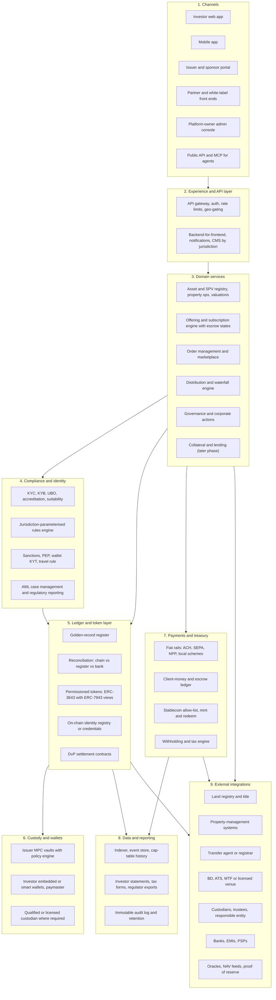
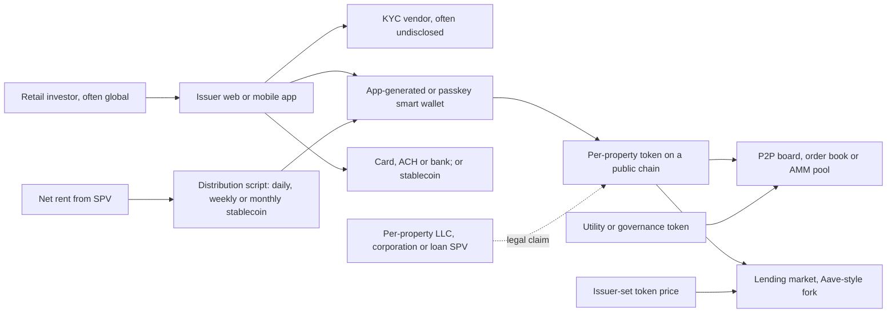
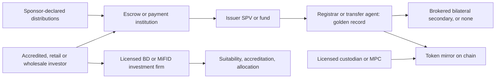
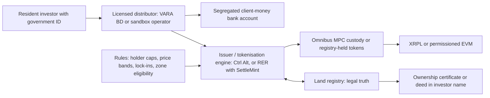
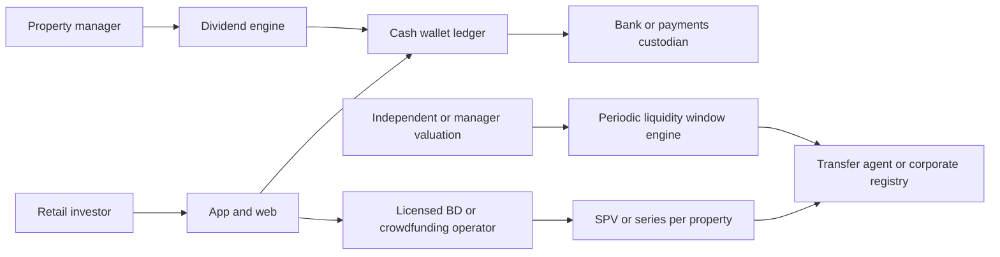
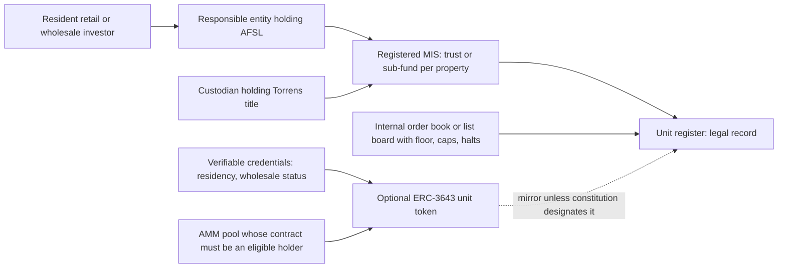
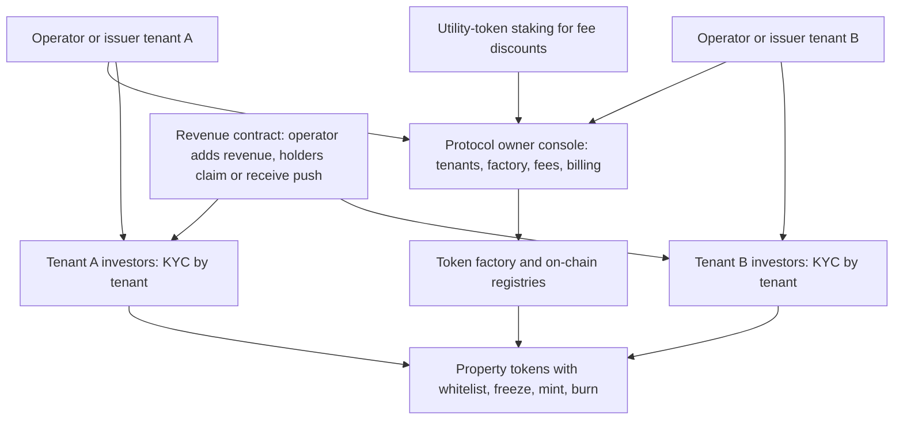
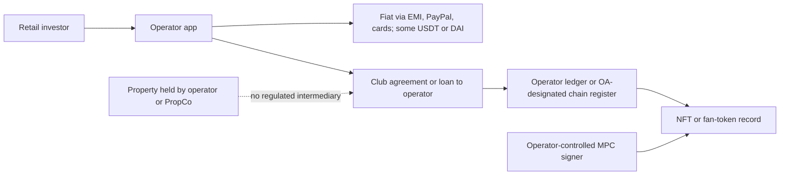
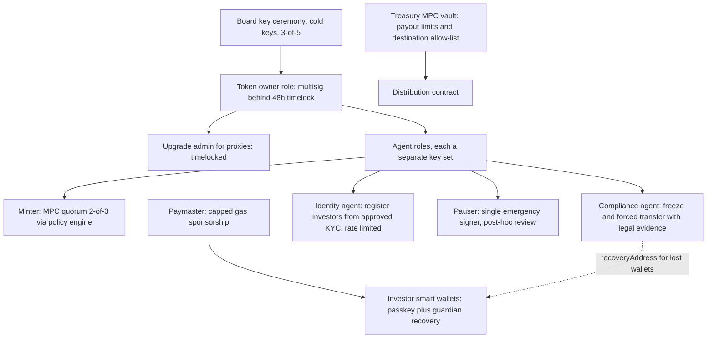

# Reference Architecture: Fractional Real-Estate Tokenisation

**Date:** 23 Sep 2026.

**Evidence key.** Labels are carried over from the source files and never upgraded: [C] confirmed, [I] inferred, [S] speculative. File codes are defined in `00-executive-summary.md`. `[I syn]` marks a design inference made in this synthesis. The architecture is a synthesis; each design choice cites the platform evidence behind it.

---

## (a) Layered reference architecture

### Layer narrative and evidence

| Layer | What it must do | Evidence behind the design |
|---|---|---|
| **1. Channels** | Separate apps for investors, issuers/sponsors, partner front ends and the admin console. Admin actions are exposed to AI agents through an API with per-action attribution. | Two-tier admin: DigiShares corporate plus per-project dashboards; Securitize Issuer Management Panel; Blocksquare protocol console plus CP dashboard [C inf/wl §18.1]. Agentic access with "delegation on every write" (Vertalo) [C inf/adm headline 7]; Brickken MCP/x402 [C eu/04 §6] |
| **2. Experience / API** | Geo-gating by residency and IP; content management that varies by jurisdiction and investor domicile; notifications. | DigiShares CMS by jurisdiction × domicile [C inf/wl §1]. Reg S "no directed selling" and 506(b) marketing rules [C reg/us §7]. Braze and Customer.io notifications (Propvest, Stake) [C eu/03 §7; C me/03 §7] |
| **3. Domain services** | Asset/SPV registry (entity sprawl); offerings with escrow states; order management; distribution and waterfall engine; governance; lending later. | RealT had 165 entities [C us/04 §2.1]. Brickken escrow soft/hard cap and refund [C eu/04 §5.2]. Waterfall builders exist only in off-chain comparators (InvestNext, Agora) [C inf/adm headline 5] |
| **4. Compliance / identity** | One rules engine with parameters per jurisdiction; KYC/KYB/UBO; accreditation and suitability; sanctions for both persons and wallets; travel rule; case management. | The cross-cutting controls file finds ~15 shared control families that differ only in parameters [C reg/x design principle]. SAR/STR workflows are not observed in any vendor [C inf/adm gaps] |
| **5. Ledger / token** | **Golden record** (see (c)); daily reconciliation; permissioned token; identity registry or credentials; DvP. | US TA proposal: DLT master file allowed only under TA exclusive control [C reg/us §5]. DLD sync [C me/02 §1]. Saudi "settlement = registry update" [C me/04 §2.2]. ERC-3643 is the de-facto standard [C inf/std §0] |
| **6. Custody / wallets** | Issuer operations go through MPC with a policy-engine quorum. Investors get a choice: non-custodial smart wallet, or licensed custody where the regime requires it. | Fireblocks policy engine is the clearest public maker-checker evidence [C inf/wl §12]. Passkey ERC-4337 wallets (Reental), Alchemy account abstraction (Blocksquare) [C eu/01 §7; C eu/02 §7]. Tangany custody (Propvest) [C eu/03 §7] |
| **7. Payments / treasury** | Fiat first. Segregated client money. Stablecoin allow-list per jurisdiction. Withholding at source. | MENA platforms and the retail AU platforms are fiat-only [C me/sum §5.3; C au/sum §5.5]; AU wholesale on-chain players use USDT/USDC/LIQ (Tokeniser) or wholesale CBDC (Canvas) [C au/03 §7; C au/04 §7]. Allow-list obligations: GENIUS Act, CBUAE payment-token rules, MiCA, ASIC Instrument 2025/867 [C reg/x A3 #19]. Automated 19% withholding at Reental [C eu/01 §2.7] |
| **8. Data / reporting** | Event indexing; point-in-time cap tables; investor and regulator exports; retention per jurisdiction (US TA 6 years, EU AML 5, VARA 8, AU 7). | Tokeny cap table with historical look-back [C inf/wl §2]. Retention periods [C reg/x §C]. Blocksquare moved from The Graph to an Envio indexer [C eu/02 §6] |
| **9. Integrations** | Land registry, property-management systems, TA, BD/ATS, custodians, banks, oracles. | DLD and RER integration [C me/01 §6; C me/04 §6]. Rent-roll sync with property-management systems is observed in no token vendor [C inf/adm gaps]. Chainlink proof of reserve, NAV feeds and ACE [C inf/ven §10] |

---

## (b) Architecture per archetype

### A1: DeFi-native public-chain marketplace (Lofty, RealT, Reental)

- **Evidence.** Lofty: Algorand ASA, order book plus PMM, daily USDC [C us/01 §6]. RealT: Gnosis, YAM, RMM, weekly USDC/xDai, REG token [C us/04 §6]. Reental: Polygon, passkey wallet, RNT P2P, RNTlend, RNT staking [C eu/01 §6].
- **Weak points:**
  - Issuer-set oracle behind the lending market [I us/04 §9].
  - Whitelist enforced by the platform UI rather than the token (Reental) [I eu/01 §7].
  - Pools that need no KYC (Lofty) [C us/01 §2.5].
  - The legal perimeter (see `compliance-matrix.md`).

### A2: Regulated security-token via licensed intermediary (RedSwan, Propvest, Canvas)

- **Evidence.** RedSwan: "registrar maintains authoritative ledger", affiliated BD, Coinbase custody [C us/02 §6]. Propvest: Mangopay, Baader and Tangany; Ethereum as a back-office ledger [C eu/03 §6]. Canvas: CDSR registry, DvP against wholesale CBDC, Zodia and Fireblocks [C au/04 §6].
- **Weak point:** secondary liquidity is thin or absent [C us/02 §9; C eu/03 §9].

### A3: Registry-anchored sovereign model (PRYPCO Mint, Ctrl Alt, Saudi RER)

- **Evidence.** PRYPCO/Ctrl Alt: DLD issues the title token and Ctrl Alt mints it into a warm MPC omnibus on Ripple Custody; ARVA dual-token layer [C me/01 §6; C me/02 §6]. Saudi: the registry itself runs the tokenisation stack ("registry-as-truth"), with enhanced ERC-3643 [C me/04 §6].
- **Weak points:**
  - Single-distributor liquidity [C me/01 §9].
  - Concentration of all retail tokens in one omnibus custody [C me/02 §10].
  - Pilot rules can change [C me/01 §10].

### A4: Off-chain fractional SPV / series benchmark (Arrived, Stake, SmartCrowd)

- **Evidence.** Arrived: NCPS BD, PPEX ATS, Modern Treasury, TA book entry, quarterly NAV [C us/03 §6]. Stake: DIFC SPVs, Emirates NBD, Exit Windows priced by valuation [C me/03 §6]. SmartCrowd: DIFC SPVs, Lean pay-by-bank, STF [C me/05 §6].

### A5: MIS / fund-unit wrapper (BrickX, Assetora, Tokeniser + Liquidise)

- **Evidence.** BrickX: AET and BrickX Trusco, off-chain register, order book with 80% floor [C au/01 §6]. Assetora: umbrella MIS with Perpetual as custodian [C au/05 §6]. Tokeniser: ERC-3643 on Redbelly with Averer credentials; eligibility of the pool contract is [I] [C au/03 §6; I au/03 §5.4].
- **Open issue:** the RBA flags "enforceable on-chain ownership records" as unresolved [C au/02 §2.3].

### A6: White-label protocol / infrastructure (Blocksquare, Brickken, Redbelly)

- **Evidence.** Blocksquare: PermissionRoles, CertifiedPartners, Users whitelist, `addRevenue`, claim or push, 1.5% fee paid in tokens, BST staking discounts [C eu/02 §6]. Brickken: prepare/sign/send API, factory clones with UUPS, STO escrow [C eu/04 §6]. Redbelly: verifiable credentials, ZK proofs, governor nodes [C au/02 §6].
- **Weak point:** compliance is pushed down to tenants, and it varies [I eu/02 §10; I eu/04 §10].

### A7: Outside-the-perimeter structures (mogul, Domoblock)

- **Evidence.** mogul: Fireblocks, Avalanche register designated in the OA, off-chain consent to transfers [C us/05 §6]. Domoblock: Mangopay, Polygon fan-token mirror, off-chain ledger as the source of truth [C eu/05 §6].

---

## (c) On-chain vs off-chain split, and golden-record options

### Responsibility split

| Function | Must stay off-chain | On-chain options seen | Recommended for RealX [I syn] |
|---|---|---|---|
| Legal title to land | Always: county recorder, Torrens, Grundbuch, DLD, RER [C reg/us §9; C reg/au §9] | DLD and RER sync title to tokens [C me/01 §2.2; C me/04 §2.1] | SPV/RE/custodian on title; registry sync where a state programme exists |
| Investor PII | Always (GDPR, and chain immutability) [C eu/sum §5] | Hashes (DS Protocol) [C inf/wl §3]; verifiable credentials and ZK proofs (Redbelly, Averer) [C au/02 §2.2] | Off-chain PII. On-chain claim or credential reference only |
| Eligibility / compliance status | Rules source and evidence | ERC-3643 identity registry; HTS KYC key; XRPL credentials; ASA freeze [C inf/std §3] | On-chain enforcement at every transfer |
| Ownership record | — | Chain as register (Lofty, mogul); chain as mirror (RedSwan, PRYPCO) [C us/01 §6; C us/05 §2.2; C us/02 §6; C me/01 §6] | Depends on jurisdiction; see the golden-record table below |
| Transfer restrictions | Rule authoring and approval | Whitelists (RealT, Blocksquare, Brickken); ERC-3643 modules (Tokeniser, Saudi) [C per file §7] | ERC-3643 modules plus ERC-7943 views |
| Cash leg | Fiat and client money | USDC/USDT/DAI (A1); wholesale CBDC (Canvas); AUDM (Redbelly) [C per file §7] | Fiat first; stablecoin DvP where allowed |
| Distribution calculation | Rent roll, expenses, reserves, withholding | — | Off-chain engine that emits a signed payout file |
| Distribution payment | Bank or wallet credit | Push/claim contracts (Blocksquare); daily batches (Lofty); merkle claims (RealT) [C eu/02 §5.3; C us/01 §5.3; I us/04 §5.3] | Push by default; claim contract for unhosted wallets |
| Valuation / NAV | Appraisal and committee | Oracle push (Chainlink proof of reserve and NAV) [C inf/ven §10] | Independent valuer, then maker-checker, then oracle |
| Governance votes | Execution (sale, property-manager change) | Snapshot or Aragon (protocol level only) [C eu/01 §5.6; C eu/02 §5.6] | Signed snapshot votes as evidence; legal execution off-chain |
| Documents | Originals | IPFS hash (Blocksquare); ERC-1643 [C eu/02 §2.1; C inf/std §1.2] | Hash-anchor offering documents and resolutions |
| Property operations and municipal compliance | Always | "Proof of property" attestations proposed [I us/04 §12] | Attest tax-paid, insurance and code-compliance status on-chain |

### Golden-record options

| Option | Examples | Legal basis | Pros | Cons | Controls required |
|---|---|---|---|---|---|
| **G1 Chain as register (contractual)** | mogul (OA designates Avalanche) [C us/05 §2.2]; Lofty ASA as member register [I us/01 §2.4]; Blocksquare [C eu/02 §6] | Operating agreement or articles designate the chain; Delaware DGCL §224 [I reg/us §9] | Simplest; T+0 transfers; transparent | **Not accepted as a TA master file** unless the TA holds exclusive control; wallet addresses cannot replace names and addresses [C reg/us §5]. Key loss equals ownership loss unless forced transfer exists | Forced transfer, re-issue, holder-identity mapping, court-order workflow |
| **G2 TA / registrar master file with chain mirror** | RedSwan [C us/02 §2.2]; Securitize and Vertalo [C inf/wl §3, §8]; Arrived (off-chain) [C us/03 §2.2]; Canvas CDSR [C au/04 §2.2] | SEC Rule 17Ad. The Sep 2026 proposal allows DLT for "all or part" of the file under TA exclusive control [C reg/us §5] | Institution-grade; regulator-accepted; re-issue powers | Two records to reconcile; TA cost | Daily reconciliation, break alerts, dual-approval re-issue, 6-year retention [C reg/us Checklist] |
| **G3 National DLT securities register** | Spain Ley 6/2023 register entity; German eWpG crypto-securities register [C reg/eu §2] | Statute gives the DLT record legal effect | The chain *is* the legal record, with a registrar | Registrar licence; national scope only. Propvest conversion unverified [eu/03 §2.2 gap] | Registrar integrity controls (Ley 6/2023 art. 6.5) [C reg/eu §2] |
| **G4 Land registry as truth** | DLD [C me/01 §2.2]; Saudi RER [C me/04 §2.2] | Registry law ("absolute probative force"; dispositions effective only once recorded) [C me/04 §2.2] | Strongest investor protection; government certificate | Access only through distributor licence or sandbox; closed-loop liquidity; pilot rules | Registry-sync monitor; exception desk for inheritance and court orders [C me/04 §11.1] |
| **G5 Trust / MIS unit register** | BrickX; Assetora; Tokeniser (legal register unless the constitution designates the token) [C au/01 §2.2; I au/03 §2.2] | Corporations Act s169; scheme constitution [I reg/au §5] | Proven retail wrapper | Token stays a mirror until the constitution is amended; RBA says legal finality is unresolved [C au/02 §2.3] | Unit-register ↔ chain reconciliation; transfer approval workflow |
| **G6 Custodian / depot books** | Propvest (Tangany/Baader) [C eu/03 §6]; PRYPCO omnibus sub-ledger [C me/01 §6] | Custody law | Investor never touches keys | Custody concentration; less on-chain transparency | Three-way reconciliation; per-investor sub-account attestations [I me/02 §12] |

**Recommendation [I syn]:**
- **US:** G2, with RealX's token as the TA's DLT file under TA control.
- **EU:** G3 where a national regime exists (Spain, Germany); otherwise G2 via a registrar.
- **UAE / KSA:** G4 as a distributor.
- **Australia:** G5 now; move toward G1-within-G5 (constitution designates the ERC-3643 ledger) when the Digital Assets Framework Act regime starts (8 Apr 2027) [C F5].
- **Everywhere:** one reconciliation service so the product works across all of these.

---

## (d) Security and key-management patterns

| Pattern | Seen at | Risk | Recommendation [I syn] |
|---|---|---|---|
| **MPC issuer vault with policy engine** (amount/destination rules, quorum approvals, admin quorum for policy changes) | mogul (Fireblocks mint policy) [C/I us/05 §7]; Redbelly and Canvas (Fireblocks) [C au/02 §7; C au/04 §7]; Ctrl Alt (Ripple Custody quorum) [I me/02 §5.2]; Fireblocks is the only clear public maker-checker [C inf/wl §12] | Policy misconfiguration | Use as the **checker for every on-chain admin action**; policies under admin quorum |
| **Omnibus MPC custody for retail** | PRYPCO/Ctrl Alt warm omnibus [C me/01 §2.4] | Single point of failure; weak on-chain transparency [C me/02 §10] | Segregated sub-accounts or per-investor attestations |
| **Licensed per-investor crypto custody** | Propvest (Tangany) [C eu/03 §2.4] | Cost | Default where custody must be licensed (EU MiFID, VARA) |
| **Non-custodial smart accounts** (passkeys, account abstraction, paymaster) | Reental HumanWallet (ERC-4337 + WebAuthn + paymaster) [C eu/01 §7]; Blocksquare (Alchemy) [C eu/02 §7]; Averer [C au/03 §7]; EIP-7702 live since May 2025 [C inf/std §1.8] | Passkey loss; paymaster drain | Guardian recovery plus ERC-3643 recovery; capped gas sponsorship per user [C inf/ven §4] |
| **AA wallet with issuer as guardian** | RealT (social login; RealT Guardians) [C us/04 §5.1] | The issuer can reconstitute keys, so the wallet is quasi-custodial | Disclose it; the guardian action requires dual approval |
| **"Non-custodial by assertion"** app wallet | Lofty (ToS says non-custodial; a reviewer says custodial) [C us/01 §7] | Legal ambiguity (MSB status, liability) | Document the key-management model explicitly |
| **Role separation in the token** | ERC-3643 Owner vs Agent (an Agent can be a multisig) [C inf/std §1.4]; DS Protocol Master/Issuer/Exchange/TA [C inf/wl §3]; HTS keys: admin, supply, KYC, freeze, wipe, pause [C inf/std §2.5]; ASA manager/freeze/clawback [C inf/std §2.1]; RealT ADMIN/UPGRADER split [C us/04 §4] | Over-privileged single keys | Separate minter, compliance agent, pauser, upgrader and owner roles |
| **Upgradeability** | Brickken UUPS [C eu/04 §7]; RealT REG upgradeable (OpenZeppelin) [C us/04 §7]; DS Protocol ERC-1967 proxies [C inf/wl §3]; Blocksquare non-proxy Ownable that can re-point its registry [C eu/02 §10] | Admin-key risk; silent logic change | Proxy behind a **timelock plus multisig**; publish upgrade notices; audit every upgrade |
| **Irreversible renunciation** | ASA role set to empty; Stellar AUTH_IMMUTABLE [C inf/std §2.1, §2.3] | Loss of compliance powers forever | Hard warning plus board approval in the admin console [C inf/std §4] |
| **Forced transfer and recovery** | ERC-3643 `recoveryAddress` and `forcedTransfer`; Securitize "destroy and reissue"; Brickken "confiscation" [C inf/adm headline 4] | Abuse or error | Maker-checker, legal evidence upload, investor notice, audit log |
| **Emergency pause** | ERC-3643 `pause`; DigiShares `isTradingAllowed` [C inf/adm §9] | Over-use freezes the market (Assetora's 13-month freeze) [C au/05 §2.8] | Single approver for emergencies, post-hoc review, time-boxed, pre-announced criteria |
| **Oracle security** | RealT's issuer-set RMM price [I us/04 §9]; Chainlink proof of reserve and ACE [C inf/ven §10] | Reflexive collapse; manipulation | Independent valuation, deviation alerts versus trade prices [I us/04 §11.4] |
| **Wallet-ecosystem risk** | Lofty dropped MyAlgo after its 2023 exploit [C us/01 §10] | Third-party wallet compromise | Wallet allow-list; incident playbook |
| **Chain resilience / business continuity** | SEC BD custody conditions: plans for forks, 51% attacks and bankruptcy [C reg/us §5]; Redbelly's low token market cap is offset by permissioned governors [I au/02 §2.8] | Chain failure | DLT risk assessment; multi-chain issuance at the same address (CREATE2) [C inf/wl §2] |
| **Smart-contract audits** | ABDK (RealT REG/CCIP), Slither (YAM) [C us/04 §2.4]; ISO 27001 at Brickken [C eu/04 §2.8] | Unaudited contracts | Audits by two independent firms before mainnet; bug bounty |

This key hierarchy is a recommended design [I syn]. It is assembled from the ERC-3643 role model [C inf/std §1.4], the Fireblocks policy engine [C inf/wl §12], and RealT's separation of ADMIN and UPGRADER roles [C us/04 §4].
