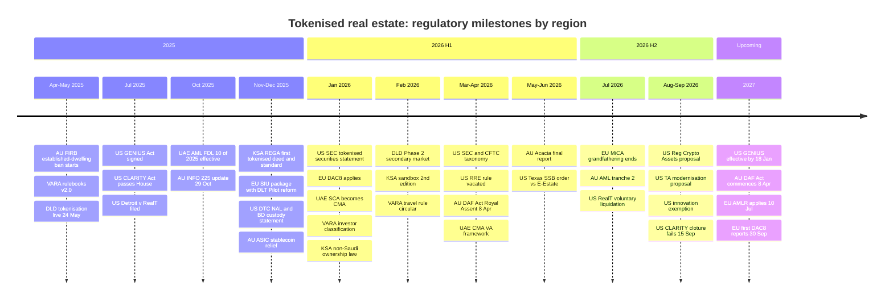

# Regional Comparison: US vs EU vs MENA vs Australia

**Date:** 23 Sep 2026.

**Evidence key.** Labels are carried over from the source files and never upgraded: [C] confirmed, [I] inferred, [S] speculative. File codes are defined in `00-executive-summary.md`. `[I syn]` = judgement made in this synthesis. F1–F6 = synthesis re-check fetches.

MENA cells separate **UAE (Dubai)** from **KSA** where the two differ.

---

## 1. Market and structure

| Dimension | United States | EU / EEA | MENA | Australia |
|---|---|---|---|---|
| **Market maturity** | Largest market, but on-chain retail is consolidating. RealT is in liquidation [F6]. HoneyBricks, Roofstock onChain and Homebase are dormant. Lofty is the largest live on-chain platform (~$101M TVL). The off-chain leader is far larger: Arrived has 885k sign-ups and $300M+ invested [C us/sum headline; C us/03] | Fragmented, with five different regulatory postures [C eu/sum §6.2]. Reental has 43.7k users; Propvest ~€250m AUM; Blocksquare US$216.9m tokenised *value*. The off-chain ECSP Bricks.co is bigger: €368m and 85k active investors [C eu/sum §3] | **Early, but driven by the state.** DLD is live: ~10 properties and AED 18.5m in Phase 1, secondary trading since 20 Feb 2026, target AED 60bn by 2033 [C reg/me §9; C me/01]. KSA runs a pilot with 9 sandbox operators [C me/04; F2]. The off-chain incumbents are large: Stake has 2m users and AED 1.4bn in transactions [C me/03] | **No live retail on-chain per-property tokeniser** [C au/sum §0]. Retail is off-chain MIS: BrickX ~A$53m funded; Assetora A$200M+ self-reported. On-chain activity is wholesale: Tokeniser A$1.2B self-reported; Acacia pilots [C au/sum §3] |
| **Dominant archetype** | A1 DeFi-native (Lofty, RealT); A4 Reg A+ benchmark (Arrived); A2 is thin (RedSwan) [C us/sum §7.2] | A1 (Reental), A6 infrastructure (Blocksquare, Brickken), A2 (Propvest), A7 (Domoblock) [C eu/sum §1] | **A3 registry-anchored** (PRYPCO/Ctrl Alt; Saudi RER), next to **A4** DIFC-SPV crowdfunding (Stake, SmartCrowd) [C me/sum §5] | **A5 MIS wrapper** (BrickX, Assetora), with A6 infrastructure (Redbelly, Tokeniser) and a wholesale A2 pilot (Canvas) [C au/sum §5] |
| **Legal classification** | Security under *Howey*. SEC staff (28 Jan 2026): "format doesn't matter"; real-estate SPV tokens are issuer-sponsored tokenised securities [C reg/us §1] | Transferable security (or AIF unit) under MiFID II, **outside MiCA** (ESMA guidelines, Dec 2024). Utility tokens such as RNT, BST and BKN fall under MiCA [C reg/eu §1; C eu/sum §6.3] | **UAE:** VARA ARVA plus a DLD title fraction; DIFC "Investment Token"; ADGM digital security [C reg/me §1]. **KSA:** CMA security or fund unit; REGA registry deed; **CMA role unresolved** [C reg/me §1; me/04 §2.3] | MIS interest per INFO 225 Example 9 ("83Smith"); a share if the vehicle is a company [C reg/au §1] |
| **Primary pathway for a new entrant** | Reg D 506(c) + Reg S through a partner BD and a registered TA. Then Reg A+ Tier 2 or Reg CF for retail. Then a partner ATS [C reg/us §2] | Tied agent of a MiFID firm → ECSP licence (€5M per project owner per year; passport), or MiFID plus a prospectus exemption (<€12M) or a prospectus. National DLT regimes. DLT Pilot venues for trading [C reg/eu §2] | **UAE:** VARA broker-dealer acting as a DLD distributor, or Category 1 issuance + BD; DFSA crowdfunding as the off-chain alternative [C reg/me §2]. **KSA:** REGA sandbox cohort; CMA fund-distribution permit [C me/04 §12; C reg/me §2] | RE-for-hire or a CAR, then own AFSL (RE) with a registered MIS; a wholesale unregistered MIS to start; **DAF Act TCP/DAP regime from 8 Apr 2027** [C reg/au §2; C F1/F5] |

## 2. Product mechanics

| Dimension | United States | EU / EEA | MENA | Australia |
|---|---|---|---|---|
| **Liquidity model** | Unregistered 24/7 on-chain venues: Lofty order book + PMM; RealT YAM, DEXs and RMM. **Regulated periodic windows:** Arrived monthly on PPEX ATS. **None:** RedSwan, mogul [C us/sum §7.5] | P2P boards with seller-set prices (Reental, Propvest at 75–80% of par, Blocksquare). DeFi borrowing used as a liquidity substitute. **No MTF or DLT-MTF listings** among the five [C eu/sum §6.7] | **UAE:** DLD 24/7 listing board with ±15% band, 3-month lock-in and 20% cap; a single distributor [C me/01 §9; F4]. DFSA SPVs trade in twice-yearly windows [C me/03 §9; C me/05 §9]. **KSA:** national marketplace still in development [C me/04 §9] | Internal order book with an 80% floor and halts (BrickX); list/accept board, **frozen for 13 months** (Assetora). Wholesale on-chain: AMMs (Liquidise) and repo (Canvas) [C au/sum §5.6] |
| **Custody model** | Mixed: app wallets "non-custodial by assertion" (Lofty); AA wallet with issuer guardians (RealT); Fireblocks custodial (mogul); Coinbase (RedSwan); TA book entry (Arrived) [C us/sum §7.7] | Self-custody smart wallets (Reental passkey, Blocksquare AA); licensed custody (Propvest/Tangany); EMI wallets (Domoblock/Mangopay) [C eu/sum §6.5] | **Custodial throughout.** Omnibus warm MPC (Ctrl Alt/Ripple) or tokens held by the registry; cash in client-money accounts [C me/sum §5.3] | Custodian holds title (AET, Perpetual). On-chain: Fireblocks, Zodia; non-custodial Averer wallet [C au/01; C au/05; C au/04; C au/03] |
| **Settlement currency** | USD plus USDC (USDT at mogul; xDai at RealT) [C us/sum §7.7] | EUR plus USDT/DAI/USDC. **No top platform uses a MiCA EMT** [C eu/sum §6.4] | **Fiat only:** AED / SAR (EGP in Egypt) [C me/sum §5.3] | Retail: AUD fiat (NPP/PayID). Wholesale on-chain: USDT/USDC/LIQ at Tokeniser/Liquidise; AUDM and wholesale CBDC in pilots [C au/sum §5.5; C au/03 §7] |
| **Distribution cadence** | Daily (Lofty), weekly (RealT until 2026), monthly (mogul; Arrived varies), quarterly for CRE (RedSwan [I]) [C us/01 §5.3; C us/04 §5.3; C us/05 §5.3; C us/03 §5.3] | Monthly (Reental, Blocksquare), quarterly (Propvest), bullet at exit (Domoblock) [C eu/sum §6.8] | Monthly (PRYPCO, SmartCrowd); weekly target (Stake); SAR fund payouts [C me/sum §4] | Monthly (BrickX, smoothed); monthly or quarterly (Assetora) [C au/01 §5.3; C au/05 §5.3] |
| **Typical minimum ticket** | $50–$250: Lofty and RealT ~$50, Arrived $100, mogul $250 [C per file] | €25–€500: Propvest €25, Reental €100 (USDT) or €500 (bank), Domoblock €200 [C per file] | AED 500–1,000: PRYPCO **AED 1,000 now** (AED 2,000 at launch) [F4; C me/01]; Stake and SmartCrowd AED 500. SAR 1,000 at Jozo [C me/04] | A$50 (BrickX) to A$1,000 (Assetora legacy) [C au/01; C au/05] |

## 3. Regulation, risk and white space

| Dimension | United States | EU / EEA | MENA | Australia |
|---|---|---|---|---|
| **Key 2025–26 regulatory changes** | SEC tokenised-securities statement (28 Jan 2026); SEC/CFTC taxonomy (17 Mar 2026); DTC no-action letter (Dec 2025); BD crypto-custody statement (17 Dec 2025); **transfer-agent modernisation proposal (1 Sep 2026; comments due 3 Nov)**; Regulation Crypto Assets proposal (18 Aug 2026; excludes tokenised securities); innovation exemption (17 Sep 2026; NMS stocks only); GENIUS Act (effective ~18 Jan 2027); **CLARITY Act failed cloture (15 Sep 2026)**; domestic BOI exemption (Aug 2026); RRE rule vacated (Mar 2026); 1099-DA basis reporting (2026) [C reg/us §10] | MiCA CASP grandfathering ended ≤1 Jul 2026; DAC8 from 1 Jan 2026; SIU package (4 Dec 2025) proposing a permanent DLT Pilot capped at €100bn; Listing Act €12M threshold; AMLA operational, with AMLR applying from 10 Jul 2027; ESMA prospectus consultation (9 Sep 2026) [C reg/eu §10] | **UAE:** DLD live (24 May 2025) → Phase 2 (20 Feb 2026); VARA rulebooks v2.0; AML FDL 10/2025 (effective 14 Oct 2025); VARA investor classification (8 Jan 2026); travel rule (24 Feb 2026); SCA renamed CMA (1 Jan 2026) with a VA framework (13 Apr 2026) [C reg/me §10]. **KSA:** REGA tokenisation standard and first tokenised deed trade (19 Nov 2025) [F2]; sandbox 2nd edition (13 Feb 2026) [C me/04]; non-Saudi ownership law (22 Jan 2026) [C reg/me §9] | INFO 225 update (29 Oct 2025; last modified 30 Apr 2026); ASIC Instruments 2025/867 (stablecoins) and 2025/871 (omnibus custody); **Digital Assets Framework Act 2026 (Royal Assent 8 Apr 2026; commences 8 Apr 2027; 6-month AFSL transition)** [F1/F5]; AML/CTF reforms (31 Mar 2026) and tranche 2 (1 Jul 2026); FIRB ban extended to 30 Jun 2029; RG 234 update (9 Jun 2026); Acacia final report (May 2026) [C reg/au §10; C au/sum §9] |
| **Biggest risks** | Unregistered offerings and state action (CA DFPI vs Lofty; Texas SSB); **municipal and property-operations failure (RealT)**; K-1 and PTP tax drag; FIRPTA on P2P trades; money-transmitter exposure [C us/01 §2.3; C reg/us §11; C us/04 §10; I us/04 §2.7; I us/05 §2.5] | Classification disputes (MiCA vs MiFID; Blocksquare's thesis); ECSP €5M cap; national fragmentation; USDT under MiCA; RETT on share deals; valuation and performance (Propvest) [I eu/02 §2.3; C reg/eu §2; I eu/01 §2.8; I reg/eu §8; C eu/03 §10] | **UAE:** licensing bottleneck (Stake's and SmartCrowd's IPAs still off the register after 7–8 months); DLD access and single-distributor liquidity; pilot rules can change; residents-only; custody concentration [C me/sum §5.5; C me/01 §10]. **KSA:** final law pending; CMA vs REGA perimeter [C me/04 §10] | MIS regime cost; **market licence needed for any secondary or AMM**; FIRB and landholder duty; freeze risk (Assetora); failed exit votes (BrickX); fit of fractional tokens with the DAF Act TCP definition [I reg/au §6; C au/05 §2.8; C au/01 §2.8; I syn from F5] |
| **White space for RealX** | **Continuous trading on a licensed venue with T+0 stablecoin settlement** [C us/sum §7.5]; tokenised Reg A+ product with a REIT wrapper (1099s) [I us/03 §12]; audited, on-chain-verifiable metrics [C us/sum §7.8] | **ECSP-licensed, token-native platform with KIIS and passport** [C eu/sum §6.2]; EURC rails; listing on a DLT Pilot venue [I eu/01 §12] | **Second DLD distributor** offering bids and market-making [C me/01 §12]; non-resident access when DLD opens it; Shariah-certified tokenised product [C me/01 §12]; KSA sandbox operator; off-plan instalments on top of tokens [C me/05 §12] | **First retail, MIS-wrapped, per-property token app**; AUD-stablecoin distributions; ready for the TCP regime from Apr 2027 [C au/03 §12; C au/sum §6] |

---

## 4. Regulatory milestones, 2025–26

Dates are from the regulatory files and fetches F1, F2, F5 and F6 [C reg/us §10; C reg/eu §10; C reg/me §10; C reg/au §10].

---

## 5. Regional narratives

**United States: clear law, a hard market.**
- The law is settled: a security remains a security [C reg/us §1].
- The market punishes weak operations. RealT's contracts worked, but its properties failed [C us/04 §6]. Lofty's legal basis for retail is undisclosed [C us/01 §2.3].
- Arrived shows that a compliant, retail-grade product works: Reg A+ Tier 2, a series LLC with a per-series REIT election, a BD and an ATS [C us/03 §12].
- The opening for a token entrant is the combination nobody has built: Arrived's compliance plus Lofty's UX, with T+0 settlement on a registered ATS.
- 2025–26 brought guidance but no statute. The TA proposal (comments due 3 Nov 2026) may formally allow a DLT master file under TA control [C reg/us §5].

**EU: fragmented, debt-shaped, under-licensed.**
- Tokens are mostly debt-like claims, because share transfers need a notary [I eu/sum §6.1].
- None of the five programmes uses ECSPR or the DLT Pilot Regime [C eu/sum §6.2].
- The largest licensed crowdfunding players stay off-chain (Bricks.co €368m) [C eu/sum §3].
- A passportable ECSP with native tokens and EURC rails would be unique.
- Performance lessons come from Propvest: licensed, yet trading at 75–80% of par [C eu/03 §9].

**MENA: the state runs the ledger.**
- Dubai and Riyadh have made the **land registry** the golden record [C me/sum §5.1]. That brings the strongest legal certainty of any region.
- The costs are closed-loop markets, residency limits and pilot rules.
- The bottleneck is licensing and access, not technology. Only PRYPCO is live on DLD rails; Stake and SmartCrowd still wait on in-principle approvals [C me/sum §5.5].
- Branding is crypto, but settlement is fiat only [C me/sum §5.3].

**Australia: settled wrapper, unresolved register.**
- Retail means a registered MIS [C reg/au §1]. Tokenisation changes only the register and settlement layers [C au/sum §5.1].
- On-chain activity is wholesale (Tokeniser, Canvas) and runs mostly on Redbelly [C au/sum §5.4].
- The **DAF Act** (commences 8 Apr 2027) creates TCP/DAP licensing [F5]. Its statutory TCP definition covers a platform that creates "a single digital token per asset" held in trust [C F5]. Whether fractional MIS-unit tokens fit TCP, or stay purely MIS interests, needs counsel [I syn].
- Nobody has launched a retail on-chain per-property product, so the field is open.

---

## 6. Entry scorecard for RealX [I syn]

Scores: 1 = unfavourable, 5 = favourable. These are judgements, reasoned from the cited evidence.

| Criterion | US | EU | UAE | KSA | AU |
|---|---|---|---|---|---|
| Speed to a first compliant launch | **4**: 506(c) + Reg S through partners in weeks [I reg/us §2] | 3: tied agent in weeks to months; ECSP licence 6–12 months [I/S reg/eu §2] | 2: VARA licence 6–12 months [S reg/me §2]; IPAs pending 7–8 months [C me/sum §5.5] | 1: sandbox cohort, then 6–24 months of testing [C me/04 §2.3] | 3: RE-for-hire takes months [I reg/au §2]; wholesale only at first |
| Retail reach at launch | 2: accredited only until Reg A (4–9 months [S]) | **4**: ECSP retail with protections plus passport [C reg/eu §2] | 3: residents only on DLD rails [C me/01 §2.6] | 3: citizens and residents; non-Saudis phased in [C me/04 §2.6] | 2: retail needs a registered MIS [C reg/au §2] |
| Legal robustness of the on-chain record | 3: TA proposal pending [C reg/us §5] | 4 where national DLT law exists (Spain, Germany) [C reg/eu §2] | **5**: registry-anchored [C me/01 §2.2] | **5**: registry has "absolute probative force" [C me/04 §2.2] | 2: RBA says finality is unresolved [C au/02 §2.3] |
| Competitive space (5 = little competition) | 2: Arrived, Lofty, Ark7 | 3 | 3: PRYPCO live; Stake and SmartCrowd coming | **4** | **4**: no retail token platform |
| Secondary-liquidity potential | **4**: ATS ecosystem (tZERO, Securitize, Texture) [C inf/ven §11] | 3: 21X / DLT Pilot [C inf/ven §11] | 3: DLD market is closed-loop [C me/01 §9] | 2: marketplace in development | 2: market licence needed [I reg/au §6] |
| **Indicative total (of 25)** | **15** | **17** | **16** | **15** | **13** |

**Reading [I syn].**
- **EU scores highest** on combined retail reach, record robustness and competitive space. The ECSP licence takes 6–12 months [S], and the per-project cap is €5M.
- **The US is fastest to a first product**, for accredited investors only.
- **The UAE has the strongest legal record**, but access to it is gated.
- **Australia has the most open field**, but timing is tied to the DAF Act (8 Apr 2027).

`implications-for-realx.md` turns this into a sequenced plan.
