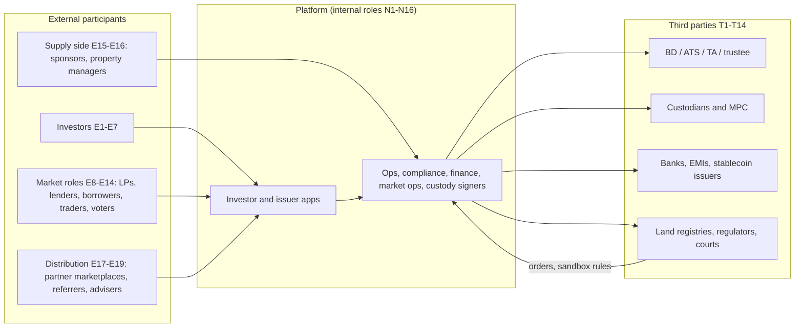

# User Types & Actions Matrix

**Date:** 23 Sep 2026.

**Evidence key.** Labels are carried over from the source files and never upgraded: [C] confirmed, [I] inferred, [S] speculative. Each label is followed by the file code and section, e.g. `[C us/01 §3]`. Codes are defined in `00-executive-summary.md`; `[I syn]` = inference made in this synthesis.

Internal roles for every platform come from §11 of each profile, "Extrapolated ADMIN PANEL". They are therefore **[I] by construction**: no admin panel is publicly visible (methodology §2.4).

---

## 1. Canonical role taxonomy

Each role has a code: **E** = external, **N** = internal, **T** = third party. The last column lists where each role was evidenced across the 20 platforms.

### 1.1 External roles

| Code | Role | Definition | Regulatory hook | Where evidenced |
|---|---|---|---|---|
| E1 | Retail investor | Non-accredited or non-professional natural person | Reg A/CF limits; ECSP non-sophisticated protections; VARA Retail; AU retail PDS/TMD [C reg/x A2] | Lofty, Arrived, RealT, mogul, Reental, Propvest, Domoblock, PRYPCO, Stake, SmartCrowd, BrickX, Assetora, Saudi operators [C per file §3] |
| E2 | Accredited investor (US) | Rule 501(a) person or entity | 506(c) verification [C reg/us §3] | RedSwan, RealT (legacy), Reental (US deals), Arrived [C us/02 §3; C us/04 §3; C eu/01 §2.6; I us/03 §3] |
| E3 | Professional / sophisticated / wholesale investor | EU professional (MiFID Annex II); DFSA professional; AU wholesale (s761G) | MiFID opt-up; DFSA; s761G/708 [C reg/eu §3; C reg/au §3] | Stake (Professional), SmartCrowd [I], Tokeniser (wholesale default), Canvas (wholesale only), Ctrl Alt (professional) [C me/03 §3; C au/03 §2.6; C au/04 §2.3; C me/02 §2.6] |
| E4 | Qualified investor | VARA Qualified (AED 3.5M net assets / AED 700k income); KSA qualified client | VARA circular of 8 Jan 2026; CMA [C reg/me §3] | Stake KSA (50/50 tranche) [C me/03 §2.6]; implied for Dubai VASPs [I reg/me §3] |
| E5 | Institutional investor / eligible counterparty | Funds, family offices, banks | — | RedSwan, Ctrl Alt, Canvas (family offices, hedge funds) [C us/02 §3; C au/04 §3] |
| E6 | Entity / SMSF / corporate investor (KYB) | Non-natural-person investor | UBO ≥25% capture [C reg/x A2 #7] | BrickX (SMSF), Assetora (SMSF/trust/company), Domoblock (KYB), Brickken (entities) [C au/01 §3; C au/05 §3; C eu/05 §3; C eu/04 §2.6] |
| E7 | Non-resident / Reg S investor | Offshore investor | Reg S; FIRPTA/FDAP; FIRB [C reg/us §2] | RealT (only non-US since 2022), RedSwan, Lofty (W-8BEN), Stake (non-residents), SmartCrowd (130+ countries), Reental (108 countries) [C per file §2.6] |
| E8 | Liquidity provider (AMM/pool) | Stakes stablecoin or property tokens into pools | Market-licence question [I reg/au §6] | Lofty PMM (**no KYC for USDC staking**), Blocksquare/Oceanpoint staking, Tokeniser/Liquidise pools [C us/01 §3; C eu/02 §3; C au/03 §3] |
| E9 | Lender (DeFi supplier) | Supplies stablecoin to a lending pool | Lending/credit regimes [I syn] | RealT RMM, Reental RNTlend [C us/04 §3; C eu/01 §3] |
| E10 | Borrower against tokens | Pledges property tokens as collateral | Same | RealT RMM, Reental RNTlend (≤75% LTV), Tokeniser leverage add-on, Canvas repo [C us/04 §3; C eu/01 §3; C au/03 §4; C au/04 §4] |
| E11 | Liquidator | Liquidates under-collateralised loans | — | RealT (whitelisted liquidators) [C us/04 §3] |
| E12 | Asset-level voter | Votes on sale, property manager or capex | Corporate/trust law | Lofty, mogul, PRYPCO, SmartCrowd, BrickX, Assetora, RealT (marketed) [C per file §5.6] |
| E13 | Protocol / utility-token holder or staker | Holds or stakes RNT, BST/sBST, BKN, REG, LIQ | MiCA "other crypto-asset" [I eu/sum §6.3] | Reental, Blocksquare, Brickken, RealT, Liquidise [C eu/01 §3; C eu/02 §3; C eu/04 §3; C us/04 §3; C au/03 §1] |
| E14 | Secondary trader (buyer or seller) | Trades on a board, order book, AMM or window | Venue licensing [C reg/x A6] | 15 of 20 platforms (not RedSwan, mogul, Domoblock, Ctrl Alt, Redbelly as a network) [C per file §5.4] |
| E15 | Property seller / sponsor / developer / issuer | Brings supply; may keep a stake | Issuer liability; offering rules | Lofty seller (keeps ≥10%), RedSwan sponsors, Reental promoters, Blocksquare Legal Issuer, Brickken tokenizer, PRYPCO developers, Assetora sponsors [C us/01 §3; C us/02 §3; C eu/01 §3; C eu/02 §3; C eu/04 §3; C me/01 §3; C au/05 §3] |
| E16 | Property / asset manager (external) | Runs tenancy, maintenance, rent | Local housing codes; real-estate AML (AU tranche 2) [C reg/au §4] | Lofty (third party or seller), RealT (3rd party, then in-house), mogul, Reental (city managers), Propvest (Sonar), Arrived (Mynd, Marketplace Homes), BrickX [C per file §3] |
| E17 | Distributor / partner marketplace / white-label operator | Resells or operates a branded front end | Licensed-distributor duties (VARA Cat 2) [C reg/me §2] | Blocksquare Certified Partners (19 marketplaces), Reental's Akka, PRYPCO as DLD distributor, Brickken white-label, Tokeniser issuer portals [C eu/02 §3; C eu/01 §3; C me/02 §3; C eu/04 §3; C au/03 §3] |
| E18 | Referrer / club leader / ambassador | Brings investors, earns rewards | **Unregistered broker risk if rewards are transaction-based** [I us/05 §2.3] | mogul "Chief Mogul" (2% reward pool), Domoblock referral, Stake referrals, Blocksquare ambassadors [C us/05 §3; C eu/05 §3; C me/03 §4; C eu/02 §3] |
| E19 | Adviser / registered rep / sales advisor | Recommends or sells | Reg BI; MiFID advice; AU best-interests duty | RedSwan registered reps, Assetora accredited advisers (legacy), Nawy sales advisors (Egypt resale), Propvest Sparplan mandate [C us/02 §3; C au/05 §3; C me/05 §3; C eu/03 §3] |
| E20 | Occupier / homebuyer / tenant | Lives in the asset; pays rent or an occupancy fee | Tenancy law | Bricklet occupier, Arrived tenant, and tenants on every platform [C au/05 §3; C us/03 §3] |
| E21 | Guest / prospect | Browses without KYC | Marketing rules | PRYPCO, Stake [C me/01 §3; C me/03 §3] |
| E22 | API developer / AI agent | Acts programmatically, including AI agents with mandates | Attribution of agent actions [C inf/adm headline 7] | Brickken (x402, ERC-8004/8226), Tokeniser API [C eu/04 §3; C au/03 §4] |

### 1.2 Internal roles

All internal roles are [I] extrapolations (§11 of each file).

| Code | Role | Typical scope |
|---|---|---|
| N1 | Super-admin (break-glass) | Configuration and roles only. **No money movement and no signing** (BrickX, PRYPCO and Ctrl Alt extrapolations) [I au/01 §11.3; I me/01 §11.3; I me/02 §11.3] |
| N2 | Compliance officer / MLRO | KYC overrides, freezes, SAR/STR filing, marketing approvals [I per file §11.3] |
| N3 | KYC / onboarding analyst | Maker on KYC decisions [I per file §11.3] |
| N4 | Operations (listings, offerings, token ops) | Offering builder, mint/allocation requests [I per file §11.3] |
| N5 | Finance / treasury / fund accounting | Reconciliation, payout batches (maker), withholding [I per file §11.3] |
| N6 | Asset manager / acquisitions / investments | Property data, sale proposals, valuations input [I per file §11.3] |
| N7 | Investor relations / comms | Statements, notices, marketing content [I per file §11.3] |
| N8 | Customer support | Read-only 360° investor view, tickets [I per file §11.3] |
| N9 | Market operations / surveillance | Halts, price bands, wash-trade monitoring [I per file §11.3] |
| N10 | Blockchain operator / custody signer | Contract deployment, MPC quorum signer [I per file §11.3] |
| N11 | Valuation officer / committee | NAV publication, oracle updates (checker) [I us/03 §11; I us/04 §11.2] |
| N12 | Company secretary / governance ops | Meetings, votes, execution of outcomes [I au/01 §11.3] |
| N13 | Tax operations | 1099 / K-1 / AMMA / withholding certificates [I us/01 §11.3] |
| N14 | Legal | Forced-transfer evidence, litigation hold [I us/04 §11.3] |
| N15 | Auditor / regulator (read-only) | Exports, audit log [I per file §11.3] |
| N16 | **Municipal-compliance officer** and **title officer** (the roles RealT lacked, flagged ⚑) | Code violations, tax delinquency, deed-to-token reconciliation [I us/04 §11.3] |

### 1.3 Third-party roles

| Code | Role | Examples |
|---|---|---|
| T1 | Broker-dealer / investment firm / placement agent | RedSwan Markets; NCPS; Reental's ESI; Exporo Invest; PRYPCO FZE (VARA BD) [C us/02 §2.4; C us/03 §2.4; C eu/01 §2.4; C eu/03 §2.4; C me/01 §2.3] |
| T2 | Trading venue (ATS / MTF / licensed market) | PPEX ATS [C us/03 §2.4]. No other licensed venue among the 20 |
| T3 | Transfer agent / registrar / share registry | RedSwan registrar; Arrived TA; Ctrl Alt (GFSC transfer agency); Canvas CDSR; IQ-EQ (Tokeniser); DIFC Registrar (Stake, SmartCrowd) [C us/02 §2.4; C me/02 §2.3; C au/04 §2.2; C au/03 §2.4; C me/03 §2.4] |
| T4 | Asset / title custodian or depot bank | AET and BrickX Trusco; Perpetual; Baader Bank [C au/01 §2.1; C au/05 §2.1; C eu/03 §2.4] |
| T5 | Digital-asset custody / MPC / wallet infrastructure | Fireblocks (mogul, Redbelly, Canvas); Ripple Custody (Ctrl Alt); Tangany (Propvest); Zodia (Canvas); Coinbase (RedSwan); Alchemy (Blocksquare); HumanWallet (Reental); Averer (Tokeniser) [C per file §7] |
| T6 | Trustee / responsible entity / fiduciary | BrickX RE; Assetora RE (earlier MSC Trustees); IQ-EQ; RealT court fiduciary [C au/01 §2.1; C au/05 §2.1; C us/04 §2.4] |
| T7 | Escrow / client-money bank / EMI / PSP | Zand; Emirates NBD; Modern Treasury; Mangopay; Stripe; Plaid; Checkout.com; Lean; Banking Circle [C per file §2.4 / §7] |
| T8 | Land registry / notary | DLD (certificates); Saudi RER (deeds); LU notary (Blocksquare); Torrens registries (AU) [C me/01 §2.4; C me/04 §2.1; C eu/02 §2.1] |
| T9 | Regulator / sandbox owner | VARA, DFSA, CMA, REGA, CNMV, BaFin, CSSF, ASIC, AUSTRAC, RBA (Acacia), SEC/FINRA, state securities boards [C per file §2.4] |
| T10 | Auditor / valuer | Independent valuers (BrickX semi-annual, Stake semi-annual, DLD smart valuation); ARVA 6-monthly audit [C au/01 §2.4; C me/03 §2.4; C reg/me §2] |
| T11 | Identity provider (commercial or government) | Sumsub; IDWise; Equifax; UAE PASS; Nafath [C eu/04; C me/03; C au/01; C me/01; C me/04] |
| T12 | Stablecoin / CBDC issuer / on-ramp | Circle (USDC); Tether; Macropod (AUDM); RBA wholesale CBDC pilot; Paxos (PAXG) [C per file §7] |
| T13 | Chain / network operator | Redbelly governors; Algorand; XRPL; Hedera; Canvas Connect L2 [C au/02 §3; C per file §7] |
| T14 | Court / municipality | City of Detroit (TRO sending rent to escrow); St. Louis officials [C us/04 §2.8; C us/01 §10] |

---

## 2. Platform × role presence

Only roles evidenced in the platform file are listed. Internal roles are shown only where a platform-specific role stands out; all are [I]. Codes are defined in §1.

| Platform | Investor classes | Market / DeFi roles | Supply side & distribution | Distinctive internal roles [I] | Third parties |
|---|---|---|---|---|---|
| Lofty | E1, E7, syndicate E2 [C us/01 §3] | E8 (no KYC), E12, E14 [C us/01 §3] | E15 (seller keeps ≥10%), E16 [C us/01 §3] | Market ops (PMM), governance ops [I us/01 §11.3] | T7 Stripe, T12 Circle, T13 Algorand, T14 St. Louis [C us/01 §2.4, §10]. **No T1, T2 or T3** |
| RedSwan | E2, E5, E7 [C us/02 §3] | — (no secondary) [C us/02 §9] | E15 sponsors, E19 registered reps [C us/02 §3] | Registered principal, FINOP [I us/02 §11] | T1 own BD, T3 registrar, T5 Coinbase, T7 escrow, T13 Hedera/Stellar [C us/02 §2.4] |
| Arrived | E1, E2 [I], IRA investors [S] [C us/03 §3] | E14 (monthly windows) [C us/03 §3] | E15 (manager), E16 (Mynd etc.), E20 tenant [C us/03 §3] | Valuation committee, blue-sky compliance [I us/03 §11] | T1 NCPS, T2 PPEX, T3 TA, T7 Modern Treasury, NCIT, Plaid [C us/03 §2.4] |
| RealT | E7, legacy E2 [C us/04 §3] | E9, E10, E11, E12 (marketed), E13 REG, E14 YAM [C us/04 §3] | E16 (3rd party, then in-house) [C us/04 §2.4] | DeFi risk manager, ⚑ municipal-compliance officer, ⚑ title officer [I us/04 §11.3] | T6 court fiduciary, T12 Circle, T13 Gnosis, T14 Detroit [C us/04 §2.4, §2.8]. **No T1 or T3** |
| mogul | E1 [C us/05 §3] | E12 (default-to-manager voting) [C us/05 §5.6] | E16, E18 Chief Mogul/club members [C us/05 §3] | Community manager (clubs) [I us/05 §11] | T5 Fireblocks, T7 Plaid/PayPal, T13 Avalanche [C us/05 §2.4] |
| Reental | E1, E2 (US deals), "SuperReentel" tier [C eu/01 §3] | E9, E10, E13 (xRNT/DAO), E14 [C eu/01 §3] | E15 promoters, E16 city managers, E17 Akka [C eu/01 §3] | Paymaster/gas treasury, lending risk console [I eu/01 §11] | T1 ESI, T5 HumanWallet, T13 Polygon [C eu/01 §2.4, §7] |
| Blocksquare | E1 (per operator) [C eu/02 §3] | E8/E13 Oceanpoint stakers, sBST voters, E14 [C eu/02 §3] | E15 Legal Issuer, E17 Certified Partners, E18 ambassadors [C eu/02 §3] | Two tiers: protocol owner and operator admin; on-chain "end-user admin" role [C eu/02 §3; I eu/02 §11] | T5 Alchemy, T8 notary [C eu/02 §2.4] |
| Propvest | E1 (Select), E1 with discretionary mandate (Sparplan) [C eu/03 §3] | E14 Handelsplatz [C eu/03 §3] | E15/E16 SPV and Sonar [C eu/03 §3] | Portfolio manager (mandates), management-board approvals [I eu/03 §11.3] | T1 Exporo Invest, T4 Baader, T5 Tangany, T7 Mangopay, T9 BaFin/CSSF [C eu/03 §2.4] |
| Brickken | E1–E6 per issuer [C eu/04 §3] | E13 BKN [C eu/04 §3] | E15 tokenizer, E17 white-label, E22 API/AI agents, partner experts [C eu/04 §3] | Tenant-level compliance guardrails [I eu/04 §11] | T11 Sumsub, T13 multi-EVM [C eu/04 §2.5, §7] |
| Domoblock | E1, pre-sale tier, E6 [C eu/05 §3] | — | E18 referrers, E20 Domo-Uniq home buyers [C eu/05 §3] | Site chief / project manager [C eu/05 §3] | T7 Mangopay, T8 notaries [C eu/05 §2.4] |
| PRYPCO Mint | E1 (UAE resident), gold investor, E21 [C me/01 §3] | E12 (sale votes), E14 [C me/01 §3] | E15 developers; PRYPCO acts as property manager [C me/01 §3] | Client-money reconciliation, DLD liaison [I me/01 §11] | T3/T5 Ctrl Alt, T7 Zand, T8 DLD, T9 VARA [C me/01 §2.4] |
| Ctrl Alt | E3/E5 direct [C me/02 §3] | — | E15 issuer clients, E17 distributors [C me/02 §3] | Custody signer, transfer-agency officer [I me/02 §11.3] | T5 Ripple Custody, T8 DLD, T9 VARA/FCA/CBI/GFSC [C me/02 §2.4] |
| Stake | E1, E3, E4 (KSA), E7, Golden Visa applicants, E21 [C me/03 §3] | E14 (Exit Windows) [C me/03 §3] | Whole-property buyers (StakeOne), E18 referrals [C me/03 §3] | SPV company secretary, KSA fund-distribution officer [I me/03 §11.3] | T3 DIFC Registrar, T7 Emirates NBD and Checkout.com, T10 valuer, T11 IDWise, third-party KSA fund manager [C me/03 §2.4] |
| Saudi RER + operators | E1 citizens/residents; non-Saudis phased in [C me/04 §2.6] | E14 (operator resale) [C me/04 §5.4] | E15 NHC/REDF as government issuers [C me/04 §3] | Registry liaison, Shariah officer, weekly REGA reporting [I me/04 §11.4] | T8 RER, T9 REGA, T11 Nafath, T13 SettleMint [C me/04 §3] |
| SmartCrowd | E1 global, E3 [I] [C me/05 §3] | E12, E14 (STF) [C me/05 §3] | E19 Nawy sales advisors; Egyptian developers [C me/05 §3] | STF manager, Egypt instalments [I me/05 §11] | T3 DIFC register, T7 Lean, T8 DLD trustee office, T9 DFSA/VARA/FRA [C me/05 §2.4] |
| BrickX | E1, E6 SMSF, Smart Invest users, Mortgage Trust investors [C au/01 §3] | E12, E14 [C au/01 §3] | Syndicate sponsor, E16 [C au/01 §3] | Company secretary, market ops (halts) [I au/01 §11.3] | T4 AET, T6 RE, T10 valuers, T11 Equifax [C au/01 §2.4] |
| Redbelly | Per issuer [C au/02 §3] | E14 (P2P, AMM) [C au/02 §3] | Asset issuers; credential issuers [C au/02 §3] | Network-operator console [I au/02 §11.1] | T5 Fireblocks, T12 Macropod/RBA, T13 governors [C au/02 §3] |
| Tokeniser + Liquidise | E3 default, E1 on Enterprise, ESOP holders [C au/03 §3] | E8, E10, E14 [C au/03 §3] | Issuer admins, administrators [C au/03 §3] | Liquidity/market manager, trustee sign-off [I au/03 §11.3] | T3/T6 IQ-EQ, T11 Averer, T13 Redbelly [C au/03 §2.4] |
| Canvas Connect | E5 family offices and funds [C au/04 §3] | E10 (repo), E14 [C au/04 §3] | Asset manager (Alceon), wealth manager (Sanlam) [C au/04 §3] | Regulator-observer role [I au/04 §11.3] | T3 CDSR, T5 Zodia/Fireblocks, T7 Banking Circle, T9 RBA/ASIC/AUSTRAC [C au/04 §3] |
| Assetora + Bricklet | E1, E6 [C au/05 §3] | E12, E14 [C au/05 §3] | E15 sponsors, E19 advisers, E20 Bricklet occupiers, co-investors [C au/05 §3] | Inflow-freeze switch owner, Bricklet ops [I au/05 §11] | T4 Perpetual, T6 RE, T7 AMP Bank/ANZ [C au/05 §2.4] |

**Observations [I syn]:**
- **DeFi roles (E8–E11, E13) appear only in A1 and A6 platforms** (RealT, Reental, Lofty, Blocksquare, Tokeniser), with Canvas's wholesale repo (E10) the one licensed-pilot exception. Licensed retail platforms expose none of them.
- **Licensed third parties (T1–T3) are absent at Lofty, RealT and mogul**, the three US platforms carrying the most legal risk.
- **The municipal-compliance and title roles (N16)** exist nowhere. They appear only as RealT's missing ⚑ modules [I us/04 §11].

---

## 3. Role × action matrix

The "On/Off" column shows where the action takes effect: **On** = on-chain, **Off** = off-chain, **Hyb** = both.

### 3.1 Investor lifecycle actions

| Action | Primary role(s) | On/Off | Platforms exhibiting (evidence) | Control / note |
|---|---|---|---|---|
| Browse listings without KYC | E21 | Off | PRYPCO guest mode; Stake [C me/01 §3; C me/03 §3] | Geo-gated content (Reg S / 506(b)) [C reg/us §7] |
| Onboard: KYC / KYB | E1–E7 | Off; on-chain credential at Redbelly, Tokeniser, Saudi | All 20. Government identity: UAE PASS (PRYPCO), Nafath (Saudi) [C me/01 §2.5; C me/04 §2.5]. Reusable verifiable credentials: Averer, Redbelly [C au/03 §2.5] | Six-state KYC machine (Brickken) [C eu/04 §2.5] |
| Accreditation / classification | E2, E3, E4 | Off | RedSwan (third-party 506(c)); Stake (Professional); Tokeniser (wholesale evidence); Ctrl Alt (professional only) [C us/02 §2.5; C me/03 §2.6; C au/03 §2.6] | Expiry tracking: US 90 days [I inf/ven §2]; AU certificates 2 years [I reg/au §3] |
| Suitability / appropriateness test | E1 | Off | Propvest (MiFID) [I eu/03 §2.3]; Domoblock suitability [C eu/05 §2.5] | VARA ≥1-week cooling-off after a failed test [C reg/me §3] |
| Create or link wallet | E1–E7 | On | Lofty auto-wallet; Reental passkey HumanWallet; RealT AA wallet; Blocksquare (≤10 wallets); Averer embedded wallet [C us/01 §5.1; C eu/01 §5.1; C us/04 §5.1; C eu/02 §4; C au/03 §4]. Custodial (no investor wallet): mogul, PRYPCO, Propvest, Stake [C per file §7] | Map wallets to identity; wallet-ownership proof (EU TFR, >€1,000 self-hosted) [C reg/eu §4] |
| Fund account in fiat | E1–E7 | Off | Stripe (Lofty); Plaid/NCIT (Arrived); Checkout.com (Stake); Lean pay-by-bank (SmartCrowd); PayID (BrickX); Apple Pay (PRYPCO); Mangopay (Propvest, Domoblock) [C per file §7] | Client-money segregation [C reg/x A3 #18] |
| Pay in stablecoin | E1–E7 | On | USDC (Lofty, RealT, RedSwan hUSDC, Brickken); USDT (Reental, mogul); DAI (Domoblock, Blocksquare); xDai (RealT) [C per file §7]. **Not offered by any MENA or AU retail platform** [C me/sum §5.3] | Stablecoin allow-list per jurisdiction [C reg/x A3 #19] |
| Subscribe to a primary offering | E1–E7 | Hyb | All. On-chain escrow at Brickken (`newInvest`) and Blocksquare (`OfferingsFixedPrice`) [C eu/04 §5.2; C eu/02 §5.2] | Min/max ticket; 20% or 15% holder caps [C me/01 §2.6; C us/01 §2.2] |
| Cancel within cooling-off / reflection period | E1 | Off | PRYPCO 24h [C me/01 §2.8] (ECSP 4-day reflection not used by any of the 20) | Timer state in the order workflow [C reg/x A3 #16] |
| Receive distributions | E1–E7 | On (stablecoin) or Off (wallet/bank) | **Daily:** Lofty USDC/USD [C us/01 §5.3]. **Weekly:** RealT (pre-2026) [C us/04 §5.3]; Stake target [C me/03 §5.3]. **Monthly:** Reental USDT, PRYPCO AED, SmartCrowd, BrickX, mogul, Arrived (varies) [C per file §8]. **Quarterly:** Propvest EUR [C eu/03 §8]. **Bullet at exit:** Domoblock [C eu/05 §8] | Maker-checker on payout batches [I per file §11.2] |
| Claim distributions (pull) | Holder | On | Blocksquare `claimRevenuesForWallet…`; RealT Ethereum merkle claim [C eu/02 §4; I us/04 §5.3] | Unclaimed-revenue tracker [I eu/02 §11] |
| Reinvest / auto-invest | E1 | Hyb | Lofty; RealT; Reental (into new project tokens); PRYPCO (into PAXG gold); Stake AutoInvest and RentReinvest; BrickX Smart Invest; Tokeniser reinvestment mint [C per file §5.3] | Suitability of auto-allocation [I au/01 §11.2] |
| Verify ownership independently | E1–E7 | On/Off | mogul (Snowtrace); PRYPCO (DLD certificate); Stake (DLD e-services + DIFC register); SmartCrowd (DIFC register); Saudi deeds visible in government apps [C us/05 §4; C me/01 §2.2; C me/03 §2.8; C me/04 §5.2] | Differentiator: proof of property [I syn] |
| Transfer to an external wallet | Holder | On | Lofty (Pera/Defly), RealT, Reental, Blocksquare, Tokeniser [C us/01 §4; C us/04 §4; C eu/01 §4]. **Not possible:** PRYPCO, mogul, Propvest, Stake [C per file §7] | Recipient must be whitelisted; travel rule (EU/UAE) [C reg/x A4 #21] |
| Recover a lost wallet | Holder → N2/N10 | On | RealT guardians; Reental passkey sync; Lofty (recoverable into any Algorand wallet); Averer delegate key-sharing; ERC-3643 `recoveryAddress`; Securitize "destroy and reissue" [C us/04 §5.1; C eu/01 §5.1; C us/01 §7; C au/02 §5.1; C inf/std §1.4; C inf/wl §3] | Identity re-verification plus dual approval [C inf/std §4] |
| Download tax documents / statements | E1–E7 | Off | Lofty 1099-DIV/B; Arrived 1099-DIV [I]; mogul K-1; RealT Rent Distribution Report; BrickX annual statement; Domoblock/Reental withholding certificates [C/I per file §2.7] | Tax engine per jurisdiction [C reg/x A8] |
| Complain / escalate | E1–E7 | Off | PRYPCO (7-day acknowledgement, 30-day resolution, 8-year retention); Propvest (Bundesbank ADR); BrickX (AFCA) [C me/01 §2.8; C eu/03 §2.4; I au/01 §2.3] | SLA timers [I me/01 §11] |
| Refer / run a club | E18 | Off | mogul Clubs (2% pool); Domoblock; Stake; Blocksquare ambassadors [C us/05 §1; C eu/05 §4; C me/03 §4; C eu/02 §3] | Broker-compensation review [I us/05 §11.2] |

### 3.2 Market, liquidity and governance actions

| Action | Primary role(s) | On/Off | Platforms exhibiting (evidence) | Control / note |
|---|---|---|---|---|
| Trade on a continuous order book | E14 | Hyb | Lofty (order book + PMM; atomic settlement on Algorand); BrickX (off-chain price-time priority) [C us/01 §5.4; C au/01 §5.4] | Surveillance; halts [I us/01 §11] |
| List on a board (seller-set price) | E14 | Hyb | PRYPCO (24/7, ±15% of DLD valuation); Reental RNT P2P; RealT YAM; Propvest Handelsplatz; Assetora list/accept; Blocksquare P2P [C per file §5.4] | Price-band validator [C me/01 §5.4] |
| Trade in periodic windows | E14 | Off | Arrived (monthly, PPEX ATS); Stake (May/Nov, valuation-set price); SmartCrowd (Mar/Sep, ±15%) [C us/03 §9; C me/03 §9; C me/05 §9] | Window scheduler; pro-rata allocation undocumented [I me/03 §5.4] |
| Swap against an AMM / pool | E14, E8 | On | Lofty PMM (≤20% of supply); Tokeniser/Liquidise (the pool contract must itself be eligible); Oceanpoint POINT (planned) [C us/01 §5.4; I au/03 §5.4; C eu/02 §9] | Market-licence question [I reg/au §6] |
| Provide liquidity | E8 | On | Lofty (USDC staking needs no KYC); Oceanpoint staking; Liquidise [C us/01 §2.5; C eu/02 §4; C au/03 §4] | KYC gap at Lofty [C us/01 §2.5] |
| Borrow against tokens | E10 | On | RealT RMM v3 (Aave v3 fork); Reental RNTlend (≤75% LTV); Tokeniser leverage; Canvas repo in wholesale CBDC [C us/04 §5.4; C eu/01 §9; C au/03 §4; C au/04 §5.4] | **Independent oracle; LTV caps; circuit breakers** [I us/04 §11.2] |
| Supply stablecoin to a lending pool | E9 | On | RealT RMM; Reental RNTlend (US$6.5m) [C us/04 §3; C eu/01 §9] | — |
| Liquidate a position | E11 | On | RealT (whitelisted liquidators) [C us/04 §3] | — |
| Vote on an asset decision | E12 | Off (all 20) | Lofty (48h discussion + 72h vote, 90-day cooldown); mogul (non-responses count for the manager); PRYPCO (50%+1, 14 days, auto-triggered at 30% ROI); BrickX (75% any time, 50% at each 5-year mark); Assetora (75% / 50%); SmartCrowd (majority) [C us/01 §5.6; C us/05 §5.6; C me/01 §5.5; C au/01 §5.5; C au/05 §5.5; C me/05 §5.6] | **No platform runs asset votes on-chain** [I syn] |
| Vote on protocol governance | E13 | On / off-chain signature | Reental (xRNT on Aragon OSx); Blocksquare (sBST on Snapshot); RealT (REG) [C eu/01 §5.6; C eu/02 §5.6; C us/04 §5.6] | MiCA and conduct risk [I eu/sum §6.3] |
| Redeem / exit at sale | Holder | Hyb | All. Sale waterfalls: Reental 60/40; Propvest 80/20; Domoblock 40/40/20 with a Guarantee Fund; SmartCrowd Flip 60/40 above a 10% hurdle [C eu/01 §5.5; C eu/03 §5.5; C eu/05 §1; C me/05 §5.5] | Waterfall calculator; burn tokens [I] |
| Request fund redemption | Holder | Off / On (ERC-7540) | Arrived funds (quarterly, after 6 months); Tokeniser redemptions [C us/03 §4; C au/03 §4] | ERC-7540 async queue [C inf/std §1.5] |

### 3.3 Supply-side (issuer / sponsor) actions

| Action | Primary role(s) | On/Off | Platforms exhibiting (evidence) | Control / note |
|---|---|---|---|---|
| Apply to list a property | E15 | Off | Lofty (seller background check); Blocksquare/Oceanpoint owner application; PRYPCO ("all developers welcome"); Reental promoters (RNT Studio) [C us/01 §5.7; C eu/02 §5.7; C me/01 §5.7; C eu/01 §5.7] | Due-diligence checklist; title verification [I us/04 §11 ⚑] |
| Set price / % sold | E15, N6 | Off | Lofty (seller sets price, sells ≤90%); Arrived (manager, with affiliate premium); PRYPCO (anchored to DLD valuation); Assetora (fixed-price campaign) [C us/01 §1; C us/03 §1; C me/01 §5.7; C au/05 §5.2] | Independent valuation [C us/03 §10] |
| Create a token / offering (self-serve) | E15 | On | Brickken (`newTokenization`, `newSto`); Blocksquare (factory via CP); RedSwan Token Studio; Tokeniser fund setup [C eu/04 §4; C eu/02 §4; C us/02 §4; C au/03 §4] | Legal sign-off before `newSto` [I eu/04 §11.2] |
| Close offering: finalise-and-mint or revert-and-refund | E15, N4 | On | Brickken `closeOffer` (soft cap); Blocksquare finalise/revert; Domoblock all-or-nothing [C eu/04 §5.2; C inf/wl §5; C eu/05 §5.2] | Escrow release maker-checker [I] |
| Declare / fund a distribution | E15, N5 | Hyb | Brickken `dividendDistribution`; Blocksquare `addRevenue` (admin or CP only); RedSwan sponsor declaration [C eu/04 §5.3; C eu/02 §5.3; C us/02 §5.3] | Preflight balance checks [C eu/04 §5.3] |
| Post updates / propose capex | E16 | Off | Lofty community channel; mogul (PM proposes quotes and 2 options) [C us/01 §4; C us/05 §5.6] | — |
| Keep skin in the game | E15 | Off | Lofty seller keeps ≥10%; Domoblock co-invests 5–10% [C us/01 §1; C eu/05 §1] | — |

### 3.4 Internal admin and compliance actions (extrapolated, §11 of each file)

| Action | Primary role(s) | On/Off | Platforms exhibiting (evidence) | Control / note |
|---|---|---|---|---|
| Approve KYC / whitelist a wallet | N3 → N2 | Hyb | Blocksquare (auto-whitelist or admin confirm) [C inf/wl §5]; RealT (per property, 1–2 days) [C us/04 §2.5]; Brickken [C eu/04 §5.1] | Maker-checker [I] |
| Freeze / unfreeze | N2 | On | Blocksquare `freezeToken` [C eu/02 §7]; operator freezes pending review [C eu/02 §2.5]; ASA freeze at Lofty [I us/01 §7]; ERC-3643 [C inf/std §1.4] | Dual control; legal basis recorded [I] |
| Forced transfer / clawback / re-issue | N2 + N14 | On | Brickken `transferFrom` and "confiscation" [C eu/04 §4; C inf/wl §4]; ERC-3643 `forcedTransfer`; Reental burn + re-mint [I eu/01 §11.2] | Court order or estate evidence upload [C inf/std §4] |
| Pause / halt a market | N9 → N2 | On/Off | BrickX halts during meetings [C au/01 §5.4]; Assetora suspended its whole marketplace [C au/05 §2.8]; PRYPCO "subject to compliance" [C me/01 §9] | Emergency single approver, then post-hoc review [I inf/std §4] |
| Mint / burn supply | N10 (quorum) | On | Ctrl Alt (MPC quorum) [I me/02 §5.2]; mogul (Fireblocks policy) [I us/05 §11]; Brickken; Blocksquare [C] | Custody policy engine as the checker [C inf/adm headline 2] |
| Set price bands / floors / caps | N9, N2 | Off/On | PRYPCO ±15%; SmartCrowd ±15%; BrickX 80% floor and 5% cap; Lofty 15% cap and PMM 20% [C per file §9] | Rule-change log [I me/02 §11] |
| Open / close liquidity windows | N9 | Off | Arrived, Stake, SmartCrowd [C per file §9] | Eligibility list (6-month or 1-year hold) |
| Publish valuation / NAV | N11 | Off → oracle | Arrived quarterly NAV; BrickX and Stake semi-annual; mogul monthly; PRYPCO DLD smart valuation [C us/03 §2.8; C au/01 §2.4; C me/03 §5.4; C us/05 §2.8; C me/01 §9] | **Independent sign-off** (RealT's issuer-set oracle lesson) [I us/04 §11.2] |
| Run the payout batch | N5 → CFO | Hyb | All 20 | Dry run; reconciliation must be zero before release [I me/01 §11.2] |
| Reconcile chain ↔ register ↔ bank | N5, T3 | Hyb | RedSwan registrar [C us/02 §2.2]; Ctrl Alt ↔ DLD sync [C me/02 §1]; Propvest three-way reconciliation [I eu/03 §11] | Daily, with break alerts [C reg/x A5 #25] |
| Monitor holder count / concentration | N2 | On/Off | RealT (2,000-holder cap); Lofty (15%); BrickX (5%) [C us/04 §2.3; C us/01 §2.2; C au/01 §2.6] | Threshold monitor [C reg/x A5 #27] |
| Fund gas (paymaster) | N5 | On | Reental sponsors gas [C eu/01 §5.1] | Paymaster balance alert [I eu/01 §11] |
| File regulatory reports | N2 | Off | Arrived 1-K/1-SA; RealT Form Ds; REGA weekly reports [C us/03 §2.3; C us/04 §2.3; C me/04 §2.3] | Filing calendar [C reg/x A7 #34] |
| Execute cessation / wind-down | Board, N14 | Hyb | PRYPCO cessation plan; Stake business cessation plan (DFSA); RealT liquidation waterfall [C me/01 §2.8; C me/03 §2.8; C us/04 §5.5] | Pre-agreed waterfall [I us/04 §12] |

### 3.5 Third-party actions

| Action | Role | On/Off | Platforms exhibiting (evidence) |
|---|---|---|---|
| Approve suitability and allocation; supervise communications | T1 | Off | RedSwan Markets; NCPS; Exporo Invest [C us/02 §4; C us/03 §4; C eu/03 §2.3] |
| Match and settle trades | T2 | Off | PPEX ATS (T+1/T+2) [C us/03 §5.4] |
| Record holders; re-issue after loss | T3 | Hyb | RedSwan registrar; Ctrl Alt transfer agency; Canvas CDSR [C us/02 §4; I me/02 §4; C au/04 §4] |
| Hold title / keys | T4, T5 | Off/On | AET, Perpetual, Baader; Tangany, Ripple Custody, Fireblocks, Zodia [C per file §2.4] |
| Register fractional owners; issue certificate | T8 | Off (registry) | DLD certificate; RER deeds in investors' names [C me/01 §2.2; C me/04 §2.1] |
| Redirect rent; appoint a fiduciary | T14 | Off | Detroit court TRO sending rent to escrow; fiduciary appointed Apr 2026 [C us/04 §2.8] |
| Supervise a sandbox | T9 | Off | REGA weekly reports; Acacia relief conditions [C me/04 §2.3; C au/04 §2.3] |
| Hold funds; release or refund | T7 | Off | Zand, Emirates NBD, Modern Treasury, Mangopay, Banking Circle [C per file §2.4] |
