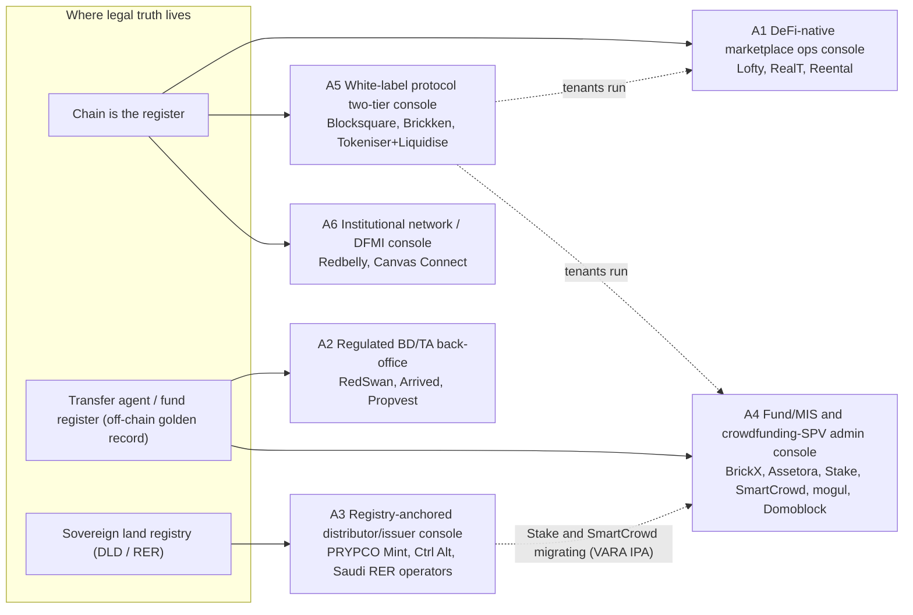

# 00 — Overview: Extrapolated Admin-Panel Specification for RealX

> **Everything in `05-admin-panels/` is EXTRAPOLATION.** None of the 20 platforms publishes its back office. This specification rebuilds the owner/operator admin panel from three kinds of public evidence: (1) the issuer and admin dashboards that white-label vendors document publicly; (2) each platform's user-facing features and flows; (3) the regulatory obligations that force a back-office control to exist. Every module, page and action gives its evidence and a confidence grade.
>
> **Date:** 23 Sep 2026 · **Audience:** the RealX founder and the product, engineering and compliance leads · **Not legal advice.**

---

## 0. Headline findings

1. **The same 27 modules recur in all 20 platforms. What changes is their weight.** Six admin-panel **archetypes** explain almost all the variation (§6). The biggest drivers are where the **legal source of truth** sits (chain, transfer agent, sovereign land registry, or a fund's unit register) and **who holds the keys** (investor, platform, or custodian).
2. **Maker-checker is almost never built into vendor issuer UIs.** It lives in the **custody policy layer**: the Fireblocks Policy Engine (quorums, admin quorum, pending-approvals dashboard) and Taurus-CAPITAL (function-level governance) [`APE` headline 2; `WLD` §12–13]. RealX should put an **approvals layer in the admin panel** and a **custody policy engine underneath it**, with one shared approval ID across both (`02-rbac-and-approvals.md`).
3. **Wallet recovery and forced transfer appear in every token stack** (ERC-3643 `recoveryAddress`/`forcedTransfer`, Securitize "destroy and reissue", DS `seize`, Brickken "Confiscation", Algorand/XRPL/Stellar clawback) [`APE` headline 4; `TSD` §4]. The admin panel must route them through a legal-evidence workflow, not expose them as a button.
4. **The register is the product.** Every archetype needs a **golden record plus 3-way reconciliation**: chain ↔ register (TA, DLD/RER, or unit register) ↔ custodian/bank. Candidates are the SEC TA proposal (Sep 2026) [`REG-US` §5], DLD/RER registry sync [`REG-ME` §9; `mena/04-saudi` §2.2], and AU s169 registers [`REG-AU` §5].
5. **Property substance is the most common blind spot.** RealT collapsed off-chain while its on-chain layer kept working: Detroit blight suit, tax foreclosure, "never owned" allegations [`us/04-realt` §10–11 ⚑]. Lofty had squatters and heat complaints [`us/01-lofty` §10]. Assetora's NDIS vacancies froze its marketplace for 13 months [`australia/05-assetora` §2.8]. **Property Operations, title verification and municipal compliance** are first-class modules in this spec, even though no token vendor ships them [`APE` gaps].
6. **Secondary-market guardrails are platform-specific and are not in any vendor product.** Examples: PRYPCO's ±15% band around DLD valuation, BrickX's 80% floor, SmartCrowd's ±15% STF band, Stake's valuation-priced exit windows, Lofty's 20% pool cap. Circuit breakers and price bands were **not observed in any vendor** [`APE` Module 9]. RealX must build them.
7. **Two-tier tenancy is standard for anyone who wants to be infrastructure.** Examples: DigiShares' corporate dashboard over per-STO dashboards, Securitize's Issuer Management Panel, Blocksquare's protocol vs Certified Partner, Ctrl Alt's issuer vs distributors [`WLD` §18.1]. Tenant scoping is built in from day one (M27), even if RealX launches single-tenant.
8. **AI agents are now admin principals.** Vertalo ("delegation on every write"), Juniper Square ("same permissions, same audit trail"), Agora and Brickken (MCP APIs, agent mandates) [`APE` headline 7; `eu/04-brickken` §11]. RBAC and the audit log treat agents as delegated principals that can **never act as checker**.

---

## 1. Method

| Step | What was done |
|---|---|
| 1. Harvest | Read Section 11 ("Extrapolated admin panel") and Sections 3–5 (roles, actions, flows) of all 20 platform files. Harvested module/page/action lists and maker-checker suggestions. |
| 2. Ground | Mapped every harvested module to observed vendor features in `03-infra-and-admin-evidence/` (17-module evidence catalogue, vendor dashboards, token-function mapping, vendor stack). |
| 3. Obligate | Mapped the 45 obligation → control rows in `01-regulatory/cross-cutting-controls.md` and the four region checklists to the module that must implement each control. |
| 4. Normalise | Merged the results into **27 modules** (M01–M27) with a shared action lifecycle, state vocabulary, role codes and audit-event naming. Platform-specific mechanics (bands, caps, windows, waterfalls) became **parameters** of those modules, not new modules. |
| 5. Classify | Clustered the 20 platforms into **6 archetypes** by source of truth, custody model, liquidity mechanism and tenancy. Scored module weight per archetype (heat-map, §7). |
| 6. Grade | Gave each module and page a confidence grade (§3). |
| 7. Validate | Rendered every Mermaid diagram with `mmdc`. Kept ASCII wireframes within 110 columns. |

**Limitations.**
- No new web research was done; everything comes from the pack.
- Several platform facts are single-source or conflicting. Examples: PRYPCO's minimum ticket (AED 2,000 at launch, AED 1,000 from 2026; whether the AED 1,000 applies to primary offerings is unverified — `04-synthesis/conflicts-and-gaps.md` #19); the fit of fractional MIS-unit tokens with the DAF Act's TCP definition (`conflicts-and-gaps.md` #2). Such items are flagged where they drive a design choice.
- **Australia's Digital Assets Framework Act is enacted.** The synthesis re-check (`04-synthesis/conflicts-and-gaps.md` #1, fetches F1/F5 of legislation.gov.au) confirmed the *Corporations Amendment (Digital Assets Framework) Act 2026* (No. 38, 2026): Royal Assent 8 Apr 2026; the whole Act commences 8 Apr 2027; 6-month transition for existing operators (to ~8 Oct 2027); low-value exemption ($10m per 12 months and $5k per client). The earlier "unverified" status in the regulatory pack is superseded, and the admin files now treat the Act as confirmed. What remains open is whether fractional MIS-unit tokens fall within the TCP definition (s761GD: "a single digital token" per underlying asset) — counsel required.

---

## 2. Evidence base and citation aliases

| Alias | File (under `tokenization-research/`) | Used for |
|---|---|---|
| `APE` | `03-infra-and-admin-evidence/admin-panel-evidence.md` (17 modules, sources C#1–C#41) | Observed vendor admin features, maker-checker evidence, gaps |
| `WLD` | `03-infra-and-admin-evidence/white-label-issuer-dashboards.md` (§1 DigiShares … §17 comparators) | Vendor dashboards (Tokeny, Securitize, Brickken, Blocksquare, Hedera ATS, Fireblocks, Taurus, Vertalo …) |
| `TSD` | `03-infra-and-admin-evidence/token-standards.md` (§3 matrix, §4 function → action map) | On-chain function per admin action |
| `VND` | `03-infra-and-admin-evidence/vendor-landscape.md` | Vendor-created admin surfaces (KYC, KYT, custody, paymasters, PM systems, oracles) |
| `XCC #n` | `01-regulatory/cross-cutting-controls.md`, master-table row *n* (1–45) | Obligation → control → admin feature |
| `REG-US` / `REG-EU` / `REG-ME` / `REG-AU` | `01-regulatory/us.md`, `eu.md`, `mena.md`, `australia.md` | Jurisdiction obligations and parameters |
| `us/01-lofty §n` etc. | `02-platforms/<region>/<nn>-<slug>.md`, section *n* | Platform behaviour and each platform's own §11 extrapolation |

**Platform short codes** (used in matrices):

| Region | Code → platform file |
|---|---|
| US | `LOF` us/01-lofty · `RSW` us/02-redswan · `ARR` us/03-arrived · `RLT` us/04-realt · `MOG` us/05-mogul |
| EU | `REN` eu/01-reental · `BSQ` eu/02-blocksquare · `PVX` eu/03-propvest-exporo · `BRK` eu/04-brickken · `DMB` eu/05-domoblock |
| MENA | `PRY` mena/01-prypco-mint · `CTA` mena/02-ctrl-alt · `STK` mena/03-stake · `KSA` mena/04-saudi-rer-national-tokenization · `SCN` mena/05-smartcrowd-nawy-shares |
| AU | `BRX` australia/01-brickx · `RBL` australia/02-redbelly-network · `TKL` australia/03-tokeniser-liquidise · `CNV` australia/04-canvas-connect · `AST` australia/05-assetora-domacom-bricklet |

**Short slugs.** Platform citations may use a shortened slug that is a prefix of the file name, e.g., `mena/04-saudi` = `02-platforms/mena/04-saudi-rer-national-tokenization.md`, `eu/03-propvest` = `…/eu/03-propvest-exporo.md`, `australia/03-tokeniser` = `…/australia/03-tokeniser-liquidise.md`. "header" refers to the platform file's profile table above §1.

**Inherited evidence labels.** `[C#n]` = confirmed by source *n* of the cited file · `[I]` = inferred · `[S]` = speculative. This spec adds **⚑**: a control whose *absence* contributed to a documented failure (mostly RealT, also Assetora).

---

## 3. Confidence scale

| Grade | Definition | Typical evidence pattern | Example |
|---|---|---|---|
| **High (H)** | **Observed in vendor admin docs AND needed by platform behaviour** (and usually by regulation). | `APE`/`WLD` feature + ≥3 platforms depend on it | Token Ops → Freeze / forced transfer / recovery (Tokeny Token Actions, ATS Controller, DS `seize`; every token platform) |
| **Medium (M)** | **Implied by platform behaviour or by regulation**, but not seen in a vendor admin UI (or seen only in an off-chain comparator). | Platform user feature and/or `XCC` row; vendor gap noted in `APE` | Secondary Market → price-band validator (PRYPCO ±15%, BrickX 80% floor; "not observed" in vendors) |
| **Low (L)** | **Industry-standard assumption** or speculative best practice, with no direct evidence in the pack. | Good practice, [S] items | Webhook catalogue specifics; Shariah purification calculator internals |

Pages within a module may carry a different grade from the module as a whole. A module graded H can still contain M/L pages.

---

## 4. Module catalogue (M01–M27)

Numbering follows the brief. The admin sidebar groups modules differently (see `01-reference-admin-spec.md` §1). The **Phase** column is the recommended RealX build order (§9).

| ID | Module | One-line purpose | Conf. | Phase |
|---|---|---|---|---|
| M01 | Home / Command Center | Real-time operational and compliance posture: KPIs, queues, breaks, chain and treasury health | H | 1 |
| M02 | Issuers, SPVs & Entity Registry | Legal entities (platform licences, issuers, SPVs/series/sub-trusts), officers, bank accounts, on-chain identities | H | 1 |
| M03 | Properties & Assets | Asset master data, diligence, title verification, valuations/NAV, Shariah screen, asset lifecycle | H | 1 |
| M04 | Offerings & Deals | Offering builder bound to an exemption/regime, caps, KIIS/PDS/TMD, raise monitor, finalise vs revert | H | 1 |
| M05 | Subscriptions, Orders, Allocations & Redemptions | Primary orders, cooling-off/reflection, escrow, allocation, refunds, redemption queues | H | 1 |
| M06 | Investors (CRM / Investor 360) | Single investor record: identity, classification, wallets, holdings, payouts, tax, cases, comms | H | 1 |
| M07 | Onboarding Review | KYC/KYB/UBO, accreditation, wholesale certificates, suitability/knowledge tests, VARA classification | H | 1 |
| M08 | Wallets & Custody | Wallet registry and whitelisting, custody accounts/vaults, signer policies, gas sponsorship | H | 1 |
| M09 | Token Operations | Deploy/configure, mint/burn, freeze/pause, forced transfer, recovery, agent/role management | H | 1 |
| M10 | Compliance Rules Engine | Jurisdiction-parameterised transfer and eligibility rules, lock-ups, caps, threshold monitors, simulation | H | 1 |
| M11 | Cap Table, Register & Reconciliation | Golden record, snapshots, 3-way reconciliation, registry sync (DLD/RER/TA), break management | H | 1 |
| M12 | Distributions & Corporate Actions | Income/waterfall calculation, record-date snapshot, payout execution, reinvest, claims, exits | H | 1 |
| M13 | Tax | Tax profiles, withholding engine, form generation (1099/K-1/1042-S/AMMA/CRS/DAC8), transaction taxes | M | 2 |
| M14 | Secondary Market Ops & Surveillance | Venue mode, eligibility lists, price bands/floors, halts, windows, trade blotter, surveillance | M | 2 |
| M15 | Lending, Liquidity & DeFi Risk | AMM/PMM pools, lending markets, collateral/oracles, liquidations, repo | M | 3 |
| M16 | Treasury, Payments & Client Money | Fiat and stablecoin rails, escrow, client-money reconciliation, withdrawals, reserves, prudential | H | 1 |
| M17 | Governance & Voting | Proposals, meetings, snapshots, timers, quorum/thresholds, execution tracking | H | 2 |
| M18 | Documents & E-sign | Templates with variables, envelopes, disclosure library, token-attached documents, retention | H | 1 |
| M19 | Reporting & Regulatory Filings | Regulatory calendar, filings, prudential/capital, regulator data room, investor and board reports | M | 1–2 |
| M20 | AML Case Management | Screening hub (names + wallets), transaction monitoring, alerts → cases → SAR/STR, travel rule, BWRA | M | 1 |
| M21 | Communications & Investor Relations | Announcements, mass mail, inbox, notices, marketing-compliance approvals | H | 1 |
| M22 | Property Operations | Rent roll, property managers, maintenance/capex, municipal/title/tax/insurance compliance, reserves | M | 1 |
| M23 | Support & Complaints | Tickets, complaints register with regulatory SLAs, escalation to ombudsman/ADR | M | 1 |
| M24 | Partners, Distributors & Referrals | Sponsors, distributors, advisers, clubs, referral/reward ledgers with conflict review | M | 2 |
| M25 | Access Control, Approvals & Audit Log | Users, roles, SoD, approval policies, approvals inbox, immutable audit log, break-glass | H | 1 |
| M26 | Integrations, API & Webhooks | Provider connectors, API keys/scopes, webhooks, agent (MCP) principals, job monitor | M | 1 |
| M27 | Platform Settings, Tenancy & White-label | Tenants, jurisdictions/rule packs, fee schedules, feature flags, branding/domains, billing | H | 1 |

---

## 5. Role codes (summary; full catalogue in `02-rbac-and-approvals.md`)

**Internal:**
`SUPER` platform super-admin (configuration only, never money or keys) · `SECO` security officer · `CCO` chief compliance officer · `MLRO` · `KYCA` KYC analyst · `CLSR` classification/accreditation reviewer · `INVM` investments/acquisitions · `ASTM` asset manager · `VALO` valuation officer · `CAPM` capital-markets/offering manager · `TOKO` token-operations officer · `REGO` registrar/TA officer · `FINA` fund accountant (maker) · `CFO` finance approver (checker) · `TRSY` treasury ops · `MKTO` market ops/surveillance · `RISK` DeFi/liquidity risk · `TAXO` tax ops · `LEGL` legal/company secretary · `IRCM` investor relations/comms · `MKTG` marketing · `SUPP` support · `CMPH` complaints handler · `PROP` property-ops manager · `ENGO` engineering/blockchain ops · `SHRO` Shariah officer · `PART` partner manager.

**External / limited:**
`X-TA` external transfer agent · `X-BDP` broker-dealer registered principal · `X-CUS` custodian signer · `X-AUD` auditor (read-only) · `X-REG` regulator observer · `X-PM` property manager · `X-ISA` issuer/sponsor tenant admin · `X-ISO` issuer tenant operator · `X-DST` distributor/adviser/club leader · `X-RE` responsible entity/trustee/SPV director · `X-VAL` independent valuer · `AGNT` AI-agent principal · `SVCA` integration service account.

---

## 6. Admin-panel archetypes

> **QA note (Fable): the admin-panel archetypes A1–A6 below are a different clustering from the seven platform archetypes A1–A7 in `04-synthesis/00-executive-summary.md` §2, and the codes collide.** Mapping: admin **A1** = synthesis A1 (Lofty, RealT, Reental) · admin **A2** = synthesis A2 (RedSwan, Propvest) plus Arrived (synthesis A4) · admin **A3** = synthesis A3 (PRYPCO, Ctrl Alt, Saudi RER) · admin **A4** = synthesis A4 (Stake, SmartCrowd) + A5 (BrickX, Assetora) + A7 (mogul, Domoblock) · admin **A5** = synthesis A6 (Blocksquare, Brickken) plus Tokeniser+Liquidise (synthesis A5/A6) · admin **A6** = Redbelly (synthesis A6) and Canvas Connect (synthesis A2). Read the code in the context of the file you are in.

### A1 — DeFi-native marketplace operations console
- **Members:** Lofty (Algorand ASAs, PMM pools, daily USDC rent), RealT (Gnosis ERC-20, YAM P2P, RMM lending, weekly rent; in liquidation), Reental (Polygon ERC-20, HumanWallet passkeys, RNT P2P, RNTlend, paymaster). Oceanpoint (Blocksquare) and Liquidise AMMs bring A1 features into A5.
- **What the panel is about:** running a **24/7 on-chain economy** for retail wallets. That means per-property whitelists and caps, high-frequency stablecoin payouts (daily or weekly) from indexer snapshots that must count tokens deposited in pools and lending markets [`us/04-realt` §5.3], liquidity pools and lending markets with oracle and liquidation risk, gas sponsorship, and treasury float in stablecoins.
- **Signature pages:** Pool/PMM console (20% cap, imbalance) [`us/01-lofty` §11 #7]; RMM/RNTlend risk console (LTV ≤75%, liquidator whitelist, oracle) [`us/04-realt` §11 #7; `eu/01-reental` §11 #12]; nightly payout batch; paymaster balance [`eu/01-reental` §11 #15]; YAM/P2P token whitelist [`us/04-realt` §11 #8].
- **Source of truth:** the chain (ASA/ERC-20 ledger), with thin off-chain LLC records. **Custody:** self-custody or app-generated wallets. **Maker-checker locus:** multisig/clawback addresses [I]. **Typical failure:** property substance and legal basis, not the tech [`us/04-realt` §10; `us/01-lofty` §2.3].

### A2 — Regulated broker-dealer / transfer-agent back-office
- **Members:** RedSwan (affiliated FINRA BD, Reg D 506(c) + Reg S, HTS/Stellar Token Studio, registrar reconciliation), Arrived (off-chain benchmark: Reg A+ Tier 2, NCPS BD + PPEX ATS, series-LLC REITs, blue-sky), Propvest/Exporo (WpIG/MiFID securities institution plus a "licensed-partner sandwich" of Mangopay, Baader and Tangany).
- **What the panel is about:** **supervision and evidence**. Exemption-bound offerings with cap meters, accreditation and suitability queues, registered-principal approval of communications (FINRA 2210), filing calendars (Form D/1-A/1-K, blue-sky, BaFin), a TA golden record reconciled to the chain, escrow release under 15c2-4, windowed ATS trading, K-1/1099 and MiFID cost reports.
- **Signature pages:** Accreditation queue with 90-day expiry [`us/02-redswan` §11 #3]; blue-sky engine [`us/03-arrived` §11 #2]; Reg A $75M cap meter [`us/03-arrived` §11 #1]; BD compliance console [`us/02-redswan` §11 #4]; token registry mirror vs Tangany vs ledger [`eu/03-propvest` §11 #6].
- **Source of truth:** TA/registrar (off-chain) with the chain as mirror [`us/02-redswan` §6]. **Custody:** qualified custodian (Coinbase, Tangany, Baader). **Maker-checker locus:** BD principal plus custody policy.

### A3 — Registry-anchored distributor / issuer console
- **Members:** PRYPCO Mint (VARA broker-dealer, distributor of DLD title-deed tokens on XRPL), Ctrl Alt (VARA Category 1 issuer, MPC omnibus custody, DLD sync, ARVA dual-token), the Saudi RER/REGA stack and sandbox operators (registry-as-truth, enhanced ERC-3643, Nafath). Stake and SmartCrowd/Nawy are migrating here (VARA IPAs).
- **What the panel is about:** **keeping three ledgers in lock-step** (sovereign registry ↔ chain ↔ client-money bank) while enforcing regulator-set market rules: price bands pegged to the official valuation, lock-ins, holder caps, transfer-time eligibility by nationality/zone, certificate issuance, sovereign-ID onboarding (Emirates ID/UAE PASS, Nafath), and weekly sandbox reporting.
- **Signature pages:** Registry sync monitor (DLD/RER) [`mena/02-ctrl-alt` §11 #4]; Registry & tokenisation console (certificates, TokenIDs) [`mena/01-prypco` §11 #5]; RER registration console and weekly REGA report builder [`mena/04-saudi` §11.1]; distributor tenant management [`mena/02-ctrl-alt` §11 #1]; ARVA module [`mena/02-ctrl-alt` §11 #7].
- **Source of truth:** the **government registry**. The chain is the synchronised technical record [`REG-ME` §9]. **Custody:** issuer-side MPC omnibus (Ripple Custody) [`mena/01-prypco` §2.4]. **Maker-checker locus:** MPC quorum, plus registry acknowledgement as the final "checker".

### A4 — Fund/MIS and crowdfunding-SPV administration console
- **Members:** BrickX (AU registered MIS, one trust per property, order book with 80% floor), Assetora (umbrella MIS with 130+ sub-funds, TMD library, marketplace freeze switch, Bricklet), Stake (DIFC SPVs under DFSA crowdfunding + CMA fund distribution; limits engine; exit windows), SmartCrowd/Nawy (DIFC SPVs, STF windows; Egypt FRA funds), mogul (Property LLCs with an Avalanche register via Fireblocks; clubs; K-1s), Domoblock (participative loans with a Polygon "fan-token" mirror; perimeter structuring).
- **What the panel is about:** **fund administration for many small vehicles**. Unit/share registers, corporate secretarial work (SPV registers, meetings, dissolutions), valuation-driven pricing, periodic or controlled liquidity (order book with floor, windows, votes), distribution smoothing and reserves, investor limits (DFSA caps, TMD/DDO), cash-wallet float.
- **Signature pages:** Trust/SPV registry with cap and LVR checks [`australia/01-brickx` §11 #4]; limits engine [`mena/03-stake` §11 #3]; Exit Window / STF manager [`mena/03-stake` §11 #8; `mena/05-smartcrowd` §11 #7]; TMD/DDO library [`australia/05-assetora` §11 #2]; global inflow freeze [`australia/05-assetora` §11 #11]; Guarantee Fund [`eu/05-domoblock` §11 #12]; Clubs admin [`us/05-mogul` §11 #10].
- **Source of truth:** off-chain unit/share register (RE, SPV registrar). Where a chain exists (mogul, Domoblock) it is a contractual register or a mirror. **Custody:** professional custodian holds title (AET, Perpetual); client cash sits in a trust/segregated account. **Maker-checker locus:** RE board / CFO in the application.

### A5 — White-label protocol / SaaS two-tier console
- **Members:** Blocksquare (protocol owner vs Certified-Partner marketplaces; `addWalletList`, `addRevenue`, `freezeToken`), Brickken (Issuer Studio plus operator console, prepare/sign/send API, agent mandates, `needKyc` guardrail), Tokeniser + Liquidise (ERC-3643 on Redbelly, per-investor billing, Protocol Finance AMM/leverage). Ctrl Alt shows the same two-tier pattern toward distributors. DigiShares and Tokeny are the vendor-side evidence.
- **What the panel is about:** **two consoles**:
  - **Protocol/operator console:** tenants, licences and billing, network/chain registry, contract factory and releases, cross-tenant guardrails, fee splits, public stats.
  - **Tenant console:** a full issuer panel scoped to the tenant.
  The hard problems are tenant isolation, guardrails against non-compliant tenants (Brickken's `needKyc=false` [`eu/04-brickken` §2.5]), and shared KYC across tenants ("one account, many marketplaces" [`eu/02-blocksquare` §2.5]).
- **Signature pages:** Tenant (CP) registry and billing [`eu/02-blocksquare` §11 A]; compliance guardrails [`eu/04-brickken` §11 A]; transaction monitor (prepared vs sent vs mined) [`eu/04-brickken` §11 A]; per-investor billing tiers [`australia/03-tokeniser` §11 #14].
- **Source of truth:** chain per tenant token, with the tenant responsible legally. **Custody:** non-custodial (local signing) or tenant's custodian. **Maker-checker locus:** within tenant, plus protocol-owner multisig for factory/role changes.

### A6 — Institutional network / DFMI console
- **Members:** Redbelly (public-permissioned L1, verifiable credentials + ZK eligibility, governor nodes, AUDM), Canvas Connect (permissioned EVM L2, participant/role allowlists, DvP/repo in RBA pilot wCBDC, CDSR registry).
- **What the panel is about:** **participant and settlement governance** for wholesale users. Participant admission and roles, credential-issuer trust lists, DvP/repo collateral management, cash-leg (wCBDC/stablecoin) monitoring, regulator-observer access with selective disclosure, and relief/sandbox condition tracking.
- **Signature pages:** Participant & role admin [`australia/04-canvas` §11 #1]; credential-issuer registry [`australia/02-redbelly` §11.1]; collateral & repo manager [`australia/04-canvas` §11 #6]; relief-conditions tracker [`australia/04-canvas` §11 #11].
- **Source of truth:** on-chain registry (CDSR) plus trustees. The legal finality of on-chain records was flagged as unresolved by the RBA [`australia/02-redbelly` §2.3]. **Custody:** Fireblocks/Zodia. **Maker-checker locus:** custody quorum and network admin.

### Archetype comparison

| Dimension | A1 DeFi-native | A2 BD/TA | A3 Registry-anchored | A4 Fund/MIS & SPV | A5 Two-tier protocol | A6 Network/DFMI |
|---|---|---|---|---|---|---|
| Legal record | Chain | TA / registrar | Govt land registry | Unit/share register | Chain per tenant | On-chain registry + trustee |
| Investor custody | Self / app wallet | Qualified custodian | Issuer MPC omnibus | None (cash wallet) | Non-custodial / tenant | Institutional custodian |
| Cash rail | USDC/USDT + card/ACH | Bank/ACH escrow | AED/SAR client-money bank | AUD/AED wallet on trust | Stablecoin escrow | wCBDC / AUD stablecoin |
| Liquidity | 24/7 order book + AMM + lending | Windowed ATS / OTC | Controlled board, band vs official valuation | Order book with floor / windows / votes | P2P cross-tenant + pools | Bilateral DvP + repo |
| Payout cadence | Daily / weekly | Quarterly | Monthly | Monthly (smoothed) | Per issuer | Coupon-style |
| Core compliance gate | Whitelist + cap | Accreditation / suitability + BD supervision | Sovereign ID + transfer-time eligibility | Investor limits + TMD/DDO | Tenant guardrails | Participant credentials |
| Where maker-checker lives | Multisig / clawback keys | BD principal + custody | MPC quorum + registry ack | RE board / CFO in app | Tenant + protocol multisig | Custody + network admin |
| Tenancy | Single | Single (+ sponsors) | Issuer ↔ distributors | Single (+ advisers/clubs) | **Two-tier** | Multi-participant |
| Characteristic failure | Property substance, legal basis | Blue-sky slippage, liquidity promises | Registry drift, single custodian | Valuation governance, frozen markets | Tenant misconduct, classification | Pilot-only relief |

---

## 7. Heat-map: module weight × archetype

Legend: `●●●` core (dedicated pages, daily use) · `●●` important · `●` light or occasional · `–` not applicable.

| Module | A1 DeFi | A2 BD/TA | A3 Registry | A4 Fund/SPV | A5 Two-tier | A6 Network |
|---|---|---|---|---|---|---|
| M01 Command Center | ●●● | ●●● | ●●● | ●●● | ●●● | ●● |
| M02 Issuers, SPVs & Entities | ●● | ●●● | ●● | ●●● | ●●● | ●● |
| M03 Properties & Assets | ●●● | ●●● | ●●● | ●●● | ●● | ● |
| M04 Offerings & Deals | ●● | ●●● | ●●● | ●●● | ●●● | ●● |
| M05 Subscriptions/Orders/Redemptions | ●● | ●●● | ●●● | ●●● | ●●● | ●● |
| M06 Investors (CRM) | ●●● | ●●● | ●●● | ●●● | ●● | ● |
| M07 Onboarding Review | ●● | ●●● | ●●● | ●●● | ●● | ●● |
| M08 Wallets & Custody | ●●● | ●● | ●●● | ● | ●●● | ●●● |
| M09 Token Operations | ●●● | ●● | ●●● | ● | ●●● | ●●● |
| M10 Compliance Rules Engine | ●● | ●●● | ●●● | ●● | ●●● | ●●● |
| M11 Register & Reconciliation | ●● | ●●● | ●●● | ●●● | ●● | ●●● |
| M12 Distributions & Corp. Actions | ●●● | ●●● | ●●● | ●●● | ●●● | ●● |
| M13 Tax | ●● | ●●● | ●● | ●●● | ● | ● |
| M14 Secondary Market & Surveillance | ●●● | ●● | ●●● | ●● | ●● | ●● |
| M15 Lending/Liquidity/DeFi Risk | ●●● | – | – | – | ●● | ●● |
| M16 Treasury & Client Money | ●●● | ●●● | ●●● | ●●● | ●● | ●●● |
| M17 Governance & Voting | ●●● | ● | ●● | ●●● | ●● | ● |
| M18 Documents & E-sign | ●● | ●●● | ●●● | ●●● | ●●● | ●● |
| M19 Reporting & Reg. Filings | ●● | ●●● | ●●● | ●●● | ●● | ●●● |
| M20 AML Case Management | ●● | ●●● | ●●● | ●●● | ●● | ●●● |
| M21 Communications & IR | ●●● | ●●● | ●●● | ●●● | ●● | ● |
| M22 Property Operations | ●●● | ●● | ●●● | ●●● | ● | ● |
| M23 Support & Complaints | ●● | ●●● | ●●● | ●●● | ●● | ● |
| M24 Partners & Distributors | ●● | ●● | ●●● | ●● | ●●● | ●● |
| M25 Access, Approvals & Audit | ●●● | ●●● | ●●● | ●●● | ●●● | ●●● |
| M26 Integrations/API/Webhooks | ●● | ●● | ●●● | ●● | ●●● | ●●● |
| M27 Settings/Tenancy/White-label | ● | ● | ●● | ● | ●●● | ●● |

**Reading the heat-map.**
- A1 is the only archetype where **M15 (DeFi risk)** is core. A1 also runs the highest-frequency M12 payouts.
- A2 and A4 are **register- and filing-heavy** (M11, M13, M19).
- A3 turns **M10 + M11 + M14** into one control loop: registry, band and eligibility.
- A5 is the only archetype where **M27 (tenancy) is core**. A6 is dominated by **M08/M09/M10** (participants, keys, allowlists).

---

## 8. How the archetypes' admin panels differ: the same module, a different shape

| Module | A1 DeFi-native | A2 BD/TA | A3 Registry-anchored | A4 Fund/MIS & SPV | A5 Two-tier | A6 Network/DFMI |
|---|---|---|---|---|---|---|
| **M12 Distributions** | Nightly/weekly batch from indexer snapshot. Counts pool/lending-deposited tokens; USDC push or merkle claim [`us/01-lofty` §5.3; `us/04-realt` §5.3] | Quarterly record date; registrar list; ACH or USDC; K-1/1099 [`us/02-redswan` §5.3] | Monthly AED credit to in-app wallet within 5 working days, from issuer/TA holder snapshot [`mena/01-prypco` §5.3] | Monthly, smoothed, keeps ~3-month reserve [`australia/01-brickx` §5.3] | `addRevenue` per property; push or claim; off-chain entitlement calc [`eu/02-blocksquare` §5.3] | Servicing on-chain in wCBDC [`australia/04-canvas` §5.3] |
| **M14 Secondary** | Order book + PMM; pool cap; wash-trade flags | ATS windows; eligibility list (6-month hold, valuation done) [`us/03-arrived` §11 #9] | Listing board; ±15% band vs DLD valuation; 3-month lock-in; approved-buyer visibility [`mena/01-prypco` §5.4] | Order book with 80% floor and meeting halts; or May/Nov windows at valuation price | P2P across tenant marketplaces; 1.5% in-kind fee split | Bilateral DvP; repo |
| **M11 Register** | Chain is register; reconcile to LLC member list and pool balances | TA golden record ↔ chain ↔ custodian | DLD/RER ↔ XRPL/EVM ↔ omnibus sub-accounts ↔ bank | Unit register ↔ custodian (title) ↔ trust bank | Tenant cap table; protocol indexer | CDSR ↔ chain |
| **M07 Onboarding** | Fast doc+selfie KYC; wallet whitelist per property; LP staking may skip KYC [`us/01-lofty` §2.5] | KYC + third-party accreditation letters + suitability (Reg BI/MiFID) | Emirates ID/UAE PASS or Nafath; SoF; VARA classification; residency/religion eligibility | eKYC (Equifax ID Matrix); wholesale/professional evidence; limits | Sumsub states per tenant; shared KYC across tenants | KYB + verifiable credentials |
| **M25 Approvals** | Multisig on clawback/freeze; timelocked lending params | Registered principal + CCO | MPC quorum + registry acknowledgement | RE board delegate + CFO | Tenant approvers + protocol owner multisig | Network admin + custody quorum |

---

## 9. What RealX should build: the recommended composite

RealX is founder-led and multi-jurisdiction. The research does not fix a launch market. The recommended shape is:

- **Core = A2 + A3 discipline:** a golden record, a jurisdiction-parameterised rules engine, and registry-grade reconciliation.
- **A1 retail UX, behind feature flags:** passkey wallets, sponsored gas, stablecoin payouts, 24/7 secondary.
- **A5-ready tenancy:** every object carries `tenant_id` from day one.

This follows the cross-cutting design principle: **"build one jurisdiction-parameterised rules engine plus shared queues"** rather than four compliance stacks [`XCC` design principle].

| Phase | Modules | Rationale |
|---|---|---|
| **0 Foundations** | M25 Access/Approvals/Audit, M27 Settings/Tenancy/rule packs, M26 Integrations, M02 Entities | Nothing else is safe without RBAC, the approval ledger, tenant scoping and licence gating (`XCC` #1) |
| **1 Launch (primary + income)** | M01, M03, M04, M05, M06, M07, M08, M09, M10, M11, M12, M16, M18, M19 (calendar + data room), M20, M21, M22, M23 | Covers the full primary lifecycle. Property Ops is launch-critical (RealT lesson ⚑) |
| **2 Liquidity & lifecycle** | M13 full tax engine, M14 secondary (bulletin board → partner venue), M17 governance, M24 partners | Secondary needs a licence route per region (ATS, MTF/DLT Pilot, VARA/DLD, AU market licence) (`XCC` #30) |
| **3 DeFi & infrastructure** | M15 (only with licensed venue/lending partner and an independent oracle), full A5 tenant console | Highest regulatory and reflexive-risk exposure (RealT RMM, Reental RNTlend) |

---

## 10. File map

| File | Contents |
|---|---|
| `00-overview.md` | This file: method, evidence, confidence, archetypes, heat-map, RealX composite |
| `01-reference-admin-spec.md` | Information architecture (sidebar), shared conventions, and the full specification of M01–M27 (pages, widgets, tables, filters, row/bulk actions, action catalogue with on-chain calls, state transitions, audit events, notifications, alerts, evidence, confidence) |
| `02-rbac-and-approvals.md` | 41-role catalogue (CEO added in QA); role × module matrices; maker-checker policy; SoD conflicts; break-glass; key-management and signer policy |
| `03-workflows-and-state-machines.md` | 13 state machines (Mermaid `stateDiagram-v2`) with narratives, plus the generic maker-checker-custody sequence |
| `04-data-model.md` | ER diagrams (overview plus five domains), key attributes, on-chain mirror and reconciliation rules |
| `05-wireframes.md` | 11 annotated ASCII wireframes (≤110 columns) |
| `06-per-platform-admin-panels.md` | 20 condensed platform admin panels, platform × module coverage matrix, most distinctive admin features |
| `07-regional-admin-variants.md` | US / EU / MENA / AU additions and changes |
| `08-kpis-reports-and-alerts.md` | Dashboards, KPI catalogue, report catalogue, alert and automation catalogue |
