# 03 — Workflows and State Machines

> **EXTRAPOLATION.** These state models are the shared vocabulary for `01-reference-admin-spec.md` (the state-transition columns) and `04-data-model.md` (the `state` attributes). They generalise the flows in platform §5s, vendor evidence (`APE`, `WLD`, `TSD`) and obligations (`XCC`). Parameters shown (timers, thresholds) are **defaults** that the jurisdiction packs (M10/M27) override. Date: 23 Sep 2026.

**Contents**

0. Generic privileged-action lifecycle (maker → checker → custody → chain → reconciliation)
1. Investor onboarding / KYC case
2. Accreditation / wholesale certificate with expiry
3. Property / listing lifecycle
4. Offering lifecycle
5. Subscription / order lifecycle
6. Token lifecycle (plus holding-level states)
7. Distribution run
8. Secondary order / trade (plus instrument states: price bands, halts)
9. Redemption and exit window
10. Governance proposal
11. AML alert → case → SAR/STR
12. Complaint
13. Wallet recovery / forced-transfer request

---

## 0. Generic privileged-action lifecycle

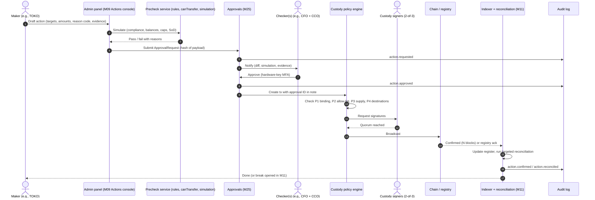

**Narrative.**
- The app layer supplies context, four-eyes and SoD.
- The custody layer refuses anything not bound to an approved request. That closes the gap that vendor UIs leave, since maker-checker "almost never" lives in issuer UIs [`APE` headline 2; `WLD` §12].
- The action is only **closed** after reconciliation: a confirmed transaction that the register does not reflect is a break (M11), not a success.

---

## 1. Investor onboarding / KYC case

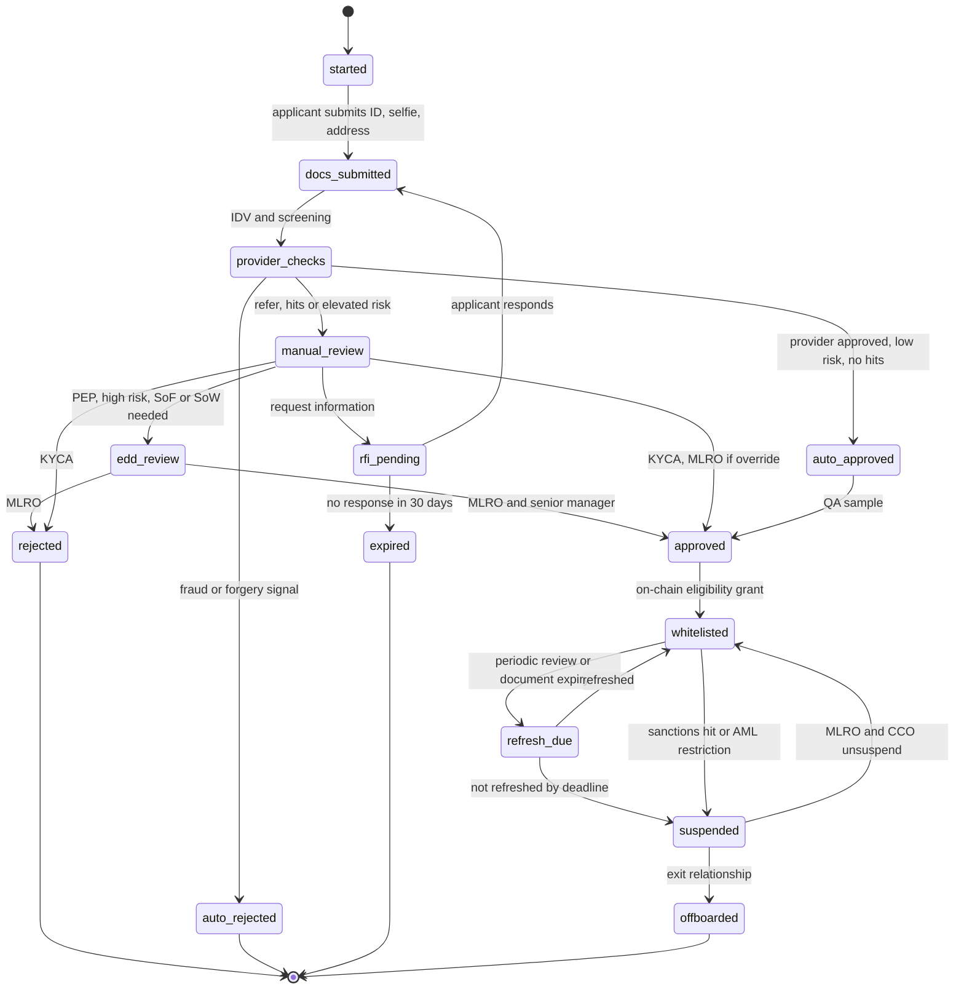

**Narrative.**
- **Providers:**
  - UAE: Emirates ID/UAE PASS [`mena/01-prypco` §2.5].
  - KSA: Nafath/Yakeen [`mena/04-saudi` §2.5].
  - AU: Equifax ID Matrix [`australia/01-brickx` §2.5].
  - UAE/KSA product (Stake): IDWise [`mena/03-stake` §2.5].
  - EU/global: Sumsub [`eu/04-brickken` §2.5].
- Brickken's six provider states map onto `provider_checks → auto_approved/manual_review/auto_rejected` [`eu/04-brickken` §2.5].
- **`approved → whitelisted`** is the on-chain grant: ERC-3643 `registerIdentity` plus KYC claim, or HTS `TokenGrantKyc`, XRPL `MPTokenAuthorize`, Blocksquare `addWalletList`. The tenant setting decides auto vs admin-confirmed whitelisting (Blocksquare's two modes) [`APE` M4 C#17].
- **Parameters:** KYC SLA 24h [`eu/02-blocksquare` §2.5]; refresh cadence by risk tier [I]; source-of-funds mandatory before any deposit in the UAE [`mena/01-prypco` §2.5].
- **Controls:** no deposits or investments before `whitelisted`; suspension freezes wallets via M09 (`SGL+R`).

---

## 2. Accreditation / wholesale certificate lifecycle (with expiry)

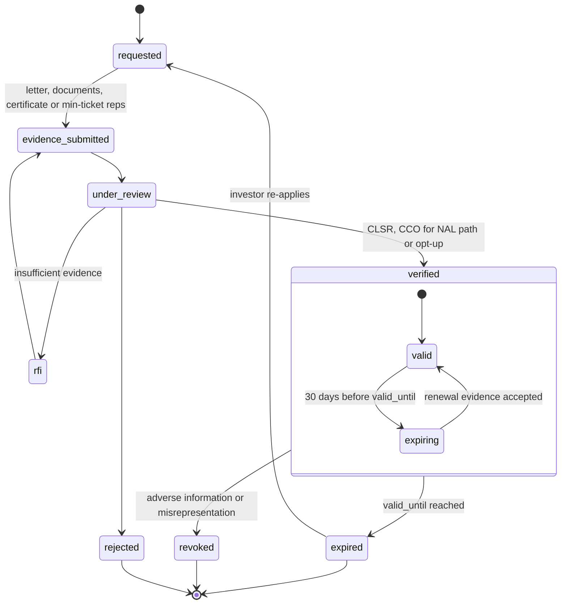

**Narrative.**
- **Tests covered:**
  - US Rule 506(c) "reasonable steps", including the **$200k / $1M minimum-investment path with written reps** [`REG-US` §3];
  - EU professional opt-up (2 of 3 tests) [`REG-EU` §3];
  - AU wholesale s761G ($500k ticket, or accountant certificate $2.5M net assets / $250k income) [`REG-AU` §3];
  - VARA Qualified (AED 3.5M net assets or AED 700k income plus knowledge) [`REG-ME` §3];
  - DFSA Professional [`mena/03-stake` §2.6].
- **Default validity (`valid_until`), set per pack:**
  - US third-party letters: 90 days (industry practice, [I]; cf. RedSwan queue [`us/02-redswan` §11 #3]);
  - AU accountant certificate: **2 years** [`XCC` #14];
  - EU professional: annual review [I];
  - VARA: periodic review with 8-year record retention [`REG-ME` §3].
- **On-chain effect:** `verified` issues an accreditation claim or credential (ONCHAINID claim, XRPL Credential, Averer VC). `expired`/`revoked` removes it, and M10 blocks further purchases of accredited-only tokens. Existing holdings stay; resale rules follow the pack.

---

## 3. Property / listing lifecycle

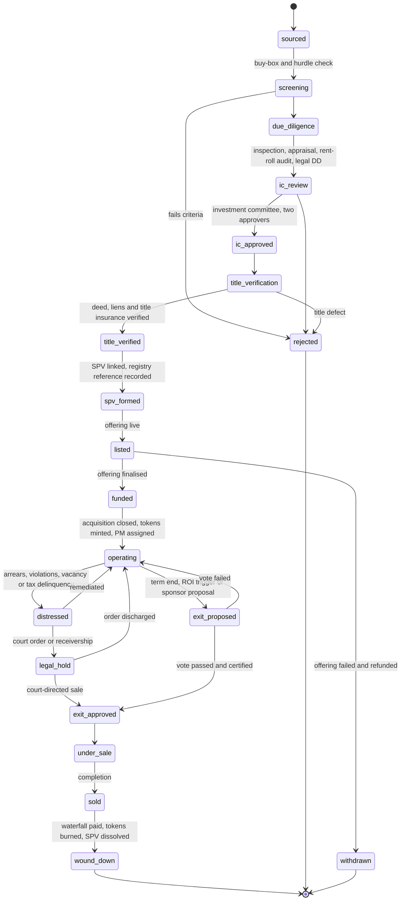

**Narrative.**
- **Gates:**
  - buy-box (Arrived: cap rate > 5%, 3+ bed, < 30 years old, $200–400k) [`us/03-arrived` §5.7];
  - hurdle (mogul 12%, < 1% approval rate) [`us/05-mogul` §5.7];
  - REGA price controls [`mena/04-saudi` §2.8];
  - Shariah screen where the product is Islamic.
- **`title_verification`** is mandatory. This is the RealT lesson: allegations that some tokenised properties "were never owned" [`us/04-realt` §2.8].
- Title verification means a registry reference, owner of record = SPV/custodian, no undisclosed liens, and title insurance.
- In A3 (DLD) the state is satisfied by **DLD registration and certificate issuance**; the SPV is skipped because the model has none [`mena/01-prypco` §2.1].
- **`distressed`** is fed by M22 alerts (tax delinquency, violations, vacancy). Entering it can auto-halt the instrument (M14) and zero its collateral factor (M15).
- **`legal_hold`** reflects court control. The RealT TRO sent rent to escrow, and a fiduciary took control in Apr 2026 [`us/04-realt` §2.8].
- **Exit triggers:** BrickX 5-year anniversary meeting (50%) or any time (75%) [`australia/01-brickx` §5.5]; PRYPCO auto-vote at 30% ROI [`mena/01-prypco` §5.5]; SmartCrowd vote at ~5 years [`mena/05-smartcrowd` §5.5].

---

## 4. Offering lifecycle

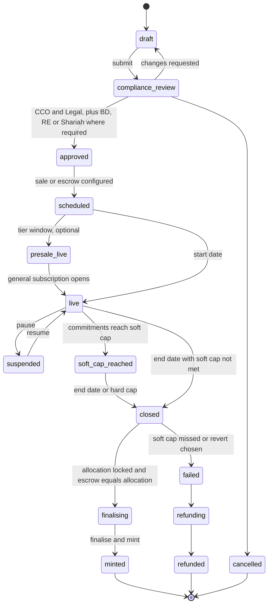

**Narrative.**
- **Finalise vs revert:** Blocksquare lets the issuer "finalize the offering, mint tokens to token buyers" or "revert the offering and return funds to investors" when under-subscribed [`APE` M3 C#18]. Brickken's escrow refunds automatically if the soft cap is missed (`closeOffer`, then `claimTokens` gives tokens or a refund) [`eu/04-brickken` §5.2]. Domoblock and Reental use all-or-nothing at 100% [`eu/05-domoblock` §5.2; `eu/01-reental` §5.2].
- **Pre-sale:** Domoblock pre-sale tier (~50% of each project, +0.5% bonus) [`eu/05-domoblock` §1]. PRYPCO waitlist and sell-outs "in minutes" [`mena/01-prypco` header "Scale"].
- **Suspension and amendments:** a material change during the commitment period needs investor re-confirmation within 5 business days [`mena/01-prypco` §2.8]. Raise-cap meters block `live` at 100% [`XCC` #3].
- **Maker-checker:** approval (`6E`); go-live (`4E+Q`); finalise (`6E`, custody 2-of-3). See `02` §3 rows 10–12.

---

## 5. Subscription / order lifecycle

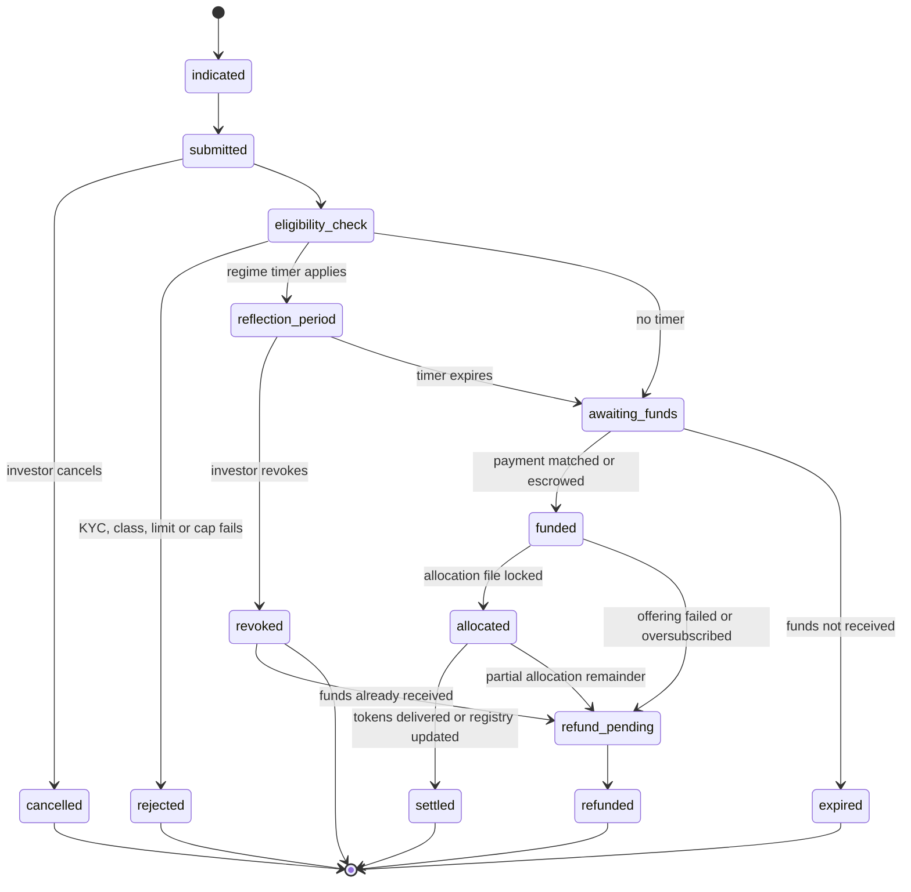

**Narrative.**
- **Eligibility** evaluates:
  - KYC status and classification;
  - **investor-limit ledgers**: Reg CF 12-month; Reg A T2 10%; DFSA AED 183.5k per property and 367k per year; KSA 50/50 retail/qualified tranches [`XCC` #10; `mena/03-stake` §2.6];
  - **holding caps**: 20% PRYPCO, 15% Lofty, 5% BrickX;
  - ECSP €1,000 / 5% warning and consent [`REG-EU` §3].
- **Timers:**
  - EU ECSP **4-calendar-day reflection** (non-sophisticated) [`REG-EU` §3];
  - PRYPCO **24h cooling-off** [`mena/01-prypco` §2.8];
  - AU CSF 5 business days / PDS 14 days [`XCC` #17].
- **Settlement:**
  - A1/A5: mint or transfer to the investor wallet;
  - A3: DLD registration plus certificate, with tokens in the MPC omnibus;
  - A4: unit-register entry.
- **Refunds:** automatic on failed offerings; revocation refunds within SLA.

---

## 6. Token lifecycle

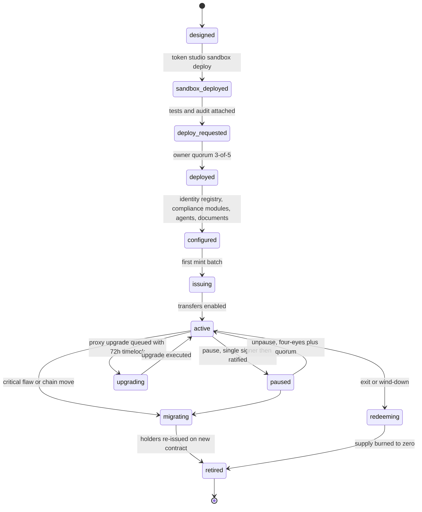

**Holding-level states** (per wallet × token) used by M09/M11:

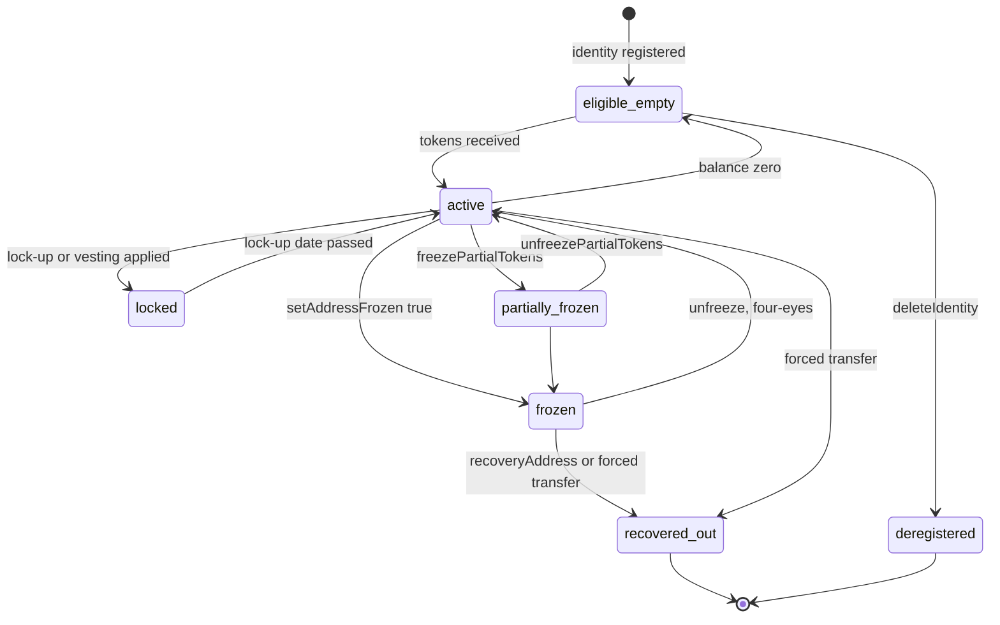

**Narrative.**
- The function set is the ERC-3643 agent/owner API: mint/burn, freeze and partial freeze, pause, forced transfer, recovery, `setIdentityRegistry`/`setCompliance`/`setOnchainID` [`TSD` §1.4]. Chain analogues are in `01` Appendix A.
- The **sandbox-first** gate follows Brickken's sandbox environment [`APE` M6 C#15].
- **Migration** is the recovery path for owner-key compromise or contract flaws (`02` §5 R3).
- **Forced transfers are blocked while paused** unless the override is explicitly approved [`VND` §12].

---

## 7. Distribution run

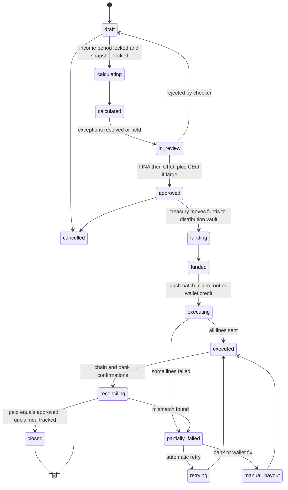

**Narrative.**
- **Cadences:**
  - daily at ~00:00 UTC (Lofty) [`us/01-lofty` §5.3];
  - weekly using **average balance including RMM-deposited tokens** (RealT) [`us/04-realt` §5.3];
  - monthly within the first 5 working days in AED (PRYPCO) [`mena/01-prypco` §5.3];
  - monthly within 10 business days with **smoothing** (BrickX) [`australia/01-brickx` §5.3];
  - quarterly (Propvest, RedSwan);
  - bullet at exit (Domoblock).
- **Execution modes:**
  - push (Blocksquare `pushRevenueToUser`, ATS Mass Payout, Brickken `dividendDistribution`);
  - claim (Blocksquare claims; RealT Ethereum claims);
  - off-chain wallet credit (A3/A4) [`WLD` §5, §11; `eu/04-brickken` §5.3].
- **Exceptions at review:** frozen or sanctioned holders are held; missing tax forms get the default rate; dust below the minimum is carried forward (PRYPCO AED 0.01); invalid addresses are held.
- **Failure handling:** automatic retries up to the approved amount; manual payouts need `4E`; unclaimed amounts age into escheat per jurisdiction (M12.5).

---

## 8. Secondary order / trade (with price bands and halts)

**Instrument (market) states:**

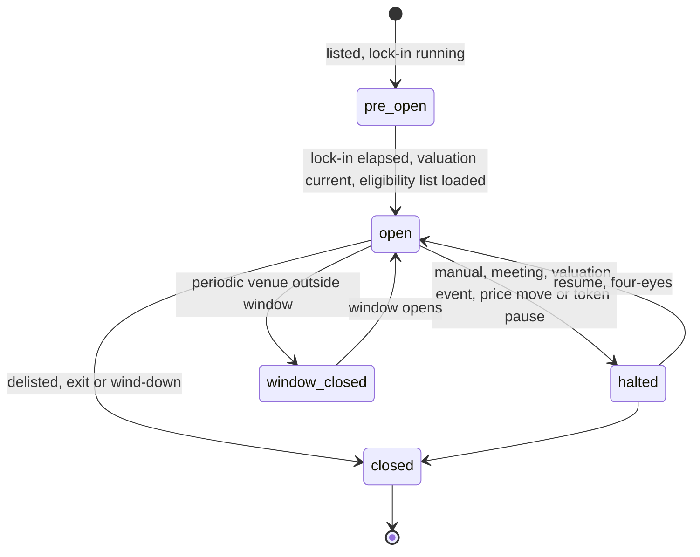

**Order and trade:**

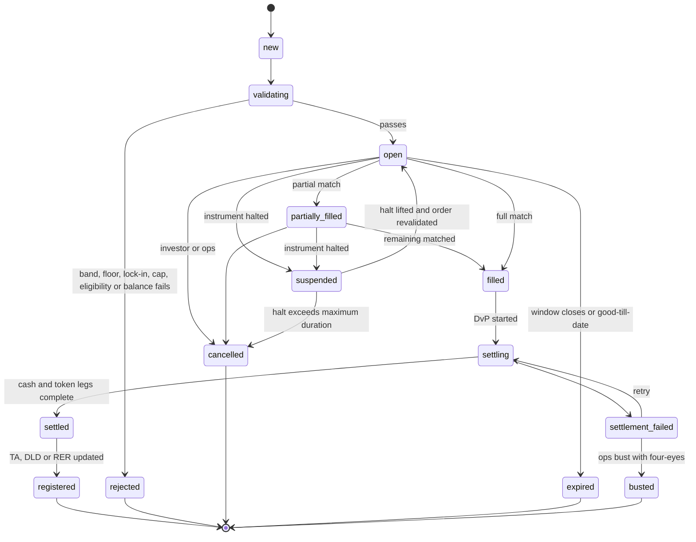

**Narrative.**
- **Validation rules** (M10/M14 parameters):
  - PRYPCO: price **within ±15% of the latest DLD smart valuation**, **3-month lock-in**, 20% cap, AED 1,000 minimum, listings visible to approved buyers only [`mena/01-prypco` §5.4];
  - BrickX: ask **≥ 80% of the latest Brick Valuation**, price-time priority [`australia/01-brickx` §5.4];
  - SmartCrowd STF: ±15% of market price, property held > 1 year [`mena/05-smartcrowd` §5.4];
  - Arrived: 6-month hold, limit orders only, monthly windows [`us/03-arrived` §5.4];
  - US restricted securities: Rule 144 / Reg CF 1-year locks [`REG-US` §6].
- **Halts:**
  - BrickX halts during unitholder meetings and resumes after [`australia/01-brickx` §5.4];
  - Assetora suspended its marketplace for ~13 months [`australia/05-assetora` §2.8];
  - **circuit breakers were not observed in vendors** and must be built [`APE` M9].
- **Settlement:**
  - atomic T+0 (Tokeniser [`australia/03-tokeniser` §9]);
  - < 24h (Propvest [`eu/03-propvest` §5.4]);
  - T+1/T+2 (Arrived/PPEX [`us/03-arrived` §5.4]);
  - registry update as legal finality (DLD/RER) [`mena/04-saudi` §2.2].

---

## 9. Redemption and exit window

**Periodic exit window** (Stake May/Nov; SmartCrowd Mar/Sep; Arrived monthly):

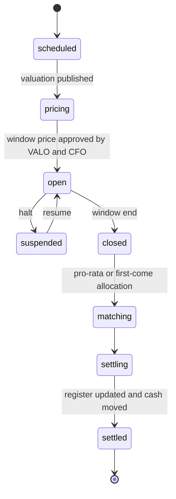

**Redemption request** (fund products; ERC-7540 async; ARVA fee-free redemption):

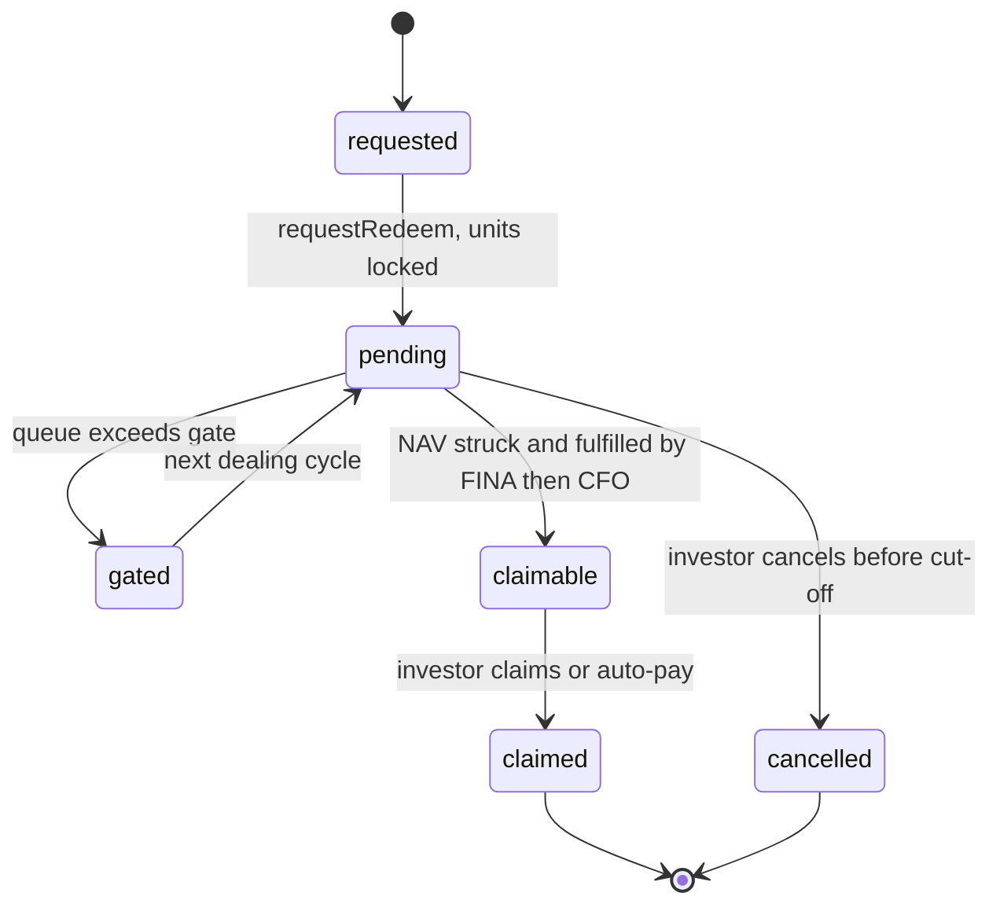

**Narrative.**
- **Stake:** share price = **valuation − fixed costs − amortised costs**; 2-week windows in May and November; 1-year lock-in [`mena/03-stake` §5.4].
- **SmartCrowd:** 2-week windows in March and September; buyers reimburse the seller's unamortised acquisition costs [`mena/05-smartcrowd` §5.4].
- **ERC-7540** gives `requestRedeem` → Pending → Claimable → Claimed for RWA redemption queues [`TSD` §1.5].
- **VARA ARVA rules** require fee-free redemption for equal AED value (Annex 2 III.E), so an SLA timer is needed [`REG-ME` §2].
- **Arrived funds:** quarterly redemptions after 6 months [`us/03-arrived` §1].

---

## 10. Governance proposal

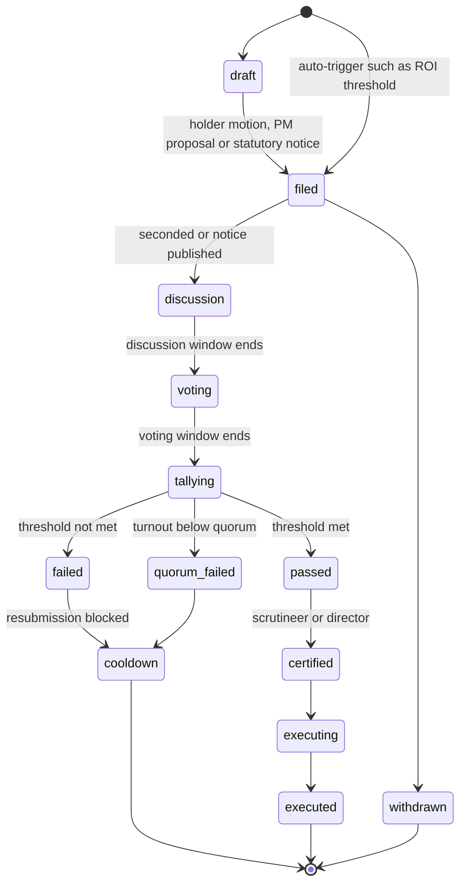

**Narrative.**
- **Lofty:** motion, then second, then **48h discussion (24h urgent)**, then **72h vote (24h)**, then a **90-day cooldown** after failure. Weight = ownership [`us/01-lofty` §5.6].
- **PRYPCO:** 50%+1 over 14 days, **auto-trigger at 30% ROI** [`mena/01-prypco` §5.5].
- **BrickX:** 75% any time / 50% at the 5-year anniversary; trading halted during the meeting [`australia/01-brickx` §5.5].
- **mogul:** "non-responses default to the manager's recommendation". The spec **disallows this by default and flags it** (Howey-risk evidence) [`us/05-mogul` §5.6, §10].
- **Execution tracking** links to M03 (exit), M22 (PM replacement) and M12 (waterfall).

---

## 11. AML alert → case → SAR/STR

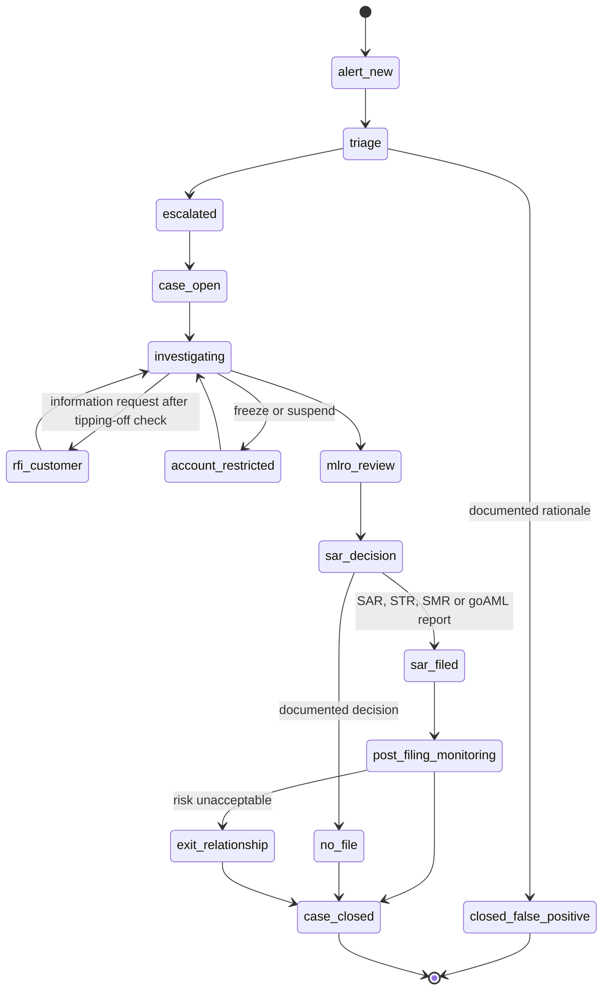

**Narrative.**
- **No vendor ships this workflow** ("SAR/STR filing workflow: not observed") [`APE` M13]. It is designed from obligations [`XCC` #22].
- **Clocks (pack parameters):**
  - US SAR: 30 days from detection [`REG-US` checklist];
  - AU SMR: 24h (terrorism) / 3 business days (other) [`REG-AU` checklist];
  - UAE goAML: without delay [`REG-ME` §4].
- **Tipping-off controls:** case access is limited to `MLRO`/`CCO`; support staff see a neutral "account under review" status.
- **Scenarios specific to tokenised property:**
  - order-book round-tripping [`australia/01-brickx` §11 #2];
  - DAI above €10k per transaction [`eu/05-domoblock` §2.5];
  - PayPal/Venmo/USDT inflows [`us/05-mogul` §11 #14];
  - VA-funded property purchases (DNFBP) [`REG-ME` §4].

---

## 12. Complaint lifecycle

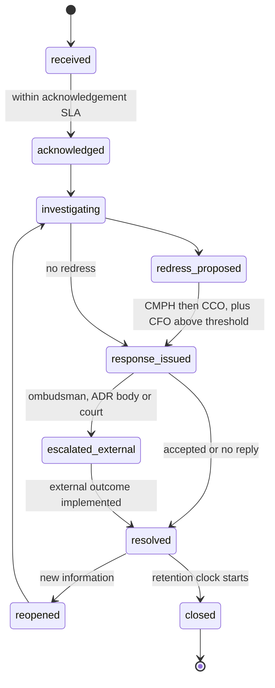

**Narrative.**
- **PRYPCO defaults:** acknowledge ≤ 7 days; resolve ≤ 30 days (max 8 weeks); **8-year retention**; disputes go to DIFC Courts [`mena/01-prypco` §2.8].
- **Other external bodies:** AFCA (AU) [`australia/01-brickx` §11 #14]; Bundesbank Schlichtungsstelle (DE) [`eu/03-propvest` §2.4]; FINRA/BBB (US) [`us/03-arrived` §11 #13].
- **Automatic conversion:** any ticket expressing dissatisfaction becomes a complaint (M23).
- **Anti-pattern:** AI-only support and long-outstanding refunds (Trustpilot complaints) [`mena/01-prypco` §10].

---

## 13. Wallet recovery / forced-transfer request

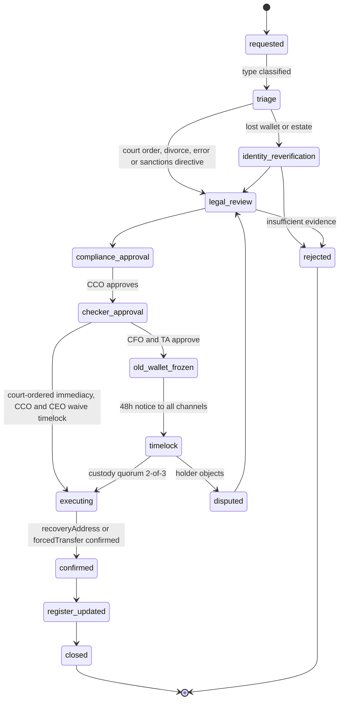

**Narrative.**
- **Universal primitive:**
  - ERC-3643 `recoveryAddress(lost, new, onchainID)` / `forcedTransfer`;
  - Securitize "destroy the tokens and reissue" (for "death, divorce, lost digital asset wallet keys");
  - DS `seize`;
  - Brickken "Confiscation";
  - Algorand/XRPL/Stellar clawback;
  - Solana permanent delegate.
  Sources: [`WLD` §3; `APE` headline 4; `TSD` §4].
- **Evidence bundle:** court order / grant of probate / death certificate / divorce decree / police report, **plus identity re-verification** of the claimant and a new-wallet ownership proof.
- **Timelock and notice** protect against social-engineered recovery. The court-ordered path allows immediacy with CEO co-approval.
- **Saudi exceptions:** inheritance, court orders and corrections "must be built into workflows" [`mena/04-saudi` §9].
- **Where the registry is legal truth (DLD/RER)**, the registry update is part of `register_updated` and is itself the legal settlement [`mena/04-saudi` §2.2].
