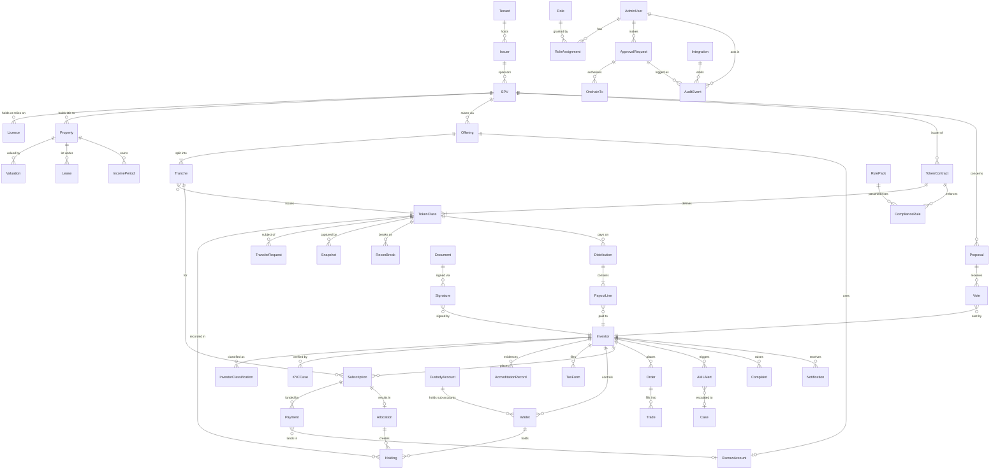
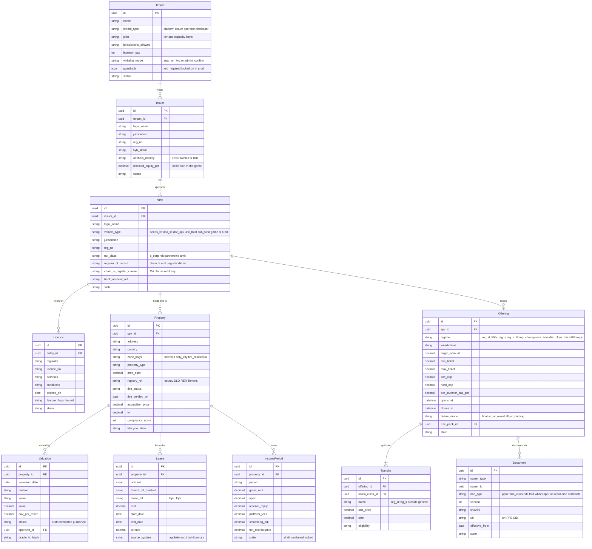
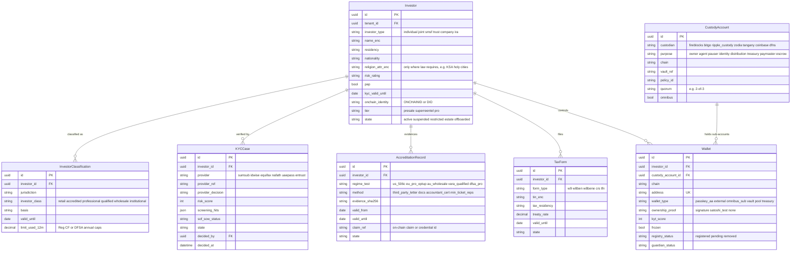
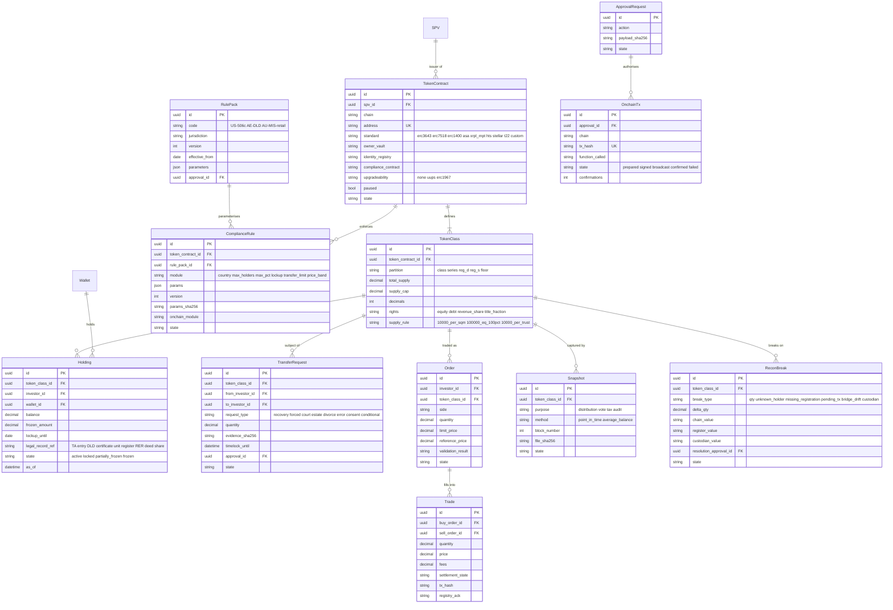
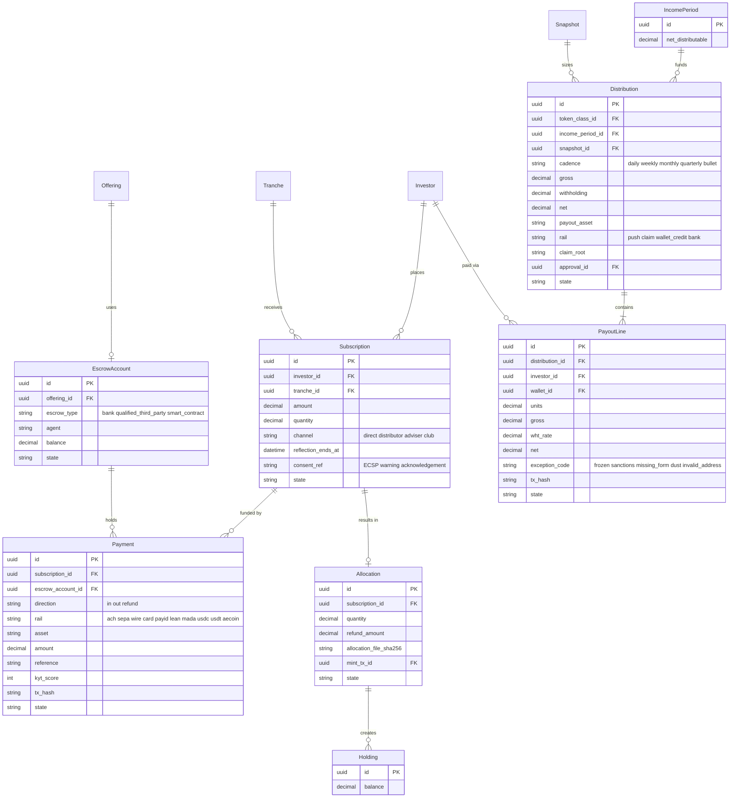
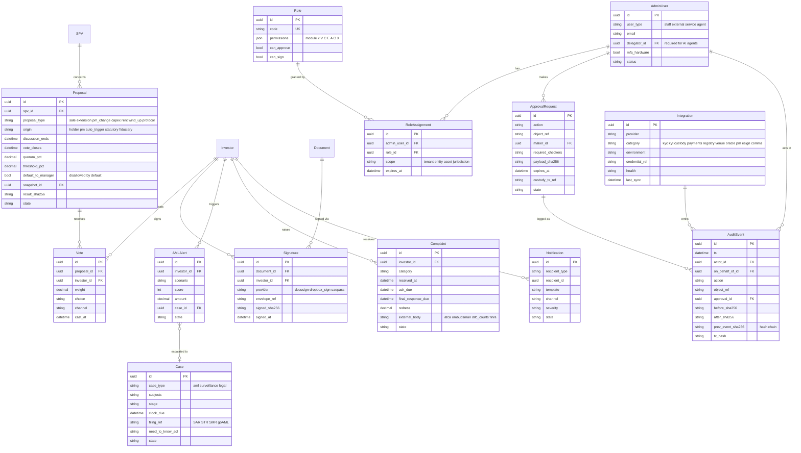

# 04 — Core Data Model (Admin-Panel Back End)

> **EXTRAPOLATION.** This is the logical data model behind modules M01–M27. The `state` enumerations follow `03-workflows-and-state-machines.md`. The model is chain-agnostic: on-chain objects are **mirrored** and reconciled, never assumed. Date: 23 Sep 2026.

**Conventions.**
- Every table carries `tenant_id`, `jurisdiction_pack_version` (where rules apply), `created_at/by` and `updated_at/by`.
- Deletes are soft deletes plus an audit event.
- PII is encrypted at field level (`_enc`). **No PII goes on-chain.** The chain sees addresses, claim/credential references and document hashes only, following the DS Registry Service pattern of hashed PII [`APE` M4 C#13] and Redbelly/Averer ZK credentials [`australia/02-redbelly` §2.2].
- Diagrams use Mermaid `erDiagram` notation:
  - `||--o{` = one-to-zero-or-many;
  - `||--|{` = one-to-one-or-many;
  - `|o--o|` = zero-or-one on both sides;
  - `}o--o{` = many-to-many.

---

## 1. Overview (entities and relationships)

---

## 2. Domain A — Tenancy, entities, assets and offerings

---

## 3. Domain B — Investors, onboarding, wallets and custody

---

## 4. Domain C — Token, register, rules and market

---

## 5. Domain D — Subscriptions, money and distributions

---

## 6. Domain E — Governance, documents, compliance cases and administration

---

## 7. Which entities mirror on-chain state

**System of record by archetype** (`00-overview.md` §6):
- **A1:** the chain.
- **A2/A4:** the TA or unit register.
- **A3:** the sovereign registry (DLD/RER).
- **A5:** the chain per tenant token.
- **A6:** the on-chain registry (CDSR) plus the trustee.

RealX default: an **off-chain golden record controlled by the registrar/TA**, reconciled to the chain. This is compatible with the SEC TA proposal's "exclusive control" requirement [`REG-US` §5] and with registry-as-truth markets.

| Entity | Off-chain record | On-chain mirror (default ERC-3643) | Mirrored fields | Reconciliation rule |
|---|---|---|---|---|
| TokenContract | Config, approved role set, rule version | Contract, owner, agents, identity registry, compliance, `paused` | Owner/agent addresses, paused flag, compliance address | **R1** on-chain role holders = approved role set (M09.5); paused flag = app state |
| TokenClass | Supply ledger (allocations − burns) | `totalSupply` (per chain; bridged supply summed) | total_supply, supply_cap | **R2** Σ chains `totalSupply` = register supply = Σ allocations − Σ burns; tolerance 0 |
| Holding | Golden record (register entry, lots, legal-record ref) | `balanceOf`, frozen amounts, `isFrozen` | balance, frozen_amount, state | **R3** per holder: chain balance = register balance = custodian sub-ledger (omnibus); **unknown holder = Sev1** |
| Wallet | Wallet ↔ investor map, KYT, proof | Identity Registry entry and country; token-level frozen flag | registry_status, country, frozen | **R4** IR members = {wallets where investor active ∧ KYC valid}; stale entries flagged |
| KYCCase / AccreditationRecord | Decision and validity | ONCHAINID claims / XRPL Credentials / VCs | claim_ref, validity | **R5** claim present ⇔ record `verified` ∧ `valid_until ≥ today` (daily sweep revokes expired) |
| ComplianceRule | Approved parameter set (+ hash) | Compliance-module parameters | params_sha256 | **R6** hash(on-chain params) = approved version hash; drift = Sev1 |
| Allocation / Subscription | Allocation file (hash) | Mint transactions | mint_tx_id | **R7** Σ minted per offering = locked allocation file; each mint references its file |
| Distribution / PayoutLine | Approved run file and hash | Transfers / claim root / claim-contract balance | tx_hash, claim_root | **R8** Σ paid on-chain = Σ approved net; claim root = Merkle root of file; unclaimed = contract balance |
| Payment (stablecoin) | Payment record | Stablecoin transfer | tx_hash, amount | **R9** each inbound transfer matched to one payment (or unmatched queue); KYT recorded |
| Payment (fiat) / EscrowAccount | Ledger | — (bank statements) | — | **R10** bank balance = Σ ledger (client money) daily; escrow = Σ commitments |
| Trade | Trade record | Settlement tx; registry ack (A3) | settlement_state, tx_hash, registry_ack | **R11** trade `registered` only when both chain tx and registry ack exist |
| Valuation | Published NAV | Oracle value (if used) | oracle_tx_hash | **R12** oracle value = published NAV ± tolerance; stale > 24h → halt / collateral 0 |
| Snapshot | File and method | Block number; optional checkpoint | file_sha256 | **R13** recompute from indexer at block N reproduces file hash |
| Document | Versioned doc | ERC-1643 `setDocument` / IPFS CID | sha256, uri | **R14** on-chain document hash = latest effective version |
| Proposal / Vote | Tally | Optional result hash | result_sha256 | **R15** anchored hash = certified result |
| Omnibus sub-ledger (A3) | Sub-accounts per investor | Omnibus address balance | — | **R16** Σ sub-accounts = omnibus on-chain balance (PRYPCO/Ctrl Alt pattern [`mena/01-prypco` §2.4]) |
| Registry (A3 DLD/RER, external TA) | Instruction log | — (registry API) | registry_ack | **R17** every ownership change has a registry ack; pending > SLA → halt secondary for that asset |
| AuditEvent | Hash-chained log | Optional daily anchor of chain head [L] | prev_event_sha256 | **R18** hash chain verifies end-to-end; anchor matches |

**Reconciliation operations.**
- **Frequency:**
  - nightly full run (M11.3);
  - targeted run after every privileged on-chain action;
  - intraday runs for payouts and registry-sync-heavy assets.
- **Tolerance:** zero for quantities. Cash tolerance applies only to FX/fee rounding, is documented per rail, and is never applied to client money.
- **Break handling:** break → owner → proposed fix → approval (`REGO` → `CCO` + `CFO`, + `X-TA`) → corrective action (register adjustment, or M09 corrective tx) → re-run.
- **Registry-truth markets (DLD/RER):** **no on-chain movement without a registry acknowledgement**. The registry has "absolute probative force" and "settlement = registry update, not token transfer" [`mena/04-saudi` §2.2].

---

## 8. Other data-design notes

> **QA note (Fable) — coverage gap.** The model covers the core lifecycle (entities, assets, offerings, investors, wallets, tokens, register, money, distributions, governance, cases, RBAC and audit) but does **not** yet define entities that `01-reference-admin-spec.md` relies on in these modules: M14 (`TradingWindow`, `Halt`, `SurveillanceAlert`, `VenueConfig`), M15 (`Pool`, `LendingMarket`, `OracleFeed`, `Position`, `Liquidation`, `RepoAgreement`), M16 (`FeeLedger`, `Reserve`/`GuaranteeFund`, `PaymentAssetAllowlist`), M18 (`Template`, `Envelope`, `RetentionHold`), M19 (`RegulatoryObligation`, `Filing`, `MetricDefinition`), M21 (`Announcement`, `Campaign`, `MarketingItem`, `Claim`), M22 (`WorkOrder`, `MunicipalObligation`, `TitleCheck`, `InsurancePolicy`, `PropertyManager`), M23 (`Ticket`), M24 (`Partner`, `Distributor`, `Reward`, `Commission`), M25 (`ApprovalPolicy`, `SoDRule`, `BreakGlassSession`, `AgentMandate`), M26 (`ApiKey`, `WebhookSubscription`, `Job`) and M27 (`FeatureFlag`, `FeeSchedule`, `JurisdictionBinding`, `Invoice`). Add these (with `tenant_id`, state enums from `03` and `approval_id` links where an action is privileged) before implementation; the reconciliation rules R1–R18 below are unaffected.

- **Multi-tenancy.** `tenant_id` is on every row, with row-level security. Platform staff get "view as tenant" with audit. Shared KYC across tenants (the Blocksquare "one account, many marketplaces" pattern [`eu/02-blocksquare` §2.5]) uses a platform-level `Investor` with tenant-scoped consent records.
- **Jurisdiction packs.** `RulePack` versions are immutable once effective. Objects store the pack version applied when an action was evaluated, which lets audits replay decisions.
- **Time-travel.** `Holding` is bi-temporal (valid time plus record time). This supports Tokeny-style historical look-back [`WLD` §2] and point-in-time register extracts.
- **GDPR vs immutability.**
  - PII stays off-chain.
  - Erasure pseudonymises the investor record and seals the address ↔ person link.
  - Retention holds (AML 5y EU; TA 6y US; VARA 8y; AU 7y [`XCC` #44]) override erasure until they expire.
- **Data residency.** Storage location is configurable per pack. Saudi national infrastructure runs "in-Kingdom" [`mena/04-saudi` §7]. Assetora reports no overseas recipients [`australia/05-assetora` §7]. Canvas processes data in five countries [`australia/04-canvas` §2.6].
- **Sensitive attributes.** Religion is stored **only** where a transfer-eligibility law requires it (KSA holy-cities rule [`REG-ME` §9]). It is encrypted, visible to `CCO`/`MLRO` only, and evaluated as an eligibility flag, never displayed.
