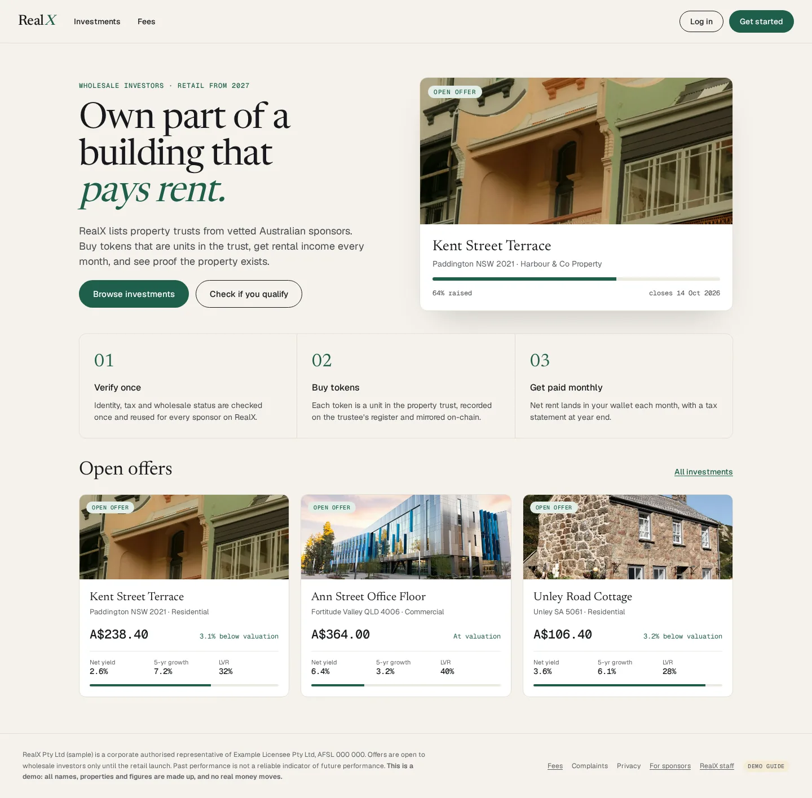
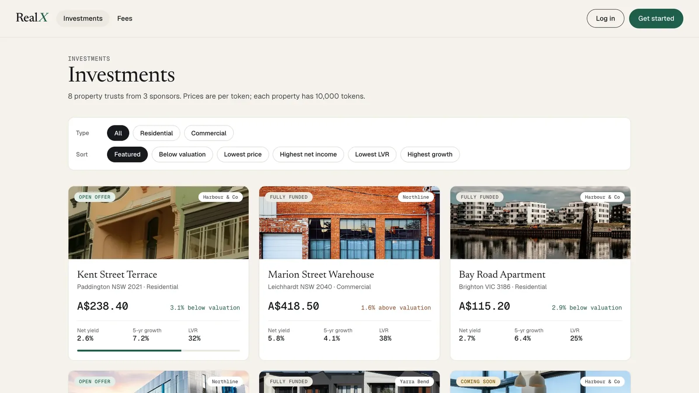
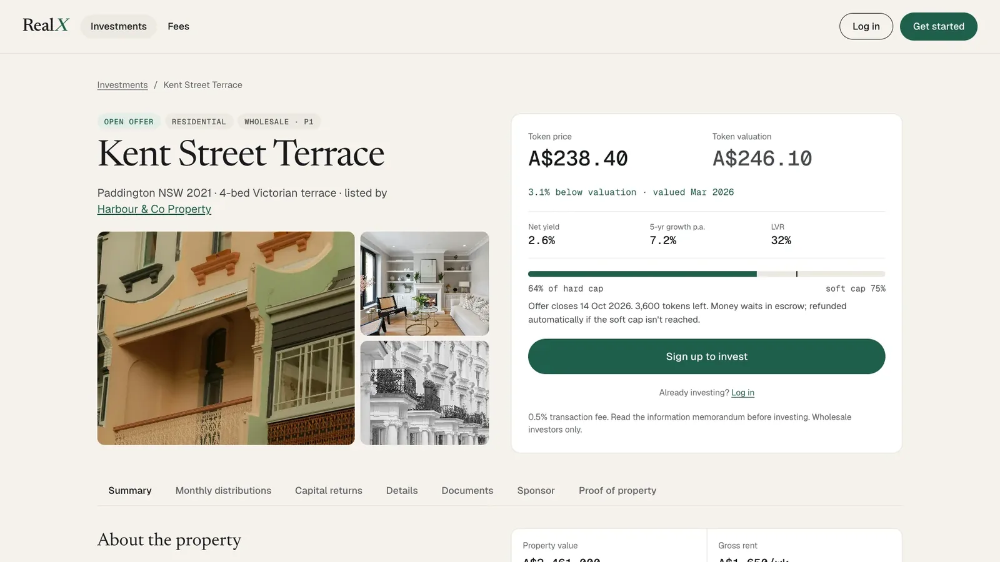

# RealX — fractional real-estate tokenisation — research & product design
-lightgrey) 

> **Need it installed, customised or supported?** Quantellics installs, customises and supports RealX on your infrastructure, under your brand. → **[Book a call](https://quantellics.com)** · email: info@quantellics.com

<p align="center"></p>

## What it is (and isn't)
**Maturity: concept (research).**
- Teardown of 20 fractional real-estate tokenisation platforms, regulatory research and synthesis.
- Product map, admin-panel designs and build plan for a RealX platform.
- No runnable application code yet.

- **Not investment advice.** Nothing here is financial, legal or tax advice.
- **No KYC, custody or licensing included.** You are responsible for KYC/AML, custody of user funds and any licence your activity requires.
- **Check your jurisdiction.** Operating trading, exchange or tokenisation services is regulated or prohibited in many jurisdictions.

> **Concept only:** this is research and design material, not software you can deploy. Security-token offerings are regulated securities in most jurisdictions.

## 2-minute quickstart
```bash
git clone <repository-url> RealX && cd RealX
python3 -m http.server 8000   # open http://127.0.0.1:8000/RealX-Product-Map.html
```
Start reading at `RealX/00 Start Here.md`. Nothing to test — no code.

## Screenshots

<table><tr><td width="50%"><br /><sub>Investments list</sub></td><td width="50%"><br /><sub>Property detail</sub></td></tr></table>

## Customisation map
| What you want to change | Where it lives |
|---|---|
| Regulatory research | `01-regulatory/` |
| Platform teardowns | `02-platforms/` |
| Synthesis / recommendations | `04-synthesis/` |
| Admin panel designs | `05-admin-panels/`, `design/` |
| Build plan | `RealX/08 Build Plan/` |

## Services: DIY vs Quantellics
| | Self-host (free) | **Install** | **Customise (Launch)** | **Dedicated support** |
|---|---|---|---|---|
| Source code (AGPL-3.0) | ✓ | ✓ | ✓ | ✓ |
| Installed on your infra / domain | you | ✓ | ✓ | ✓ |
| Branding, features, markets | you | – | ✓ | ✓ |
| Security review, KYC/payments integration | – | – | ✓ | ✓ |
| SLA, on-call, upgrades | – | – | – | ✓ |
| Commercial licence (no AGPL obligations) | – | available | available | included |
| Price | free | Contact us for pricing — info@quantellics.com | Contact us for pricing — info@quantellics.com | Contact us for pricing — info@quantellics.com |

See [SUPPORT.md](SUPPORT.md) or [open an enquiry](../../issues/new?template=enquiry.yml).

## Licence
**AGPL-3.0** ([LICENSE](LICENSE)). If you run a modified version as a network service, you must publish your changes under AGPL-3.0.
Need proprietary/closed-source use? A **commercial licence** is available — see [COMMERCIAL-LICENSE.md](COMMERCIAL-LICENSE.md).
"Quantellics" and product names are trademarks and are not licensed under AGPL.

> **Need it installed, customised or supported?** Quantellics installs, customises and supports RealX on your infrastructure, under your brand. → **[Book a call](https://quantellics.com)** · email: info@quantellics.com

---

## Technical reference (previous README)

# Fractional Real-Estate Tokenisation: Global Teardown of 20 Platforms

**Prepared for:** Arjun · RealX

**As of:** 23 Sep 2026

**Scope:** the top 5 platforms in each of the US, EU/EEA, MENA and Australia, reverse-engineered for:
- compliance
- user types and the actions they can take
- architecture
- flows
- tech stack
- an extrapolated platform-owner admin panel

**Status:** research is complete. A Fable 5.1 QA pass (5 reviewers) rated every slice "Pass with fixes", about 8/10, with ~165 corrections applied.

**Size:** 66 markdown files, ~20k lines, 124 mermaid diagrams (all render), from ~1,050 searches and fetches.

> Research, not legal advice. Evidence labels: **[C#n]** = confirmed with source *n*; **[I]** = inferred, with the reasoning given; **[S]** = speculative. Admin panels are **extrapolations**, since no platform publishes its back office. Each admin module carries a confidence grade and the evidence behind it.

---

## Suggested reading order

1. [`04-synthesis/00-executive-summary.md`](04-synthesis/00-executive-summary.md): the 20 platforms on one table, 7 archetypes, 10 findings.
2. [`04-synthesis/implications-for-realx.md`](04-synthesis/implications-for-realx.md): what to copy, avoid and differentiate; phased go-to-market; 15 must-haves for v1; top 10 risks.
3. [`05-admin-panels/00-overview.md`](05-admin-panels/00-overview.md), then [`01-reference-admin-spec.md`](05-admin-panels/01-reference-admin-spec.md) and [`05-wireframes.md`](05-admin-panels/05-wireframes.md): what the admin panels look like.
4. The platform profiles in `02-platforms/<region>/` whose models you want to borrow from.
5. [`04-synthesis/conflicts-and-gaps.md`](04-synthesis/conflicts-and-gaps.md): what is still uncertain.

## The 20 platforms

| Region | #1 | #2 | #3 | #4 | #5 |
|---|---|---|---|---|---|
| **US** | [Lofty](02-platforms/us/01-lofty.md): Algorand, daily USDC rent, largest live on-chain retail platform | [RedSwan](02-platforms/us/02-redswan.md): Reg D/S commercial real estate, own FINRA broker-dealer, Hedera/Stellar | [Arrived](02-platforms/us/03-arrived.md): off-chain Reg A+ benchmark, the scale leader | [RealT](02-platforms/us/04-realt.md): the most advanced DeFi design, **in voluntary liquidation since Jul 2026** | [mogul](02-platforms/us/05-mogul.md): Avalanche + Fireblocks "investment club" |
| **EU** | [Reental](02-platforms/eu/01-reental.md) (ES): Polygon, monthly USDT, P2P + lending | [Blocksquare + Oceanpoint](02-platforms/eu/02-blocksquare.md) (SI): white-label protocol, 19 marketplaces | [Propvest / Exporo](02-platforms/eu/03-propvest-exporo.md) (DE): CSSF-prospectus token bonds, fully licensed | [Brickken](02-platforms/eu/04-brickken.md) (ES): tokenisation SaaS/API, ERC-7943 | [Domoblock](02-platforms/eu/05-domoblock.md) (ES): "fan token" over participative loans (anti-pattern) |
| **MENA** | [PRYPCO Mint](02-platforms/mena/01-prypco-mint.md) (Dubai): DLD title-deed tokens on XRPL, VARA | [Ctrl Alt](02-platforms/mena/02-ctrl-alt.md): DLD issuer, custody and registry infrastructure | [Stake](02-platforms/mena/03-stake.md) (UAE/KSA): DFSA/CMA fractional, VARA in-principle approval | [Saudi REGA / Real Estate Registry + sandbox](02-platforms/mena/04-saudi-rer-national-tokenization.md): national registry tokens | [SmartCrowd / Nawy Shares](02-platforms/mena/05-smartcrowd-nawy-shares.md) (UAE/EG): DFSA crowdfunding, VARA in-principle approval |
| **Australia** | [BrickX](02-platforms/australia/01-brickx.md): registered MIS "Bricks", order book, 80% price floor | [Redbelly Network](02-platforms/australia/02-redbelly-network.md): compliance-native L1, Project Acacia | [Tokeniser + Liquidise](02-platforms/australia/03-tokeniser-liquidise.md): ERC-3643 fund units, AMM | [Canvas Connect](02-platforms/australia/04-canvas-connect.md): Acacia pilot, real-estate credit SPV vs wholesale CBDC | [Assetora (DomaCom) + Bricklet](02-platforms/australia/05-assetora-domacom-bricklet.md): MIS sub-funds; market frozen 2024–25 |

Why each platform was chosen, and the runners-up, are in each region's `_selection-and-summary.md`. Australia has **no live retail per-property on-chain tokeniser**. Its top 5 therefore mixes off-chain MIS incumbents, which set the compliance baseline, with on-chain infrastructure and pilots. The file says this openly.

## Headline findings

1. **Platforms fail on property operations, not smart contracts.** RealT's contracts still work in liquidation; Detroit code enforcement, taxes and a court-appointed fiduciary broke it. RealX needs a property-ops, municipal-compliance and title-verification module on day one.
2. **Tokenising changes the register, not the legal wrapper:**
   - US: a security.
   - EU: a MiFID transferable security, outside MiCA.
   - Dubai: a VARA asset-referenced virtual asset (ARVA) with Dubai Land Department (DLD) title.
   - Australia: a managed investment scheme (MIS) interest.
3. **The core architecture decision is where the golden record lives:** the chain, a transfer agent/registrar, or the land registry. Every option needs daily three-way reconciliation.
4. **Secondary liquidity is unsolved.** Nobody combines continuous trading on a licensed venue with T+0 stablecoin settlement. That is the clearest white space.
5. **Crypto branding, fiat plumbing.** MENA, retail Australia and licensed EU platforms are all fiat and custodial, and wallets have converged on no seed phrase. Freeze, forced transfer and recovery are universal.
6. **Standards are converging on ERC-3643 + ERC-7943** (Final), but the retail leaders still use custom whitelists or native L1 controls (Algorand/Hedera/XRPL).
7. **2025–26 regulation changed the map:**
   - US: SEC "format doesn't matter" statement (Jan 2026); transfer-agent modernisation proposal (Sep 2026); GENIUS Act.
   - EU: Listing Act €12m prospectus exemption (Jun 2026); DAC8.
   - UAE: DLD secondary market (Feb 2026); SCA renamed to Capital Market Authority.
   - Saudi Arabia: REGA tokenisation sandbox; non-Saudi ownership law (Jan 2026).
   - Australia: Digital Assets Framework Act 2026 (commences Apr 2027); AML tranche 2 (Jul 2026).

## What the admin panels look like (from `05-admin-panels/`)

- **27 modules**, each with pages, widgets, table columns, filters, row and bulk actions, and an action catalogue. The catalogue gives, per action, the roles allowed, maker-checker, the on-chain function (ERC-3643 / Algorand / XRPL / Hedera equivalents), state transitions, audit events and alerts.
  - **Core spine:** Command Center, Onboarding Review, Orders/Allocations, Distributions, Treasury & Client Money.
  - **Must-have for regulated players:** Register & 3-way Reconciliation, Token Operations, Compliance Rules Engine.
- **6 admin archetypes:**
  - DeFi marketplace operations console
  - Broker-dealer/transfer-agent back office
  - Registry-anchored distributor console
  - Fund/crowdfunding administration
  - Two-tier white-label console (protocol owner → tenant operator)
  - Institutional network console
- **Governance and controls:** 40 admin roles, a 57-row maker-checker policy, segregation-of-duties conflicts, break-glass runbooks and an MPC/multisig key hierarchy. The design principle is **approve in the admin panel, sign in custody**, bound by one approval ID.
- **Workflows and data:** 13 state machines, an ER data model, **11 ASCII wireframes**, per-platform admin panels for all 20, regional admin variants (US / EU / MENA / AU) and a catalogue of KPIs, reports and alerts.

---

## Folder map

### `00-method/`: how the research was done
| File | What it is |
|---|---|
| [methodology.md](00-method/methodology.md) | Question, scope decisions, ranking criteria, evidence grading, process |
| [platform-profile-template.md](00-method/platform-profile-template.md) | The 13-section template every platform profile follows |

### `01-regulatory/`: regulatory landscape per region
| File | What it is |
|---|---|
| [us.md](01-regulatory/us.md) | Howey; Reg D/S/A+/CF; transfer agent (TA), broker-dealer (BD) and trading-venue (ATS) rules; FinCEN/OFAC; tax; 2025–26 SEC and Congress changes; enforcement |
| [eu.md](01-regulatory/eu.md) | MiFID vs MiCA; Prospectus Regulation and Listing Act; ECSPR crowdfunding rules; DLT Pilot Regime; national regimes; AMLR/TFR; DAC8 |
| [mena.md](01-regulatory/mena.md) | VARA (ARVA), DLD framework, DFSA, ADGM, SCA→CMA, CBUAE; Saudi CMA/REGA; Bahrain, Qatar and others; Shariah |
| [australia.md](01-regulatory/australia.md) | MIS/RE, AFSL, wholesale tests, TMD/DDO, INFO 225, Digital Assets Framework Act 2026, AML tranche 2, FIRB, duty |
| [cross-cutting-controls.md](01-regulatory/cross-cutting-controls.md) | **Master map:** obligation → platform control → admin-panel feature; region comparison; licence pathways |

### `02-platforms/`: 20 reverse-engineered profiles
Each region folder contains:
- `01`–`05` platform profiles covering snapshot, legal structure, user types, actions, flows (mermaid), architecture, stack, money flows, secondary market, risks, **extrapolated admin panel**, builder takeaways and sources;
- `_selection-and-summary.md`: scored longlist, ranking, regional table and patterns;

| Region | Profiles | Logged searches |
|---|---|---|
| [us/](02-platforms/us/_selection-and-summary.md) | Lofty · RedSwan · Arrived · RealT · mogul | 154 entries |
| [eu/](02-platforms/eu/_selection-and-summary.md) | Reental · Blocksquare · Propvest/Exporo · Brickken · Domoblock | 177 entries |
| [mena/](02-platforms/mena/_selection-and-summary.md) | PRYPCO Mint · Ctrl Alt · Stake · Saudi REGA/RER · SmartCrowd/Nawy | 208 entries |
| [australia/](02-platforms/australia/_selection-and-summary.md) | BrickX · Redbelly · Tokeniser+Liquidise · Canvas Connect · Assetora+Bricklet | 214 entries |

### `03-infra-and-admin-evidence/`: the infrastructure layer and public evidence of admin panels
| File | What it is |
|---|---|
| [token-standards.md](03-infra-and-admin-evidence/token-standards.md) | ERC-20/721/1155/1400/1404/3643/4626/7518/7540/7943; Algorand ASA; Solana Token-2022; Stellar; XRPL (MPT, Credentials); Hedera HTS/ATS; Polymesh; Canton. Maps each standard's functions to admin actions |
| [white-label-issuer-dashboards.md](03-infra-and-admin-evidence/white-label-issuer-dashboards.md) | Publicly documented issuer consoles: Tokeny, Securitize, DigiShares, Blocksquare, Brickken, Hedera ATS, Fireblocks, Zoniqx, Stobox, Vertalo, etc. |
| [vendor-landscape.md](03-infra-and-admin-evidence/vendor-landscape.md) | KYC/KYB, accreditation, KYT, travel rule, custody/wallets, fiat rails, stablecoins, transfer agents, e-sign, property-management systems, oracles, venues, audits; with pricing where public |
| [admin-panel-evidence.md](03-infra-and-admin-evidence/admin-panel-evidence.md) | Catalogue of admin features observed across vendors, by module; on-chain vs off-chain; maker-checker |

### `04-synthesis/`: cross-platform analysis
| File | What it is |
|---|---|
| [00-executive-summary.md](04-synthesis/00-executive-summary.md) | 20-platform table, 7 archetypes, 10 findings |
| [compliance-matrix.md](04-synthesis/compliance-matrix.md) | 20 platforms × wrapper, licence, eligibility, KYC/AML, tax, enforcement; minimum viable compliance stack per region |
| [user-types-and-actions-matrix.md](04-synthesis/user-types-and-actions-matrix.md) | Role taxonomy (external, internal, third-party) and a role × action matrix (on-chain vs off-chain, by platform) |
| [reference-architecture.md](04-synthesis/reference-architecture.md) | 9-layer reference architecture, one diagram per archetype, golden-record options, key management |
| [end-to-end-flows.md](04-synthesis/end-to-end-flows.md) | 10 canonical flows with sequence diagrams and archetype variants, plus a wind-down playbook |
| [tech-stack-comparison.md](04-synthesis/tech-stack-comparison.md) | Stack by layer × 20 platforms; recommended default stack per region |
| [regional-comparison.md](04-synthesis/regional-comparison.md) | US vs EU vs MENA vs AU; 2025–26 timeline; market-entry scorecard |
| [implications-for-realx.md](04-synthesis/implications-for-realx.md) | Builder playbook for RealX |
| [conflicts-and-gaps.md](04-synthesis/conflicts-and-gaps.md) | 55 cross-file contradictions and how each was resolved; claims resting on [I]/[S]; prioritised re-verification list |

### `05-admin-panels/`: extrapolated platform-owner admin panels
| File | What it is |
|---|---|
| [00-overview.md](05-admin-panels/00-overview.md) | Method, confidence scale, 6 admin archetypes, module × archetype heat-map, MVP phasing |
| [01-reference-admin-spec.md](05-admin-panels/01-reference-admin-spec.md) | **Full information architecture:** sidebar tree and all 27 modules (pages, widgets, columns, actions, maker-checker, on-chain calls, audit events, alerts) |
| [02-rbac-and-approvals.md](05-admin-panels/02-rbac-and-approvals.md) | 40 roles, role × module permissions, maker-checker policy, segregation-of-duties conflicts, break-glass, key and signer policy |
| [03-workflows-and-state-machines.md](05-admin-panels/03-workflows-and-state-machines.md) | 13 state machines: KYC, accreditation, property, offering, order, token, distribution, trade, redemption, governance, AML/SAR, complaints, recovery |
| [04-data-model.md](05-admin-panels/04-data-model.md) | ER diagram of core entities; on-chain mirror and reconciliation rules |
| [05-wireframes.md](05-admin-panels/05-wireframes.md) | 11 ASCII wireframes of key admin screens |
| [06-per-platform-admin-panels.md](05-admin-panels/06-per-platform-admin-panels.md) | Condensed admin panel for each of the 20 platforms, coverage matrix and the most distinctive admin features |
| [07-regional-admin-variants.md](05-admin-panels/07-regional-admin-variants.md) | What the admin panel adds or changes in the US, EU, MENA and Australia |
| [08-kpis-reports-and-alerts.md](05-admin-panels/08-kpis-reports-and-alerts.md) | KPI catalogue, report catalogue, alert and automation catalogue |

---

## Known limitations

- **Search quota ran out.** The shared WebSearch quota was exhausted mid-research. Later work fetched known primary URLs directly (regulators, EUR-Lex, legislation.gov.au, EDGAR full-text, official docs, GitHub). Blocked sites were logged and never worked around.
- **Undisclosed stack details.** KYC vendors and exact token-contract configurations are undisclosed for most platforms and are marked [I]/[S].
- **Top re-verification items:**
  - Australian licence fit for fractional MIS-unit tokens (tokenised custody platform vs digital asset platform)
  - The CA DFPI order against Lofty
  - Saudi framework status after Apr 2026
  - Spain's choice between the €12m and €5m prospectus thresholds
  - PRYPCO's primary minimum ticket

  The full list is in `qa-summary.md` and `conflicts-and-gaps.md`.
