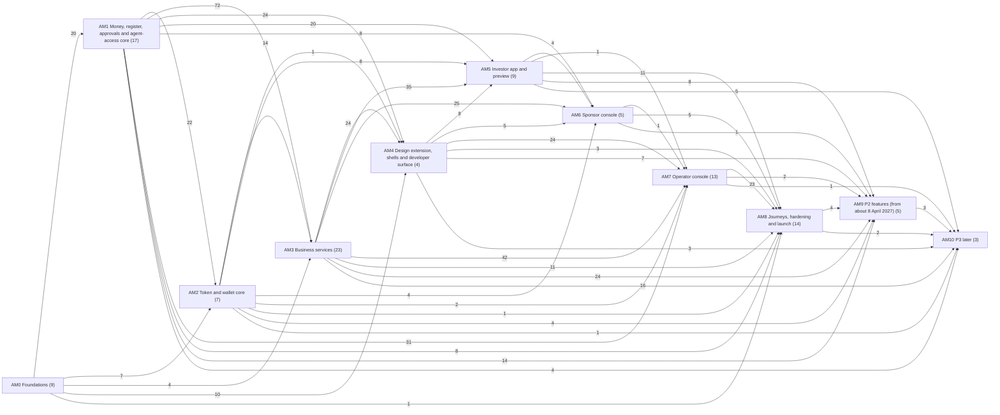
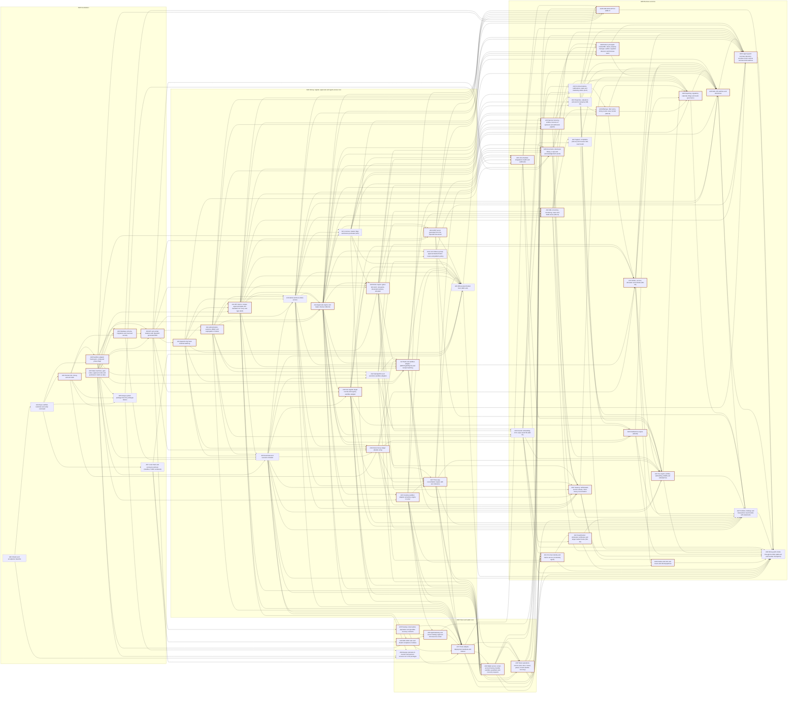
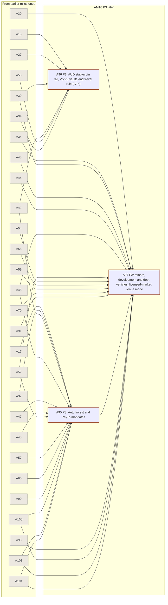

# App Development Graph

**107 nodes (A00-A106) in 11 milestones, plus 2 scheduled follow-up items that run under their owner's note (A12.1, A61.1), with 797 dependency edges.** Generated by `06 Evidence/Tools/app_plan/build_app_plan.py` from `09 App Build/Data/final-graph.json` (the graph data of 23 Sep 2026), the node specs in `09 App Build/Nodes/` and `09 App Build/Data/graph-revisions.json`. Every node runs the [[App Gauntlet]] loop (roles by decision D19): Specify and Plan by Opus 5.5 (high), Oracle (the node QA, Opus 5.5 high, writes hidden tests first on oracle nodes), Build by Grok 4.7 (xhigh), Challenge by the node QA at every loop in a fresh session, Gate, up to three fix loops, then Escalate. When all of a milestone's nodes have passed, Fable 5.1 (high) runs the graph QA gate; a fail reopens the owner nodes, at most two rounds. Estimates are agent-hours for build plus QA loops. The headline schedule is the one [[Build Orchestration]] runs: one milestone at a time, on 3 parallel build streams (A01 allows up to three nodes to build at once; four streams are shown only for comparison and would need an A01 change).

**How the plan was checked.** Fable 5.1 (high) wrote the graph and the specs A00-A45 and A47; Opus 5.5 wrote the other specs and assembled the plan. An independent Opus 5.5 reviewer with no stake in the plan checked every node spec and the whole plan. When the check run started, every node spec had had one independent check followed by a fix pass (106 specs have check records). 1 passed a re-check (A05); 105 still await their re-check because the usage limit stopped the check run; A106 was written by the plan fixer on 24 Sep 2026 and has had no independent check yet. Under D19 the remaining re-checks are run by Opus 5.5 (high) per spec, and Fable 5.1 (high) reviews the plan as a whole.

## Milestones

| Milestone | Goal | Nodes | Oracle | Work (agent-hours) | Loop allowance (h) | Done by, one milestone at a time on 3 streams | Done by if milestones overlapped |
|---|---|---|---|---|---|---|---|
| AM0 Foundations | Charter and coverage baseline (91 screens, 22 journeys including the D04 journey J22, 22 gates, 27 modules, 14 state machines), git repo and pinned toolchain, pure domain package (integer money, unit math, ids, all 14 state machines, permission matrix, gate codes incl. G22), Postgres schema with RLS, design system generated from the dc prototype tokens, local Hardhat chain with T-REX vendored, sandbox adapter framework, API and worker skeleton with the OpenAPI-generated SDK (the seed and scenario simulator A06 moved to AM1, because it seeds token, audit and session rows from A10, A11 and A12) | 9 | 5 | 69 - 105 | 2 - 6 (2) | 47 - 71 | 47 - 71 |
| AM1 Money, register, approvals and agent-access core | The risk core, proven before any UI: append-only audit chain, passkey/hardware-key auth with RBAC and SoD, API tokens with agent mandates for every user type (G22) and the MCP server generated from the OpenAPI document, the seed and scenario simulator, the alerts and SLA-clock service, approvals engine (SM-00) with custody policy sandbox and approval-ID binding, double-entry client-money ledger, NPP/PayID bank rail sandbox, the legal unit register with registry adapter, the rules engine for G01-G22, three-way reconciliation with zero tolerance, licence-bound feature flags, identity and sanctions sandboxes, and A12's follow-up loop A12.1 (approval-backed token routes) | 16 + 1 item | 12 | 167 - 237 | 10 - 30 (10) | 164 - 236 | 173 - 251 |
| AM2 Token and wallet core | ERC-3643 suite per trust with RealX compliance modules, the AgentGateway that binds approval IDs on-chain, passkey smart wallets with paymaster and guardian recovery, chain adapter and indexer feeding reconciliation, token operations service, wallet service; and design extension A (A50: the undrawn and partly drawn investor, public, sponsor and partner screens and the drawn-screen supplements), moved here from AM4 on 24 Sep 2026 so that its build uses idle streams and the user's HG-REVIEW of it happens while the backend is built | 7 | 6 | 72 - 100 | 0 - 0 (0) | 216 - 308 | 190 - 277 |
| AM3 Business services | Every API module the screens will need, each tested against the core and publishing its read contracts into the SDK: KYC and onboarding cases, on-chain claims, classification, tenancy and entities, properties and valuations, documents, offerings, orders/escrow/allocation, finalise-and-mint pipeline, treasury, distributions, tax, AML, comms, support, reporting, jobs, portfolio read models, halts and wind-down, partner principals, the IAM admin API for ADM-37 (A106) and the agent guard (anomalies, notices, tiered kill switches) | 23 | 17 | 235 - 337 | 31 - 93 (31) | 338 - 495 | 293 - 420 |
| AM4 Design extension, shells and developer surface | Design extension B (A51: the undesigned operator console screens, incl. ADM-35 and the five undrawn admin screens renumbered ADM-36..ADM-40, and their drawn-screen supplements) drawn in the prototype's own language and reviewed by the user before any console node uses it (extension A, A50, with ACC-05, SPN-16 and the PUB-05 standalone page, moved to AM2 on 24 Sep 2026); the web app shells (public, investor, sponsor) with passkey sign-in and the operator console shell with hardware-key sign-in; and the developer surface (API versioning, reference docs, per-user sandbox, SDK and MCP packaging; A99, moved from AM3 so that A49 closes AM3) | 4 | 2 | 52 - 76 | 9 - 27 (9) | 367 - 540 | 315 - 455 |
| AM5 Investor app and preview | Public site, onboarding, buy flow, portfolio, wallet, account and the investor and sponsor API-token screens on top of the proven services, then a Docker Desktop preview the user can open, re-run in full once every AM5 screen node has passed (A61.1) | 8 + 1 item | 1 | 75 - 111 | 7 - 21 (7) | 405 - 599 | 391 - 560 |
| AM6 Sponsor console | Dashboard, apply, team and billing; the four-step listing wizard and offer monitor; register, distributions, property reporting, valuations and announcements; the partner portal for trustee, auditor, regulator observer and licensee users | 5 | 1 | 50 - 73 | 5 - 15 (5) | 436 - 647 | 347 - 496 |
| AM7 Operator console | All 35 ADM screens plus the five undrawn admin screens (ADM-36..ADM-40), module by module, each bound to the approvals engine and audit log, including ADM-35 agent and API access | 13 | 2 | 112 - 164 | 30 - 90 (30) | 496 - 750 | 383 - 550 |
| AM8 Journeys, hardening and launch | Playwright journeys J01-J06, J09-J15, J17, J19-J21 with planted breaks, the D04 journey J22 driven by an agent through the API/MCP and the agent-parity matrix, security and performance passes, observability and runbooks with the nine runbook drills executed, backups with a restore drill and retention/erasure, a Base Sepolia integration run with the HG-AUDIT pack, design fidelity and accessibility, three clean regression runs with every gate G01-G22 exercised, and the Docker Desktop launch | 14 | 2 | 156 - 240 | 10 - 30 (10) | 578 - 880 | 490 - 692 |
| AM9 P2 features (from about 8 April 2027) | Registered scheme and sub-funds with PDS, TMD and G05, retail cooling-off as a parameter, the guarded resale board (SM-09), governance votes (SM-10), P2 journeys J07, J08, J16 and a P2 launch update | 5 | 3 | 69 - 97 | 11 - 33 (11) | 642 - 973 | 506 - 718 |
| AM10 P3 later | Auto Invest with PayTo, AUD stablecoin rail with V5/V6 vaults and the travel rule (G15), minors and development or debt vehicles, licensed-market venue mode | 3 | 3 | 48 - 68 | 25 - 75 (25) | 681 - 1040 | 524 - 744 |

**Total work:** 1105 - 1608 agent-hours across all nodes and items, plus a follow-up loop allowance of 140 - 420 agent-hours for 140 follow-up loop runs (69 loop ids named in the notes, one run per loop id and requester; 1-3 h each, a planning assumption).

**Schedules.** The orchestration runs one milestone at a time and starts the next only after the user has seen the report, so the barrier schedule is the planning figure:

| Schedule | AM3 exit (A49) | AM5 exit | P1 launch (AM8, A89) | Everything (AM10) |
|---|---|---|---|---|
| One milestone at a time, 3 streams (used) | 338 - 495 | 405 - 599 | 578 - 880 | 681 - 1040 |
| One milestone at a time, 4 streams (comparison) | 341 - 498 | 408 - 601 | 576 - 871 | 677 - 1028 |
| Milestones overlapping, 3 streams (reference only; the orchestration does not run this way) | 293 - 420 | 391 - 560 | 490 - 692 | 524 - 744 |

**Critical path to the P1 launch (A89):** 390-566 agent-hours: A00 → A01 → A02 → A03 → A04 → A09 → A10 → A11 → A12 → A06 → A13 → A14 → A18 → A19 → A17 → A20 → A27 → A29 → A28 → A35 → A43 → A36 → A37 → A41 → A45 → A48 → A101 → A49 → A99 → A60 → A105 → A65 → A78 → A80 → A85 → A103 → A88 → A89.

**Critical path through the whole graph (to the P3 node A96):** 424-616 agent-hours: A00 → A01 → A02 → A03 → A04 → A09 → A10 → A11 → A12 → A06 → A13 → A14 → A18 → A19 → A17 → A20 → A27 → A29 → A28 → A35 → A43 → A36 → A37 → A41 → A45 → A48 → A101 → A49 → A99 → A60 → A105 → A65 → A78 → A80 → A85 → A103 → A88 → A89 → A94 → A96.

Critical paths ignore stream limits and milestone barriers, so they are floors. Usage limits will pause the run several times; each run resumes from the last passed step of each node. These figures are planning assumptions, not measurements, and are re-estimated after AM0 from real gate times.

**Wall-clock waits outside agent-hours:** [[A86 - Base Sepolia integration run and HG-AUDIT pack|A86]]: about 5 wall-clock days for the three sessions (the multisig and recovery timelocks on a public chain cannot be skipped, §3), plus the human lead time for HG-ACCOUNTS (bundler account and faucet funding) before session 1. The schedule does not model them; the orchestration parks such a node between sessions ([[Build Orchestration]] §5).

## What changed from the graph data

The node specs were frozen after the graph data, and many of them ask for graph changes. The generator applies them, so this graph and the specs agree. The 23 Sep graph data alone had 453 edges and a critical path of 183-284 agent-hours; with the specs' changes it has 797 edges and 424-616. Both kinds of change matter about equally: the specs' estimates on the old edges give 289-426 agent-hours, and the specs' edges with the old estimates give 289-430. Most of the growth is AM1 to AM3 turning into one long chain, because many service specs now depend on each other directly. Because the orchestration runs one milestone at a time, only the edges inside a milestone lengthen the run. Titles, owned paths and human gates are read from the notes, so a note and the graph cannot disagree on them. The full change list with sources is in `Data/app-graph.json` (`revisions_applied`).

- **Dependencies added:** 338 (from the specs' Depends on and Unlocks lines and from the written requests listed in `graph-revisions.json`).
- **Estimates raised to the specs' figures (72):** A01 4-6 to 5-7 h; A03 6-10 to 8-12 h; A04 8-12 to 16-24 h; A06 6-10 to 8-12 h; A08 4-6 to 8-12 h; A09 6-10 to 10-14 h; A10 6-8 to 8-10 h; A11 8-12 to 12-16 h; A12 8-12 to 14-20 h; A13 5-8 to 6-9 h; A15 8-12 to 12-18 h; A16 10-14 to 12-16 h; A17 8-12 to 14-20 h; A18 10-14 to 12-16 h; A19 10-14 to 12-16 h; A20 10-14 to 12-16 h; A21 4-8 to 8-14 h; A22 4-8 to 8-12 h; A27 8-12 to 12-16 h; A30 8-12 to 12-18 h; A31 6-10 to 10-16 h; A32 4-8 to 8-12 h; A33 6-10 to 12-18 h; A34 8-12 to 10-14 h; A35 6-8 to 12-16 h; A36 8-12 to 9-13 h; A38 6-10 to 10-14 h; A39 6-10 to 14-18 h; A41 8-12 to 12-16 h; A43 6-10 to 10-16 h; A44 4-8 to 10-14 h; A45 4-8 to 8-12 h; A46 4-8 to 10-16 h; A47 4-8 to 8-12 h; A48 6-10 to 12-16 h; A49 5-8 to 8-12 h; A50 10-14 to 14-18 h; A51 10-14 to 16-22 h; A52 6-10 to 8-14 h; A53 6-10 to 10-14 h; A57 8-12 to 12-18 h; A60 6-10 to 10-14 h; A61 5-8 to 8-12 h; A63 10-14 to 12-16 h; A65 6-10 to 10-16 h; A67 5-8 to 8-12 h; A70 8-12 to 10-14 h; A75 8-12 to 10-14 h; A76 6-10 to 10-14 h; A77 5-8 to 8-12 h; A80 10-14 to 20-30 h; A81 8-12 to 12-18 h; A82 6-10 to 12-18 h; A83 8-12 to 16-24 h; A85 4-8 to 8-12 h; A86 6-10 to 10-16 h; A87 6-10 to 10-16 h; A88 6-10 to 8-12 h; A89 4-8 to 6-10 h; A90 10-14 to 21-31 h (includes the loops named on its Estimate line); A94 8-12 to 16-24 h; A95 8-12 to 12-16 h; A96 10-14 to 18-26 h (includes the loops named on its Estimate line); A97 8-12 to 18-26 h; A98 6-10 to 10-14 h; A99 8-12 to 18-26 h; A100 6-10 to 10-14 h; A101 6-10 to 10-14 h; A102 5-8 to 10-16 h; A103 6-10 to 18-30 h; A104 4-6 to 10-14 h; A105 5-8 to 10-15 h.
- **Oracle flags set from the specs (26):** A04, A08, A09, A27, A32, A33, A35, A36, A45, A46, A48, A53, A59, A63, A66, A75, A83, A90, A93, A95, A96, A97, A98, A99, A102, A104 (each now has the node QA write hidden tests before the build).
- **Milestone moved:** A06 AM0 to AM1 (its spec gives the reason).
- **Milestone moved:** A50 AM4 to AM2 (its spec gives the reason).
- **Milestone moved:** A99 AM3 to AM4 (its spec gives the reason).
- **Title changed:** A88 'P1 full regression: 17 journeys, three clean runs, every gate exercised' to 'P1 full regression: 18 P1 journeys, three clean runs, every gate exercised' (from the note's frontmatter).
- **Edge declined:** A22 → A11 (A11 line 20 (first draft)). Cycle: A22 needs A11's fresh passkey assertions. Settled 24 Sep 2026: A11's note no longer asks for the edge; A11 exposes a liveness port that A22 registers into after A22 passes, and A11's own tests use a recorded fake.
- **Edge declined:** A13 → A11 (A11 line 20 (first draft)). Cycle: A13 needs A11 and A12 (real sessions and tokens), and A12 needs A11. Settled 24 Sep 2026: A11 exposes a break-glass clock port; A13 registers its clock and emit into it, and A11's own tests use a recorded fake.
- **Edge declined:** A28 → A29 (A29 line 20 (first draft)). Cycle: A28 depends on A29 (recovery request lookup, wallet identity link). Settled 24 Sep 2026: A29 reaches A28 only over A28's public transfer-request route and events, tests against a recorded fake of both, and has A18 and A20 as direct dependencies.
- **Edge declined:** A101 → A41 (A41 line 20 (first draft)). Cycle A41 -> A45 -> A48 -> A101 -> A41. Settled 24 Sep 2026: A41 writes A10 audit codes with sensitivity 'sensitive' on its agent-writable routes; A101 raises the notice from any such code without depending on A41, and proves it at its own gate, in A49 and in A100.
- **Edge declined:** A19 → A21 (A21 line 22 (first draft), change (1)). Conflicts with A19's own Depends line, which lists A21 so that A19 can call A21's evaluateG21 (A19 line 305 freezes that signature). Settled 24 Sep 2026: the graph keeps A21 -> A19; A21 exports evaluateG21, A19's g21.ts adapter calls it, the daf.* values are read from A08's config or passed in by A19, and A21's Specify stop rule is removed.
- **Edge declined:** A89 → A92 (A92 line 21). The note accepts A23 as the minimum; A89 would put A92 behind the P1 launch without need.
- **Edge declined:** A00 → A02 (A02 lines 23 and 210). Optional in the note; A00 is already reached through A01.
- **Scheduled follow-up item:** A12.1 A12 follow-up loop: approval-backed token routes and platform policy, 4-6 h, oracle, after A12, A14; runs under [[A12 - API tokens, scopes, agent principals and mandates for every user type (G22)|A12]]'s owned paths and note (§8 'Follow-up loop A12.1'); source: A12 line 18 (estimate) and section 8; runs under A12's owned paths and adds cases to gauntlet\hidden\A12\
- **Scheduled follow-up item:** A61.1 A61 re-run loop: full preview re-run after A55, A59 and A60 (AM5 exit), 3-5 h, no oracle, after A55, A59, A60, A61; runs under [[A61 - Docker Desktop preview of the investor app (AM5 exit)|A61]]'s owned paths and note (Gauntlet loop, 'Re-run loop A61.1'); source: A61 lines 15, 79 and 269 (AM5 closes only after a full re-run once A55 and A59 have passed); added as a scheduled item by the plan fixer on 24 Sep 2026, with A60 so that ACC-05 is captured
- **Node added:** [[A106 - IAM admin API for ADM-37|A106]] IAM admin API for ADM-37 (AM3, 12-16 h, oracle).
- **Listing:** A51 screens + ADM-36, ADM-37, ADM-38, ADM-39, ADM-40 (A00 lines 57 and 61, design node for the five renumbered admin screens).
- **Listing:** A53 screens + ADM-36 (A00 line 57).
- **Listing:** A67 screens + ADM-37 (A00 line 57).
- **Listing:** A68 screens + ADM-38 (A00 line 57).
- **Listing:** A69 screens + ADM-39 (A00 line 57).
- **Listing:** A72 screens + ADM-40 (A00 line 57).
- **Listing:** A50 screens + PUB-05; design_refs + design-ext:PUB-05 (plan review 24 Sep 2026: the prototype's Sponsor tab draws PUB-05 only in part; A50 §3 draws the standalone page).
- **Listing:** A54 design_refs + design-ext:PUB-05 (A54 Depends line and Design references (PUB-05 standalone page from A50)).
- **Listing:** A60 journeys + J22 (A60 line 132 and A00 line 61).
- **Listing:** A82 journeys + J22 (A60 line 132 and A00 line 61 (J22 owner)).
- **Listing:** A12 journeys + J22 (A00 line 58 (supporting node for J22; A12's Requirements covered names J22's token steps)).
- **Listing:** A100 journeys + J22 (A00 line 58 (supporting node for J22)).
- **Listing:** A104 journeys + J22 (A00 line 58 (supporting node for J22; J22 step 2 runs through the MCP server)).
- **Listing:** A59 journeys + J22 (A59 Requirements covered, J22 step 3 (the investor's view)).
- **Listing:** A77 journeys + J22 (A77 Requirements covered, J22 step 6 (staff oversight on ADM-35)).
- **Listing:** A101 journeys + J22 (A101 Requirements covered, J22 steps 3 and 6 (notices and holds)).
- **Listing:** A89 journeys + J22 (A89 Requirements covered (the J22 entry probe at launch)).
- **Listing:** A88 journeys + J22 (A88 retitled '18 P1 journeys' on 24 Sep 2026; J22 runs inside the three-clean-runs criterion).
- **Listing:** A100 gates + G01, G02, G03, G04, G05, G06, G07, G08, G09, G10, G11, G12, G14, G15, G16, G17, G18, G19, G20, G21 (A00 line 61 ('A100 lists only G13 and G22'); D04 applies every gate to agent calls).
- **Listing:** A105 gates + G18; modules + M23; design_refs + design-ext:ADM-26, design-ext:ADM-28, design:adApprovals (A105 line 20).
- **Listing:** A106 gates + G13, G22; modules + M25; design_refs + design-ext:ADM-37 (A106 Requirements covered (the ADM-37 backend)).
- **Owned-path overlaps between ordered nodes (allowed; the later node was specified knowing the earlier one):** 5. Overlaps between nodes that no dependency orders: 0 (the generator fails on any).
- **Follow-up loops named in the notes:** 69 numbered loop ids without their own estimate, requested 140 times in all (one run per loop id and requester), counted in the loop allowance in the requester's milestone (AM0 2; AM1 10; AM3 31; AM4 9; AM5 7; AM6 5; AM7 30; AM8 10; AM9 11; AM10 25). Each run goes through the orchestration's follow-up mechanism under the id `<loop>-<requester>` (for example `A04.1-A12`) when that requester's Specify step finds it not yet passed in `status.json`, so a later requester's change list is never taken as done because an earlier requester's run of the same loop id passed. Citations that name a loop only as a pattern are not counted (4: A72 cites A04.1 as a pattern; A74 cites A04.1 as a pattern; A86 cites A04.1 as a pattern; A103 cites A04.1 as a pattern).
- **Docker lock in the schedule:** the orchestration runs one stack-bound Challenge or re-verify at a time across the streams, so the schedules run the last 35% of each Docker-using node's estimate (and of each loop run) one node at a time (102 of 109 nodes and items use Docker; the share is a planning assumption in `graph-revisions.json`).

**Still open for the reviewer and the graph owner (not applied):**

- Node splits offered as options (A04, A33, A48, A81, A83, A94, A97, A99, A102, A103) are not applied. A99's split was considered on 24 Sep 2026 and not made: A99 moved to AM4 instead, so A49 closes AM3.
- A44 line 186 asks for A44 as a dependency of the Investor 360 contributors 'or an integration node before A68'; the owner is not named, so no edge is added.
- Summary text changes (A19 line 305, the at-or-below G07 rule) and design_refs for A49 (line 106) are not applied.
- Interface-only edges on the critical path (A12 -> A06, A06 -> A13, A20 -> A27, A28 -> A35, A28 and A29 -> A43) are kept. The orchestration runs one milestone at a time, so an edge between milestones never lengthens the run; the two inside AM1 (A12 -> A06, A06 -> A13) carry real seed data (token rows, the design's alerts) that A06 and A13 need at their gates. Replacing them with recorded fakes is left to the reviewer.

## Graph

Mermaid draws at most 500 edges in one diagram, so the 797 dependency edges are split into parts by the milestone of the dependent node. Every edge appears exactly once. In each part the nodes of its milestones are grouped by milestone, and their dependencies from earlier milestones appear as small grey boxes. Thick brick borders mark oracle nodes; dashed boxes are follow-up items that run under their owner's note.

### Overview: milestones

### Part 1: AM0 to AM3 (293 edges)

### Part 2: AM4 to AM6 (191 edges)

```mermaid
flowchart LR
  subgraph EXT["From earlier milestones"]
    A00["A00"]
    A03["A03"]
    A04["A04"]
    A05["A05"]
    A06["A06"]
    A09["A09"]
    A11["A11"]
    A12["A12"]
    A13["A13"]
    A14["A14"]
    A15["A15"]
    A17["A17"]
    A18["A18"]
    A20["A20"]
    A21["A21"]
    A22["A22"]
    A23["A23"]
    A29["A29"]
    A30["A30"]
    A32["A32"]
    A33["A33"]
    A34["A34"]
    A35["A35"]
    A36["A36"]
    A37["A37"]
    A38["A38"]
    A39["A39"]
    A40["A40"]
    A41["A41"]
    A42["A42"]
    A43["A43"]
    A44["A44"]
    A45["A45"]
    A46["A46"]
    A47["A47"]
    A48["A48"]
    A49["A49"]
    A50["A50"]
    A98["A98"]
    A101["A101"]
    A104["A104"]
  end
  subgraph AM4["AM4 Design extension, shells and developer surface"]
    A51["A51 Design extension B: operator console screens not in the prototype"]
    A52["A52 Web app shells, routing and passkey sign-in (public, investor, sponsor)"]
    A53["A53 Operator console shell, hardware-key sign-in and approval action pattern"]
    A99["A99 Developer surface: API versioning, reference docs, per-user sandbox and SDK/MCP packaging"]
  end
  subgraph AM5["AM5 Investor app and preview"]
    A54["A54 Public site: home, investments, property page, sponsor profile, fees"]
    A55["A55 Public site: how it works, returns calculator, transparency, help and documents"]
    A56["A56 Onboarding flow ONB-01 to ONB-10 with entity branch"]
    A57["A57 Buy flow: order, review and confirm, order status (INV-01 to INV-03)"]
    A58["A58 Portfolio, holding detail, transactions, distributions and statements"]
    A59["A59 AUD wallet, token wallet and account screens"]
    A60["A60 Investor and sponsor API tokens and agents screens (ACC-05, SPN-16)"]
    A61["A61 Docker Desktop preview of the investor app (AM5 exit)"]
    A61_1["A61.1 A61 re-run loop: full preview re-run after A55, A59 and A60 (AM5 exit)"]
  end
  subgraph AM6["AM6 Sponsor console"]
    A62["A62 Sponsor console: apply, dashboard, team and approvals, billing"]
    A63["A63 Sponsor console: new listing wizard SPN-03 to SPN-06 and offer monitor SPN-07"]
    A64["A64 Sponsor console: register, distributions, property reporting, valuations, announcements"]
    A65["A65 Sponsor journeys J11, J12, J13, J14, J19 end to end in Docker (AM6 exit)"]
    A105["A105 Partner portal: trustee/RE, auditor, regulator observer and licensee views"]
  end
  A00 --> A51
  A03 --> A51
  A05 --> A51
  A09 --> A51
  A12 --> A51
  A14 --> A51
  A21 --> A51
  A48 --> A51
  A101 --> A51
  A05 --> A52
  A06 --> A52
  A09 --> A52
  A11 --> A52
  A12 --> A52
  A14 --> A52
  A21 --> A52
  A22 --> A52
  A23 --> A52
  A32 --> A52
  A33 --> A52
  A50 --> A52
  A05 --> A53
  A06 --> A53
  A11 --> A53
  A14 --> A53
  A33 --> A53
  A35 --> A53
  A51 --> A53
  A104 --> A53
  A06 --> A54
  A20 --> A54
  A23 --> A54
  A32 --> A54
  A34 --> A54
  A36 --> A54
  A42 --> A54
  A43 --> A54
  A47 --> A54
  A50 --> A54
  A52 --> A54
  A104 --> A54
  A20 --> A55
  A21 --> A55
  A35 --> A55
  A36 --> A55
  A43 --> A55
  A47 --> A55
  A50 --> A55
  A52 --> A55
  A06 --> A56
  A17 --> A56
  A29 --> A56
  A30 --> A56
  A32 --> A56
  A35 --> A56
  A36 --> A56
  A41 --> A56
  A50 --> A56
  A52 --> A56
  A06 --> A57
  A23 --> A57
  A35 --> A57
  A37 --> A57
  A38 --> A57
  A52 --> A57
  A101 --> A57
  A104 --> A57
  A06 --> A58
  A23 --> A58
  A35 --> A58
  A36 --> A58
  A41 --> A58
  A47 --> A58
  A50 --> A58
  A52 --> A58
  A06 --> A59
  A23 --> A59
  A29 --> A59
  A32 --> A59
  A39 --> A59
  A41 --> A59
  A43 --> A59
  A44 --> A59
  A47 --> A59
  A50 --> A59
  A52 --> A59
  A56 --> A59
  A12 --> A60
  A23 --> A60
  A33 --> A60
  A37 --> A60
  A40 --> A60
  A50 --> A60
  A52 --> A60
  A98 --> A60
  A99 --> A60
  A101 --> A60
  A06 --> A61
  A23 --> A61
  A43 --> A61
  A54 --> A61
  A56 --> A61
  A57 --> A61
  A58 --> A61
  A104 --> A61
  A55 --> A61_1
  A59 --> A61_1
  A60 --> A61_1
  A61 --> A61_1
  A33 --> A62
  A36 --> A62
  A40 --> A62
  A43 --> A62
  A47 --> A62
  A50 --> A62
  A52 --> A62
  A98 --> A62
  A104 --> A62
  A06 --> A63
  A23 --> A63
  A34 --> A63
  A35 --> A63
  A36 --> A63
  A37 --> A63
  A38 --> A63
  A43 --> A63
  A50 --> A63
  A52 --> A63
  A98 --> A63
  A104 --> A63
  A06 --> A64
  A18 --> A64
  A23 --> A64
  A34 --> A64
  A40 --> A64
  A41 --> A64
  A43 --> A64
  A47 --> A64
  A50 --> A64
  A52 --> A64
  A98 --> A64
  A101 --> A64
  A104 --> A64
  A38 --> A65
  A45 --> A65
  A60 --> A65
  A61 --> A65
  A62 --> A65
  A63 --> A65
  A64 --> A65
  A105 --> A65
  A04 --> A99
  A05 --> A99
  A06 --> A99
  A09 --> A99
  A12 --> A99
  A13 --> A99
  A15 --> A99
  A17 --> A99
  A18 --> A99
  A20 --> A99
  A22 --> A99
  A23 --> A99
  A30 --> A99
  A32 --> A99
  A33 --> A99
  A36 --> A99
  A37 --> A99
  A38 --> A99
  A39 --> A99
  A40 --> A99
  A41 --> A99
  A43 --> A99
  A44 --> A99
  A45 --> A99
  A46 --> A99
  A47 --> A99
  A48 --> A99
  A49 --> A99
  A98 --> A99
  A101 --> A99
  A104 --> A99
  A44 --> A105
  A45 --> A105
  A50 --> A105
  A51 --> A105
  A52 --> A105
  A55 --> A105
  A60 --> A105
  A64 --> A105
  A98 --> A105
  classDef oracle stroke:#9A4524,stroke-width:3px
  classDef pending stroke-dasharray:5 5
  classDef ext fill:#ECE8E0,stroke:#9A9A9A,color:#4A4D52
  class A53,A59,A63,A99 oracle
  class A61_1 pending
  class A00,A03,A04,A05,A06,A09,A11,A12,A13,A14,A15,A17,A18,A20,A21,A22,A23,A29,A30,A32,A33,A34,A35,A36,A37,A38,A39,A40,A41,A42,A43,A44,A45,A46,A47,A48,A49,A50,A98,A101,A104 ext
```

### Part 3: AM7 to AM9 (277 edges)

```mermaid
flowchart LR
  subgraph EXT["From earlier milestones"]
    A04["A04"]
    A06["A06"]
    A10["A10"]
    A11["A11"]
    A12["A12"]
    A12_1["A12.1"]
    A13["A13"]
    A14["A14"]
    A15["A15"]
    A18["A18"]
    A19["A19"]
    A20["A20"]
    A21["A21"]
    A23["A23"]
    A24["A24"]
    A27["A27"]
    A28["A28"]
    A29["A29"]
    A30["A30"]
    A32["A32"]
    A33["A33"]
    A34["A34"]
    A35["A35"]
    A36["A36"]
    A37["A37"]
    A38["A38"]
    A39["A39"]
    A40["A40"]
    A41["A41"]
    A42["A42"]
    A43["A43"]
    A44["A44"]
    A45["A45"]
    A46["A46"]
    A47["A47"]
    A48["A48"]
    A50["A50"]
    A51["A51"]
    A52["A52"]
    A53["A53"]
    A54["A54"]
    A55["A55"]
    A56["A56"]
    A57["A57"]
    A58["A58"]
    A59["A59"]
    A60["A60"]
    A61["A61"]
    A62["A62"]
    A63["A63"]
    A64["A64"]
    A65["A65"]
    A98["A98"]
    A99["A99"]
    A101["A101"]
    A104["A104"]
    A105["A105"]
    A106["A106"]
  end
  subgraph AM7["AM7 Operator console"]
    A66["A66 Console: command center, alerts centre, approvals inbox, audit log"]
    A67["A67 Console: users, roles, access reviews and break-glass (ADM-37)"]
    A68["A68 Console: identity review, wholesale certificates, investor directory and Investor 360"]
    A69["A69 Console: sponsor admission, licences, sponsors and guardrails, feature flags, entities register"]
    A70["A70 Console: property register, valuations workbench, property operations"]
    A71["A71 Console: listing review, live raise monitor, orders and allocation"]
    A72["A72 Console: token operations, forced transfer and recovery desk, wallets and custody, token registry"]
    A73["A73 Console: rule packs and threshold monitors, register and reconciliation"]
    A74["A74 Console: treasury, distribution run review, tax centre"]
    A75["A75 Console: AML cases, complaints register, marketing compliance, disclosure library"]
    A76["A76 Console: regulatory calendar and data room, sponsor performance, integrations and jobs"]
    A77["A77 Console: agent and API access (ADM-35)"]
    A78["A78 Operator journey J20 end to end in Docker (AM7 exit)"]
  end
  subgraph AM8["AM8 Journeys, hardening and launch"]
    A79["A79 End-to-end journeys: investor money path"]
    A80["A80 End-to-end journeys: sponsor and operations"]
    A81["A81 End-to-end journeys: recovery, AML and planted breaks"]
    A82["A82 End-to-end: an agent drives the account through the API and MCP"]
    A83["A83 Security hardening"]
    A84["A84 Performance and scale"]
    A85["A85 Observability and runbooks"]
    A86["A86 Base Sepolia integration run and HG-AUDIT pack"]
    A87["A87 Design fidelity and accessibility pass"]
    A88["A88 P1 full regression: 18 P1 journeys, three clean runs, every gate exercised"]
    A89["A89 Docker Desktop launch (P1)"]
    A100["A100 Agent-parity suite: every UI action has an API and MCP equivalent under the same gates"]
    A102["A102 Backups, restore drill, data retention and erasure"]
    A103["A103 Runbook drills R1-R9 executed on the stack"]
  end
  subgraph AM9["AM9 P2 features (from about 8 April 2027)"]
    A90["A90 P2: registered scheme, sub-funds, PDS and TMD, target market (G05), retail cooling-off"]
    A91["A91 P2: resale board market module (SM-09)"]
    A92["A92 P2: resale board screens (sell, buy on the board, market tracker, board control)"]
    A93["A93 P2: governance votes and meetings (SM-10) with screens"]
    A94["A94 P2: end-to-end journeys and launch update"]
  end
  A06 --> A66
  A10 --> A66
  A13 --> A66
  A14 --> A66
  A15 --> A66
  A20 --> A66
  A21 --> A66
  A36 --> A66
  A39 --> A66
  A42 --> A66
  A45 --> A66
  A46 --> A66
  A48 --> A66
  A53 --> A66
  A101 --> A66
  A104 --> A66
  A06 --> A67
  A11 --> A67
  A51 --> A67
  A53 --> A67
  A106 --> A67
  A06 --> A68
  A23 --> A68
  A30 --> A68
  A32 --> A68
  A44 --> A68
  A51 --> A68
  A53 --> A68
  A06 --> A69
  A21 --> A69
  A33 --> A69
  A48 --> A69
  A51 --> A69
  A53 --> A69
  A98 --> A69
  A101 --> A69
  A104 --> A69
  A34 --> A70
  A48 --> A70
  A51 --> A70
  A53 --> A70
  A54 --> A70
  A06 --> A71
  A36 --> A71
  A37 --> A71
  A38 --> A71
  A43 --> A71
  A51 --> A71
  A53 --> A71
  A104 --> A71
  A06 --> A72
  A15 --> A72
  A28 --> A72
  A29 --> A72
  A35 --> A72
  A42 --> A72
  A48 --> A72
  A51 --> A72
  A53 --> A72
  A104 --> A72
  A06 --> A73
  A18 --> A73
  A19 --> A73
  A20 --> A73
  A48 --> A73
  A51 --> A73
  A53 --> A73
  A72 --> A73
  A98 --> A73
  A104 --> A73
  A06 --> A74
  A20 --> A74
  A37 --> A74
  A38 --> A74
  A39 --> A74
  A40 --> A74
  A41 --> A74
  A42 --> A74
  A51 --> A74
  A53 --> A74
  A98 --> A74
  A104 --> A74
  A35 --> A75
  A42 --> A75
  A43 --> A75
  A44 --> A75
  A51 --> A75
  A53 --> A75
  A33 --> A76
  A45 --> A76
  A46 --> A76
  A51 --> A76
  A53 --> A76
  A12 --> A77
  A12_1 --> A77
  A48 --> A77
  A51 --> A77
  A53 --> A77
  A67 --> A77
  A99 --> A77
  A101 --> A77
  A104 --> A77
  A65 --> A78
  A66 --> A78
  A67 --> A78
  A68 --> A78
  A69 --> A78
  A70 --> A78
  A71 --> A78
  A72 --> A78
  A73 --> A78
  A74 --> A78
  A75 --> A78
  A76 --> A78
  A77 --> A78
  A48 --> A79
  A55 --> A79
  A59 --> A79
  A61 --> A79
  A66 --> A79
  A68 --> A79
  A71 --> A79
  A72 --> A79
  A73 --> A79
  A74 --> A79
  A101 --> A79
  A48 --> A80
  A62 --> A80
  A63 --> A80
  A64 --> A80
  A69 --> A80
  A70 --> A80
  A73 --> A80
  A74 --> A80
  A75 --> A80
  A76 --> A80
  A78 --> A80
  A105 --> A80
  A55 --> A81
  A59 --> A81
  A61 --> A81
  A66 --> A81
  A68 --> A81
  A72 --> A81
  A73 --> A81
  A75 --> A81
  A78 --> A81
  A12 --> A82
  A60 --> A82
  A61 --> A82
  A77 --> A82
  A78 --> A82
  A98 --> A82
  A99 --> A82
  A101 --> A82
  A104 --> A82
  A79 --> A83
  A80 --> A83
  A81 --> A83
  A104 --> A83
  A79 --> A84
  A80 --> A84
  A79 --> A85
  A80 --> A85
  A27 --> A86
  A79 --> A86
  A80 --> A86
  A81 --> A86
  A79 --> A87
  A80 --> A87
  A81 --> A87
  A82 --> A88
  A83 --> A88
  A84 --> A88
  A85 --> A88
  A86 --> A88
  A87 --> A88
  A100 --> A88
  A102 --> A88
  A103 --> A88
  A88 --> A89
  A32 --> A90
  A35 --> A90
  A36 --> A90
  A43 --> A90
  A45 --> A90
  A46 --> A90
  A48 --> A90
  A52 --> A90
  A54 --> A90
  A56 --> A90
  A57 --> A90
  A60 --> A90
  A71 --> A90
  A76 --> A90
  A98 --> A90
  A100 --> A90
  A101 --> A90
  A104 --> A90
  A18 --> A91
  A19 --> A91
  A20 --> A91
  A21 --> A91
  A23 --> A91
  A24 --> A91
  A28 --> A91
  A37 --> A91
  A42 --> A91
  A43 --> A91
  A47 --> A91
  A48 --> A91
  A90 --> A91
  A98 --> A91
  A101 --> A91
  A104 --> A91
  A06 --> A92
  A23 --> A92
  A42 --> A92
  A50 --> A92
  A51 --> A92
  A52 --> A92
  A53 --> A92
  A54 --> A92
  A57 --> A92
  A58 --> A92
  A60 --> A92
  A90 --> A92
  A91 --> A92
  A100 --> A92
  A104 --> A92
  A06 --> A93
  A14 --> A93
  A18 --> A93
  A33 --> A93
  A38 --> A93
  A40 --> A93
  A43 --> A93
  A46 --> A93
  A50 --> A93
  A51 --> A93
  A52 --> A93
  A53 --> A93
  A91 --> A93
  A98 --> A93
  A100 --> A93
  A101 --> A93
  A104 --> A93
  A105 --> A93
  A89 --> A94
  A90 --> A94
  A92 --> A94
  A93 --> A94
  A12 --> A100
  A55 --> A100
  A59 --> A100
  A61 --> A100
  A65 --> A100
  A78 --> A100
  A99 --> A100
  A104 --> A100
  A04 --> A102
  A10 --> A102
  A35 --> A102
  A44 --> A102
  A48 --> A102
  A79 --> A102
  A85 --> A102
  A98 --> A102
  A99 --> A102
  A101 --> A102
  A11 --> A103
  A15 --> A103
  A48 --> A103
  A77 --> A103
  A80 --> A103
  A81 --> A103
  A85 --> A103
  classDef oracle stroke:#9A4524,stroke-width:3px
  classDef pending stroke-dasharray:5 5
  classDef ext fill:#ECE8E0,stroke:#9A9A9A,color:#4A4D52
  class A66,A75,A83,A90,A91,A93,A102 oracle
  class A04,A06,A10,A11,A12,A12_1,A13,A14,A15,A18,A19,A20,A21,A23,A24,A27,A28,A29,A30,A32,A33,A34,A35,A36,A37,A38,A39,A40,A41,A42,A43,A44,A45,A46,A47,A48,A50,A51,A52,A53,A54,A55,A56,A57,A58,A59,A60,A61,A62,A63,A64,A65,A98,A99,A101,A104,A105,A106 ext
```

### Part 4: AM10 (36 edges)

## Nodes

| Node | Milestone | Lane | Oracle | Human gate | Estimate (h) | Depends on | Unlocks | Start (h, one milestone at a time on 3 streams, opt - upper) |
|---|---|---|---|---|---|---|---|---|
| [[A00 - Charter and acceptance baseline\|A00 Charter and acceptance baseline]] | AM0 | Plan | — | none | 2-4 | — | A01, A50, A51 | 0 - 0 |
| [[A01 - Repo scaffold, toolchain and verify command\|A01 Repo scaffold, toolchain and verify command]] | AM0 | Platform | — | none | 5-7 | A00 | A02, A05, A07, A08 | 2 - 4 |
| [[A02 - Domain ids, money and unit math\|A02 Domain ids, money and unit math]] | AM0 | Domain core | yes | none | 6-10 | A01 | A03, A04, A05, A08, A16, A18 | 7 - 11 |
| [[A03 - State machines, gate codes, approval codes and permission matrix as data\|A03 State machines, gate codes, approval codes and permission matrix as data]] | AM0 | Domain core | yes | none | 8-12 | A02 | A04, A05, A06, A09, A12, A14, A19, A24, A50, A51, A106 | 13 - 21 |
| [[A04 - Database schema, migrations and row-level security\|A04 Database schema, migrations and row-level security]] | AM0 | Platform | yes | none | 16-24 | A02, A03, A08 | A06, A09, A99, A102, A106 | 21 - 33 |
| [[A05 - Design system package from the prototype tokens\|A05 Design system package from the prototype tokens]] | AM0 | Design | — | none | 8-12 | A01, A02, A03 | A35, A50, A51, A52, A53, A99 | 21 - 33 |
| [[A07 - Local chain and contracts toolchain (Hardhat, T-REX vendored)\|A07 Local chain and contracts toolchain (Hardhat, T-REX vendored)]] | AM0 | Chain | — | none | 6-10 | A01 | A23, A24, A26 | 7 - 11 |
| [[A08 - Sandbox adapter framework, config and phase flags\|A08 Sandbox adapter framework, config and phase flags]] | AM0 | Platform | yes | none | 8-12 | A01, A02 | A04, A06, A09, A15, A17, A21, A22 | 13 - 21 |
| [[A09 - API and worker skeleton with OpenAPI-generated SDK\|A09 API and worker skeleton with OpenAPI-generated SDK]] | AM0 | Platform | yes | none | 10-14 | A03, A04, A08 | A10, A11, A13, A16, A18, A19, A27, A46, A51, A52, A99, A104 | 37 - 57 |
| [[A06 - Seed data and scenario simulator\|A06 Seed data and scenario simulator]] | AM1 | Platform | — | none | 8-12 | A03, A04, A08, A10, A11, A12 | A13, A16, A20, A22, A23, A24, A27, A29, A41, A47, A49, A52, A53, A54, A56, A57, A58, A59, A61, A63, A64, A66, A67, A68, A69, A71, A72, A73, A74, A92, A93, A99, A101 | 81 - 117 |
| [[A10 - Append-only hash-chained audit log\|A10 Append-only hash-chained audit log]] | AM1 | Compliance core | yes | none | 8-10 | A09 | A06, A11, A12, A13, A16, A17, A23, A35, A66, A102 | 47 - 71 |
| [[A11 - Authentication, sessions, RBAC and segregation of duties\|A11 Authentication, sessions, RBAC and segregation of duties]] | AM1 | Compliance core | yes | none | 12-16 | A09, A10 | A06, A12, A13, A14, A17, A22, A27, A30, A33, A52, A53, A67, A98, A103, A106 | 55 - 81 |
| [[A12 - API tokens, scopes, agent principals and mandates for every user type (G22)\|A12 API tokens, scopes, agent principals and mandates for every user type (G22)]] | AM1 | Compliance core | yes | none | 14-20 | A03, A10, A11 | A06, A12.1, A13, A14, A17, A19, A23, A27, A29, A33, A46, A50, A51, A52, A60, A77, A82, A98, A99, A100, A101, A104, A106 | 67 - 97 |
| A12.1 A12 follow-up loop: approval-backed token routes and platform policy (follow-up loop; runs under [[A12 - API tokens, scopes, agent principals and mandates for every user type (G22)\|A12]]) | AM1 | Compliance core | yes | none | 4-6 | A12, A14 | A23, A77, A101 | 124 - 178 |
| [[A13 - Alerts and SLA-clocks service\|A13 Alerts and SLA-clocks service]] | AM1 | Platform | — | none | 6-9 | A06, A09, A10, A11, A12 | A14, A16, A17, A20, A21, A23, A27, A39, A42, A46, A48, A66, A99, A101, A106 | 89 - 129 |
| [[A14 - Approvals engine and maker-checker (SM-00)\|A14 Approvals engine and maker-checker (SM-00)]] | AM1 | Compliance core | yes | none | 10-14 | A03, A11, A12, A13 | A12.1, A15, A16, A17, A18, A19, A21, A27, A29, A30, A33, A34, A35, A39, A40, A42, A43, A51, A52, A53, A66, A93, A101, A104, A106 | 95 - 138 |
| [[A15 - Custody sandbox adapter and policy engine P1-P10\|A15 Custody sandbox adapter and policy engine P1-P10]] | AM1 | Compliance core | yes | none | 12-18 | A08, A14 | A20, A23, A25, A27, A28, A29, A31, A66, A72, A96, A99, A103, A106 | 117 - 168 |
| [[A16 - Client-money ledger (double entry)\|A16 Client-money ledger (double entry)]] | AM1 | Money | yes | none | 12-16 | A02, A06, A09, A10, A13, A14 | A17, A20, A37, A39, A40, A47 | 105 - 153 |
| [[A17 - Bank rail sandbox adapter (NPP-PayID-PayTo) and receipt matching\|A17 Bank rail sandbox adapter (NPP/PayID/PayTo) and receipt matching]] | AM1 | Money | yes | none | 14-20 | A08, A10, A11, A12, A13, A14, A16, A19, A22 | A20, A23, A37, A39, A41, A42, A48, A56, A95, A99 | 133 - 192 |
| [[A18 - Unit register (legal record) and registry sandbox adapter\|A18 Unit register (legal record) and registry sandbox adapter]] | AM1 | Register | yes | none | 12-16 | A02, A09, A14 | A19, A20, A23, A27, A28, A29, A37, A40, A47, A64, A73, A91, A93, A98, A99 | 105 - 152 |
| [[A19 - Rules engine- gates G01-G22, rule packs, threshold monitors, simulator\|A19 Rules engine: gates G01-G22, rule packs, threshold monitors, simulator]] | AM1 | Compliance core | yes | none | 12-16 | A03, A09, A12, A14, A18, A21 | A17, A20, A30, A31, A34, A35, A36, A37, A39, A73, A91, A104 | 120 - 173 |
| [[A20 - Three-way reconciliation engine with zero tolerance\|A20 Three-way reconciliation engine with zero tolerance]] | AM1 | Register | yes | none | 12-16 | A06, A13, A15, A16, A17, A18, A19 | A23, A27, A28, A29, A39, A41, A46, A47, A54, A55, A66, A73, A74, A91, A99 | 147 - 212 |
| [[A21 - Licences, feature flags and licence perimeter (G21)\|A21 Licences, feature flags and licence perimeter (G21)]] | AM1 | Compliance core | — | none | 8-14 | A08, A13, A14 | A19, A23, A33, A35, A36, A45, A47, A48, A51, A52, A55, A66, A69, A91 | 105 - 152 |
| [[A22 - Identity-DVS and sanctions sandbox adapters\|A22 Identity/DVS and sanctions sandbox adapters]] | AM1 | Services | — | none | 8-12 | A06, A08, A11 | A17, A23, A29, A30, A39, A42, A52, A99 | 89 - 130 |
| [[A23 - Whole-stack Docker boot (AM1 exit)\|A23 Whole-stack Docker boot (AM1 exit)]] | AM1 | Platform | — | none | 5-8 | A06, A07, A10, A12, A12.1, A13, A15, A17, A18, A20, A21, A22, A104 | A48, A49, A52, A54, A57, A58, A59, A60, A61, A63, A64, A68, A91, A92, A99 | 159 - 228 |
| [[A104 - MCP server generated from the OpenAPI document\|A104 MCP server generated from the OpenAPI document]] | AM1 | Platform | yes | none | 10-14 | A09, A12, A14, A19 | A23, A27, A35, A41, A48, A53, A54, A57, A61, A62, A63, A64, A66, A69, A71, A72, A73, A74, A77, A82, A83, A90, A91, A92, A93, A95, A97, A99, A100, A101 | 133 - 192 |
| [[A24 - ERC-3643 suite and RealX compliance modules\|A24 ERC-3643 suite and RealX compliance modules]] | AM2 | Chain | yes | none | 10-14 | A03, A06, A07 | A25, A27, A91 | 164 - 236 |
| [[A25 - AgentGateway and owner multisig- approval IDs bound on-chain\|A25 AgentGateway and owner multisig: approval IDs bound on-chain]] | AM2 | Chain | yes | none | 8-12 | A15, A24, A26 | A27, A106 | 178 - 254 |
| [[A26 - Passkey smart wallet, paymaster and guardian recovery contracts\|A26 Passkey smart wallet, paymaster and guardian recovery contracts]] | AM2 | Chain | yes | none | 10-14 | A07 | A25, A27, A29 | 164 - 236 |
| [[A27 - Chain adapter, deployment manifests and indexer\|A27 Chain adapter, deployment manifests and indexer]] | AM2 | Chain | yes | none | 12-16 | A06, A09, A11, A12, A13, A14, A15, A18, A20, A24, A25, A26, A104 | A28, A29, A31, A46, A47, A86, A96 | 186 - 266 |
| [[A28 - Token operations service (mint, burn, freeze, pause, forced transfer, recovery)\|A28 Token operations service (mint, burn, freeze, pause, forced transfer, recovery)]] | AM2 | Chain | yes | none | 10-14 | A15, A18, A20, A27, A29 | A31, A35, A38, A42, A43, A48, A72, A91 | 206 - 294 |
| [[A29 - Wallet service- smart-account factory, bundler sandbox, guardians and recovery requests\|A29 Wallet service: smart-account factory, bundler sandbox, guardians and recovery requests]] | AM2 | Wallets | yes | none | 8-12 | A06, A12, A14, A15, A18, A20, A22, A26, A27 | A28, A31, A43, A49, A56, A59, A72, A101 | 198 - 282 |
| [[A50 - Design extension A- investor and sponsor screens not in the prototype\|A50 Design extension A: investor and sponsor screens not in the prototype]] | AM2 | Design | — | blocks-dependents | 14-18 | A00, A03, A05, A12 | A52, A54, A55, A56, A58, A59, A60, A62, A63, A64, A92, A93, A105 | 164 - 236 |
| [[A30 - Investor onboarding, KYC cases and KYB (SM-01)\|A30 Investor onboarding, KYC cases and KYB (SM-01)]] | AM3 | Services | — | none | 12-18 | A11, A14, A19, A22 | A31, A32, A33, A41, A42, A44, A49, A56, A68, A97, A99 | 216 - 308 |
| [[A31 - On-chain identity and claims service (V4 identity agent)\|A31 On-chain identity and claims service (V4 identity agent)]] | AM3 | Chain | yes | none | 10-16 | A15, A19, A27, A28, A29, A30 | A32, A49 | 243 - 350 |
| [[A32 - Classification- wholesale certificates and target-market hooks (SM-02)\|A32 Classification: wholesale certificates and target-market hooks (SM-02)]] | AM3 | Services | yes | none | 8-12 | A30, A31 | A47, A49, A52, A54, A56, A59, A68, A90, A99 | 270 - 387 |
| [[A33 - Sponsor tenancy, entities, licences of sponsors and admission pipeline\|A33 Sponsor tenancy, entities, licences of sponsors and admission pipeline]] | AM3 | Services | yes | none | 12-18 | A11, A12, A14, A21, A30 | A34, A39, A52, A53, A60, A62, A69, A76, A93, A98, A99 | 228 - 326 |
| [[A34 - Properties, valuations and proof of property (SM-03)\|A34 Properties, valuations and proof of property (SM-03)]] | AM3 | Services | — | none | 10-14 | A14, A19, A33 | A36, A40, A48, A54, A63, A64, A70, A97, A98 | 240 - 344 |
| [[A35 - Documents, disclosure library, e-sign and acknowledgements (G12)\|A35 Documents, disclosure library, e-sign and acknowledgements (G12)]] | AM3 | Services | yes | none | 12-16 | A05, A10, A14, A19, A21, A28, A104 | A36, A41, A43, A47, A53, A55, A56, A57, A58, A63, A72, A75, A90, A98, A102 | 216 - 308 |
| [[A36 - Offerings- offer terms, listing review, raise monitor (SM-04)\|A36 Offerings: offer terms, listing review, raise monitor (SM-04)]] | AM3 | Services | yes | none | 9-13 | A19, A21, A34, A35, A43 | A37, A45, A48, A54, A55, A56, A58, A62, A63, A66, A71, A90, A99 | 250 - 359 |
| [[A37 - Orders, escrow, allocation and refunds (SM-05)\|A37 Orders, escrow, allocation and refunds (SM-05)]] | AM3 | Money | yes | none | 10-14 | A16, A17, A18, A19, A36 | A38, A41, A45, A47, A48, A57, A60, A63, A71, A74, A91, A95, A99, A101 | 263 - 377 |
| [[A38 - Finalise-and-mint and revert-and-refund pipelines\|A38 Finalise-and-mint and revert-and-refund pipelines]] | AM3 | Register | yes | none | 10-14 | A28, A37, A39 | A49, A57, A63, A65, A71, A74, A93, A99 | 280 - 401 |
| [[A39 - Treasury- withdrawals, escrow release, client-money reconciliation\|A39 Treasury: withdrawals, escrow release, client-money reconciliation]] | AM3 | Money | yes | none | 14-18 | A13, A14, A16, A17, A19, A20, A22, A33, A42 | A38, A45, A49, A59, A66, A74, A96, A97, A99 | 246 - 354 |
| [[A40 - Distributions engine (SM-08)\|A40 Distributions engine (SM-08)]] | AM3 | Money | yes | none | 10-14 | A14, A16, A18, A34 | A41, A47, A48, A49, A60, A62, A64, A74, A93, A99 | 253 - 366 |
| [[A41 - Tax engine- profiles, withholding, AMMA and CRS-FATCA\|A41 Tax engine: profiles, withholding, AMMA and CRS/FATCA]] | AM3 | Money | yes | none | 12-16 | A06, A17, A20, A30, A35, A37, A40, A43, A46, A104 | A45, A47, A49, A56, A58, A59, A64, A74, A99 | 274 - 392 |
| [[A42 - AML screening, monitoring, cases and SMR clocks (SM-11)\|A42 AML screening, monitoring, cases and SMR clocks (SM-11)]] | AM3 | Compliance core | yes | none | 8-12 | A13, A14, A17, A22, A28, A30 | A39, A44, A45, A49, A54, A66, A72, A74, A75, A91, A92, A95, A96, A101 | 235 - 338 |
| [[A43 - Communications, notifications, tasks and marketing claims (G17)\|A43 Communications, notifications, tasks and marketing claims (G17)]] | AM3 | Services | — | none | 10-16 | A14, A28, A29, A35 | A36, A41, A45, A48, A49, A54, A55, A59, A61, A62, A63, A64, A71, A75, A90, A91, A93, A97, A99, A101, A106 | 232 - 332 |
| [[A44 - Support, complaints (SM-12) and Investor 360 read model\|A44 Support, complaints (SM-12) and Investor 360 read model]] | AM3 | Services | — | none | 10-14 | A30, A42 | A45, A47, A59, A68, A75, A97, A99, A102, A105 | 260 - 372 |
| [[A45 - Reporting, regulatory calendar, filings and metric governance\|A45 Reporting, regulatory calendar, filings and metric governance]] | AM3 | Services | yes | none | 8-12 | A21, A36, A37, A39, A41, A42, A43, A44, A98 | A47, A48, A65, A66, A76, A90, A99, A105 | 286 - 408 |
| [[A46 - Job scheduler, integrations health and webhooks\|A46 Job scheduler, integrations health and webhooks]] | AM3 | Platform | yes | none | 10-16 | A09, A12, A13, A20, A27 | A41, A49, A66, A76, A90, A93, A95, A97, A99, A101, A106 | 216 - 308 |
| [[A47 - Portfolio, holdings and transactions read models with statements\|A47 Portfolio, holdings and transactions read models with statements]] | AM3 | Services | — | none | 8-12 | A06, A16, A18, A20, A21, A27, A32, A35, A37, A40, A41, A44, A45, A48 | A49, A54, A55, A58, A59, A62, A64, A91, A95, A99 | 308 - 439 |
| [[A48 - Halts, kill switches and wind-down\|A48 Halts, kill switches and wind-down]] | AM3 | Compliance core | yes | none | 12-16 | A13, A17, A21, A23, A28, A34, A36, A37, A40, A43, A45, A104 | A47, A49, A51, A66, A69, A70, A72, A73, A77, A79, A80, A90, A91, A95, A99, A101, A102, A103 | 296 - 422 |
| [[A49 - Money-path smoke through the SDK (AM3 exit and founder checkpoint)\|A49 Money-path smoke through the SDK (AM3 exit and founder checkpoint)]] | AM3 | Quality | — | none | 8-12 | A06, A23, A29, A30, A31, A32, A38, A39, A40, A41, A42, A43, A46, A47, A48, A101, A106 | A99 | 321 - 457 |
| [[A98 - Partner principals- trustee-RE, valuer, property manager, auditor, regulator observer and licensee users\|A98 Partner principals: trustee/RE, valuer, property manager, auditor, regulator observer and licensee users]] | AM3 | Services | yes | none | 10-14 | A11, A12, A18, A33, A34, A35 | A45, A60, A62, A63, A64, A69, A73, A74, A82, A90, A91, A93, A97, A99, A101, A102, A105 | 267 - 382 |
| [[A101 - Agent guard- anomaly detection, sensitive-action notices and tiered kill switches\|A101 Agent guard: anomaly detection, sensitive-action notices and tiered kill switches]] | AM3 | Compliance core | yes | none | 10-14 | A06, A12, A12.1, A13, A14, A29, A37, A42, A43, A46, A48, A98, A104 | A49, A51, A57, A60, A64, A66, A69, A77, A79, A82, A90, A91, A93, A95, A97, A99, A102 | 308 - 438 |
| [[A106 - IAM admin API for ADM-37\|A106 IAM admin API for ADM-37]] | AM3 | Platform | yes | none | 12-16 | A03, A04, A11, A12, A13, A14, A15, A25, A43, A46 | A49, A67 | 277 - 397 |
| [[A51 - Design extension B- operator console screens not in the prototype\|A51 Design extension B: operator console screens not in the prototype]] | AM4 | Design | — | blocks-own-gate | 16-22 | A00, A03, A05, A09, A12, A14, A21, A48, A101 | A53, A67, A68, A69, A70, A71, A72, A73, A74, A75, A76, A77, A92, A93, A105 | 338 - 495 |
| [[A52 - Web app shells, routing and passkey sign-in (public, investor, sponsor)\|A52 Web app shells, routing and passkey sign-in (public, investor, sponsor)]] | AM4 | Investor app | — | none | 8-14 | A05, A06, A09, A11, A12, A14, A21, A22, A23, A32, A33, A50 | A54, A55, A56, A57, A58, A59, A60, A62, A63, A64, A90, A92, A93, A95, A97, A105 | 338 - 495 |
| [[A53 - Operator console shell, hardware-key sign-in and approval action pattern\|A53 Operator console shell, hardware-key sign-in and approval action pattern]] | AM4 | Operator console | yes | none | 10-14 | A05, A06, A11, A14, A33, A35, A51, A104 | A66, A67, A68, A69, A70, A71, A72, A73, A74, A75, A76, A77, A92, A93, A96 | 354 - 517 |
| [[A99 - Developer surface- API versioning, reference docs, per-user sandbox and SDK-MCP packaging\|A99 Developer surface: API versioning, reference docs, per-user sandbox and SDK/MCP packaging]] | AM4 | Platform | yes | none | 18-26 | A04, A05, A06, A09, A12, A13, A15, A17, A18, A20, A22, A23, A30, A32, A33, A36, A37, A38, A39, A40, A41, A43, A44, A45, A46, A47, A48, A49, A98, A101, A104 | A60, A77, A82, A100, A102 | 338 - 495 |
| [[A54 - Public site- home, investments, property page, sponsor profile, fees\|A54 Public site: home, investments, property page, sponsor profile, fees]] | AM5 | Investor app | — | none | 10-14 | A06, A20, A23, A32, A34, A36, A42, A43, A47, A50, A52, A104 | A61, A70, A90, A92, A97 | 367 - 540 |
| [[A55 - Public site- how it works, returns calculator, transparency, help and documents\|A55 Public site: how it works, returns calculator, transparency, help and documents]] | AM5 | Investor app | — | none | 6-10 | A20, A21, A35, A36, A43, A47, A50, A52 | A61.1, A79, A81, A100, A105 | 392 - 577 |
| [[A56 - Onboarding flow ONB-01 to ONB-10 with entity branch\|A56 Onboarding flow ONB-01 to ONB-10 with entity branch]] | AM5 | Investor app | — | none | 10-14 | A06, A17, A29, A30, A32, A35, A36, A41, A50, A52 | A59, A61, A90 | 367 - 540 |
| [[A57 - Buy flow- order, review and confirm, order status (INV-01 to INV-03)\|A57 Buy flow: order, review and confirm, order status (INV-01 to INV-03)]] | AM5 | Investor app | — | none | 12-18 | A06, A23, A35, A37, A38, A52, A101, A104 | A61, A90, A92, A95 | 367 - 540 |
| [[A58 - Portfolio, holding detail, transactions, distributions and statements\|A58 Portfolio, holding detail, transactions, distributions and statements]] | AM5 | Investor app | — | none | 8-12 | A06, A23, A35, A36, A41, A47, A50, A52 | A61, A92, A97 | 379 - 558 |
| [[A59 - AUD wallet, token wallet and account screens\|A59 AUD wallet, token wallet and account screens]] | AM5 | Investor app | yes | none | 8-12 | A06, A23, A29, A32, A39, A41, A43, A44, A47, A50, A52, A56 | A61.1, A79, A81, A97, A100 | 386 - 568 |
| [[A60 - Investor and sponsor API tokens and agents screens (ACC-05, SPN-16)\|A60 Investor and sponsor API tokens and agents screens (ACC-05, SPN-16)]] | AM5 | Investor app | — | none | 10-14 | A12, A23, A33, A37, A40, A50, A52, A98, A99, A101 | A61.1, A65, A82, A90, A92, A95, A105 | 382 - 563 |
| [[A61 - Docker Desktop preview of the investor app (AM5 exit)\|A61 Docker Desktop preview of the investor app (AM5 exit)]] | AM5 | Quality | — | milestone-close | 8-12 | A06, A23, A43, A54, A56, A57, A58, A104 | A61.1, A65, A79, A81, A82, A100 | 389 - 572 |
| A61.1 A61 re-run loop: full preview re-run after A55, A59 and A60 (AM5 exit) (follow-up loop; runs under [[A61 - Docker Desktop preview of the investor app (AM5 exit)\|A61]]) | AM5 | Quality | — | none | 3-5 | A55, A59, A60, A61 | — | 400 - 589 |
| [[A62 - Sponsor console- apply, dashboard, team and approvals, billing\|A62 Sponsor console: apply, dashboard, team and approvals, billing]] | AM6 | Sponsor console | — | none | 8-12 | A33, A36, A40, A43, A47, A50, A52, A98, A104 | A65, A80 | 405 - 599 |
| [[A63 - Sponsor console- new listing wizard SPN-03 to SPN-06 and offer monitor SPN-07\|A63 Sponsor console: new listing wizard SPN-03 to SPN-06 and offer monitor SPN-07]] | AM6 | Sponsor console | yes | none | 12-16 | A06, A23, A34, A35, A36, A37, A38, A43, A50, A52, A98, A104 | A65, A80 | 405 - 599 |
| [[A64 - Sponsor console- register, distributions, property reporting, valuations, announcements\|A64 Sponsor console: register, distributions, property reporting, valuations, announcements]] | AM6 | Sponsor console | — | none | 10-14 | A06, A18, A23, A34, A40, A41, A43, A47, A50, A52, A98, A101, A104 | A65, A80, A105 | 405 - 599 |
| [[A65 - Sponsor journeys J11, J12, J13, J14, J19 end to end in Docker (AM6 exit)\|A65 Sponsor journeys J11, J12, J13, J14, J19 end to end in Docker (AM6 exit)]] | AM6 | Quality | — | none | 10-16 | A38, A45, A60, A61, A62, A63, A64, A105 | A78, A100 | 425 - 628 |
| [[A105 - Partner portal- trustee-RE, auditor, regulator observer and licensee views\|A105 Partner portal: trustee/RE, auditor, regulator observer and licensee views]] | AM6 | Sponsor console | — | none | 10-15 | A44, A45, A50, A51, A52, A55, A60, A64, A98 | A65, A80, A93 | 415 - 613 |
| [[A66 - Console- command center, alerts centre, approvals inbox, audit log\|A66 Console: command center, alerts centre, approvals inbox, audit log]] | AM7 | Operator console | yes | none | 10-14 | A06, A10, A13, A14, A15, A20, A21, A36, A39, A42, A45, A46, A48, A53, A101, A104 | A78, A79, A81 | 436 - 647 |
| [[A67 - Console- users, roles, access reviews and break-glass (ADM-37)\|A67 Console: users, roles, access reviews and break-glass (ADM-37)]] | AM7 | Operator console | — | none | 8-12 | A06, A11, A51, A53, A106 | A77, A78 | 436 - 647 |
| [[A68 - Console- identity review, wholesale certificates, investor directory and Investor 360\|A68 Console: identity review, wholesale certificates, investor directory and Investor 360]] | AM7 | Operator console | — | none | 8-12 | A06, A23, A30, A32, A44, A51, A53 | A78, A79, A81 | 456 - 675 |
| [[A69 - Console- sponsor admission, licences, sponsors and guardrails, feature flags, entities register\|A69 Console: sponsor admission, licences, sponsors and guardrails, feature flags, entities register]] | AM7 | Operator console | — | none | 8-12 | A06, A21, A33, A48, A51, A53, A98, A101, A104 | A78, A80 | 460 - 680 |
| [[A70 - Console- property register, valuations workbench, property operations\|A70 Console: property register, valuations workbench, property operations]] | AM7 | Operator console | — | none | 10-14 | A34, A48, A51, A53, A54 | A78, A80, A97 | 446 - 661 |
| [[A71 - Console- listing review, live raise monitor, orders and allocation\|A71 Console: listing review, live raise monitor, orders and allocation]] | AM7 | Operator console | — | none | 8-12 | A06, A36, A37, A38, A43, A51, A53, A104 | A78, A79, A90 | 463 - 685 |
| [[A72 - Console- token operations, forced transfer and recovery desk, wallets and custody, token registry\|A72 Console: token operations, forced transfer and recovery desk, wallets and custody, token registry]] | AM7 | Operator console | — | none | 10-14 | A06, A15, A28, A29, A35, A42, A48, A51, A53, A104 | A73, A78, A79, A81 | 436 - 647 |
| [[A73 - Console- rule packs and threshold monitors, register and reconciliation\|A73 Console: rule packs and threshold monitors, register and reconciliation]] | AM7 | Operator console | — | none | 8-12 | A06, A18, A19, A20, A48, A51, A53, A72, A98, A104 | A78, A79, A80, A81 | 466 - 689 |
| [[A74 - Console- treasury, distribution run review, tax centre\|A74 Console: treasury, distribution run review, tax centre]] | AM7 | Operator console | — | none | 8-12 | A06, A20, A37, A38, A39, A40, A41, A42, A51, A53, A98, A104 | A78, A79, A80 | 469 - 694 |
| [[A75 - Console- AML cases, complaints register, marketing compliance, disclosure library\|A75 Console: AML cases, complaints register, marketing compliance, disclosure library]] | AM7 | Operator console | yes | none | 10-14 | A35, A42, A43, A44, A51, A53 | A78, A80, A81 | 449 - 666 |
| [[A76 - Console- regulatory calendar and data room, sponsor performance, integrations and jobs\|A76 Console: regulatory calendar and data room, sponsor performance, integrations and jobs]] | AM7 | Operator console | — | none | 10-14 | A33, A45, A46, A51, A53 | A78, A80, A90 | 453 - 671 |
| [[A77 - Console- agent and API access (ADM-35)\|A77 Console: agent and API access (ADM-35)]] | AM7 | Operator console | — | none | 8-12 | A12, A12.1, A48, A51, A53, A67, A99, A101, A104 | A78, A82, A103 | 472 - 698 |
| [[A78 - Operator journey J20 end to end in Docker (AM7 exit)\|A78 Operator journey J20 end to end in Docker (AM7 exit)]] | AM7 | Quality | — | none | 6-10 | A65, A66, A67, A68, A69, A70, A71, A72, A73, A74, A75, A76, A77 | A80, A81, A82, A100 | 480 - 710 |
| [[A79 - End-to-end journeys- investor money path\|A79 End-to-end journeys: investor money path]] | AM8 | Quality | — | none | 10-14 | A48, A55, A59, A61, A66, A68, A71, A72, A73, A74, A101 | A83, A84, A85, A86, A87, A102 | 496 - 750 |
| [[A80 - End-to-end journeys- sponsor and operations\|A80 End-to-end journeys: sponsor and operations]] | AM8 | Quality | — | none | 20-30 | A48, A62, A63, A64, A69, A70, A73, A74, A75, A76, A78, A105 | A83, A84, A85, A86, A87, A103 | 496 - 750 |
| [[A81 - End-to-end journeys- recovery, AML and planted breaks\|A81 End-to-end journeys: recovery, AML and planted breaks]] | AM8 | Quality | — | none | 12-18 | A55, A59, A61, A66, A68, A72, A73, A75, A78 | A83, A86, A87, A103 | 496 - 750 |
| [[A82 - End-to-end- an agent drives the account through the API and MCP\|A82 End-to-end: an agent drives the account through the API and MCP]] | AM8 | Quality | — | none | 12-18 | A12, A60, A61, A77, A78, A98, A99, A101, A104 | A88 | 516 - 780 |
| [[A83 - Security hardening\|A83 Security hardening]] | AM8 | Quality | yes | none | 16-24 | A79, A80, A81, A104 | A88 | 524 - 791 |
| [[A84 - Performance and scale\|A84 Performance and scale]] | AM8 | Quality | — | none | 6-10 | A79, A80 | A88 | 553 - 838 |
| [[A85 - Observability and runbooks\|A85 Observability and runbooks]] | AM8 | Quality | — | none | 8-12 | A79, A80 | A88, A102, A103 | 519 - 785 |
| [[A86 - Base Sepolia integration run and HG-AUDIT pack\|A86 Base Sepolia integration run and HG-AUDIT pack]] | AM8 | Chain | — | none | 10-16 | A27, A79, A80, A81 | A88 | 528 - 798 |
| [[A87 - Design fidelity and accessibility pass\|A87 Design fidelity and accessibility pass]] | AM8 | Quality | — | blocks-own-gate | 10-16 | A79, A80, A81 | A88 | 540 - 815 |
| [[A88 - P1 full regression- 18 P1 journeys, three clean runs, every gate exercised\|A88 P1 full regression: 18 P1 journeys, three clean runs, every gate exercised]] | AM8 | Quality | — | none | 8-12 | A82, A83, A84, A85, A86, A87, A100, A102, A103 | A89 | 562 - 852 |
| [[A89 - Docker Desktop launch (P1)\|A89 Docker Desktop launch (P1)]] | AM8 | Quality | — | milestone-close | 6-10 | A88 | A94 | 570 - 864 |
| [[A100 - Agent-parity suite- every UI action has an API and MCP equivalent under the same gates\|A100 Agent-parity suite: every UI action has an API and MCP equivalent under the same gates]] | AM8 | Quality | — | none | 10-14 | A12, A55, A59, A61, A65, A78, A99, A104 | A88, A90, A92, A93, A95, A97 | 543 - 832 |
| [[A102 - Backups, restore drill, data retention and erasure\|A102 Backups, restore drill, data retention and erasure]] | AM8 | Platform | yes | none | 10-16 | A04, A10, A35, A44, A48, A79, A85, A98, A99, A101 | A88 | 549 - 821 |
| [[A103 - Runbook drills R1-R9 executed on the stack\|A103 Runbook drills R1-R9 executed on the stack]] | AM8 | Quality | — | none | 18-30 | A11, A15, A48, A77, A80, A81, A85 | A88 | 531 - 802 |
| [[A90 - P2- registered scheme, sub-funds, PDS and TMD, target market (G05), retail cooling-off\|A90 P2: registered scheme, sub-funds, PDS and TMD, target market (G05), retail cooling-off]] | AM9 | P2 | yes | none | 21-31 | A32, A35, A36, A43, A45, A46, A48, A52, A54, A56, A57, A60, A71, A76, A98, A100, A101, A104 | A91, A92, A94, A95 | 578 - 880 |
| [[A91 - P2- resale board market module (SM-09)\|A91 P2: resale board market module (SM-09)]] | AM9 | P2 | yes | none | 12-14 | A18, A19, A20, A21, A23, A24, A28, A37, A42, A43, A47, A48, A90, A98, A101, A104 | A92, A93, A97 | 599 - 911 |
| [[A92 - P2- resale board screens (sell, buy on the board, market tracker, board control)\|A92 P2: resale board screens (sell, buy on the board, market tracker, board control)]] | AM9 | P2 | — | none | 10-14 | A06, A23, A42, A50, A51, A52, A53, A54, A57, A58, A60, A90, A91, A100, A104 | A94 | 611 - 925 |
| [[A93 - P2- governance votes and meetings (SM-10) with screens\|A93 P2: governance votes and meetings (SM-10) with screens]] | AM9 | P2 | yes | none | 10-14 | A06, A14, A18, A33, A38, A40, A43, A46, A50, A51, A52, A53, A91, A98, A100, A101, A104, A105 | A94 | 612 - 926 |
| [[A94 - P2- end-to-end journeys and launch update\|A94 P2: end-to-end journeys and launch update]] | AM9 | P2 | — | none | 16-24 | A89, A90, A92, A93 | A96 | 625 - 944 |
| [[A95 - P3- Auto Invest and PayTo mandates\|A95 P3: Auto Invest and PayTo mandates]] | AM10 | P3 | yes | none | 12-16 | A17, A37, A42, A46, A47, A48, A52, A57, A60, A90, A100, A101, A104 | A97 | 642 - 973 |
| [[A96 - P3- AUD stablecoin rail, V5-V6 vaults and travel rule (G15)\|A96 P3: AUD stablecoin rail, V5/V6 vaults and travel rule (G15)]] | AM10 | P3 | yes | none | 18-26 | A15, A27, A39, A42, A53, A94 | — | 642 - 973 |
| [[A97 - P3- minors, development and debt vehicles, licensed-market venue mode\|A97 P3: minors, development and debt vehicles, licensed-market venue mode]] | AM10 | P3 | yes | none | 18-26 | A30, A34, A39, A43, A44, A46, A52, A54, A58, A59, A70, A91, A95, A98, A100, A101, A104 | — | 654 - 989 |

Canvas: [[RealX App Build.canvas|app build canvas]] (one card per node, grouped by milestone).

---
[[App Build Plan]] · [[App Gauntlet]] · [[Build Orchestration]] · [[Screen Coverage Matrix]] · [[Human Gates]] · [[Decisions]]
