# App Gauntlet

**Every one of the <!--g:nodes-->107<!--/g--> nodes and <!--g:items-->2<!--/g--> scheduled follow-up items (<!--g:item_ids-->A12.1, A61.1<!--/g-->) in the [[App Development Graph]], and every follow-up loop a spec names, runs the same loop: Specify, Oracle, Plan, Build, Challenge, Gate, then Fix (at most three loops) or Escalate. Every milestone then passes a graph-level gate before it closes.** The model roles are the founder's decision D19 of 30 Sep 2026 ([[Decisions]]):

| Role | Model | What it does |
|---|---|---|
| **Planner** | Opus 5.5 (high) | Specify: freezes the node, answers the spec's Specify points as proposals, opens follow-up loops. Plan: splits the build into sub-tasks on disjoint files and writes one build brief per sub-task. Also the orchestrator's clerk (status, git, merges) |
| **Builder** | Grok 4.7 (xhigh) | Build: one sub-builder per sub-task, then one integrator that joins the parts, runs the whole-repo verify and writes the evidence manifest. Fix: fixes the findings |
| **Node QA** | Opus 5.5 (high) | Writes the hidden oracles or hidden challenge fixtures before any code exists, challenges the node at every loop, decides the node's gate, and re-verifies after the rebase. Always a fresh session: it never sees the planner's or builder's transcripts, only the frozen spec, the tree and the evidence |
| **Graph QA** | Fable 5.1 (high) | The graph-level gate (§9): before a milestone closes, it tests the passed nodes together on `main`: cross-node contracts, every published oracle, the milestone's journeys and exit evidence, coverage, and a sample of the node QA's own verdicts |

A node unlocks its dependents only when the node QA passes it. A milestone closes only when the graph QA passes it. [[Build Orchestration]] explains how the loop runs, one milestone run at a time. This note is not legal advice. Where a rule below touches a licence, a legal declaration or a vendor contract, the build stops at the human gate and does not decide it ([[Human Gates]]).

**How this plan was checked.** Fable 5.1 (high) wrote the 106-node graph and the node specs A00-A45 and A47 on 23-24 September 2026. Its weekly limit then ran out. Opus 5.5 wrote the other 59 specs and assembled the plan. An independent Opus 5.5 reviewer, run in ultracode as a third party with no stake in the plan, checked every node spec and the whole plan. When that check run started, every node spec had had one independent check and one fix pass. One spec (A05) had then passed a re-check. The other 105 are still waiting for their re-check, because the usage limit stopped the check run. Five of them (A00, A01, A07, A08 and A16) had a re-check that still found open issues. <!--g:checks.unchecked_ids-->A106<!--/g--> was added by the plan fixer on 24 Sep 2026 and has had no independent check yet. Under D19 the remaining spec re-checks use the same split as the build: Opus 5.5 (high) checks each node spec, and Fable 5.1 (high) reviews the plan as a whole. Each spec's check record is in `09 App Build\Data\checks\`, and the orchestration does not start a spec without a passed re-check unless the user accepts it by name ([[Build Orchestration]] §2).

## 1. The loop

```mermaid
flowchart LR
  S["Specify (planner, Opus 5.5 high): freeze the note, design refs, requirement ids; answer the spec's open points"] --> R{"Ready? deps passed, no open founder question"}
  R -->|no| E
  R -->|yes| O{"Oracle node?"}
  O -->|"yes (oracle specs and oracle follow-up items)"| H["Oracle (node QA, Opus 5.5 high): hidden tests in the gauntlet hidden folder"]
  O -->|no| X["Node QA writes hidden challenge fixtures to the same folder"]
  H --> P
  X --> P["Plan (planner, Opus 5.5 high): sub-tasks on disjoint files, one build brief each"]
  P --> B["Build (Grok 4.7 xhigh): parallel sub-builders, integrator, whole-repo verify, self-check"]
  B --> C["Challenge (node QA, Opus 5.5 high): verify, hidden tests, node challenges, design fidelity, gates incl. G22 on API and MCP, evidence"]
  C --> G{"Node gate"}
  G -->|pass| M["Merge: one commit on main, node QA re-verifies the rebased tree, hidden cases published, dependents unlocked"]
  G -->|"pass, human sign-off in the spec"| W["Waits in 'challenged' until the human gate is recorded"]
  W --> M
  G -->|"fail, loops < 3"| F["Fix (Grok 4.7 xhigh) gets the findings"]
  F --> C
  G -->|"fail after 3 loops, or spec defect"| E["Escalate: split, re-spec upstream, or ask the user"]
  M --> Q{"All of the milestone's ids passed?"}
  Q -->|yes| GQ["Graph QA (Fable 5.1 high): contracts, every published oracle, journeys, exit evidence, coverage, verdict sample"]
  GQ -->|pass| CL["Milestone closes"]
  GQ -->|"fail, rounds < 2"| RO["Reopen the owner nodes named by each finding: Fix (Grok), Challenge and gate (node QA), merge"]
  RO --> GQ
  GQ -->|"fail after 2 rounds, or spec defect"| E
```



| Step | Who | What must happen | Evidence |
|---|---|---|---|
| **Specify** | Planner (Opus 5.5 high) | Hash the node note (`specVersion`). Confirm every dependency is `passed` in `status.json`. Collect the spec's open Specify points and record the proposed answers in [[Decisions]]. Any point that needs the founder or counsel stops the node here. Open any follow-up loop the spec asks an upstream node for, under the loop id the spec names (AXX.n) or `<owner>-fu-<node>`, unless `status.json` already shows it passed (for example A87 asks A01 to widen the `e2e` workspace glob). A missing human step (for example A86's bundler account) parks the node instead of escalating it. Create the node's worktree. | `specVersion`, the check record, the model names of all four roles and the design-baseline hash in the manifest; the Decisions row |
| **Oracle** | Node QA (Opus 5.5 high) | Write the hidden tests (oracle nodes) or the hidden challenge fixtures (all other nodes) from the frozen spec only, before any code exists (§2). This session has not seen the planner's work. | `oracleVersion`, `hiddenCasesHash`, case count |
| **Plan** | Planner (Opus 5.5 high) | Split the node into 1-6 sub-tasks, each with a disjoint set of files inside the node's owned paths. The spec's "Suggested shape" is the starting point. Files where parts meet (`index.ts`, module registration, `package.json`) go to the integrator only. Write one build brief per sub-task: its goal, its files, the spec clauses and pass criteria it serves, and the interfaces it must honour. The planner writes no product code and never reads `<workspace>\gauntlet\`. | The sub-task split and briefs in the manifest |
| **Build** | Builder (Grok 4.7 xhigh) | (1) Parallel sub-builders, one per sub-task, in the node's worktree, each writing only its own files and their tests. (2) One integrator joins the parts, finishes anything left, runs the whole-repo `npm run verify` and the node's own commands, and writes `app\evidence\<node>.json`. (3) Self-check against the spec's pass criteria. The builder never reads `<workspace>\gauntlet\`. | Builder manifest (§3) |
| **Challenge** | Node QA (Opus 5.5 high) | Run the checks in the next list on every loop, from a clean state. | `app\evidence\<node>.qa.md`, screenshots under `app\evidence\<node>\` |
| **Gate** | Node QA decides; the clerk records | Pass only when every standing criterion (§4) and every node pass criterion holds, with no open Critical or High finding. | Verdict in `.qa.md`, `gatedAt` in the manifest, state in `status.json` |
| **Fix** | Builder (Grok 4.7 xhigh) | Fix the findings in owned paths only. A fix must never weaken a test, a gate or a threshold. Every fix is followed by a full Challenge, not a spot check. | Loop number and changed files added to the manifest |
| **Merge** | Clerk (Opus 5.5 high), then node QA | The clerk publishes the hidden cases, makes the node's one commit and rebases it onto `main`. The node QA re-runs the full verify, the owned-path check and the published oracle on the rebased tree. Only then is `main` fast-forwarded. | Commit id in `status.json`; re-verify result in `.qa.md` |
| **Graph gate** | Graph QA (Fable 5.1 high) | Once every id in the milestone run has passed: the checks in §9 on `main`. | `app\evidence\graph-<AMx>.qa.md`; the milestone's entry in `status.json` |
| **Escalate** | Clerk, then the user | After three failed loops on the same spec, after two failed graph rounds, or at once for a spec defect, a finding outside the node's owned paths, or a founder or counsel question. Waiting for a human step or for real time is not an escalation: the node is parked. Escalation means split the node, re-spec it (or the upstream node that caused it), or ask the user. | `status.json` state `escalated` with a reason |

**What the node QA runs at every Challenge.** None of these is optional. A check whose surface does not exist yet in the graph is "not applicable", recorded with that reason: MCP calls before A104 has passed, token routes before A12, the agent-parity suite before A100, the A87 fidelity harness before A87, and design fidelity for a node that renders no UI. The orchestration tells the node QA which of these surfaces have passed. A check that applies but could not be run is a finding, never a skip.

1. **Repo verify.** `npm run verify` on the whole repository (typecheck, lint with the module-boundary rule, unit tests, secrets scan, hygiene and owned-path check), not only on the node's workspace. The node's own commands too (for example `npm run audit:verify`, `verify:chain`, `parity:matrix`).
2. **Hidden oracles and fixtures** from `<workspace>\gauntlet\hidden\<node>\` (§2).
3. **Node challenges.** Every item in the spec's "Node-specific challenges (node QA)" section, done by hand against the running code, usually by planting the fault the challenge describes in a scratch copy and confirming that the node's own tests catch it.
4. **Design fidelity** for nodes that render UI. The node QA drives the prototype `<workspace>\design\RealX App.dc.html` through its "view as" bar in the right role (visitor, investor, sponsor or RealX admin) and its own buttons. The prototype has no URLs. The node QA screenshots each state the spec lists. Screens the prototype does not draw are compared with A50's and A51's extension files instead. It then compares these captures with the built pages at the widths A87 freezes (1280 × 800 and 375 × 812, and 1024 × 768 for the console). Checks: colour, font and radius tokens (cream `#F5F2EC`, ink `#17191C`, green `#1F5E4B`, brick `#9A4524`; Newsreader, Geist and Geist Mono), layout, copy, and every listed state (empty, blocked, not eligible, refused, pending approval, agent-acted). A small pixel difference never excuses a missing disclosure, a hidden precondition or a look-alike colour. Before [[A87 - Design fidelity and accessibility pass]] exists, the node QA uses its own Playwright captures by the same rules. After A87, it uses the harness (`npm -w e2e/fidelity run fidelity -- --node <id>`). The design folder is read only, and its SHA-256 baseline from A00 is re-checked at every gate.
5. **Compliance gates, enforced on the server.** The node QA calls the API directly, with no UI in between. It also calls the same action through the MCP server with a scoped API token. For every G01-G22 gate the node touches, a request that should be refused must be refused by the server with a named reason code. It is not enough for a button to be hidden. G22 (agent authority) is tested on every token-authenticated route the node adds: a scope that is missing, a cap that is exceeded, a property that is not allowed, a time window, expiry, revocation, the kill-switch tiers, a non-delegable act, and an agent acting as checker.
6. **Agent parity.** Every UI action the node adds has an API route (declared through A09's `defineRoute`, in the OpenAPI document) and an MCP tool (generated by A104). Each has the same gates, the same reason codes and the same audit event, apart from the actor and the `on_behalf_of` field. An action that must not be delegated is declared as such in A03's `delegable.ts` and refused to tokens. Before [[A100 - Agent-parity suite- every UI action has an API and MCP equivalent under the same gates]] exists, the node QA checks the node's own actions by hand. After it, it runs `npm run parity:matrix`.
7. **Maker-checker.** Wherever money, supply or holdings move, the requester cannot approve. One approval ID binds the admin approval to the custody signature. A replayed or mismatched approval ID is refused at every layer. An agent is never the checker, approver, ratifier or custody signer, and segregation of duties counts an agent as its human.
8. **Audit.** Every state change emits exactly one hash-chained audit event. An agent's action is recorded as "agent <token> on behalf of <person>", and `npm run audit:verify` stays green.
9. **Evidence check.** The manifest exists, validates against A00's `evidence-manifest.schema.json`, and every file hash in it matches the file on disk.

## 2. Hidden oracles and hidden challenge fixtures

- **Which nodes.** <!--g:oracle_specs-->53<!--/g--> node specs are marked `oracle: yes`, plus the oracle follow-up item <!--g:oracle_item_ids-->A12.1<!--/g--> (its cases are added to its owner's hidden folder). These are the nodes where money, units or tokens move, or where authority is decided: domain math, state machines and the permission matrix, the schema with RLS, sandbox adapters, API core, audit, authentication and SoD, API tokens and G22 (A12), approvals, custody, ledger, bank rail, unit register, rules engine, reconciliation, contracts, gateway, wallets, token operations, claims, offerings, orders, finalise-and-mint, treasury, distributions, tax, AML, halts, the MCP server, the developer surface, the agent guard, backups, security hardening, and the P2 and P3 money nodes. Authority decided by a service or a front door also counts: [[A98 - Partner principals- trustee-RE, valuer, property manager, auditor, regulator observer and licensee users]] (who may act as the trustee), A93 (voting power and tallies), A59 (the investor's front door to withdrawals, bank account and recovery), A46 (webhook signing and event visibility, the money dead-letter discard) and A53 (the only UI path to approvals and break-glass) were set to `oracle: yes` on 24 Sep 2026. A note whose text requires the Oracle stage while its frontmatter says `oracle: no` fails `check_plan.py`. The spec frontmatter is the authority, and `Data\app-graph.json` is generated from it. The older flag set of the 23 Sep graph data (26 nodes) is superseded.
- **Oracle nodes.** The node QA (Opus 5.5 high) writes executable tests (Vitest, fast-check property tests, Hardhat and Foundry-style contract tests, Playwright where a route is needed) from the frozen spec before any code exists. It writes them to `<workspace>\gauntlet\hidden\<node>\` and they cover at least the invariants the spec lists under "Oracle".
- **Every other node.** The node QA writes hidden challenge fixtures to the same folder before the build: fault-injection patches, persona sets, state recipes, its own design crops, and clean-clone procedures. The loop is the same; only the content differs.
- **Why the oracle is the node QA's, not the planner's.** Opus 5.5 plays both roles, so they are kept in separate sessions: the oracle session reads the frozen spec only, and it never sees the planner's sub-task split or build briefs. The planner and the builder never see the oracle.
- **The builder and the planner must not read that folder.** Their prompts forbid any path under `<workspace>\gauntlet\`, and the builder works only in its own worktree. Nothing under that folder may be tracked in git. The hygiene step in `npm run verify` (A01) fails on a tracked `status.json`, on a `hidden\A<n>` path, or on any spelling of `<workspace>\gauntlet`. Two more controls make this more than a prompt. (1) **The node QA never quotes the oracle:** its findings cite the spec clause and the violated invariant, never a hidden case's file name, inputs or expected outputs, so the Fix prompt cannot leak them. (2) **Transcript scan:** after every Plan, Build and Fix, a clerk step searches the run journal for the planner's and builder agents' transcripts and flags any read, list or search of a path under `gauntlet\hidden\` or `gauntlet\qa\`. A hit is a High finding, and the node QA rewrites the oracle with new inputs before the next Challenge. If the runner cannot give the journal folder, the report says the scan did not run.
- **Version and hash.** The node QA records `oracleVersion` and `hiddenCasesHash` (SHA-256 over the sorted file list and contents) in the manifest before the build starts. If the spec changes, the oracle is rewritten and the hash changes.
- **Publication.** Only after the node gate passes does the clerk copy the hidden cases into the node's own owned paths, in an `oracle\` test folder (for example `services\api\src\modules\agent-access\oracle\`). They then join `npm run verify` as regression tests, and later nodes and the graph QA can re-run them. A49 and A82, for example, re-run A12's cases against the real routes. The hash is re-checked after the copy.
- **Oracle disputes.** If the builder believes a hidden test contradicts the spec, the builder cannot see the test and cannot change it. The node QA re-derives the case from the spec. If the spec is ambiguous, the node escalates for a re-spec. The node QA never loosens the case to make the build pass.

## 3. Evidence

| File | Written by | Content |
|---|---|---|
| `app\evidence\<node>.json` | Builder (Grok 4.7 xhigh); the planner adds the plan fields; the node QA adds the verifier fields at the gate | The evidence manifest (skeleton below): files changed with SHA-256, commands run and their results, test counts, coverage where measured, requirement ids covered (screens, journeys, gates, modules, state machines), design references, the sub-task split, open issues |
| `app\evidence\<node>.qa.md` | Node QA (Opus 5.5 high) | Verdict per loop, findings by severity with file and line, standing criteria one by one, hidden cases run and failed, results of each node challenge, design-fidelity table (screen, state, width, result), gate and G22 refusals observed on the API and on MCP, parity rows checked, the re-verify after the rebase |
| `app\evidence\graph-<AMx>.qa.md` | Graph QA (Fable 5.1 high) | Verdict per graph round, findings with their owner nodes, the checks in §9 one by one, the published oracles re-run and their results, the node verdicts sampled and re-derived |
| `app\evidence\<node>\` | Builder and node QA | Screenshots, logs, the verify JSON, design crops |
| `<workspace>\gauntlet\status.json` | Clerk only, through `gauntlet\tools\set-status.mjs` | Per node or follow-up id (`A12`, the scheduled item `A12.1`, a spec-named loop run keyed by its requester such as `A04.1-A12`, `A01-fu-A87`) and per milestone graph gate (`AM3`): `state`, `lastPassedStep`, `loop`, `specHash`, `oracleVersion`, `hiddenCasesHash`, `commit`, `humanGate`, `approval` (the user's recorded sign-off), `held`, `critical` (an open Critical finding), `parkUntil`, `parkKey`, `reason`, `run`, history |

`status.json` is kept outside the repository on purpose. A01's hygiene rule fails the build if a `status.json` is tracked under the repo root, `evidence\` or `docs\`. It is the only place where build state lives. Node notes in the vault keep "Build status: not started" and are never edited by the build.

**Build states** (A00's vocabulary, used everywhere): `not started`, `building`, `challenged`, `passed`, `escalated`, and `parked` (waiting for real time or a human step, with `parkUntil` or `parkKey`; never a failure, and the loop counter is kept). **Steps** recorded in `lastPassedStep`: `specify`, `oracle`, `build`, `challenge`, `gate`. A node in `building` is somewhere between Oracle and Fix (the Plan step belongs to `build`). A node in `challenged` has a node-QA verdict pending or is waiting for its own human sign-off. A `passed` node with `held` set has merged but holds its dependents until the user signs off. A milestone's graph-gate entry uses the same states: `challenged` while a graph round is open, `passed` when Fable passes it, `escalated` after two failed rounds.

Evidence manifest skeleton (A00 freezes it as `evidence-manifest.schema.json`):

```json
{
 "node": "A12", "status": "passed", "specVersion": "sha256:…", "buildCommit": "…",
 "environment": {"os": "Windows 11", "node": "24.21.0", "docker": "29.8.0", "git": "2.55"},
 "dependencyEvidence": [{"node": "A11", "commit": "…", "manifest": "sha256:…"}],
 "oracleVersion": "A12-o1", "hiddenCasesHash": "sha256:…", "seed": 424242,
 "plan": {"subtasks": ["domain", "service", "http", "migrations", "fixtures"], "integrationFiles": ["…"]},
 "checks": [{"name": "npm run verify", "result": "pass", "counts": {"tests": 812, "failed": 0}}],
 "findings": [{"id": "A12-F3", "severity": "High", "status": "fixed", "loop": 1}],
 "planner": "Opus 5.5 (high)", "builder": "Grok 4.7 (xhigh)", "verifier": "Opus 5.5 (high, node QA)", "graphVerifier": "Fable 5.1 (high)",
 "modelVersions": {"planner": "…", "builder": "…", "nodeQa": "…", "graphQa": "…"},
 "humanApproval": null, "gatedAt": "2026-…", "artifactHashes": [{"path": "…", "sha256": "…"}]
}
```

If a model version changes mid-build, the affected node's oracles are re-run before the next gate.

## 4. Standing pass criteria (every node)

1. **Whole-repo verify.** `npm run verify` passes for the whole repository on the rebased tree, not just in the node's workspace, and it passes again after the merge onto `main`.
2. **No open Critical or High finding.** A Medium finding is fixed, or recorded with a reason and an owner node. A Low finding is recorded.
3. **Owned paths only.** The node changed only its owned paths, its own evidence files, the shared files its spec declares, and the shared generated files (`openapi.json` and the generated SDK types, the MCP catalogue, `screens.generated.json`) when their generators reproduce them byte for byte from the node's tree (A01's sanctioned-regeneration rule). A change needed outside those paths is a finding against the owning node, handled in that node's follow-up loop and never patched in place.
4. **No secrets, no real vendor calls, no real money.** There are no production keys, credentials or mainnet RPC, and no real money moves. Every rented service goes through its sandbox adapter: custody signing policy engine, identity and DVS provider, NPP/PayID bank rail, unit registry, and the T-REX reference contracts (whose GPL-3.0 licence goes to counsel). Each swap point stays behind its adapter interface, so that the Q12 build-or-buy decision can be reversed. The build runs locally, on a local chain and on testnet only.
5. **Design fidelity.** The design prototype (`RealX App.dc.html`) and A50's and A51's extensions are the visual source of truth. The BrickX-style coral look belongs only to the product-map document and must not appear. UI nodes match the right role view in every listed state (§1, check 4). The prototype's "view as" role switcher is a design-review device only (D20): no build of any app contains a role or persona switcher, a persona list or a sign-in shortcut, and every role view is reached by that person signing in through their own front door in their own browser context. A switcher or shortcut in any build is a High finding.
6. **Compliance gates enforced on the server.** Every G01-G22 gate the node touches is enforced by the API and the rules engine, with a reason code and a `gate_evaluation` row. A gate enforced only in the UI is a Critical finding.
7. **Agent parity.** Every UI action has an API and MCP equivalent under the same gates, limits and audit. Every route declares its permission cell and token scope, or says that it is human-only or not delegable. A route that declares none is refused to tokens.
8. **G22 and the non-delegable acts.** Tokens can never exceed their person's own rights. The acts that need the person present with a passkey are refused to every token. Those acts are: identity and liveness checks, the first passkey or wallet, creating or widening a token, changing the withdrawal bank account, recovery and guardian changes, and closing the account. A legal declaration counsel may require to be personal (wholesale status, target-market answers) stays refused and is recorded as a counsel question, not silently decided.
9. **Maker-checker cannot be bypassed.** This holds through any route: UI, API, MCP, worker, seed script, or a direct database write under RLS. The approval code (4E, 4E+Q, 6E, SGL+R, AUTO) matches the action's row in A03's matrix. One approval ID binds the approval to the custody signature.
10. **Audit events emitted.** Every state change writes exactly one audit event with actor, `on_behalf_of`, approval ID where one applies, and reason code. The hash chain verifies.
11. **Register, chain and bank stay reconciled.** Every node that moves units, tokens or client money leaves the three-way reconciliation clean with zero tolerance. A planted break must be detected, and it must halt resale.
12. **Requirement coverage.** The screens, journeys, gates, modules and state machines the node lists are each implemented and tested, and each appears in the node's evidence (see [[Screen Coverage Matrix]]).
13. **Evidence matches disk.** The manifest and `.qa.md` exist, the manifest validates against its schema, and every hash matches the file on disk.
14. **No human gate crossed.** The node has not touched a licence or counsel opinion, a vendor contract, a production key, real money, mainnet, a smart-contract audit, a pentest, or go-live ([[Human Gates]]). A human sign-off is never claimed by an agent. How it acts is data, the node's `human_gate` frontmatter, which the graph and the orchestration carry: `blocks-own-gate` (the node does not pass until the user's sign-off is recorded; A51, A87), `blocks-dependents` (the node passes and merges, but no dependent starts until the sign-off is recorded; A50), `milestone-close` (the node passes; the milestone closes only after the sign-off; A61, A89), or `none` (any review is recorded but blocks nothing; A00, A49, A99).

## 5. Severity

| Severity | Meaning | RealX examples | Gate |
|---|---|---|---|
| **Critical** | Money, units or trust can be lost, or the law or the register can be broken without anyone noticing | Money or tokens created or lost (the ledger does not balance, a mint happens without a bound approval ID, a replay mints twice, a refund is paid twice). The register differs from the chain or the bank and nothing detects it, or the break is detected but resale is not halted. A gate G01-G22 can be bypassed (the UI refuses but the API or MCP accepts). Maker = checker, or an approval ID is reused, or custody signs without a matching approval. An agent exceeds its token: wrong scope, a cap exceeded, a property not on its list, working after expiry or revocation, acting as checker, approver or custody signer, or a session key outside its limits or touching the owner key. PII leaks across users or tenants (an RLS hole, logs, evidence, webhooks). Tipping-off: an AML case, SMR or restriction reason visible to the investor, to support staff or to an agent token. A secret, a real vendor call, real money or mainnet appears. | Blocks. The orchestrator starts no new node in the milestone until the finding is fixed or escalated; nodes already running finish their current step. A Critical found by the graph QA blocks the milestone the same way. |
| **High** | A requirement or designed behaviour is missing or wrong, or the proof is not real | A spec pass criterion is not met. A hidden oracle fails. A listed screen state is missing. A UI action has no API or MCP equivalent, or it has different gates. A non-delegable act is allowed through a token. A refusal does not name its reason. An audit event is missing. A test is fake or tautological. The owned-path rule is broken. `npm run verify` is red. A mandatory disclosure is missing (CAR/AFSL footer, PDS/TMD link, fees). The builder or planner read the hidden folder. Two passed nodes disagree on a contract one of them freezes (a graph-QA finding). | Blocks |
| **Medium** | Partial behaviour or weak proof | An edge case is untested. A test is weak but not fake. There is noticeable drift from the design (spacing, an untokenised colour that is not a look-alike brand colour). Non-legal copy has drifted. A performance budget is missed without breaking a journey. | Fix, or record with a reason and an owner node |
| **Low** | Polish | Naming, minor copy, comments, doc typos | Record |

## 6. Parallel builds

- **Streams.** Three build streams. A01's frozen commit and worktree policy says "up to three nodes may build at once", and the graph's schedule is computed for three streams, one milestone at a time. [[Build Orchestration]] takes the stream count as an argument; four streams would need an A01 change first. Each stream is one node's gauntlet: the Opus 5.5 planner, the Grok 4.7 builders and the Opus 5.5 node QA.
- **One worktree per node.** Once A01 has passed, each node builds in `<workspace>\worktrees\<node>` on branch `node/<node>`, created from `main`. A00 and A01 run in `<workspace>\app` itself, because until A01 there is no repository. A50 and A51 are committed by their own gates with their own pathspecs, as A01 says.
- **Disjoint paths inside a node.** The Plan step gives each sub-builder a disjoint file set inside the node's owned paths. Only the integrator touches the files where the parts meet, such as `index.ts`.
- **Serialised merges.** At the gate, the clerk makes one commit on `node/<node>` and rebases it onto the current `main`. The node QA re-runs the full verify and the owned-path check on the rebased tree, then `main` is fast-forwarded. Only one merge runs at a time. A rebase conflict in anything except `package-lock.json` and the shared generated files is an owned-path defect and escalates. A lockfile conflict is resolved only by re-running `npm install` on the rebased tree and verifying again.
- **Docker.** Each worktree sets `REALX_STACK_ID=realx-<node>`, so no two worktrees share a compose project or a volume. Challenge steps that use Docker are also serialised by one machine-wide lock, and so is the graph gate. Only one milestone run happens at a time.
- **Dependencies.** The common dependency set is pinned in A01. A node that needs another package adds it to its own workspace's `package.json` and retries if npm's lock is busy.
- **Commits.** Commits are local only, with no remote and never pushed. There is one commit per passed node, plus one per graph-QA reopen, made by the clerk. A builder never commits. The user starting a milestone run is the permission for these local commits.

## 7. Usage limits and resuming

A node that is interrupted by a usage limit resumes from its last passed step, not from the start and not in the middle of a step.

- Each step records itself in `status.json` only when it completes: `lastPassedStep` becomes `specify`, `oracle`, `build`, `challenge` or `gate`.
- A step that was cut off is re-run whole. For an interrupted Oracle step, the node QA deletes the partial folder and writes it again; the hash is recorded only when it finishes. An interrupted Plan, Build or Fix step restarts in the same worktree: the planner or builder first reads the draft manifest and the worktree diff, then continues, and the next Challenge judges the whole result anyway. An interrupted Challenge step is re-run from a clean state, with no credit for half a check. An interrupted graph round is re-run whole.
- The loop counter is stored and never reset by an interruption. A node on its third fix loop is still on its third loop after the resume. The graph-round counter is stored the same way, on the milestone's entry.
- A node that is not `passed` never unlocks anything, so a usage limit can never leave a dependent half-built on an unverified base. Each merge onto `main` is one commit, so `main` never holds half a node.
- The run stops cleanly when an agent call returns nothing (the usage limit, or the user skipping it) or when the token budget runs low. It starts no new node, lets running steps end, and returns the list of nodes to re-run. [[Build Orchestration]] §5 explains how to resume.
- **Usage by model.** Grok 4.7 does the most work (every sub-build, integration and fix). Opus 5.5 does the planning, the oracle, every Challenge and every re-verify. Fable 5.1 runs about once per milestone, plus any reopen rounds. Fable's weekly limit therefore no longer paces the build; Opus 5.5 and Grok 4.7 do.

## 8. Who does what

- **Separation rule.** The agent that built a node never gates it, and the agent that planned it never writes its oracle. Grok 4.7 builds and fixes. The Opus 5.5 planner specifies and plans. A separate Opus 5.5 node-QA session writes the oracles and fixtures, challenges and decides the node gate at every loop. Fable 5.1 decides the graph gate for each milestone. The clerk records states, merges and escalates; it does not judge code.
- **Why a second model at the graph level.** The planner and the node QA are the same model family. Fable 5.1 is a different one, and it tests the nodes as a whole, so a blind spot the Opus sessions share is caught before the milestone closes.
- **Plan check and build QA are different.** The independent Opus 5.5 reviewer described at the top checked the plan. Under D19, the remaining spec re-checks use Opus 5.5 (high) per spec and Fable 5.1 (high) for the plan as a whole.
- **Stop rule.** After three failed loops on the same assumption, the node escalates. If the assumption touches a founder decision (D01-D04, D19), a counsel question or a human gate, the user decides.

## 9. Graph-level QA (Fable 5.1 high)

**When.** Once every id in a milestone run has passed its node gate, including the scheduled follow-up items and the follow-up loops the run created, the graph QA runs on `main` at its current head. It also runs when the user resumes a milestone whose nodes are all passed but whose graph gate is not. A milestone run that ends with unfinished nodes does not run it. The next milestone's run does not start until the previous milestone's graph gate is `passed` in `status.json`.

**What Fable 5.1 checks.** Each of these is recorded in `app\evidence\graph-<AMx>.qa.md` with its result:

1. **Clean tree.** A fresh clone of `main` at the recorded head: `npm ci`, then the whole-repo `npm run verify`. For a milestone with a Docker exit, the compose stack boots from nothing and passes its health report.
2. **Every published oracle.** Every `oracle\` folder that passed nodes have published so far, from all milestones, not only this one. A case that passed at its node gate and fails now is a regression, and the finding names both the node that owns the case and the node whose change broke it.
3. **Cross-node contracts.** For each interface a spec freezes (A03's state machines, gate codes and permission matrix, A16's approval catalogue, A12's token and G22 rules, A04's schema, A09's route and envelope rules, and the others the milestone's specs name), every consumer in this milestone imports it through its public `index.ts`, uses the frozen spellings and codes, and does not re-implement it. Where two passed nodes disagree, the finding names the owner of the contract.
4. **Journeys and exit evidence.** The milestone's journeys that are runnable at this point (the [[Screen Coverage Matrix]] names them) and its exit node's evidence: for example A23's boot in AM1, A49's money-path smoke in AM3, A61.1's preview in AM5 and A89's launch in AM8. Money conservation and the three-way reconciliation are checked across the whole flow, not per node.
5. **Gates across nodes.** For every G01-G22 gate enforced in this milestone, a request that crosses two or more nodes' routes (for example an order that reaches the ledger, the register and the chain) is refused by the server with the named code at the first node that owns the gate, and via MCP with a scoped token where A104 has passed. G22 and the non-delegable acts hold end to end.
6. **Coverage.** Every requirement id the milestone's nodes claim appears in their evidence and is exercised by a test or a journey. A claimed id with no test is a High finding against the node that claims it.
7. **Verdict sample.** Fable re-derives at least two node verdicts in the milestone from the spec and the tree, without reading the node QA's `.qa.md` first: the oracle node with the highest estimate, and one node picked from the rest by the milestone's run label. A pass that Fable cannot reproduce is a High finding against that node, and it is flagged in the report as a node-QA miss.
8. **Evidence integrity.** Every passed node has its manifest and `.qa.md`, the manifests validate, every artifact hash matches the disk, and the four role names are the D19 models.

**Verdict and reopen.** Fable returns pass only with no open Critical or High finding across the milestone. Each finding names its **owner node**: the node whose owned paths must change. On fail, the run reopens each owner node: its worktree is created again from `main`, the builder fixes the findings, the node QA challenges and gates it, and the clerk merges one new commit (`<id>: graph QA fix <round>`). A reopen counts against the node's three fix loops. Then Fable runs the graph gate again. At most two graph rounds per milestone; after that, or at once for a spec defect or a finding with no owner node inside the milestone, the milestone escalates to the user. A finding whose owner node belongs to an earlier, closed milestone is never fixed inside this run: the milestone escalates, and the report names the owner so the user can decide whether to reopen it.

**What Fable does not do.** It writes no product code and changes no spec. It never loosens a published oracle or a threshold. Its findings cite the spec clause and the violated invariant.

---
[[App Build Plan]] · [[App Development Graph]] · [[Build Orchestration]] · [[Screen Coverage Matrix]] · [[Design Integration]] · [[Human Gates]] · [[Decisions]]
